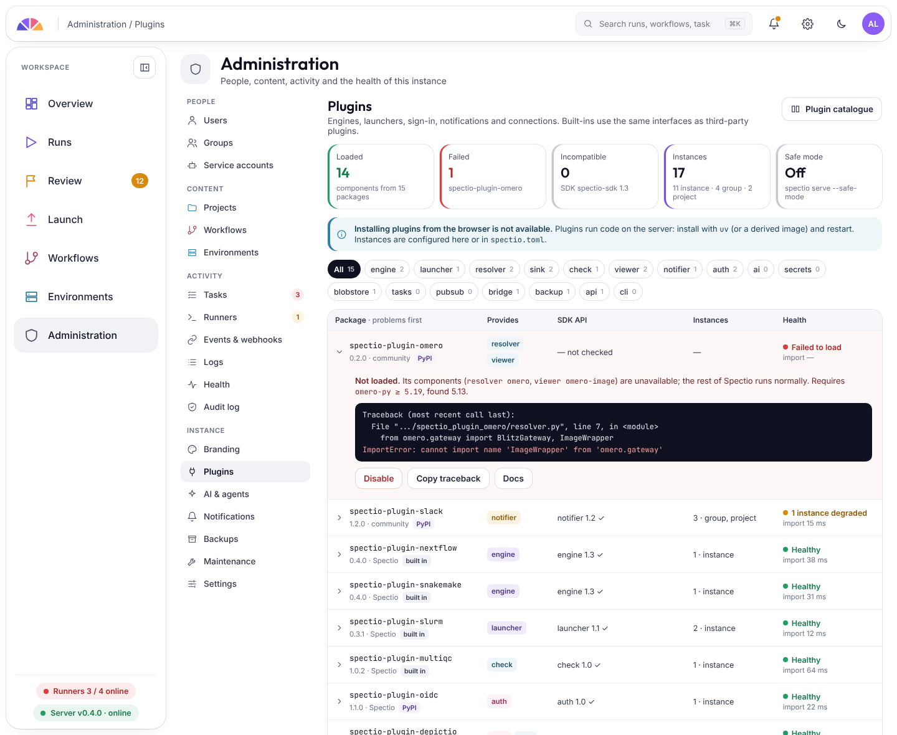

# Administration

!!! note "Designed, planned through the 0.x versions"

- **Users and groups,** as in depictio, with roles per project.
- **Sign-in:** passwords, email sign-in links, OIDC and SAML single sign-on, and depictio accounts. Links that open a single gate or run let you share without an account.
- **Plugins** for engines, schedulers, sign-in, storage, notifications and more, installed like Python packages.
- **Backups and restore** from the interface or the CLI, and moving an instance to another server.
- **Branding** of the interface, as in depictio.
- **Logs, background tasks and health** in one place.

Design details: [administration and operations](../specs/admin-and-operations.md), [plugins](../specs/architecture-plugins-and-packaging.md), [authentication and access](../specs/authentication-and-access.md).
