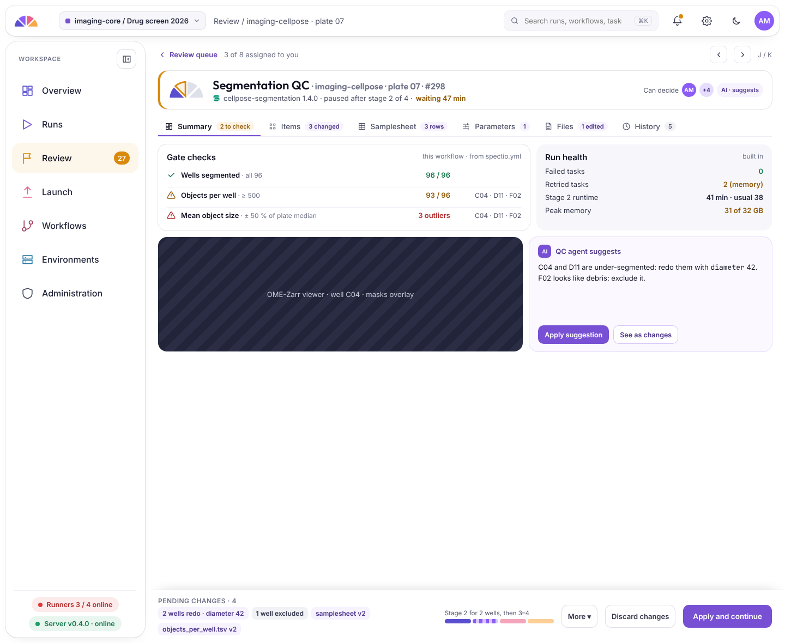
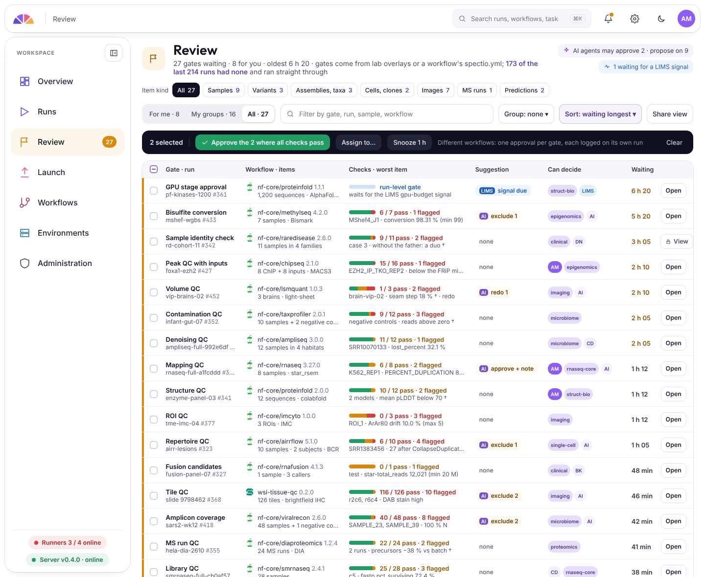
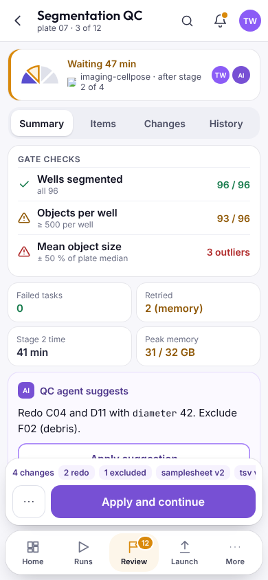

# QC gates and review

!!! note "Designed, planned from 0.1"

Gates are **optional**. A pipeline without gates runs from start to end as usual. A gate stops a run between two stages so that someone can check the results before the next, often expensive, stage starts. Any pipeline can get one without being changed: Spectio uses the engine's own way to stop and resume.

- **Declared once** for a workflow: after which stage, which checks to show (MultiQC tables, plots, images), and who may decide.
- **The review screen** shows the checks that pass and fail, the evidence next to them, and what an AI agent suggests, if one is set up.
- **Decisions:** approve, exclude samples, change a parameter and rerun the stage, or stop the run. Every decision is recorded.
- **From a phone:** a reviewer can open a link that gives access to one gate only, with no account needed. Every use of the link is recorded.
- **The review queue** gathers every gate waiting for you or your groups.

{ .sp-phone }

How the stop and resume work is shown in [How Spectio works](../usage/index.md).

Design details: [checking scenarios](../specs/checking-scenarios.md), [authentication and access](../specs/authentication-and-access.md).
