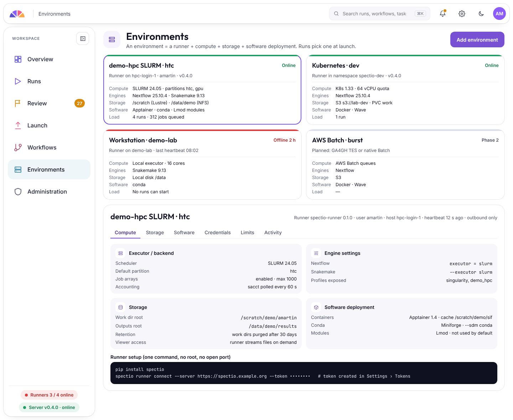

# Runners

!!! note "Designed: SLURM and the laptop first, Kubernetes next"

A runner is a small program that runs next to the compute. It starts the engine, watches the scheduler, and reports to the server.

- **SLURM** and other HPC schedulers: the runner sits on a login node. It shows why jobs wait, what they used, and why they failed, and suggests what to change when a job ran out of memory or time.
- **Kubernetes:** the runner runs in the cluster, with Kueue for queues.
- **A laptop** for small runs and tests.
- **No inbound ports.** The runner only makes outgoing HTTPS calls to the server.
- **Checks before launch:** walltimes against partition limits, storage quotas, scratch purge rules.

Design details: [schedulers and monitoring](../specs/schedulers-and-monitoring.md).
