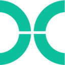
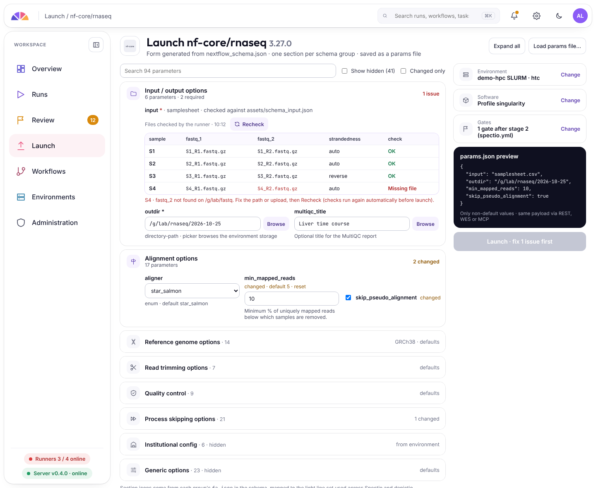
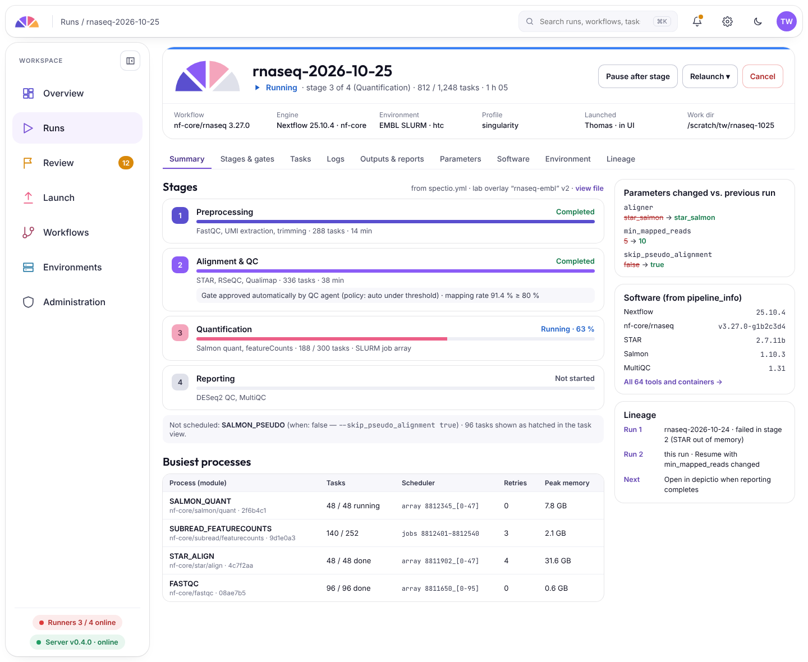
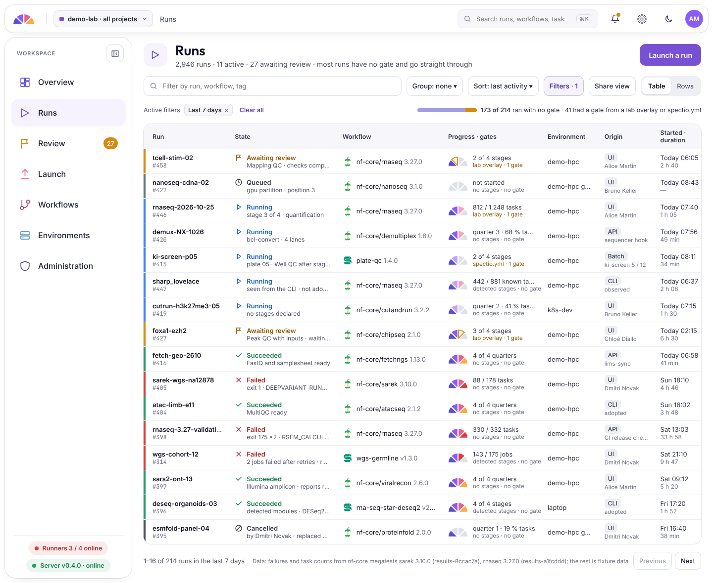
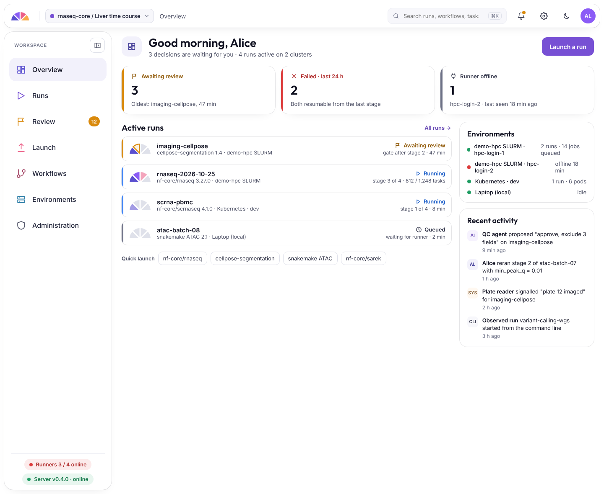

<a class="sp-status" href="roadmap/"><b>In design</b> First release, 0.0.1: launch, monitor and relaunch from the browser→</a>

<svg class="sp-emblem" viewBox="0 0 200 100" role="img" aria-label="Spectio emblem"><path fill="#5A4FCF" d="M86.09 94.24L4.17 94.24A96 96 0 0 1 28.17 36.31Z"/><path fill="#8B5CF6" d="M94.24 86.09L36.31 28.17A96 96 0 0 1 94.24 4.17Z"/><path fill="#EC5F87" d="M105.76 86.09L105.76 4.17A96 96 0 0 1 163.69 28.17Z"/><path fill="#F9A947" d="M113.91 94.24L171.83 36.31A96 96 0 0 1 195.83 94.24Z"/></svg>
Spectio

Launch, monitor and relaunch your Nextflow and Snakemake runs, on your own cluster.

Open-source run manager for HPC and Kubernetes. Add quality checks between stages only where you want them. A project of its own, which will connect to depictio later.

<a class="md-button md-button--primary" href="usage/">How it works</a> <a class="md-button" href="roadmap/">Roadmap</a>

<figure class="sp-hero2__media">
<video controls muted loop playsinline preload="metadata" poster="assets/shots/run-detail_light.webp" aria-label="A terminal runs the synthetic pipeline to its QC gate while the browser shows a gate review design board">
<source src="assets/media/gate-review.mp4" type="video/mp4">
</video>
<figcaption>A run with an optional QC gate: it stops, someone reviews it, it resumes from the cache. The screens are the current design.</figcaption>
</figure>

## Works with { .sp-h2 }

:material-sitemap:Workflow engines

<a class="sp-work" href="https://www.nextflow.io/">Nextflow</a>
<a class="sp-work" href="https://snakemake.github.io/">Snakemake</a>

CWL and WDL later

:material-bookshelf:Pipeline catalogs

<a class="sp-work" href="https://nf-co.re/">nf-core</a>
<a class="sp-work" href="https://snakemake.github.io/snakemake-workflow-catalog/">Snakemake catalog</a>

or your own Git repository

:material-server:Where runs execute

<a class="sp-work" href="https://slurm.schedmd.com/" markdown>:material-server-network:SLURM (HPC)</a>
<a class="sp-work" href="https://kubernetes.io/" markdown>:simple-kubernetes:Kubernetes</a>

or a single machine

:material-chart-box:Where results go

<a class="sp-work" href="https://github.com/depictio/depictio">depictio dashboards</a>

optional

Logos are trademarks of their owners and show compatibility only.

## How it works { .sp-h2 }

1
<h3>Launch</h3>

Pick a pipeline, fill its parameters from the pipeline's own schema, choose where it runs, and say where it should stop for a check.

2
<h3>Watch</h3>

Every run in one place: its stages, its tasks and samples, its logs, and what the cluster is doing with it.

3
<h3>Fix and relaunch</h3>

When a task fails, Spectio says why (out of memory, out of time, a tool error, a node lost) and what to change. Relaunch with the change; finished work comes back from the cache.

4
<h3>Results and dashboards</h3>

Outputs, reports and logs stay attached to the run. Finished results can go to depictio as dashboards, with the same users and groups.

:material-gate:

**Optional: quality checks between stages.** For pipelines where a bad sample should not reach the expensive stage, add a gate: the run stops after a stage, someone looks at the QC evidence, from a desk or a phone, and the run resumes from the cache. Pipelines without gates run straight through. [How gates work](features/gates.md)

## What is inside { .sp-h2 }

<a class="sp-card2" href="features/runs/" markdown>:material-play-network:<b>Runs</b>Launch, watch and relaunch.</a>
<a class="sp-card2" href="features/runners/" markdown>:material-server-network:<b>Runners</b>SLURM, Kubernetes, a laptop.</a>
<a class="sp-card2" href="features/gates/" markdown>:material-gate:<b>QC gates</b>Optional checks between stages.</a>
<a class="sp-card2" href="api/" markdown>:material-api:<b>API and CLI</b>Everything scriptable.</a>
<a class="sp-card2" href="features/administration/" markdown>:material-shield-account:<b>Administration</b>Users, plugins, backups.</a>
<a class="sp-card2" href="features/depictio/" markdown>:material-chart-box:<b>depictio</b>Results become dashboards.</a>

## Where it stands { .sp-h2 }

<!-- spectio:progress-strip -->

<a href="roadmap/">Roadmap</a> · <a href="developer/">Developer documentation</a> · <a href="changelog/">Changelog</a>

