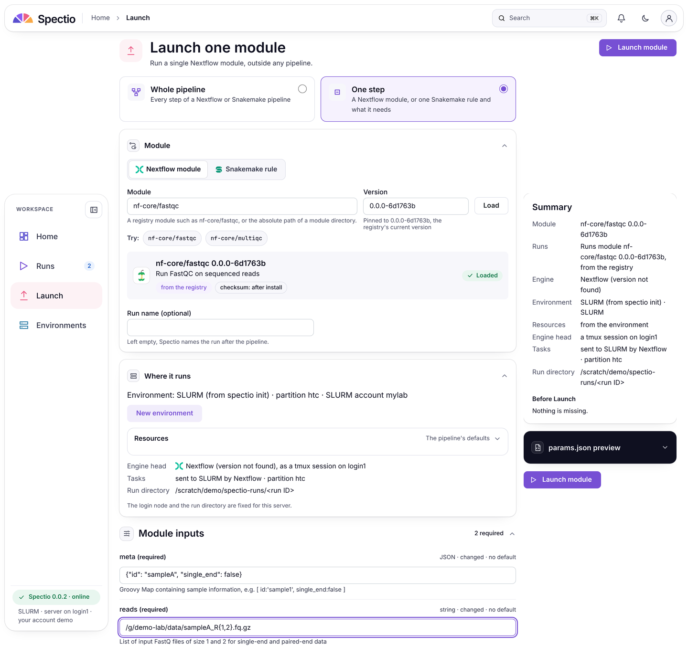
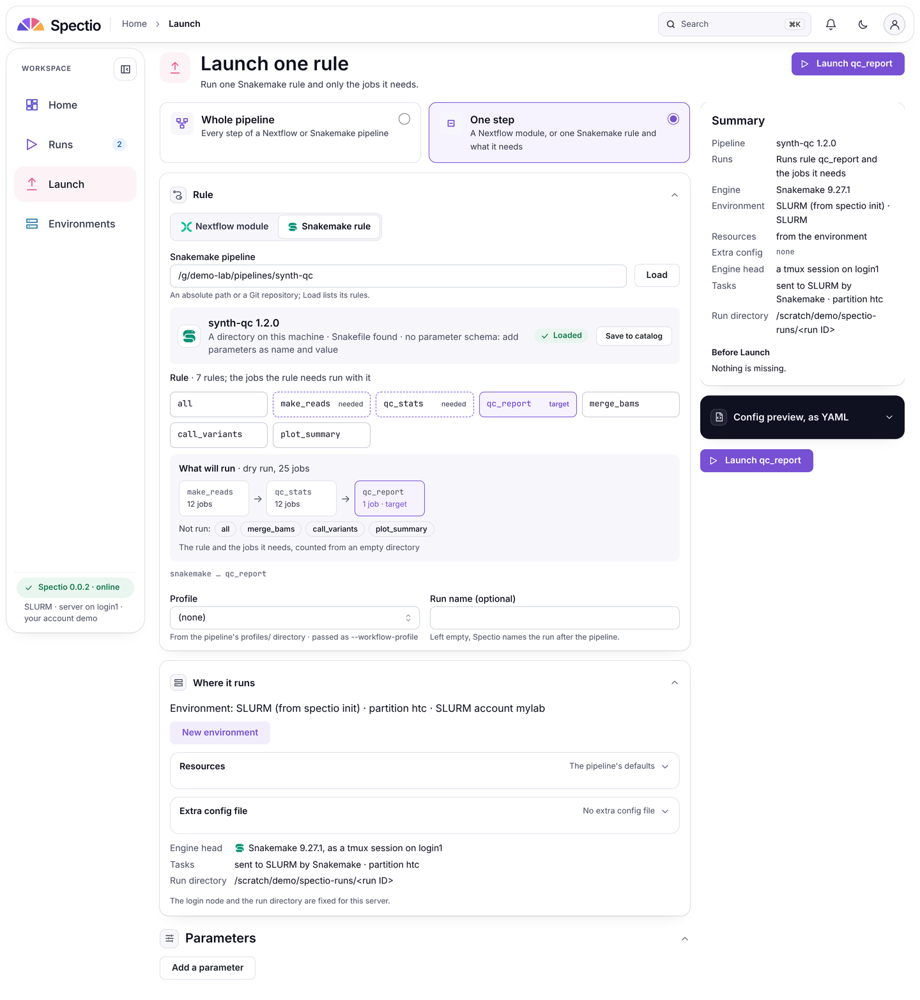
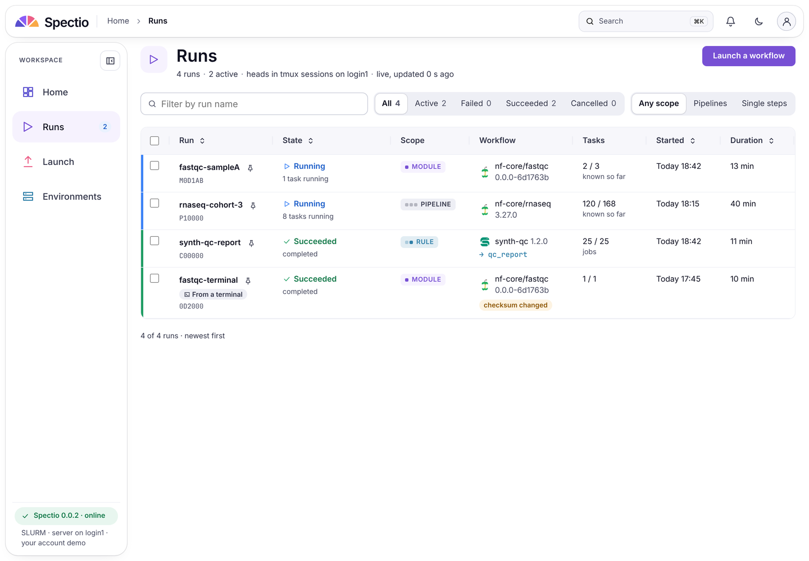
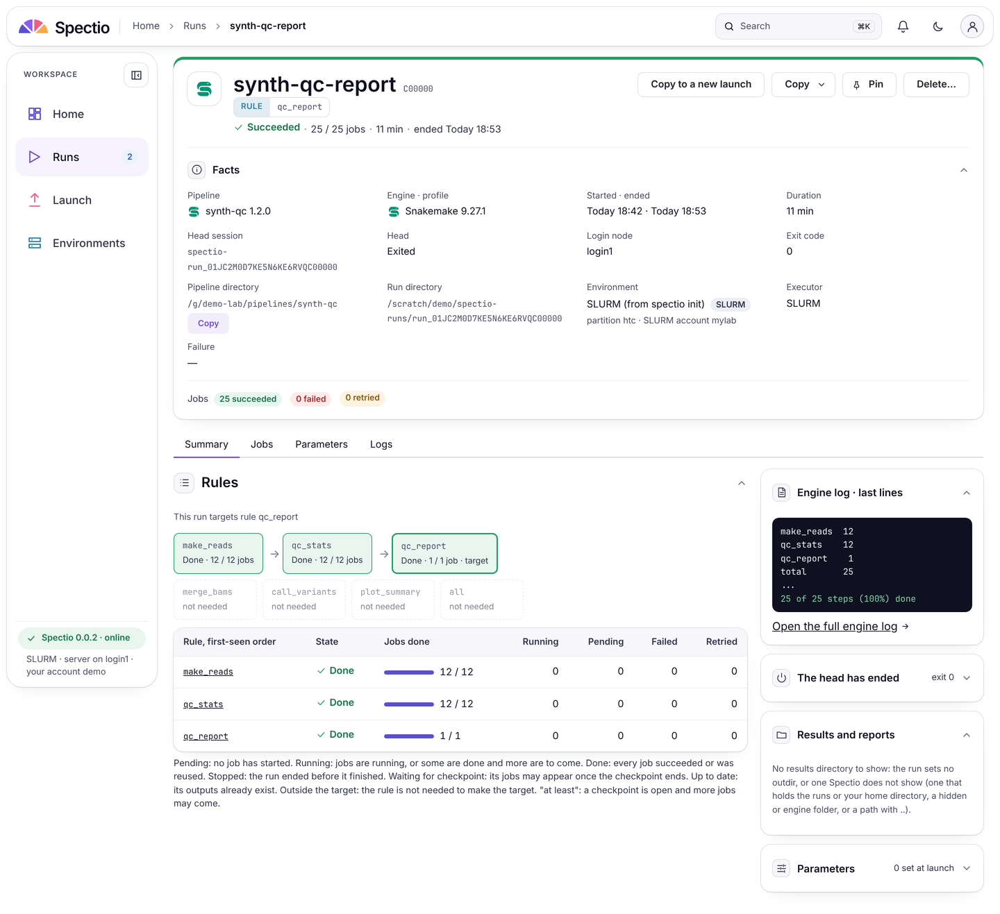

# Issue #161 · Runs that target one Nextflow module or one Snakemake rule

!!! success "Done 2026-11-11 · [issue #161](https://github.com/spectio-org/spectio/issues/161) · PR [#255](https://github.com/spectio-org/spectio/pull/255) · 0.0.2, behind `[features] single_target` · not a pipeline step · `code-reviewer` and `security-reviewer` approve (web: 2 rounds; server, runner and bridges: 8 rounds) · `doc-reviewer` not run yet"


This page is for a feature that came from a GitHub issue, not from a step of `pipeline.yaml`. No earlier issue-driven PR has a Progress page of its own: the P3 follow-ups (`FU-P3-*`) are recorded as sections of their milestone page, by batch ([P3-M9](P3-M9.md) for example). This feature is not a batch task, so it gets its own page. It sits in wave W5, the wave of the implementation, because the docs check ties a page to a wave folder; the front matter `step` is `ISSUE-161`. It is `done` now that the code reviews are in; `review:` stays `null` until `doc-reviewer` has read it.

## What changed

**Before.** Spectio assumed a run is a whole pipeline: its identity, its Summary and its Launch form. Nextflow 26.04 added `nextflow module run`, which runs one module with no wrapper pipeline, and Snakemake can run one rule as a target ([issue #161](https://github.com/spectio-org/spectio/issues/161), [spike](../../research/spike-module-run-2026-11-10.md)).

**After.** A run may carry an optional `target`. `null` is the whole pipeline, today's behaviour, unchanged. Owner of the contract: [api §5.10](../../specs/api-and-data-model.md#510-run-target-one-module-or-one-rule-002). Owner of the screens: [ui-spec §4.15](../../specs/ui-spec.md#415-runs-that-target-one-module-or-one-rule-002). This page does not repeat either.

Where the change lands, by layer (`git diff --stat 498e8c0..HEAD`, 498e8c0 being the merge base with `main`: 85 files, 7102 insertions, 166 deletions, 39 commits; by folder: `packages` 32, `docs` 18, `web` 16, `tests` 8, `spikes` 6, `engine-bridges` 3, `tools` 2):

| Layer | What it does | Main files |
|---|---|---|
| Model | `RunTarget` with `kind`, `name`, `version`, `hash`, `source`, `path`, `flag`, `more`, `checksum_changed` | `packages/spectio-sdk/src/spectio_sdk/targets.py` |
| Bridges | nf-spectio adds `target` to `onFlowCreate` for `nextflow module run`; the Snakemake logger adds it to `workflow_started` from its own arguments | `engine-bridges/nf-spectio/…/SpectioPlugin.groovy`, `snakemake_logger_plugin_spectio/__init__.py` |
| Server | stores the target (migration `0015_run_target`), moves a terminal module run to the module's workflow, sets `checksum_changed`, answers `POST /targets:inspect`, validates a launch with a target, keeps the target on Resume and Copy | `packages/spectio-server/src/spectio_server/targets.py`, `projector/targets.py`, `api/runs_write.py`, `api/relaunch.py` |
| Runner | the head script runs `nextflow module run <name> -version <v>` (or a local module directory), or puts the Snakemake rule as a positional target; it refuses stop flags next to a target | `packages/spectio/src/spectio/runner/headscript.py` |
| Web | the Scope badge, a Scope column and filter on the runs list, the target badge on the run header, the steps-to-target strip, and the Launch mode "One step" | `web/src/runs/target.tsx`, `RunsPage.tsx`, `RunHeader.tsx`, `web/src/launch/LaunchPage.tsx`, `target.ts` |
| Fixtures | one synthetic Nextflow module and a Snakemake rule target | `tests/pipelines/synthetic/modules/synth_stats/`, `tests/pipelines/synthetic/snakemake/targets.yaml` |

**Behaviour to know** (all from the specs above):
- Off by default. With `[features] single_target` off, `POST /runs` with a `target` answers `422 not-in-this-version` and Launch has no target mode. A target a bridge reports is stored and shown either way, because it is a fact about a run that already happened.
- A registry module is always launched at a pinned version, never `latest`, from the namespaces in `[features] module_namespaces` (default `["nf-core"]`).
- A module run takes no extra config file (`422` on `config_file`).
- A target run has no stages and no gates. The head refuses `--until`, `--omit-from`, `--allowed-rules`, `--forcerun` or `-R` in `extra_args` beside a target.
- Inspect and the files it reads are bounded: [dev-env §15.3, req. 21](../../specs/dev-environment-and-testing.md#153-001-on-a-cluster-architecture-and-safety-without-accounts) holds the limits (added by the server review rounds below).

**Redesign of the web part, 2026-11-11.** Thomas found the first screens "pas assez intuitif et joli" and asked for distinctions in the runs list. Mockups were shown and approved ("Me parait bon, continue"). The result is one scope colour code (grey pipeline, accent module, sky rule or file, always with the word), a Scope column and segmented filter, one target badge on the run header, a titled "Same version, different content" warning, the steps-to-target strip, and Launch cards "What to run" with a rule grid and a "What will run" dry-run strip. Commit `915f48e`; [decision log 2026-11-11](../../decisions/log.md#2026-11-11-single-target-runs-clearer-screens-thomas-161).

**Specs and notes changed:** [api §5.10](../../specs/api-and-data-model.md#510-run-target-one-module-or-one-rule-002) (renumbered from §5.9 when `main` took §5.9 for Notifications), `runs.target` in api §7, [ui-spec §4.15](../../specs/ui-spec.md#415-runs-that-target-one-module-or-one-rule-002), the [architecture §13.8](../../specs/architecture-plugins-and-packaging.md#138-runs-started-from-a-terminal) note, one row of [dev-env §15.1](../../specs/dev-environment-and-testing.md#151-capabilities-by-version), and [docs/map.md](../../map.md).

## Why

- **Request.** [Issue #161](https://github.com/spectio-org/spectio/issues/161). Decisions of Thomas, 2026-11-08, in the issue: a Snakemake "single module" is a rule target, not the `module:` directive; not in 0.0.1; launching from the UI is in scope. Thomas, 2026-11-10: in the 0.0.2 plan, behind a feature flag, capture and launch both, built to code with tests.
- **Decision.** [Decision log 2026-11-10](../../decisions/log.md#2026-11-10-runs-that-target-one-module-or-one-rule-002-behind-a-flag-161) (scope by Thomas; the design assumed under the standing rule of [autopilot §10](../../playbooks/autopilot.md#10-unattended-mode-thomas-2026-10-30)) and [2026-11-11](../../decisions/log.md#2026-11-11-single-target-runs-clearer-screens-thomas-161) (the redesign).
- **Facts.** [Spike module-run](../../research/spike-module-run-2026-11-10.md), on Nextflow 26.10.4 and Snakemake 9.27.1: `module run` loads nf-spectio and fires the usual events; there is no manifest or commit to identify the run, so the module's own `meta.yml` and `.module-info` do; a rule target and `--until` plan the same jobs, and `--allowed-rules` does not prune a DAG with a checkpoint.
- **Why this shape.** It is the smallest change that keeps today's runs unchanged: one nullable column, one optional body field, one inspect route, and the head script's existing generators.

## Evidence

Commits since the merge base (`git log --oneline 498e8c0..HEAD`, 39 commits, `HEAD` = `650ec9e`; the first and last of the code, then the last of the docs):

```text
22fbd61 spike(module-run): nextflow module run and Snakemake rule targets (#161)
f920dcb docs(spec): run target for single-module and single-rule runs, 0.0.2 behind a flag (#161)
4a5711c feat(targets): runs that target one module or one rule, behind a flag (#161)
...
9ee947f test(server): one write a line in the engine-check exit test (CR-161S8-04); round-8 record (#161)
d987656 refactor(161): simplify inspect's file pool lookup
650ec9e docs(reviews): final CODE lines of the #161 server review
```

The review record is [docs/reviews/code/ISSUE-161.md](../../reviews/code/ISSUE-161.md). Its two CODE lines:

```text
CODE  step=ISSUE-161/web     review=approve b/M/m=0/0/4 (round 2; round 1 changes 0/1/9)  security=approve b/M/m=0/0/2 (round 2; round 1 changes 0/1/3)  rounds=2
CODE  step=ISSUE-161/server  review=approve b/M/m=0/0/4 (round 8; round 1 changes 0/3/17)  security=approve b/M/m=0/0/1 (round 8; round 1 block 1/2/10)  rounds=8 (security majors open until round 7, inbox #75)  simplify=changed -3/+1  tests=pass
```

**At `d987656`, the last code commit (recorded by `code-simplifier`, not re-run for this page):**

| Check | Result |
|---|---|
| `uv run pytest -q packages` | 1782 passed, 2 skipped |
| `uv run mypy packages` | clean |
| `uv run ruff check packages` | clean |
| `uv run ruff format --check packages` | clean |
| `lint-imports` | clean |

**Re-run for this page, 2026-11-11, on `650ec9e` (only `docs/reviews/code/ISSUE-161.md` differs from `d987656`):**

```text
$ uv run pytest -q packages/spectio-server/tests/api/test_targets.py packages/spectio-sdk/tests/test_targets.py
59 passed in 9.84s
$ cd web && npx tsc --noEmit -p .
(no output)
$ cd web && npx vitest run
 Test Files  61 passed (61)
      Tests  812 passed (812)
```

**A flaky test, found and fixed.** `test_engine_version_check_never_holds_the_process_exit` failed 2 runs in 5, because two daemon threads' `print` calls interleaved (`['', 'nextflowsnakemake']`). Each line is now one `os.write`, atomic on a pipe under `PIPE_BUF`. Fixed in `9ee947f` (CR-161S8-04), outside the range of the review, which reported it.

**Earlier, 2026-11-10, before the merge of `main`:** runner 528 passed; SDK 50; Snakemake logger 79; nf-spectio engine tests on Nextflow 26.10.4: 30 passed, 1 skipped.

**Not verified here.**
- The nf-spectio engine tests need Nextflow 26.04 or later, which this container does not have. The nf-spectio fixes of `dafaabd` (CR-161S-01, CR-161S-05, SEC-161S-11) were checked under Groovy 3 standalone only; the engine tests were not re-run after them. The 30 passed above date from before those fixes.
- `module run` on a real cluster, and against the live registry from the web screens. The screens below use a mocked API.

**CI.** On `4cf00f0`, `pr-body` failed because a `feat` PR that changes a mechanism needs a sketch figure (the figure at the top of this page), and `nextflow` (pipelines on SLURM with sind) reported `timeout_fatal` `QC_STATS.failed=4`, expected 3, judged unrelated. On `650ec9e`, read from the GitHub check-runs API when this page was written: `docs-gate`, `pr-body`, `unit`, `frontmatter`, `preview` and the four `security` jobs had succeeded, `pipelines-synthetic / snakemake 9.27.1` had succeeded, and `product`, `web`, `e2e-local` and both `nextflow` jobs were still running. Their result is not on this page.

## Figures and media

**Sketch (first on the page).** The mechanism: two ways in (a terminal run captured by the bridges, a launch from the screens) end in one `runs.target`, which the runs list and the run header show as a Scope badge. By `diagram-artist`, script `tools/diagrams/single_target_run.py`. Provisional paths, to be confirmed: `docs/assets/diagrams/module-run-161_light.png` and `…_dark.png`.

**Screenshots.** The web code of this branch on a vite dev server, the API mocked with demo data (`demo-lab`, `login1`, `/scratch/demo`); 1440 wide, light only, as the other live shots of the docs. Script and conversion: `tools/media/single_target_demo.js`; the four files are listed in `docs/assets/media.yaml`. The script writes seven PNGs; four are kept, to stay small (four WebP files, 0.62 MB together).

1. **Launch one module.** "What to run" cards, the kind choice, a registry module loaded with its pinned version and "checksum: after install", and the module's inputs as the form. Spec: [ui-spec §4.15, Launch](../../specs/ui-spec.md#415-runs-that-target-one-module-or-one-rule-002).

    [](../../assets/shots/app-single-target-launch-module_light.webp)

    The sidebar and the Summary sit lower than the form because the capture is a full-page one with a sticky layout. The Summary and the Engine head both say "Nextflow (version not found)": a known follow-up (see below).

2. **Launch one rule.** The rule grid marks the target and the rules it needs; "What will run" shows the dry run, 25 jobs, as three boxes joined by arrows, with the other rules as "Not run".

    [](../../assets/shots/app-single-target-launch-rule_light.webp)

3. **Runs list.** A Scope column (Module, Pipeline, Rule), the "Any scope / Pipelines / Single steps" filter, "→ qc_report" under a rule run's workflow, and the "checksum changed" chip on a terminal module run.

    [](../../assets/shots/app-single-target-runs_light.webp)

4. **Run detail of a rule run.** The target badge under the name, "This run targets rule qc_report", the steps to the target (make_reads, qc_stats, qc_report with job counts) and the rules not needed, dashed.

    [](../../assets/shots/app-single-target-run-rule_light.webp)

Not kept in the docs (in the script's output only): the empty Launch form, the module run detail, and the checksum warning of a terminal module run.

## Findings and open questions

**Reviews.** Record: [docs/reviews/code/ISSUE-161.md](../../reviews/code/ISSUE-161.md), findings by round with ids and commits.

| Review | Range | Outcome |
|---|---|---|
| `code-reviewer` + `security-reviewer`, web redesign | `6a6244c..915f48e`, fixes to `d907d27` | **approve** in round 2. Round 1: code changes (0 blocker, 1 major, 9 minors), security changes (0/1/3). Round 2: code 0/0/4, security 0/0/2. The major (SEC-161W-01 / CR-161R-01): a hidden Profile select was still sent for a module |
| `code-reviewer` + `security-reviewer`, server, runner and bridges | `498e8c0..f18c218`, then each round's fixes | **approve** in round 8. Round 1: code changes (0/3/17), security **block** (1/2/10). Round 8: code 0/0/4, security 0/0/1. Security majors stayed open until round 7, so the standing rule (inbox #75) kept the loop going. `code-simplifier` changed -3/+1 lines and the tests passed |
| `doc-reviewer` | this page and the pages it touches | not run; `review:` is `null` until it is |

What the eight server rounds closed, in short (details and ids in the record):
- the blocker: a local `meta.yml` parsed with YAML aliases allowed (SEC-161S-01);
- unbounded engine output and file reads on `targets:inspect`, and a two-slot bound for every engine call;
- YAML that cost minutes or answered 500: deep flow nesting, quoted closers, sexagesimal integers, bad tags, lone surrogates, deep schemas;
- Resume and rebuild skipped the feature flag and the namespace list;
- nf-spectio chose registry or local from the shape of the name; now `.module-info` decides.

**[to be validated]** (from the decision log and the specs):
- whether the registry serves the checksum before the install, so the head could refuse a mismatch ([api §5.10, Checksum](../../specs/api-and-data-model.md#510-run-target-one-module-or-one-rule-002));
- `module run` on Nextflow 25.x (expected absent), a workflow-kind module, and what `module run` with no version downloads;
- registry reachability from HPC login and compute nodes;
- the engine log of a terminal module run (`.module.log`, [architecture §13.8](../../specs/architecture-plugins-and-packaging.md#138-runs-started-from-a-terminal)).

**Follow-ups, not in this change:**
- **FU-161-01** (SEC-161S6-03, from before #161): move `workflows._Loader` to a shared module, use it in `stages/freeze.py`, catch its refusals there, and log the exception type only. The ingest readers of `freeze.py` take no bound today; req. 21 says it covers the request paths and names this as open;
- arrow keys between the rule radios (CR-161R-05; each is reached with Tab today);
- a board pass by `ux-reviewer` before 0.0.2 ships: the redesign was agreed on mockups and built from the existing tokens, and the boards in `design/ui-canvas` were not drawn;
- an "X available" chip for a newer registry version;
- the Summary and the Engine head on Launch say "(version not found)" for a module;
- a Snakemake profile that sets `until:` is not checked by the rule-target guard (recorded in api §5.10);
- an accepted residual: integer keys that collide in Python's hash make a mapping quadratic, 0.84 s at 256 KiB (SEC-161S5-05);
- seen by the worker and not changed: a resumed registry module run is named after `parent.workflow_name`, and `GET /runs/{id}` shows `nextflow run` as the command of a module run;
- `freeze` still reads stage sources for a rule target, because the Snakefile's rules are needed to list the others as `not_needed` (CR-161S-20, partly).

**Docs still to do:** the `doc-reviewer` pass, which fills `review:` in the front matter.
