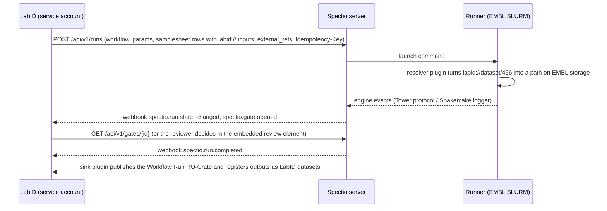
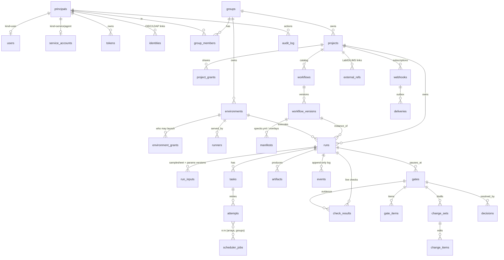

# Spectio — headless integration, API and data model

Status: draft v0.1 · 2026-10-25 · author: Thomas Weber (with Claude)
Companion docs: [`synthesis.md`](synthesis.md) (architecture, §7bis and §7quinquies), [`ui-spec.md`](ui-spec.md) (screens), [`decisions/log.md`](../decisions/log.md) (decisions log).

## 0. Decisions in brief

1. **Headless first.** The server is an engine-agnostic launch-and-monitor service. The web UI, the CLI, the MCP server, the WES facade and embedded elements in other tools (LabID, portals) are all clients of the same public API. Nothing the UI does is private.
2. **Single-user is a configuration, not a different system.** One schema and one API for every deployment. A single-user install is a multi-user install with one user, one group and one project created at first start, and an authentication mode that maps local requests to that user.
3. **Everything belongs to a project.** Every tenant row has `project_id` and `created_by`; every list endpoint is filtered by the projects the caller can see. Adding users and groups later needs no schema migration, only data.
4. **Principals, not just users.** People, service accounts (LIMS, CI), AI agents, runners and the system itself are all principals with tokens and roles. Every decision and change records which principal made it.
5. **Extension points are plugins.** Engines, input resolvers (`labid://`, `s3://`, `drs://`…), output sinks, check providers, notifiers and identity providers are Python entry points, so an institute adds an integration without forking Spectio.

## 1. Deployment modes

| Mode | What runs | Typical use |
|---|---|---|
| **Personal** | `spectio serve` on a laptop or a login node, bound to `127.0.0.1`, auth mode `single` | One researcher, no setup |
| **Team server** | server + Postgres (or SQLite on local disk) + runners on clusters, auth mode `oidc` | A lab or core facility |
| **Headless** | same server with `--no-ui`; only API, WES, webhooks, MCP | Driven entirely by a LIMS, portal or CI |
| **Embedded** | team or headless server + Spectio elements inside another web app | LabID or an institute portal shows launch forms, run cards and reviews |

Runners always connect outward to a server; they never need inbound ports.

## 2. Integration patterns

### A. LIMS-driven run (LabID)


### B. Standard client through WES
A portal or another WES client calls `POST /ga4gh/wes/v1/runs` with `workflow_type: NFL` or `SMK`. Spectio maps it to a native run in the caller's default project. Gates, pause and resume are available as WES extensions (`/ga4gh/wes/v1/runs/{id}/x-spectio/...`) and through the native API.

### C. Host UI with embedded elements
The host backend exchanges its service token for a short-lived **embed token** limited to one resource and a few actions, then renders `<spectio-launch-form>`, `<spectio-run-card>` or `<spectio-review>`. The elements talk to the Spectio API directly with that token and emit `postMessage` events (`spectio:run-launched`, `spectio:gate-decided`) to the host page.

### D. Observed or adopted CLI runs
A run started in a terminal with Spectio enabled is attached to the user's default project, or the project given by `SPECTIO_PROJECT`. It is the same run object as a UI or API launch.

### E. Event-driven automation
A robot or instrument subscribes to `spectio.gate.opened` for a gate type, does its work, and calls `POST /api/v1/gates/{id}/signals` with its service-account token. Policy decides whether that signal resolves the gate or only adds evidence.

## 3. Extension points (plugins)

Python entry points, one group per kind (`spectio.engine`, `spectio.notifier`, …), loaded on the server or the runner as indicated. Each plugin declares its capabilities, config schema (JSON Schema, rendered as a settings form) and required scopes. The full contract (discovery, settings, instances and scopes, context, versioning, conformance tests, frontend plugins) and the packaging for the Python bundle, Docker Compose and Kubernetes are in [`architecture-plugins-and-packaging.md`](architecture-plugins-and-packaging.md), which also adds the launcher, AI provider, file store, broker, API and CLI extension kinds and the `plugin_instances` table.

| Kind | Runs on | Examples | Contract |
|---|---|---|---|
| Engine adapter | runner | nextflow, snakemake; later cwl (cwltool/Toil), wdl (Cromwell/miniwdl) | launch, stop at stage, resume, cancel, event source |
| Input resolver | runner | `file://`, `s3://`, `drs://`, `labid://`, `omero://`, `ena://` | URI → local path or staged copy, with checksum |
| Output sink | server or runner | RO-Crate to LabID, copy to S3, register in OMERO, Zenodo / WorkflowHub deposit | called on `run.completed` or on gate decisions |
| Check provider | server | MultiQC general stats, TSV/CSV column, JSON path, h5ad obs table, VCF stats | file → item × metric table for gate checks |
| Evidence viewer | UI | HTML report (sandboxed), OME-Zarr, IGV, PDF, table, embedding scatter | MIME type / file pattern → viewer |
| Notifier | server | email, Slack, Mattermost, Teams, Matrix | event → message |
| Identity provider | server | OIDC (EMBL SSO, LS Login), LDAP | login → principal |
| Secret backend | server, runner | local encrypted store, HashiCorp Vault | credentials for resolvers and sinks |

## 4. API design rules

- Base path `{root}/api/v1`, where `root` is empty for a standalone install and `/spectio` when co-hosted with depictio (`/depictio/api/v1`) behind one domain; JSON; resource-oriented; OpenAPI 3.1 published at `/api/v1/openapi.json`; generated Python and TypeScript SDKs.
- **IDs**: prefixed ULIDs (`run_01JB…`, `gate_01JB…`, `prj_01JB…`), sortable, safe in URLs, unique across the instance.
- **Tenancy**: every object returns `project_id`, `created_by` and `created_at`. Collections are top level (`/runs`, `/workflows`, `/gates`) and filtered by `?project=`; without it, the caller sees every project they can read. Create calls take `project_id`, defaulting to the caller's default project, so single-user clients never need to send it.
- **Ownership is data, not path**: no `/users/{id}/runs` paths, so moving a run between projects or adding users never changes URLs.
- **Lists**: cursor pagination (`?cursor=`, `limit` ≤ 200, `next` in the response), filters (`?state=running&workflow=wf_…&external_ref=labid:sample/123`), sort (`?sort=-created_at`), sparse fields (`?fields=`).
- **Writes**: `Idempotency-Key` on every POST that creates or triggers something; `ETag` / `If-Match` on gates, change sets and settings to prevent lost updates when two reviewers act at once.
- **Long operations** (catalogue import, RO-Crate export, cleanup) return `202 Accepted` with an `Operation` resource (`/operations/{id}`).
- **Errors**: RFC 9457 `application/problem+json` with a stable `type` URI and, for validation, a list of field errors.
- **Versioning**: only additive changes within v1; breaking changes go to v2; deprecations announced with `Deprecation` and `Sunset` headers.
- **Limits**: per-token rate limits with `RateLimit-*` headers; request size limits; files go through artefact endpoints, never in JSON bodies.

## 5. Endpoint catalogue (v1)

| Area | Endpoints |
|---|---|
| Session & me | `GET /me` (principal, default project, scopes), `GET /me/projects`, `POST /auth/device` + `POST /auth/token` (CLI device flow, phase 2), `POST /embed-tokens` |
| Users & groups | `GET/POST /users`, `GET/PATCH /users/{id}`, `GET/POST /groups`, `GET/POST/DELETE /groups/{id}/members` |
| Projects | `GET/POST /projects`, `GET/PATCH /projects/{id}`, `GET/PUT/DELETE /projects/{id}/grants` |
| Service accounts & tokens | `GET/POST /service-accounts`, `GET/POST /tokens`, `DELETE /tokens/{id}` (personal and service tokens, scopes, expiry, optional project restriction) |
| Workflows | `GET/POST /workflows`, `GET /workflows/{id}`, `GET /workflows/{id}/versions`, `GET /workflow-versions/{id}/schema` (params JSON Schema), `POST /workflows:import` (git, nf-core, Snakemake catalog, **RO-Crate**), `GET/PUT /workflows/{id}/manifest` (spectio.yml overlay) |
| Environments & runners | `GET/POST /environments`, `GET/PATCH /environments/{id}`, `GET/PUT /environments/{id}/grants`, `POST /runners:register` (one-time token → runner credential), `GET /runners`, `GET /runners/{id}`, runner channel `WS /runners/{id}/channel` (commands, heartbeats, file streaming) |
| Runs | `POST /runs`, `GET /runs`, `GET /runs/{id}`, `POST /runs/{id}:cancel`, `:pause` (after current stage), `:resume`, `POST /runs/{id}:relaunch` (mode, from stage, param overrides), `GET /runs/{id}/graph`, `GET /runs/{id}/params`, `GET /runs/{id}/samplesheets` (versions), `GET /runs/{id}/lineage`, `PATCH /runs/{id}` (name, tags, external_refs, project move) |
| Tasks & logs | `GET /runs/{id}/tasks`, `GET /tasks/{id}`, `GET /tasks/{id}/attempts`, `GET /tasks/{id}/logs/{stdout|stderr}` (range requests), `GET /runs/{id}/logs` |
| Artefacts | `GET /runs/{id}/artifacts`, `GET /artifacts/{id}`, `GET /artifacts/{id}/content` (streamed through the runner or presigned URL), `GET /artifacts/{id}/preview` |
| Gates (reviews) | `GET /gates` (queue: `?assigned_to=me&state=open`), `GET /gates/{id}`, `GET /gates/{id}/checks`, `GET /gates/{id}/items` (paged, filterable), `GET/PUT /gates/{id}/change-set` (draft edits: item decisions, samplesheet, params, editable files), `POST /gates/{id}/proposals` (AI or robot suggestion), `POST /gates/{id}/signals` (external systems), `POST /gates/{id}/decisions` (approve, apply, go back, stop — with If-Match), `POST /gates:bulk-decide` |
| Events | `GET /events?run=…&after=seq` , `GET /events/stream` (SSE, resumable with `Last-Event-ID`) |
| Webhooks | `GET/POST /webhooks`, `GET/PATCH/DELETE /webhooks/{id}`, `GET /webhooks/{id}/deliveries`, `POST /deliveries/{id}:redeliver` |
| Provenance | `GET /runs/{id}/ro-crate` (JSON-LD or zip, profile: workflow-run or provenance-run), `POST /runs:import-crate` (prefill a relaunch) |
| Search | `GET /search?q=` (runs, workflows, tasks, samples by external ref) |
| Admin | `GET/PATCH /settings`, `GET /audit-log`, `GET /plugins`, `GET /health`, `GET /version`; full admin surface (users, groups, tasks, logs, health, branding, plugins, backups and restores, migrations, maintenance) under `/admin/*`, see [`admin-and-operations.md`](admin-and-operations.md) §5 |
| Ingest (engines) | `/trace/*` (Nextflow Tower protocol, token = run-scoped), `POST /ingest/events` (Snakemake logger, companion plugins) |
| Facades | `/ga4gh/wes/v1/*` (WES 1.1 + `x-spectio` extensions), `/mcp` (MCP server) |

### Example: launch from a LIMS
```http
POST /api/v1/runs
Authorization: Bearer spk_svc_…            # LabID service account
Idempotency-Key: labid-order-8812
Content-Type: application/json

{
  "project_id": "prj_01JB…",
  "workflow_version_id": "wfv_01JB…",       # nf-core/rnaseq 3.27.0
  "environment_id": "env_01JB…",            # EMBL SLURM · htc
  "profile": "singularity",
  "params": { "aligner": "star_salmon", "outdir": "spectio://results" },
  "samplesheet": {
    "param": "input",
    "rows": [
      { "sample": "S1", "fastq_1": "labid://dataset/456/R1", "fastq_2": "labid://dataset/456/R2",
        "strandedness": "auto", "external_refs": ["labid:sample/123"] }
    ]
  },
  "gates": "from-manifest",
  "external_refs": ["labid:order/8812", "labid:project/77"],
  "notify": { "webhook_ids": ["whk_01JB…"] }
}
```
Response `201` with the run, its `id`, `state: queued` and links. Retrying with the same `Idempotency-Key` returns the same run.

## 6. Identity, tenancy and permissions

Sign-in methods, sessions, tokens, magic links, share links and pipeline provisioning are specified in [`authentication-and-access.md`](authentication-and-access.md). This section owns principals, tenancy and roles.

### Model
- **Principal**: anything that can act. `kind ∈ {user, service, agent, runner, system}`. Users are people; service accounts are integrations (LIMS, CI, robots); agents are AI agents (with model and version recorded on each action); runners are Spectio processes on compute environments; `system` is Spectio itself.
- **Group**: a lab, team or facility. Flat in v1, with an optional `parent_id` for later hierarchy. Memberships carry a role: `member`, `admin` or `pi` (principal investigator, as in depictio); groups synced from the identity provider are flagged `sso_managed`.
- **Project**: the unit of ownership and sharing. Owned by one group. Visibility `private` (grants only), `group` (all members of the owning group) or `instance` (everyone can read).
- **Grant**: `(project, principal or group, role)`, role ∈ `viewer < launcher < reviewer < editor < owner`. `viewer`, `editor` and `owner` mean exactly what they mean in depictio; `launcher` and `reviewer` are Spectio-only steps between viewer and editor (§13).
- **Environment grant**: which projects or groups may launch on an environment. Clusters and their credentials belong to groups, not to users.

### Roles on a project
| Action | viewer | launcher | reviewer | editor | owner |
|---|---|---|---|---|---|
| See runs, logs, artefacts | ✓ | ✓ | ✓ | ✓ | ✓ |
| Launch, relaunch, cancel own runs | | ✓ | ✓ | ✓ | ✓ |
| Decide gates (when the gate policy names them) | | | ✓ | ✓ | ✓ |
| Cancel anyone's runs, edit workflow manifests | | | | ✓ | ✓ |
| Manage grants, webhooks, service accounts, delete | | | | | ✓ |

Gate policies in `spectio.yml` name principals or groups (`humans: [group:rnaseq-core]`, `agents: propose`); the decision endpoint checks both the role and the policy.

### Tokens and scopes
Personal tokens, service-account tokens and agent tokens share one format (`spk_<kind>_<random>`, stored hashed), with scopes (`runs:read`, `runs:launch`, `gates:decide`, `gates:propose`, `artifacts:read`, `admin`), an expiry, and an optional project restriction. Runner credentials are separate: a one-time registration token becomes a rotating runner credential bound to one environment.

### Single-user mode
- `auth.mode: single` (the default for `spectio serve`). At first start Spectio creates: the instance, a user named after the OS account, a group `personal`, a project `default` owned by that group, and owner rights for the user.
- Requests from `127.0.0.1` / a Unix socket without a token are treated as that user. Any remote access (another machine, a runner, an integration) still needs a token, created in Profile › Tokens or with `spectio token create`.
- The UI hides the project switcher and sharing controls while there is a single project and user; all API fields are still present.

### Moving to multi-user (no migration)
`spectio auth enable oidc --issuer … --client-id …` (EMBL SSO; LS Login for external collaborators), then link the existing local user to their OIDC identity, invite users, create groups and grant projects. Optional later: LDAP, SCIM group sync, and a CLI device authorization flow for `spectio login`. SAML 2.0 is supported as well as OIDC, because depictio uses SAML (§13).

### Enforcement
One policy function `can(principal, action, resource)` in the service layer, used by the REST API, WES, MCP and the UI's server-rendered data alike. List queries join on `visible_projects(principal)`. With Postgres, row-level security on `project_id` can be added as defence in depth. Every write appends to the audit log.

## 7. Database schema

Portable across SQLite (WAL, local disk, ≥ 3.51.3) and Postgres: ULID text primary keys, UTC timestamps, JSON in `TEXT` (SQLite JSON1) / `JSONB` (Postgres) through the ORM type, `CHECK` constraints instead of enums, no SQLite-only features. Every tenant table has `project_id`, `created_by` (principal) and `created_at`; mutable ones add `updated_at` and `deleted_at` (soft delete).



| Table | Key columns (besides id, created_at, created_by) |
|---|---|
| `principals` | kind, display_name, disabled_at |
| `users` | principal_id, email, username, default_project_id, preferences (JSON) |
| `service_accounts` | principal_id, owning_group_id, purpose (`lims`, `ci`, `robot`, `agent`), model (agents) |
| `identities` | principal_id, provider, subject, unique (provider, subject) |
| `tokens` | principal_id, hash, scopes (JSON), project_id (nullable), expires_at, last_used_at |
| `groups`, `group_members` | name, parent_id · group_id, principal_id, role |
| `projects`, `project_grants` | owning_group_id, name, visibility · project_id, grantee (principal or group), role |
| `environments`, `environment_grants` | owning_group_id, kind (slurm, k8s, local…), config (JSON) · environment_id, project_id or group_id |
| `runners` | environment_id, principal_id, version, last_heartbeat_at, status |
| `workflows`, `workflow_versions`, `manifests` | project_id, source (git, nf-core, catalog, crate), engine · revision, commit, params_schema (JSON) · kind (repo, overlay), content |
| `runs` | project_id, workflow_version_id, environment_id, state, stage_index, origin (ui, api, wes, cli-observed, cli-adopted), parent_run_id, relaunch_mode, idempotency_key, external refs via table |
| `run_inputs` | run_id, version, kind (params, samplesheet), content (JSON), checksum |
| `tasks`, `attempts`, `scheduler_jobs`, `attempt_jobs` | run_id, process_or_rule, stage, tag · task_id, n, state, exit, resources (JSON) · environment_id, native_id, array_index |
| `artifacts` | run_id, task_id, uri, mime, size, checksum, role (output, report, evidence) |
| `events` | run_id, seq, event_id, type, payload (JSON); unique (run_id, event_id) |
| `gates` | run_id, stage, state, policy (JSON), opened_at, etag |
| `check_results` | run_id, stage, gate_id (nullable: live checks have none), watch_id (nullable), check_key, item_key (nullable), value, verdict (`ok`, `warn`, `fail`, `provisional`, `too_large`, `error`), file_uri, file_hash, evaluated_at; a gate reuses a live result whose file_hash is unchanged ([`checking-scenarios.md`](checking-scenarios.md) §11.4) |
| `gate_items` | gate_id, item_key, kind (sample, cell-set, well, region…), attributes (JSON), verdict |
| `change_sets`, `change_items` | gate_id, state (draft, applied, discarded), etag · change_set_id, target (item, samplesheet, param, file), before, after, author |
| `decisions` | gate_id, principal_id, actor_kind, model, action, justification, evidence (JSON), change_set_id, idempotency_key |
| `webhooks`, `deliveries` | project_id, url, secret_hash, event_types (JSON) · webhook_id, event_id, status, attempts, next_attempt_at |
| `external_refs` | project_id, object_type, object_id, ref (e.g. `labid:sample/123`); index on ref |
| `audit_log` | principal_id, action, object_type, object_id, diff (JSON), ip |

Indexes on `(project_id, created_at)` for every list, `(run_id, seq)` for events, `(state, project_id)` for runs and gates, and `ref` for external references.

## 8. Events and webhooks

CloudEvents 1.0 envelope (`id`, `source`, `type`, `time`, `subject`, `data`), plus `spectioproject` and `spectiosequence` extensions.

| Type | When |
|---|---|
| `spectio.run.created`, `.state_changed`, `.completed`, `.failed` | run lifecycle |
| `spectio.stage.started`, `.completed` | stage boundaries |
| `spectio.task.failed`, `.retried` | noteworthy task events (full task stream via SSE only) |
| `spectio.gate.opened`, `.proposal_added`, `.signal_received`, `.decided` | reviews |
| `spectio.check.failed` | a live check on a watched file failed (`warn` or `block`), with run, stage, item, check, value; every evaluation, passed or not, goes to SSE only as `check.evaluated` ([`checking-scenarios.md`](checking-scenarios.md) §11) |
| `spectio.artifact.published` | reports and outputs |
| `spectio.runner.offline`, `.online` | environment health |

Delivery: at least once, from an outbox table written in the same transaction as the change; ordered per run by `spectiosequence`; HMAC-SHA256 signature in `Spectio-Signature` with a timestamp; exponential retry for 24 h; redelivery from the API.

## 9. Embedded elements

- Distributed as a small web-components bundle (`@spectio/elements`), also usable as iframes.
- The host backend calls `POST /api/v1/embed-tokens` with its service token: `{resource: "run_…", actions: ["read", "decide"], ttl: 900}` → short-lived token for the browser.
- Allowed host origins per instance (`frame-ancestors` and CORS allow-list). Styling follows the design tokens, so elements look native in depictio or LabID.

## 10. Standards compatibility

| Standard | Use |
|---|---|
| GA4GH WES 1.1 | facade for launching and tracking; Spectio states map onto WES states (`AWAITING_REVIEW` and `PAUSED` → `PAUSED` with detail in extensions) |
| GA4GH TRS, DRS | phase 2: catalogue as TRS; artefacts as DRS objects |
| RO-Crate | import workflows from Workflow RO-Crates (nf-core, WorkflowHub); export runs as Workflow Run / Provenance Run Crates with gate provenance |
| Nextflow Tower protocol | ingest only (runs launched with `-with-tower`) |
| CloudEvents | webhook envelope |
| OIDC | authentication (phase 2) |

## 11. UI consequences

- Project switcher in the top bar, hidden while there is one project.
- Owner and project shown on runs, workflows and environments; a Share dialog on projects.
- Settings tabs: Users & groups, Projects, Service accounts, Tokens, Webhooks, Plugins.
- Launch form: project and environment pickers filtered by grants.

## 12. Open questions

1. LabID's API surface and authentication (to confirm with the MODIS team).
2. Whether groups need hierarchy in v1 (institute → unit → lab).
3. Default visibility for new projects (`group` is proposed).
4. Where environment credentials live when a cluster is shared by several groups.

## 13. depictio compatibility

Spectio and depictio must feel like one platform: same accounts, groups, projects and roles, same look, and runs in Spectio becoming dashboards in depictio without manual configuration. They keep **separate databases** (depictio: MongoDB + S3/Delta; Spectio: SQLite/Postgres) and integrate only through identity, tokens and APIs. Findings come from a code audit of depictio (25/10/2026; file references in the working notes).

### 13.1 Identity
| Topic | depictio today | Spectio decision |
|---|---|---|
| Login | email + password, Google OAuth, SAML 2.0 (tested with Keycloak), magic links; no OIDC | support **SAML 2.0 and OIDC**; recommended deployment: one identity provider (or Keycloak as broker) for both apps, same group attribute (`memberOf`) |
| Co-deployed, before SSO | depictio issues RS256 JWTs | Spectio **trusts depictio's JWTs** (public key or `GET /depictio/api/v1/auth/me`), creates or updates the principal with an identity link `depictio:user/<id>`, same email: one login for both |
| Admin | `User.is_admin` bypasses permissions | same flag and meaning |
| Single-user | anonymous admin `anonymous@depict.io` | Spectio's local user maps to depictio's anonymous admin when both run single-user; no tokens on localhost |
| Service identity | provisioning API key, long-lived tokens of a service user | Spectio holds one depictio service credential (server side), used to provision or act as the run owner; runners get a scoped token, never depictio's S3 root secret |
| CLI | `~/.depictio/CLI.yaml`, `DEPICTIO_CLI_*` | `~/.spectio/config.yaml`, `SPECTIO_*`; `spectio login` can reuse a depictio token when the server trusts depictio |

### 13.2 Tenancy and roles
| Spectio | depictio | Rule |
|---|---|---|
| Principal `user` | `User` | matched by email, linked by `depictio:user/<id>` |
| Principal `service` / `agent` | none | stays on the Spectio side |
| Group (member / admin / pi, `sso_managed`) | `Group` (`users_ids`, `admin_ids`, `pi_id`, `sso_managed`) | same names and members; synced from the same identity provider |
| Project | `Project` | linked 1:1 by `external_refs` (`depictio:project/<id>` ↔ `spectio:project/<id>`) |
| Visibility `instance` / `group` / `private` | `is_public` / group grants / direct grants | `instance` ↔ `is_public`; `group` ↔ `group_viewers` of the owning group |
| Roles `viewer` · `editor` · `owner` | `viewers` · `editors` · `owners` | identical meaning, highest role wins (direct or through a group) |
| Roles `launcher`, `reviewer` | — | Spectio-only; when mirrored to depictio they become `viewer` (they must not gain edit rights on dashboards) |

### 13.3 Run → dashboard hand-off
depictio already knows how to build a project from a pipeline's results (versioned templates for about 35 nf-core pipelines, `depictio ingest --pipeline-id --triggered-by --attach-run --user --provenance-file --result-json`). Spectio drives that path:
```yaml
# spectio.yml (or the workflow's settings in Spectio)
depictio:
  on: completed            # or gate:<id> · stage:<n>
  template: auto           # by pipeline id, e.g. nf-core/rnaseq/3.27.0; or an explicit template id
  project: linked          # the depictio project linked to this Spectio project
  attach_run: true         # one depictio run per Spectio run (run_tag = Spectio run ID)
```
1. On the trigger, the **runner** (which sits next to the results) runs `depictio-cli ingest <outdir> --pipeline-id <org>/<name>/<version> --triggered-by spectio --attach-run --user <owner email> --provenance-file <run summary or RO-Crate> --result-json <file>`, with a short-lived credential from the server.
2. The server stores the returned project and dashboard links on the run, shows **Open in depictio** in Run detail and emits `spectio.run.dashboard_ready`.
3. For runs Spectio launches, depictio's own Nextflow `onComplete` trigger is turned off (`--depictio_enabled false`) to avoid ingesting twice. For Snakemake, Spectio provides the trigger depictio lacks.
4. Later, a server-to-server ingestion call can replace the CLI when depictio reads the storage directly.
5. Filter artifacts from gates (cell keep lists, bin lists, excluded samples) are passed to depictio as part of the provenance, so dashboards show the reviewed data.

### 13.4 Shared conventions
- **Pipeline identifier**: `<org>/<name>/<version>` everywhere (depictio template IDs, Spectio workflow versions, RO-Crate, WES `workflow_url` resolution).
- **IDs**: each side keeps its own (ObjectId, prefixed ULID) and links both ways through `external_refs`.
- **Paths when co-hosted**: `/depictio/…` and `/spectio/…` on one domain, shared SSO session.
- **Events**: depictio uses a WebSocket, Spectio SSE and webhooks; only `spectio.run.dashboard_ready` is bridged (it refreshes the depictio project).

### 13.5 UI consistency
- One branding model: when co-deployed, Spectio reads depictio's instance `BrandTheme` (primary, secondary, tertiary, surfaces, fonts, radius), so an institute brands both apps once.
- Shared pages look the same as depictio's: **Profile** (email, name, title, role, ID, dates, avatar, tokens) and **project sharing** (Visibility · Members · Groups).
- Settings follow depictio's Administration grouping: **People** (Users, Groups, Service accounts) · **Content** (Projects, Workflows, Environments) · **Activity** (Runs, Events, Logs, Health) · **Instance** (Branding, AI & agents, Webhooks, Settings).
- Section colours: Projects and Administration/Settings use depictio's roles (secondary teal, primary blue) when co-deployed. Spectio's own menus keep their colours, except Workflows, which moves from orange to coral 700 (`#A54666`) so it is not mistaken for depictio's Dashboards orange.
- An **app switcher** in both top bars and deep links both ways: run → dashboard, dashboard → producing run and gate decisions.

### 13.6 QC rendering: one catalogue, two renderers

Spectio's review screens and depictio's dashboards show the same QC. They must give the same numbers and look like one product. Facts and file references: [research note](../research/depictio-qc-integration-2026-10-26.md) §1.

| Layer | Owner | Spectio uses it for | depictio uses it for |
|---|---|---|---|
| **Catalogue**: `find` glob → recipe (`OUTPUT_SCHEMA`) → columns | depictio (`depictio/catalog/`) | the source of gate checks: `depictio:<module>/<output>#<column>`, beside the bindings of [`checking-scenarios.md`](checking-scenarios.md) §7 | building data collections from a run |
| **Tables** computed by the recipes | computed once, by the runner at gate time, then ingested | evaluating checks, the review views | dashboards |
| **Decision tables** `spectio_checks` (item, check, value, threshold, verdict) and `spectio_decisions` (item, decision, reason, actor, gate, time) | Spectio writes them at each decision | the gate history | data collections joined to the catalogue tables on the item key (depictio `joins`), so a dashboard can colour, filter or hide by decision |
| **Renderers**: figure, table, MultiQC, image, map, `advanced_viz` | depictio (`depictio-react-core`) | the review views, with a thin decision layer on top: selection, keep / exclude / flag, threshold handles, the changes bar | dashboards |
| **Theme**: `BrandTheme`, chart palette, check-state colours | shared (§13.5) | everything | everything |

Rules:
1. **Same computation.** A check that has a catalogue binding uses it. The runner runs the recipe on the partial outputs at gate time, and the hand-off of §13.3 ingests the same tables. Spectio never re-implements a recipe that the catalogue has.
2. **Same item key.** Items are keyed as the catalogue keys them (`sample`, `cell_id`, `well`…), so `spectio_decisions` joins without a mapping table.
3. **A preliminary dashboard at gate time.** With `depictio: {on: gate:<id>}` (§13.3), the gate's review gets a **Dashboard** tab that embeds the depictio dashboard of the partial results. Selections are kept in step both ways by messages between the two frames (request in [`depictio-ecosystem-reuse.md`](depictio-ecosystem-reuse.md) §3).
4. **Back-links.** A dashboard built after a gate shows a Spectio gate tile (decision, who, when, excluded items) that links to the decision.
5. **Live checks** ([`checking-scenarios.md`](checking-scenarios.md) §11) cannot use catalogue outputs that read the final `multiqc.parquet`; they use per-file bindings until depictio has per-file recipes.
6. **Without depictio**, Spectio's own bindings (§7 of checking-scenarios) and its built-in renderers do the same job. The decision tables are still written, as files in the RO-Crate.

Open points: the recipe runtime on the runner (polars, a depictio-cli install or a small shared runtime), and the size of per-cell tables at gate time (aggregates first, per-cell on demand). Both are in the research note, §4.
