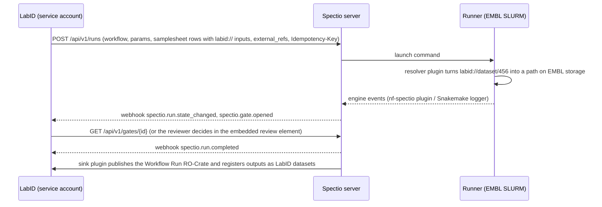
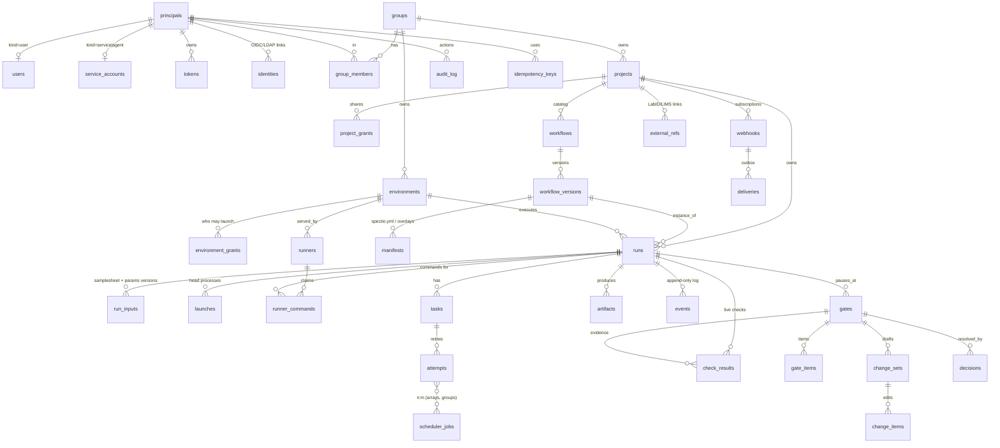

# Spectio — headless integration, API and data model

Status: draft v0.1 · 2026-10-25 · author: Thomas Weber (with Claude)
Companion docs: [`synthesis.md`](synthesis.md) (architecture, §7bis and §7quinquies), [`ui-spec.md`](ui-spec.md) (screens), [`decisions/log.md`](../decisions/log.md) (decisions log).

## 0. Decisions in brief

1. **Headless first.** The server is an engine-agnostic launch-and-monitor service. The web UI, the CLI, the MCP server, the WES facade and embedded elements in other tools (LabID, portals) are all clients of the same public API. Nothing the UI does is private.
2. **Single-user is a configuration, not a different system.** One schema and one API for every deployment. A single-user install is a multi-user install with one user, one group and one project created at first start, and an authentication mode that maps local requests to that user.
3. **Everything belongs to a project.** Every tenant row has `project_id` and `created_by`; every list endpoint is filtered by the projects the caller can see. Adding users and groups later needs no schema migration, only data.
4. **Principals, not just users.** People, service accounts (LIMS, CI), AI agents, runners and the system itself are all principals with tokens and roles. Every decision and change records which principal made it.
5. **Extension points are plugins.** Engines, input resolvers (`labid://`, `s3://`, `drs://`…), output sinks, check providers, notifiers and identity providers are Python entry points, so an institute adds an integration without forking Spectio.

## 1. Deployment modes

| Mode | What runs | Typical use |
|---|---|---|
| **Personal** | `spectio serve` on a laptop or a login node, bound to `127.0.0.1`, auth mode `single` | One researcher, no setup |
| **Team server** | server + Postgres (or SQLite on local disk) + runners on clusters, auth mode `oidc` | A lab or core facility |
| **Headless** | same server with `--no-ui`; only API, WES, webhooks, MCP | Driven entirely by a LIMS, portal or CI |
| **Embedded** | team or headless server + Spectio elements inside another web app | LabID or an institute portal shows launch forms, run cards and reviews |

Runners always connect outward to a server; they never need inbound ports.

## 2. Integration patterns

### A. LIMS-driven run (LabID)


### B. Standard client through WES
A portal or another WES client calls `POST /ga4gh/wes/v1/runs` with `workflow_type: NFL` or `SMK` (TRS descriptor types, which WES 1.1 accepts as instance-specific values, WES 1.1.0 OpenAPI `:753`; listed in `service-info.workflow_type_versions`). Spectio maps it to a native run in the caller's default project. Gates, pause and resume are available as WES extensions (`/ga4gh/wes/v1/runs/{id}/x-spectio/...`) and through the native API.

### C. Host UI with embedded elements
The host backend exchanges its service token for a short-lived **embed token** limited to one resource and a few actions, then renders `<spectio-launch-form>`, `<spectio-run-card>` or `<spectio-review>`. The elements talk to the Spectio API directly with that token and emit `postMessage` events (`spectio:run-launched`, `spectio:gate-decided`) to the host page.

### D. Observed or adopted CLI runs
A run started in a terminal with Spectio enabled is attached to the user's default project, or the project given by `SPECTIO_PROJECT`. It is the same run object as a UI or API launch.

### E. Event-driven automation
A robot or instrument subscribes to `spectio.gate.opened` for a gate type, does its work, and calls `POST /api/v1/gates/{id}/signals` with its service-account token. Policy decides whether that signal resolves the gate or only adds evidence.

## 3. Extension points (plugins)

Python entry points, one group per kind (`spectio.engine`, `spectio.notifier`, …), loaded on the server or the runner. The kinds (among them the task backend, pub/sub and event bridge), where each runs and their contracts are owned by [`architecture-plugins-and-packaging.md`](architecture-plugins-and-packaging.md) §2 and §3.6, together with discovery, settings, instances and scopes, versioning, conformance tests, frontend plugins, packaging and the `plugin_instances` table.

## 4. API design rules

- Base path `{root}/api/v1`, where `root` is empty for a standalone install and `/spectio` when co-hosted with depictio (`/depictio/api/v1`) behind one domain; JSON; resource-oriented; OpenAPI 3.1 published at `/api/v1/openapi.json`; generated Python and TypeScript SDKs.
- **IDs**: prefixed ULIDs (`run_01JB…`, `gate_01JB…`, `prj_01JB…`), sortable, safe in URLs, unique across the instance.
- **Tenancy**: every object returns `project_id`, `created_by` and `created_at`. Collections are top level (`/runs`, `/workflows`, `/gates`) and filtered by `?project=`; without it, the caller sees every project they can read. Create calls take `project_id`, defaulting to the caller's default project, so single-user clients never need to send it.
- **Ownership is data, not path**: no `/users/{id}/runs` paths, so moving a run between projects or adding users never changes URLs.
- **Lists**: cursor pagination (`?cursor=`, `limit` ≤ 200, `next` in the response), filters (`?state=running&workflow=wf_…&external_ref=labid:sample/123`), sort (`?sort=-created_at`), sparse fields (`?fields=`). Lists return no total. Whether an optional `total` (`?count=exact|estimate|none`) is affordable is decided by spike S-R7-4 ([R7](../reviews/R7-ui.md#proposed-spikes)); until then clients page with Next / Load more, never numbered pages or "of N". Headline counts and breakdowns come from the summary endpoints (§5). *(assumed — pending Thomas, inbox #30)*
- **Writes**: `Idempotency-Key` on every POST that creates or triggers something, kept 24 h: the server inserts the key first (`idempotency_keys`, §7), so two concurrent requests cannot both pass, and returns the stored response on a retry (scope and replay rules: next bullet); `ETag` / `If-Match` on gates, change sets, settings and the work-directory clean of a resumable run *(assumed — pending Thomas, inbox #30)* to prevent lost updates when two reviewers act at once; on a gate with a quorum each decision is a vote and does not compare-and-swap on the gate ETag, and change-set items carry their own version (§5, §7).
- **Idempotency keys are scoped to the caller.** A key is unique per (principal, or the owning group for a service account; HTTP method; route). The same key from another caller is a new request, never a replay. Replaying a key with a different body returns `422` (`problem+json`; exit code 5 in the CLI, [`cli-and-shared-libraries.md`](cli-and-shared-libraries.md) §2). A replay returns the stored result only if the caller still passes `can(read)` on it (§6). **Test:** tenant B reusing tenant A's key gets a new run or `422`, never A's run.
- **Long operations** (catalogue import, RO-Crate export, cleanup) return `202 Accepted` with an `Operation` resource (`/operations/{id}`). An `Operation` is the caller's view of a background task ([`admin-and-operations.md`](admin-and-operations.md) §3.1). *(assumed — pending Thomas, inbox #29)*
- **Errors**: RFC 9457 `application/problem+json` with a stable `type` URI and, for validation, a list of field errors.
- **Versioning**: during 0.x, `/api/v1` may break in a minor release, announced in the changelog ([`dev-environment-and-testing.md`](dev-environment-and-testing.md) §12); from 1.0.0, only additive changes within API v1, and breaking changes go to API v2; deprecations announced with `Deprecation` (RFC 9745) and `Sunset` (RFC 8594) headers.
- **Limits**: per-token rate limits with `RateLimit-*` headers; request size limits; files go through artefact endpoints, never in JSON bodies.

## 5. Endpoint catalogue (API v1)

Paths under `/admin/*` are for system admins only and are specified in [`admin-and-operations.md`](admin-and-operations.md) §5. Everything a non-admin may call is at the root and specified here. *(assumed — pending Thomas, inbox #29)*

| Area | Endpoints |
|---|---|
| Session & me | `GET /me` (principal, default project, scopes), `GET /me/projects`, `POST /auth/device` + `POST /auth/token` (CLI device flow, phase 2), `POST /embed-tokens` |
| Sign-in | `POST /auth/magic-links:exchange` (the ticket from the URL fragment, posted after the 'Continue as' screen → session; mirrors depictio's `POST /auth/magic/exchange`, [research note](../research/depictio-auth-2026-10-26.md) l.108). The other sign-in endpoints are in [`authentication-and-access.md`](authentication-and-access.md) §1-§2 |
| Notifications (per user) | `GET /me/notifications?after=` (in-app inbox with unread count), `POST /me/notifications:mark-read`, `GET/PUT /me/subscriptions` (resource and event type, for example a runner's `spectio.runner.online` or a gate's `spectio.gate.opened`) *(assumed — pending Thomas, inbox #17)* |
| Users & groups | `GET /users`, `GET /users/{id}` (read only), `GET /groups`, `GET /groups/{id}`, `GET/POST/DELETE /groups/{id}/members` (group admins and system admins). Creating users, changing a user's state or admin flag, creating or deleting groups and setting the P.I. are under `/admin/*` (admin §5) *(assumed — pending Thomas, inbox #29)* |
| Projects | `GET/POST /projects`, `GET/PATCH /projects/{id}`, `GET/PUT/DELETE /projects/{id}/grants`, `GET /projects/{id}/audit-log` (project owners: the audit entries of that project) *(assumed — pending Thomas, inbox #29)* |
| Service accounts & tokens | `GET/POST /service-accounts`, `GET/POST /tokens`, `DELETE /tokens/{id}` (personal and service tokens, scopes, expiry, optional project restriction) |
| Workflows | `GET/POST /workflows`, `GET /workflows/{id}`, `GET /workflows/{id}/versions`, `GET /workflow-versions/{id}/schema` (params JSON Schema), `POST /workflows:import` (git, nf-core, Snakemake catalog, **RO-Crate**), `GET/PUT /workflows/{id}/manifest` (spectio.yml overlay) |
| Environments & runners | `GET/POST /environments`, `GET/PATCH /environments/{id}`, `GET/PUT /environments/{id}/grants`, `POST /runners:register` (one-time token → runner credential), `GET /runners`, `GET /runners/{id}`, runner channel `WS /runners/{id}/channel` (commands, heartbeats, file streaming) |
| Storage and work directories | `GET/PUT /environments/{id}/storage` (locations: role, path, type, quota source, access, retention), `GET/PUT /environments/{id}/lifecycle` (work-directory rules per run state), `GET /environments/{id}/workdirs?sort=size`, `POST /runs/{id}/workdir:keep`, `POST /runs/{id}/workdir:clean` (on a resumable run, `:clean` requires `If-Match` with the run's current ETag, so a clean never breaks a resumable run, [`ui-spec.md`](ui-spec.md) §4.8) *(assumed — pending Thomas, inbox #30)* |
| Runs | `POST /runs`, `GET /runs`, `GET /runs:summary` (`?project=&since=&group_by=state|workflow`; counts for headline numbers) *(assumed — pending Thomas, inbox #30)*, `GET /runs/{id}`, `POST /runs/{id}:cancel`, `:pause` (after current stage), `:resume`, `POST /runs/{id}:relaunch` (mode, from stage, param overrides), `GET /runs/{id}/graph`, `GET /runs/{id}/processes` (per process: tasks by state, retries, peak RSS, native ID range) *(assumed — pending Thomas, inbox #30)*, `GET /runs/{id}/scheduler` (scheduler jobs, summary, relaunch suggestions; [`schedulers-and-monitoring.md`](schedulers-and-monitoring.md) §8) *(assumed — pending Thomas, inbox #29)*, `GET /runs/{id}/params`, `GET /runs/{id}/samplesheets` (versions), `GET /runs/{id}/lineage`, `PATCH /runs/{id}` (name, tags, external_refs, project move) |
| Tasks & logs | `GET /runs/{id}/tasks`, `GET /tasks/{id}`, `GET /tasks/{id}/attempts`, `GET /tasks/{id}/logs/{stdout|stderr}` (range requests), `GET /runs/{id}/logs` |
| Artefacts | `GET /runs/{id}/artifacts`, `GET /artifacts/{id}`, `GET /artifacts/{id}/content` (streamed through the runner or presigned URL), `GET /artifacts/{id}/preview` |
| Gates (reviews) | `GET /gates` (queue: `?assigned_to=me&state=open`), `GET /gates:summary` (`?project=&since=&group_by=state|item_kind|workflow`) *(assumed — pending Thomas, inbox #30)*, `GET /gates/{id}`, `GET /gates/{id}/checks`, `GET /gates/{id}/items` (paged, filterable), `GET/PUT /gates/{id}/change-set` (draft edits: item decisions, samplesheet, params, editable files), `PATCH /gates/{id}/change-set/items/{item}` (one item, with its own version, so two reviewers editing different items never conflict), `POST /gates/{id}/proposals` (AI or robot suggestion), `POST /gates/{id}/signals` (external systems), `POST /gates/{id}/decisions` (`approve`, `apply`, `go_back` with a stage, `stop`; §7 — with If-Match) *(assumed — pending Thomas, inbox #29)*, `POST /gates:bulk-decide` (one result per gate; atomic within each gate, not across gates) |
| Events | `GET /events?run=…&after=seq`, `GET /events?project=&type=` (instance activity feed, filtered to the caller's visible projects) *(assumed — pending Thomas, inbox #30)*, `GET /events/stream` (SSE; a single-run stream resumes with `Last-Event-ID`, a multi-run stream by snapshot then tail, §8.2) |
| Webhooks | `GET/POST /webhooks`, `GET/PATCH/DELETE /webhooks/{id}`, `GET /webhooks/{id}/deliveries`, `POST /deliveries/{id}:redeliver` |
| Provenance | `GET /runs/{id}/ro-crate` (JSON-LD or zip, profile: workflow-run or provenance-run), `POST /runs:import-crate` (prefill a relaunch) |
| Search | `GET /search?q=` (exact and prefix matches on indexed keys: IDs, external refs, names, tags; task search scoped to one run, §7) |
| Admin | everything under `/admin/*`, for system admins only: users, groups, background tasks, logs, health, branding, plugins and plugin instances, AI & agents, backups and restores, migrations, maintenance, settings, audit log ([`admin-and-operations.md`](admin-and-operations.md) §5) *(assumed — pending Thomas, inbox #29)* |
| Public (no token) | `GET /public-config` (one document with sections `auth`, `branding` and `analytics`; [`telemetry-and-analytics.md`](telemetry-and-analytics.md) §4.2), `GET /version`; `/health/live`, `/health/ready` and `/metrics` are outside the API prefix (admin §3.5) *(assumed — pending Thomas, inbox #29)* |
| Plugins (UI) | `GET /plugins/ui-manifest` (any signed-in user; viewer modules, [`architecture-plugins-and-packaging.md`](architecture-plugins-and-packaging.md) §5) *(assumed — pending Thomas, inbox #29)* |
| Ingest (engines) | `POST /ingest/events` (Nextflow plugin `nf-spectio`, Snakemake logger). The Tower protocol routes `/trace/*` are not implemented ([decision 0001](../decisions/0001-nextflow-through-nf-spectio.md)) |
| Facades | `/ga4gh/wes/v1/*` (WES 1.1 + `x-spectio` extensions), `/mcp` (MCP server) |

### Example: launch from a LIMS
```http
POST /api/v1/runs
Authorization: Bearer spk_svc_…            # LabID service account
Idempotency-Key: labid-order-8812
Content-Type: application/json

{
  "project_id": "prj_01JB…",
  "workflow_version_id": "wfv_01JB…",       # nf-core/rnaseq 3.27.0
  "environment_id": "env_01JB…",            # EMBL SLURM · htc
  "profile": "singularity",
  "params": { "aligner": "star_salmon", "outdir": "spectio://results" },
  "samplesheet": {
    "param": "input",
    "rows": [
      { "sample": "S1", "fastq_1": "labid://dataset/456/R1", "fastq_2": "labid://dataset/456/R2",
        "strandedness": "auto", "external_refs": ["labid:sample/123"] }
    ]
  },
  "gates": "from-manifest",
  "external_refs": ["labid:order/8812", "labid:project/77"],
  "notify": { "webhook_ids": ["whk_01JB…"] }
}
```
Response `201` with the run, its `id`, `state: queued` and links. Retrying with the same `Idempotency-Key` from the same caller returns the same run (§4).

### Imports are untrusted input

`POST /workflows:import` and `POST /runs:import-crate` take content written by someone else (WorkflowHub, email, another instance). They: *(assumed — pending Thomas, inbox #25)*
- **extract crates safely:** every entry is resolved inside the extraction directory, with no zip slip ([Snyk](https://security.snyk.io/research/zip-slip-vulnerability)), and with limits on total size, file count and compression ratio;
- **process JSON-LD with remote context loading off.** Remote `@context` retrieval is part of JSON-LD processing ([JSON-LD 1.1 API](https://www.w3.org/TR/json-ld11-api/#remote-document-and-context-retrieval)); whether the chosen library loads contexts by default is **[to be validated]**;
- **accept git URLs over `https` or `ssh` only.** `file://`, `ext::` and other transports are refused ([git `protocol.allow`](https://git-scm.com/docs/git-config#Documentation/git-config.txt-protocolallow));
- **never pre-fill a launch silently.** A launch pre-filled from a crate shows every non-default parameter, hidden ones included, and flags parameters that load code or config from elsewhere. Example: nf-core/rnaseq sets `custom_config_base` to a remote URL and calls `includeConfig "${params.custom_config_base}/nfcore_custom.config"` (`95dbcd9`, `nextflow.config:154,331`); `config_profile_url` is also listed by R5 **[to be validated]**.

Project imports between instances follow [`admin-and-operations.md`](admin-and-operations.md) §4.3. **Tests:** a zip-slip crate, an `ext::` git URL and a crate that names a remote JSON-LD context are refused or processed offline.

## 6. Identity, tenancy and permissions

Sign-in methods, sessions, tokens, magic links, share links and pipeline provisioning are specified in [`authentication-and-access.md`](authentication-and-access.md). This section owns principals, tenancy and roles.

### Model
- **Principal**: anything that can act. `kind ∈ {user, service, agent, runner, system}`. Users are people; service accounts are integrations (LIMS, CI, robots); agents are AI agents (with model and version recorded on each action); runners are Spectio processes on compute environments; `system` is Spectio itself.
- **Group**: a lab, team or facility. Flat in v1, with an optional `parent_id` for later hierarchy. Memberships carry a role: `member`, `admin` or `pi` (principal investigator, as in depictio); groups synced from the identity provider are flagged `sso_managed`.
- **Project**: the unit of ownership and sharing. Owned by one group. Visibility `private` (grants only), `group` (all members of the owning group) or `instance` (everyone can read).
- **Grant**: `(project, principal or group, role)`, role ∈ `viewer < launcher < reviewer < editor < owner`. `viewer`, `editor` and `owner` mean exactly what they mean in depictio; `launcher` and `reviewer` are Spectio-only steps between viewer and editor (§13).
- **Environment grant**: which projects or groups may launch on an environment. Clusters and their credentials belong to groups, not to users.

### Roles on a project
| Action | viewer | launcher | reviewer | editor | owner |
|---|---|---|---|---|---|
| See runs, logs, artefacts | ✓ | ✓ | ✓ | ✓ | ✓ |
| Launch, relaunch, cancel own runs | | ✓ | ✓ | ✓ | ✓ |
| Decide gates (when the gate policy names them) | | | ✓ | ✓ | ✓ |
| Cancel anyone's runs, edit workflow manifests | | | | ✓ | ✓ |
| Manage grants, webhooks, service accounts, delete | | | | | ✓ |

Gate policies in `spectio.yml` name principals or groups (`humans: [group:rnaseq-core]`, `agents: propose`); the decision endpoint checks both the role and the policy.

### Tokens and scopes
Personal tokens, service-account tokens and agent tokens share one format (`spk_<kind>_<random>`, stored hashed), with scopes (`runs:read`, `runs:launch`, `gates:decide`, `gates:propose`, `artifacts:read`, `admin`), an expiry, and an optional project restriction. Runner credentials are separate: a one-time registration token becomes a rotating runner credential bound to one environment.

### Single-user mode
- `auth.mode: single` (the default for `spectio serve`). At first start Spectio creates: the instance, a user named after the OS account, a group `personal`, a project `default` owned by that group, and owner rights for the user.
- Requests from `127.0.0.1` / a Unix socket without a token are treated as that user. Any remote access (another machine, a runner, an integration) still needs a token, created in Profile › Tokens or with `spectio token create`.
- The UI hides the project switcher and sharing controls while there is a single project and user; all API fields are still present.

### Moving to multi-user (no migration)
`spectio auth enable oidc --issuer … --client-id …` (EMBL SSO; LS Login for external collaborators), then link the existing local user to their OIDC identity, invite users, create groups and grant projects. Optional later: LDAP, SCIM group sync, and a CLI device authorization flow for `spectio login`. SAML 2.0 is supported as well as OIDC, because depictio uses SAML (§13).

### Enforcement
One policy function `can(principal, action, resource)` in the service layer, used by the REST API, WES, MCP and the UI's server-rendered data alike. List queries join on `visible_projects(principal)`. With Postgres, row-level security on `project_id` can be added as defence in depth. Every write appends to the audit log.

## 7. Database schema

Portable across SQLite (WAL, local disk, with the WAL-reset fix, rule below) and Postgres: ULID text primary keys, UTC timestamps, JSON in `TEXT` (SQLite JSON1) / `JSONB` (Postgres) through the ORM type, `CHECK` constraints instead of enums, no SQLite-only features. Search uses exact and prefix matches on indexed keys only (IDs, external refs, names, tags), and task search is scoped to one run; tasks reach 10⁷–10⁸ rows a year, where `LIKE '%q%'` does not scale. Full-text search is engine-specific (FTS5 in SQLite, `tsvector` or `pg_trgm` in Postgres), so it comes only as an optional adapter per engine, allowed by name. Every tenant table has `project_id`, `created_by` (principal) and `created_at`; mutable ones add `updated_at` and `deleted_at` (soft delete).

**SQLite version rule.** The SQLite library Python loads (`sqlite3.sqlite_version`, not a system `sqlite3` binary) must carry the WAL-reset fix: ≥ 3.51.3, or ≥ 3.50.7 / ≥ 3.44.6 in those series ([sqlite.org/wal.html](https://www.sqlite.org/wal.html) §11, read 2026-10-26). The server checks it at start.



| Table | Key columns (besides id, created_at, created_by) |
|---|---|
| `principals` | kind, display_name, disabled_at |
| `users` | principal_id, email, username, default_project_id, preferences (JSON) |
| `service_accounts` | principal_id, owning_group_id (nullable: an instance-scoped principal, such as an instance-wide plugin instance or event bridge, has no group and is owned by the `system` principal), purpose (`lims`, `ci`, `robot`, `agent`, `plugin`, `bridge`) *(assumed — pending Thomas, inbox #18)*, model (agents), limits (JSON, agents only: evidence size, environments it may launch on, sending files to hosted models; never looser than the instance defaults, [`ui-spec.md`](ui-spec.md) §4.9) *(assumed — pending Thomas, inbox #29)* |
| `identities` | principal_id, provider, subject, unique (provider, subject) |
| `tokens` | principal_id, hash, scopes (JSON), project_id (nullable), expires_at, last_used_at |
| `groups`, `group_members` | name, parent_id · group_id, principal_id, role |
| `projects`, `project_grants` | owning_group_id, name, visibility · project_id, grantee (principal or group), role |
| `environments`, `environment_grants` | owning_group_id, kind (slurm, k8s, local…), config (JSON) · environment_id, project_id or group_id |
| `runners` | environment_id, principal_id, version, last_heartbeat_at, status |
| `runner_commands` | runner_id, run_id, launch_id, kind (launch, cancel, resume, …), payload (JSON), idempotency_key, state (`pending`, `leased`, `acked`, `done`, `failed`), lease_until, attempts; written in the same transaction as the decision or relaunch that causes it *(assumed — pending Thomas, inbox #12)* |
| `environment_snapshots` | environment_id, taken_at, capacity (JSON: partitions, limits, quotas, reservations); kept 30 days *(assumed — pending Thomas, inbox #29)* |
| `workflows`, `workflow_versions`, `manifests` | project_id, source (git, nf-core, catalog, crate), engine · revision, commit, key (canonical `<org>/<name>/<version>`, unique per project: nf-core and catalog `<org>/<name>/<tag>`; git `<owner>/<repo>/<tag or short commit>`; local `local/<directory name>/<short content hash>`) *(assumed — pending Thomas, inbox #29)*, params_schema (JSON) · kind (repo, overlay), content |
| `runs` | project_id, workflow_version_id, environment_id, state (§7.1), flags (JSON: `head_silent`, `runner_offline`) *(assumed — pending Thomas, inbox #29)*, stage_index, origin (ui, api, wes, cli-observed, cli-adopted), parent_run_id, relaunch_mode, idempotency_key, last_seq (per-run event sequence, §8.2), bridge_versions (JSON: bridge name → version, as reported by the bridges; [`architecture-plugins-and-packaging.md`](architecture-plugins-and-packaging.md) §12) *(assumed — pending Thomas, inbox #28)*, external refs via table |
| `launches` | run_id, n, head_native_id, head_state, started_at, exited_at, exit_code; one row per head process of a run (first launch, each Continue, resume or relaunch); unique (run_id, n) *(assumed — pending Thomas, inbox #28)* |
| `run_inputs` | run_id, version, kind (params, samplesheet), content (JSON), checksum |
| `tasks`, `attempts`, `scheduler_jobs`, `attempt_jobs` | run_id, process_or_rule, stage, tag · task_id, n, state, exit, resources (JSON) · environment_id, native_id, array_index |
| `artifacts` | run_id, task_id, uri, mime, size, checksum, role (output, report, evidence) |
| `events` | run_id, seq, event_id, type, source, source_seq, engine_time, received_at (§8.2), actor_principal_id, actor_kind (same vocabulary as `decisions.actor_kind`: person, AI agent, service / API, CLI, so the activity feed can say who acted without parsing payloads) *(assumed — pending Thomas, inbox #30)*, payload (JSON; the raw part moves to the file store once the run is terminal, §8.4) *(assumed — pending Thomas, inbox #28)*; unique (run_id, event_id) |
| `gates` | run_id, stage, state (§7.1), item_kind (the gate's item kind, from `spectio.yml` `items`; `gate_items.kind` stays per item) *(assumed — pending Thomas, inbox #30)*, policy (JSON), opened_at, etag |
| `check_results` | run_id, stage, gate_id (nullable: live checks have none), watch_id (nullable), check_key, item_key (nullable), value, verdict (`pass`, `fail`, `provisional`, `too_large`, `error`), severity (`block`, `warn`, `info`, copied from the check; the UI shows warn or fail from verdict × severity) *(assumed — pending Thomas, inbox #29)*, file_uri, file_hash, evaluated_at; a gate reuses a live result whose file_hash is unchanged ([`checking-scenarios.md`](checking-scenarios.md) §11.4) |
| `gate_items` | gate_id, item_key, kind (sample, cell-set, well, region…), attributes (JSON), verdict |
| `change_sets`, `change_items` | gate_id, state (draft, applied, discarded), etag · change_set_id, target (item, samplesheet, param, file), before, after, author, version (one version per item) |
| `decisions` | gate_id, principal_id, actor_kind, model, action ∈ {`approve` (continue unchanged), `apply` (continue with the change set), `go_back` (rerun from an earlier stage), `stop` (end the run; it becomes `cancelled`, §7.1)} *(assumed — pending Thomas, inbox #29)*, stage (for `go_back`), justification, evidence (JSON), change_set_id, idempotency_key; a decision is a vote: the gate's policy resolves the gate state in one conditional update (`UPDATE gates … WHERE id=? AND state='open' AND etag=?`), and the timeout uses the same compare-and-swap, so a timeout and a human decision cannot both win |
| `webhooks`, `deliveries` | project_id, url, secret_ref (reference through the secret backend, encrypted at rest; [`architecture-plugins-and-packaging.md`](architecture-plugins-and-packaging.md) §3.2), event_types (JSON) · webhook_id, event_id, status, attempts, next_attempt_at; `deliveries` rows only for failed attempts, progress kept as a per-subscriber cursor over `events` (§8) |
| `external_refs` | project_id, object_type, object_id, ref (e.g. `labid:sample/123`); index on ref |
| `audit_log` | principal_id, action, object_type, object_id, diff (JSON, redacted as in [`admin-and-operations.md`](admin-and-operations.md) §3.4) *(assumed — pending Thomas, inbox #27)*, ip |
| `idempotency_keys` | scope (principal, or the owning group for a service account), method, route, key, request_hash, response_ref, expires_at; unique (scope, method, route, key); kept 24 h (§4) |
| `workdir_usage` | project_id, run_id, environment_id, path, size_bytes, inodes, measured_at, kept (set by Keep), cleaned_at; measured by the runner, reusing the storage-quota layer of [`schedulers-and-monitoring.md`](schedulers-and-monitoring.md) §3.2 *(assumed — pending Thomas, inbox #30)* |

Reassigning a gate and waiting for an external signal are gate operations, not decisions (signals: `POST /gates/{id}/signals`). *(assumed — pending Thomas, inbox #29)*

`failure_class` (on `attempts` and `scheduler_jobs`) ∈ {`oom`, `timeout`, `preempted`, `node_failure`, `cancelled_external`, `image`, `tool_error`, `engine_fault`} (meanings: [`schedulers-and-monitoring.md`](schedulers-and-monitoring.md) §3.5). Scheduler jobs link to engine attempts only through `attempt_jobs` (n:m). *(assumed — pending Thomas, inbox #29)*

Indexes on `(project_id, created_at)` for every list, `(run_id, seq)` for events, `(state, project_id)` for runs and gates, and `ref` for external references. Every `idempotency_key` column (`runs`, `decisions`) is unique per caller scope, method and route (§4), never across the instance.

### 7.1 Run and gate state machines

This section owns the run and gate state enums and their WES mapping. *(assumed — pending Thomas, inbox #29)*

1. **Run states.** `runs.state` ∈ {`queued`, `running`, `pausing`, `paused`, `awaiting_review`, `cancelling`, `succeeded`, `failed`, `cancelled`}, lower snake case, enforced by a `CHECK` constraint.
2. **Run transitions** and their trigger:
    - `queued` → `running`: the runner reports the head process started, or the first engine event arrives;
    - `running` → `awaiting_review`: a gate opens at the end of a stage (`spectio.gate.opened`);
    - `awaiting_review` → `running`: decision `approve`, `apply` or `go_back` starts the next launch (`spectio.gate.decided`);
    - `awaiting_review` → `cancelled`: decision `stop`;
    - `running` → `succeeded` / `failed`: the engine reports completion or failure (`spectio.run.completed` / `.failed`);
    - `queued`, `running`, `awaiting_review` or `paused` → `cancelling`: a cancel request; `cancelling` → `cancelled`: the runner reports the head process ended;
    - `running` → `pausing` → `paused`, and `paused` → `running`: pause and resume (which verbs lead there is open, inbox #16).

    Every transition emits `spectio.run.state_changed` with the new value.
3. **Gate states.** `gates.state` ∈ {`open`, `decided`, `expired`, `superseded`}: `open` → `decided` (a decision is recorded); `open` → `expired` (the policy timeout passes and `on_timeout` applies); `open` → `superseded` (the run is cancelled, or a relaunch from an earlier stage replaces the gate).
4. **Not states.** "Head silent" and "runner offline" are flags on the run (`runs.flags`); waiting for an external signal is a condition of an open gate.
5. **WES 1.1.0 mapping.**

| Spectio `runs.state` | WES `State` |
|---|---|
| `queued` | `QUEUED` |
| `running` | `RUNNING` |
| `pausing`, `paused`, `awaiting_review` | `PAUSED` |
| `succeeded` | `COMPLETE` |
| `failed` | `EXECUTOR_ERROR` when the failure class is a task failure (`tool_error`, `oom`, `timeout`), `SYSTEM_ERROR` otherwise ([`schedulers-and-monitoring.md`](schedulers-and-monitoring.md) §3.5) |
| `cancelling` | `CANCELING` |
| `cancelled` | `CANCELED` |

WES states source: `openapi/workflow_execution_service.openapi.yaml:659-673`, tag `1.1.0` of ga4gh/workflow-execution-service-schemas (fetched 2026-10-26, review R1).

## 8. Events and webhooks

CloudEvents 1.0.2 envelope (`specversion: "1.0"`, `id`, `source`, `type`, `time`, `subject`, `datacontenttype: application/json`, `data`; `id`, `source`, `specversion` and `type` are required, CloudEvents `v1.0.2` `spec.md:248-315`), plus the `spectioproject` and `spectioenvironment` (runner and environment events) *(assumed — pending Thomas, inbox #13)* extensions and a per-run sequence (`spectiosequence`, or the documented `sequence` extension, `extensions/sequence.md`).

| Type | When |
|---|---|
| `spectio.run.created`, `.state_changed`, `.completed`, `.failed` | run lifecycle |
| `spectio.run.dashboard_ready` | depictio project and dashboard links stored on the run (§13.3); emitted only when the depictio hand-off is enabled (version: [`dev-environment-and-testing.md`](dev-environment-and-testing.md) §15) |
| `spectio.run.workdir_cleaned` | a run's work directory was cleaned, by a person or by the lifecycle cleanup job ([`admin-and-operations.md`](admin-and-operations.md) §4.4) *(assumed — pending Thomas, inbox #30)* |
| `spectio.stage.started`, `.completed` | stage boundaries |
| `spectio.task.failed`, `.retried` | noteworthy task events (the task stream reaches SSE as coalesced deltas, or raw for an open task, §8.3) *(assumed — pending Thomas, inbox #28)*; `.failed` carries `failure_class` (§7) *(assumed — pending Thomas, inbox #29)*; coalesced per run per minute for subscribers (with `errorStrategy 'ignore'`, 10 000 failed tasks would otherwise make 10 000 deliveries per subscriber) |
| `spectio.task.waiting_changed` | a task's pending reason or estimated start changed; coalesced, only on change *(assumed — pending Thomas, inbox #29)* |
| `spectio.gate.opened`, `.proposal_added`, `.signal_received`, `.decided` | reviews |
| `spectio.check.failed` | a live check on a watched file failed (verdict `fail` with severity `warn` or `block`) *(assumed — pending Thomas, inbox #29)*, with run, stage, item, check, value; every evaluation, passed or not, goes to SSE only as `spectio.check.evaluated` ([`checking-scenarios.md`](checking-scenarios.md) §11) |
| `spectio.check.evaluated` (SSE only) | every evaluation of a watched or gate check: run, stage, item, check, values, verdict, file hash ([`checking-scenarios.md`](checking-scenarios.md) §11) |
| `spectio.artifact.published` | reports and outputs |
| `spectio.runner.offline`, `.online` | environment health |
| `spectio.environment.capacity_low` | an environment's quota is above 90 %, or maintenance starts within 24 h *(assumed — pending Thomas, inbox #29)* |
| `spectio.ext.<plugin>.*` | a plugin's own events ([`architecture-plugins-and-packaging.md`](architecture-plugins-and-packaging.md) §3.4); the plugin declares their `data` schema, exported with its settings schema in `spectio-plugin.json` (architecture §4) |

This table is the complete catalogue. Every type goes to webhooks and SSE unless marked SSE only.

Delivery: at least once, from the event log written in the same transaction as the change. Each subscriber (webhook, notifier, sink, bridge) has its own cursor over the log, so a slow subscriber (such as the depictio hand-off) never delays another. An ordered subscriber is delivered in `spectiosequence` order and blocks only per (subscriber, run); a subscriber pauses after N consecutive failures until an admin resumes it ([`admin-and-operations.md`](admin-and-operations.md) §3.3). Delivery rows are written only for failed attempts. HMAC-SHA256 signature in `Spectio-Signature` with a timestamp; the signing secret is generated by Spectio, shown once at creation and stored through the secret backend (`webhooks.secret_ref`, §7), never as a hash, because an HMAC needs the plaintext; rotation keeps the old secret for 24 h and sends both signatures during the overlap; exponential retry for 24 h; redelivery from the API. **Test:** a database dump contains no webhook secret.

**Who receives which event.** *(assumed — pending Thomas, inbox #13)*
- Every event carries a project (`spectioproject`) or, for runner and environment events (`spectio.runner.offline`, `.online`, and scheduler events such as `spectio.environment.capacity_low`, [`schedulers-and-monitoring.md`](schedulers-and-monitoring.md) §8), an environment (`spectioenvironment`). An event with neither is not published.
- Project events go to principals who can read the project. Environment events go to principals with a grant on the environment.
- **SSE and `GET /events`** filter each event at fan-out against an authorisation cache, not only when the stream opens. A "grants changed" pub/sub message invalidates the cache. A stream whose principal loses access, or whose token or session is revoked, ends within 30 s.
- **Search** (`GET /search`) is a union of the per-type list queries, each joined on `visible_projects()` (§6), never an unfiltered index. Counts, facets and autocomplete are computed after that filter.
- **Embedded elements** stream with `fetch()` and an `Authorization` header, or with a single-use stream ticket valid for 60 s. A bearer token never goes in a query string, because the browser's `EventSource` cannot send headers ([WHATWG HTML](https://html.spec.whatwg.org/multipage/server-sent-events.html#the-eventsource-interface)).
- **Tests:** two-tenant search and SSE fixtures; revoking a grant during a stream closes it; no `token=` appears in access logs.

### 8.1 Event pipeline

1. Ingest validates the batch, appends it to `events` and acknowledges.
2. One projector, on a dedicated writer thread or process with one write connection, builds `runs`, `tasks` and the other projections from the log.
3. SSE reads the projections (§8.3).

Heavy background tasks (RO-Crate export, backup, check evaluation) run in a subprocess pool, even in the Python bundle, so they never block the event loop that serves the UI and SSE. Under back-pressure, ingest answers `429` with `Retry-After` (bridge side: [`architecture-plugins-and-packaging.md`](architecture-plugins-and-packaging.md) §13.2). *(assumed — pending Thomas, inbox #28)*

Why: `sqlite3` calls are synchronous; measured in R4, 200 000 events take 7.2 s of CPU with Pydantic plus SQLAlchemy Core, so a 100 000-event burst on the request path stalls the loop for seconds, and slower acknowledgements make the bridges time out and retry. Every new projection would otherwise add cost to the ingest hot path.

### 8.2 Ordering, cursors and clocks

- **Per-run sequence.** `seq` is allocated under the run row lock (`UPDATE runs SET last_seq = last_seq + n RETURNING last_seq`), so within a run commit order equals `seq` order, without gaps or duplicates.
- **Resuming streams.** A single-run stream resumes with `Last-Event-ID` = the run's `seq`. A stream that covers many runs (Overview, Review queue, `/events` without `run=`) resumes by snapshot then tail: on reconnect the client refetches the runs it shows through REST, then subscribes from now. There is no global cursor: on Postgres, concurrent writers commit a `bigserial` out of order, and a reader resuming from `id > N` would silently skip rows with lower IDs that commit later.
- **Producers and source order.** Every event carries `source` (engine bridge, scheduler observer, live check) and `source_seq`, monotonic per producer and run.
- **State lattice.** Projections never move a terminal state back; a retry creates a new attempt; only the engine sets task success, while the scheduler observer adds `failure_class` and usage. Retried batches arrive out of order and spooled events arrive minutes late ([`architecture-plugins-and-packaging.md`](architecture-plugins-and-packaging.md) §13.1), so arrival order alone would let a task go back from `SUCCEEDED` to `RUNNING`, or let `sacct` mark a task `COMPLETED` before the engine has decided on a retry.
- The arrival `seq` stays the SSE cursor only.
- **Clocks.** Events store `engine_time` (the producer's clock) and `received_at` (the server's). Order only by `seq` and `source_seq`, never by ULID or `time` across hosts (ULIDs embed the clock of the host that mints them, §4); compute durations from one clock source; freshness checks ('head silent', 'runner offline') and gate timeouts always use server receive time.

### 8.3 Live streams (SSE)

- The server sends at most one coalesced delta per run per second: counters per process and state, and the IDs of changed rows; clients refetch what they show.
- Raw task events go only to a client that has that task open.
- A browser opens one `EventSource`, shared by its tabs ([`ui-spec.md`](ui-spec.md) §7).
- Each server process caps its SSE clients; clients reconnect with jitter.
- Team servers serve the UI over HTTP/2 ([`architecture-plugins-and-packaging.md`](architecture-plugins-and-packaging.md) §7.2). *(assumed — pending Thomas, inbox #28)*

Why: at 1–10 k events/s for one run, applying every event in every watching tab freezes it; over HTTP/1.1 a browser allows only 6 SSE connections ([MDN EventSource](https://developer.mozilla.org/en-US/docs/Web/API/EventSource)); with an HPA, every rollout or scale-down reconnects every stream at once.

### 8.4 Event retention and raw payloads

While a run is active, every event keeps its full raw payload next to the normalised columns. Once the run is terminal and a configurable number of days has passed, a cleanup job moves the raw payloads into one compressed file per run (`events-<run>.jsonl.zst`) in the file store and keeps only the normalised rows. The raw payload kept per task is the terminal one. Backups copy these archives as files, not rows ([`admin-and-operations.md`](admin-and-operations.md) §4.3). *(assumed — pending Thomas, inbox #28)*

Why: about 0.7–0.9 GB per 100 000-task run (measured in R4: 733 MB per 500 000 events) and about 1 TB a year on a team server unpruned (estimate); Nextflow `TraceRecord.FIELDS` has 45 fields, including `script`, `env` and `workdir` (`modules/nextflow/src/main/groovy/nextflow/trace/TraceRecord.groovy:69-112`, `114f1fe`), repeated on every lifecycle event, and `env` may contain secrets.

## 9. Embedded elements

- Distributed as a small web-components bundle (`@spectio/elements`), also usable as iframes.
- The host backend calls `POST /api/v1/embed-tokens` with its service token: `{resource: "run_…", actions: ["read", "decide"], ttl: 900}` → short-lived token for the browser.
- Allowed host origins per instance (`frame-ancestors` and CORS allow-list). Styling follows the design tokens, so elements look native in depictio or LabID.

## 10. Standards compatibility

| Standard | Use |
|---|---|
| GA4GH WES 1.1.0 (strict) | facade for launching and tracking, in strict WES 1.1.0: `workflow_type` `NFL` or `SMK` (values of the TRS `DescriptorType` enum, `tool-registry-service-schemas` `openapi/openapi.yaml:729-739`, `d40e63b`, also used by Sapporo's `service_info.json`), `workflow_engine` `nextflow` or `snakemake`, `/tasks` served from Spectio's task table, bearer tokens. Spectio states map onto WES states (state mapping in §7.1; detail in extensions) *(assumed — pending Thomas, inbox #29)*. Sapporo 2.x compatibility is a non-goal unless a partner asks for it *(assumed — pending Thomas, inbox #17)*: Sapporo deviates from WES 1.1 (`docs/wes-compatibility.md`: `default_workflow_engine_parameters` keyed by engine, `RunLog.outputs` as a list of `FileObject`, `workflow_engine` required, `/tasks` returns 400). Galaxy (MIT; serves every 1.1 route but declares `supported_wes_versions=["1.0.0"]`, `services/wes.py:412`, `fd43a3c`, and uses `x-api-key` instead of bearer tokens) and Sapporo (Apache-2.0) are references for the models, not conformance targets ([landscape note](../research/landscape-2026-10-26.md) §4, §8) |
| GA4GH TRS, DRS | phase 2: catalogue as TRS; artefacts as DRS objects |
| RO-Crate | import workflows from Workflow RO-Crates (nf-core, WorkflowHub); export runs as Workflow Run Crates with gate provenance. **Pinned version set: RO-Crate 1.1 + WRROC 0.5** (process, workflow, provenance), what the engine exporters emit today: nf-prov 1.8.0 declares RO-Crate 1.1 + WRROC 0.1 (`WrrocRenderer.groovy:590-611`), Sapporo 2.4.0 and `snakemake-report-plugin-rocrate` 0.1.0 declare RO-Crate 1.1 + 0.5 (`sapporo/ro_crate.py:47-50`, `rocrate_builder.py:294-305`). WRROC 0.6 (2026-09-07) requires RO-Crate 1.3 and "is not backward compatible with RO-Crate 1.1/Workflow RO-Crate 1.0" (`workflow-run-crate` `docs/profiles/changelog.md`, `31518a5`); the move to 0.6 is planned as a later, separate change. Merging an engine crate with gate provenance rewrites `conformsTo` to the pinned versions. The Provenance Run Crate profile is claimed only when per-step `HowToStep` / `ControlAction` entities are present (Sapporo's `docs/ro-crate.md` explains why it does not claim it). Every exported crate must pass `crs4/rocrate-validator` (tests: [`dev-environment-and-testing.md`](dev-environment-and-testing.md) §6). Sources: [landscape note](../research/landscape-2026-10-26.md) §7. The Provenance Run Crate is step level up to a task threshold and aggregated per process above it, written by a streaming writer within a stated size budget (threshold and budget set from a ro-crate-py run at 100 000 tasks **[to be validated]**); one action per task would give hundreds of MB of JSON-LD (estimate) |
| Nextflow Tower protocol | not implemented. Nextflow reports through `nf-spectio`, so a run can report to Seqera Platform (`nf-tower`) and to Spectio at the same time (**[to be validated]** in spike T2; [decision 0001](../decisions/0001-nextflow-through-nf-spectio.md)) |
| CloudEvents | webhook envelope |
| OIDC | authentication (phase 2) |

## 11. UI consequences

- Project switcher in the top bar; where it shows is set in [`ui-spec.md`](ui-spec.md) §2.
- Owner and project shown on runs, workflows and environments; a Share dialog on projects.
- Administration sections: owned by [`admin-and-operations.md`](admin-and-operations.md) §1 and [`ui-spec.md`](ui-spec.md) §4.9; personal tokens are in Profile (ui-spec §4.10).
- Launch form: project and environment pickers filtered by grants.

## 12. Open questions

1. LabID's API surface and authentication (to confirm with the MODIS team).
2. Whether groups need hierarchy from the start (institute → unit → lab).
3. Default visibility for new projects (`group` is proposed).
4. Where environment credentials live when a cluster is shared by several groups.

## 13. depictio compatibility

Spectio and depictio must feel like one platform: same accounts, groups, projects and roles, same look, and runs in Spectio becoming dashboards in depictio without manual configuration. They keep **separate databases** (depictio: MongoDB + S3/Delta; Spectio: SQLite/Postgres) and integrate only through identity, tokens and APIs. Findings come from a code audit of depictio (25/10/2026; file references in the working notes).

### 13.1 Identity
| Topic | depictio today | Spectio decision |
|---|---|---|
| Login | email + password, Google OAuth, SAML 2.0 (tested with Keycloak), magic links; no OIDC | support **SAML 2.0 and OIDC**; recommended deployment: one identity provider (or Keycloak as broker) for both apps, same group attribute (`memberOf`) |
| Co-deployed, before SSO | depictio issues RS256 JWTs | Spectio **trusts depictio's JWTs** (public key or `GET /depictio/api/v1/auth/me`), creates or updates the principal with an identity link `depictio:user/<id>`, same email: one login for both |
| Admin | `User.is_admin` bypasses permissions | same flag and meaning |
| Single-user | anonymous admin `anonymous@depict.io` | Spectio's local user maps to depictio's anonymous admin when both run single-user; no tokens on localhost |
| Service identity | provisioning API key, long-lived tokens of a service user | Spectio holds one depictio service credential (server side), used to provision or act as the run owner; runners get a scoped token, never depictio's S3 root secret |
| CLI | `~/.depictio/CLI.yaml`, `DEPICTIO_CLI_*` | `~/.spectio/config.yaml`, `SPECTIO_*`; `spectio login` can reuse a depictio token when the server trusts depictio |

### 13.2 Tenancy and roles
| Spectio | depictio | Rule |
|---|---|---|
| Principal `user` | `User` | matched by email, linked by `depictio:user/<id>` |
| Principal `service` / `agent` | none | stays on the Spectio side |
| Group (member / admin / pi, `sso_managed`) | `Group` (`users_ids`, `admin_ids`, `pi_id`, `sso_managed`) | same names and members; synced from the same identity provider |
| Project | `Project` | linked 1:1 by `external_refs` (`depictio:project/<id>` ↔ `spectio:project/<id>`) |
| Visibility `instance` / `group` / `private` | `is_public` / group grants / direct grants | `instance` ↔ `is_public`; `group` ↔ `group_viewers` of the owning group |
| Roles `viewer` · `editor` · `owner` | `viewers` · `editors` · `owners` | identical meaning, highest role wins (direct or through a group) |
| Roles `launcher`, `reviewer` | — | Spectio-only; when mirrored to depictio they become `viewer` (they must not gain edit rights on dashboards) |

### 13.3 Run → dashboard hand-off
depictio already knows how to build a project from a pipeline's results (versioned templates for 32 nf-core pipelines, 41 templates in all, counted with `find depictio/projects/nf-core -name template.yaml` at depictio `0d1aa0a`; `depictio ingest --pipeline-id --triggered-by --attach-run --user --provenance-file --result-json`). `--pipeline-id` needs an exact shipped template: it accepts only an exact version, `latest` or no version, and exits 1 with no fallback otherwise (`depictio/cli/cli/commands/run.py:1384-1400`, `cli/utils/templates.py:131,214-257`). The rule "closest shipped version not newer than the run" applies only to auto-detection without `--pipeline-id` (`templates.py:291-313`), and `--compose` cannot rescue the call (`run.py:1464-1468`). So `template: auto` never passes `--pipeline-id`: Spectio lets depictio detect the template from the run directory (closest not newer, then compose), or passes an explicit `--template <id>` that it resolved beforehand (request 14 in [`depictio-ecosystem-reuse.md`](depictio-ecosystem-reuse.md) §3). Spectio drives that path:
```yaml
# spectio.yml (or the workflow's settings in Spectio)
depictio:
  on: completed            # or gate:<id> · stage:<n>
  template: auto           # detected by depictio from the run directory; or an explicit template id, e.g. nf-core/rnaseq/3.26.0
  project: per_run         # default: one depictio project per Spectio run (QC dashboards); or linked: the project linked to this Spectio project
  attach_run: false        # with project: linked, add this run to it (file-based collections only)
```
The `depictio:` key is part of the `spectio.yml` schema ([`checking-scenarios.md`](checking-scenarios.md) §12); this section owns what the hand-off does. *(assumed — pending Thomas, inbox #29)*

**One depictio project per Spectio run.** *(assumed — pending Thomas, inbox #22)* With `--attach-run`, the project is found by `--project` (a name, not an ID) or by the template's own name, and collections that a recipe computes still read the project's first run only (depictio `0d1aa0a`: `depictio/cli/cli/commands/run.py:2918-2939`). A flat run is named after its directory (`flat_run_tag = os.path.basename(os.path.normpath(location))`, `cli/utils/scan.py:798-825`), two outdirs both named `results` clash and stop the ingestion (`run.py:966-975`), and `--result-json` returns no run ID or run tag (`run.py:157-177`). So QC dashboards use one depictio project per Spectio run, and `attach_run` serves file-based collections only, until depictio adds a `--run-tag` option and builds recipe collections from every attached run (requests 15 and 16 in [`depictio-ecosystem-reuse.md`](depictio-ecosystem-reuse.md) §3).

1. On the trigger, the **runner** (which sits next to the results) runs `depictio-cli ingest <outdir> --pipeline-id <org>/<name>/<version> --triggered-by spectio --attach-run --user <owner email> --provenance-file <run summary or RO-Crate> --result-json <file>`, with a short-lived credential from the server.
2. The server stores the returned project and dashboard links on the run, shows **Open in depictio** in Run detail and emits `spectio.run.dashboard_ready`.
3. For runs Spectio launches, depictio's own Nextflow `onComplete` trigger is turned off (`--depictio_enabled false`) to avoid ingesting twice. For Snakemake, Spectio provides the trigger depictio lacks.
4. **Refresh without the CLI.** depictio already has a server-side ingestion call: `POST /depictio/api/v1/projects/ingestion/trigger/{project_id}` starts a `project.ingest` job (depictio `0d1aa0a`: `depictio/api/v1/endpoints/projects_endpoints/routes.py:659-760`). It is off by default (`DEPICTIO_INGESTION_BROWSER_TRIGGER`), confined to `DEPICTIO_INGESTION_ALLOWED_DATA_ROOTS`, needs editor rights on the project, and returns 409 when the server cannot read the locations. It only re-ingests an existing project's locations: it cannot create a project or add a run. When depictio reads the same storage, the server uses it to refresh a gate-time project (`on: gate:<id>`) at completion; creating a project or adding a run still goes through the CLI of step 1.
5. **Decisions travel as data.** Gate decisions and filter artifacts (cell keep lists, bin lists, excluded samples) are not provenance. The runner writes `spectio/spectio_checks.tsv` and `spectio/spectio_decisions.tsv` (the decision tables of §13.6) into the ingested directory. They become data collections through a template overlay (`--project-config-path`), or through `--compose --include 'spectio/*.tsv'` when composing (`depictio/cli/cli/commands/run.py:3055-3072`), with joins declared on the item key (§13.6 rule 2). `--provenance-file` carries only short scalars: the Spectio run URL (`spectio_run_url`), gate IDs and decision counts. depictio lists its entries under "User provided" in the project's run-provenance report, cuts each value at 500 characters (`_PROVENANCE_VALUE_MAX`) and stores it once per project, not per run (`run.py:2951-2962`; `cli/utils/templates.py:1003,1053-1065,1149-1162`; `depictio/models/models/templates.py:368,400-412`), so it can carry neither a keep list nor an RO-Crate (request 6 in [`depictio-ecosystem-reuse.md`](depictio-ecosystem-reuse.md) §3).
6. **Which `depictio-cli`.** Wherever the ingestion runs (step 1; where it runs and with which credential waits for inbox #22), the sink first reads the depictio server version from `GET /depictio/api/v1/utils/status`, then uses, in this order: a site-configured `depictio_cli_executable`; the image `ghcr.io/depictio/depictio-cli:<server version>` through Apptainer or Docker (depictio `build-images.yaml:14-16`, `docker-images/Dockerfile.cli:103`); `uvx depictio-cli==<server version>`. The route taken and the version are recorded in the run's hand-off record, and `spectio doctor` reports which route resolves. depictio's base install is about 0.9 GB ([`depictio-cli-packaging.md`](../research/depictio-cli-packaging.md) §3.1), far above the runner's 80 MB ([`cli-and-shared-libraries.md`](cli-and-shared-libraries.md) §6), so it is never added to the runner.

### 13.4 Shared conventions
- **Pipeline identifier**: `<org>/<name>/<version>` everywhere (depictio template IDs, Spectio workflow versions, RO-Crate, WES `workflow_url` resolution).
- **IDs**: each side keeps its own (ObjectId, prefixed ULID) and links both ways through `external_refs`.
- **Paths when co-hosted**: `/depictio/…` and `/spectio/…` on one domain, shared SSO session.
- **Events**: depictio uses a WebSocket, Spectio SSE and webhooks; only `spectio.run.dashboard_ready` is bridged (it refreshes the depictio project).

### 13.5 UI consistency
- One branding model: when co-deployed, Spectio reads depictio's instance `BrandTheme` (primary, secondary, tertiary, surfaces, fonts, radius), so an institute brands both apps once.
- Shared pages look the same as depictio's: **Profile** (email, name, title, role, ID, dates, avatar, tokens) and **project sharing** (Visibility · Members · Groups).
- Administration follows depictio's grouping (People · Content · Activity · Instance); the sections are owned by admin §1 and ui-spec §4.9.
- Section colours: Projects and Administration use depictio's roles (secondary teal, primary blue) when co-deployed. Spectio's own menus keep their colours, except Workflows, which moves from orange to coral 700 (`#A54666`) so it is not mistaken for depictio's Dashboards orange.
- An **app switcher** in both top bars and deep links both ways: run → dashboard, dashboard → producing run and gate decisions (the dashboard side links back through the `spectio_run_url` provenance entry until depictio request 18; §13.6 rule 4).

### 13.6 QC rendering: one catalogue, two renderers

Spectio's review screens and depictio's dashboards show the same QC. They must give the same numbers and look like one product. Facts and file references: [research note](../research/depictio-qc-integration-2026-10-26.md) §1.

| Layer | Owner | Spectio uses it for | depictio uses it for |
|---|---|---|---|
| **Catalogue**: `find` glob → recipe (`OUTPUT_SCHEMA`) → columns | depictio (`depictio/catalog/`) | the source of gate checks: `depictio:<module>/<output>#<column>`, beside the bindings of [`checking-scenarios.md`](checking-scenarios.md) §7 | building data collections from a run |
| **Tables** computed by the recipes | computed once, by the runner at gate time, then ingested | evaluating checks, the review views | dashboards |
| **Decision tables** `spectio_checks` (item, check, value, threshold, verdict) and `spectio_decisions` (item, decision, reason, actor, gate, time) | Spectio writes them at each decision | the gate history | data collections joined to the catalogue tables on the item key (depictio `joins`), so a dashboard can colour, filter or hide by decision |
| **Renderers**: figure, table, MultiQC, image, map, `advanced_viz` | depictio (`depictio-react-core`) | the review views, with a thin decision layer on top: selection, keep / exclude / flag, threshold handles, the changes bar | dashboards |
| **Theme**: `BrandTheme`, chart palette, check-state colours | shared (§13.5) | everything | everything |

Rules:
1. **Same computation.** A check that has a catalogue binding uses it. The runner runs the recipe on the partial outputs at gate time, and the hand-off of §13.3 ingests the same tables. Spectio never re-implements a recipe that the catalogue has.
2. **Same item key.** Items are keyed as the catalogue keys them (`sample`, `cell_id`, `well`…), so `spectio_decisions` joins without a mapping table.
3. **A preliminary dashboard at gate time.** With `depictio: {on: gate:<id>}` (§13.3), the gate's review links to a depictio dashboard of the partial results. The **Dashboard** tab embeds it only when Spectio is served from depictio's origin (co-hosting, §13.4; the co-hosting default is still open). Otherwise the tab is a **deep link** that opens the dashboard in depictio. *(assumed — pending Thomas, inbox #23)* Reasons (depictio `0d1aa0a`): the API sends `X-Frame-Options: SAMEORIGIN` and CSP `frame-ancestors 'self'` (`depictio/api/v1/configs/security_headers.py:121,133`), nginx sets the same headers at server level (`docker-images/nginx.conf.template:231,234`), and the session lives in depictio-origin `localStorage` (`packages/depictio-react-core/src/api.ts:25,3723`), which a frame on another origin does not get under partitioned storage **[to be validated]**. Before deep-linking, the server may preset excluded items with `PUT /dashboards/filter_state/{dashboard_id}`, acting as the user (`api/v1/endpoints/dashboards_endpoints/filter_state_routes.py:1-8,71-77`; payload **[to be validated]**, `depictio/models/models/dashboard_filter_state.py`). When embedded, selections are kept in step through depictio's existing `depictio-embed` messages (`depictio/viewer/src/embed/EmbedApp.tsx:12-33,69-104`), extended as request 9 in [`depictio-ecosystem-reuse.md`](depictio-ecosystem-reuse.md) §3.
4. **Back-links.** depictio has no field for a Spectio back-reference: `external_ref` appears nowhere in its code, `Project` has only `data_management_platform_project_url` (one URL, meant for a data-management platform such as LabID, so left to the LabID plugin) and `triggered_by`, and `WorkflowRun` has no free link field (depictio `0d1aa0a`: `depictio/models/models/projects.py:27-68`, `workflows.py:125-139`). Links are therefore stored on the Spectio side only. Until depictio adds `external_refs` on `Project` and `WorkflowRun`, with an `--external-ref` option (request 18 in [`depictio-ecosystem-reuse.md`](depictio-ecosystem-reuse.md) §3), the back-link from a dashboard is the `spectio_run_url` entry of `--provenance-file` (§13.3 step 5), shown under "User provided" (**[to be validated]**: rendered as a link). The Spectio gate tile (decision, who, when, excluded items, link to the decision) waits for request 18; meanwhile the decision tables of rule 2 carry the decisions.
5. **Live checks** ([`checking-scenarios.md`](checking-scenarios.md) §11) cannot use catalogue outputs that read the final `multiqc.parquet`; they use per-file bindings until depictio has per-file recipes.
6. **Without depictio**, Spectio's own bindings (§7 of checking-scenarios) and its built-in renderers do the same job. The decision tables are still written, as files in the RO-Crate.

Open points: the recipe runtime on the runner (polars, a depictio-cli install or a small shared runtime), and the size of per-cell tables at gate time (aggregates first, per-cell on demand). Both are in the research note, §4.
