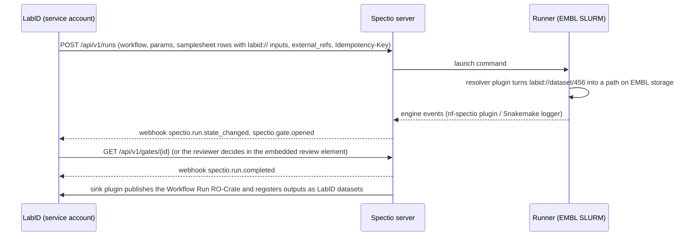
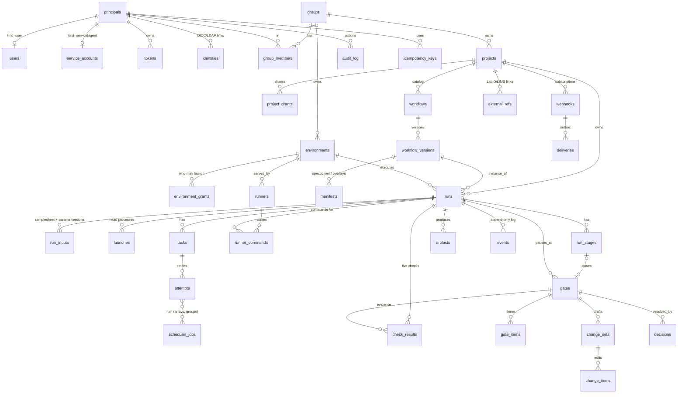

# Spectio — headless integration, API and data model

Status: draft v0.1 · 2026-10-25 · author: Thomas Weber (with Claude)
Companion docs: [`synthesis.md`](synthesis.md) (architecture, §7bis and §7quinquies), [`ui-spec.md`](ui-spec.md) (screens), [`decisions/log.md`](../decisions/log.md) (decisions log).

## 0. Decisions in brief

1. **Headless first.** The server is an engine-agnostic launch-and-monitor service. The web UI, the CLI, the MCP server, the WES facade and embedded elements in other tools (LabID, portals) are all clients of the same public API. Nothing the UI does is private.
2. **Single-user is a configuration, not a different system.** One schema and one API for every deployment. A single-user install is a multi-user install with one user, one group and one project created at first start, and an authentication mode that maps local requests to that user.
3. **Everything belongs to a project.** Every tenant row has `project_id` and `created_by`; every list endpoint is filtered by the projects the caller can see. Adding users and groups later needs no schema migration, only data.
4. **Principals, not just users.** People, service accounts (LIMS, CI), AI agents, runners and the system itself are all principals with tokens and roles. Every decision and change records which principal made it.
5. **Extension points are plugins.** Engines, input resolvers (`labid://`, `s3://`, `drs://`…), output sinks, check providers, notifiers and identity providers are Python entry points, so an institute adds an integration without forking Spectio.

## 1. Deployment modes

| Mode | What runs | Typical use |
|---|---|---|
| **Personal** | `spectio serve` on a laptop or a login node, bound to `127.0.0.1`, auth mode `single` | One researcher, no setup |
| **Team server** | server + Postgres (or SQLite on local disk) + runners on clusters, auth mode `oidc` | A lab or core facility |
| **Headless** | same server with `--no-ui`; only API, WES, webhooks, MCP | Driven entirely by a LIMS, portal or CI |
| **Embedded** | team or headless server + Spectio elements inside another web app | LabID or an institute portal shows launch forms, run cards and reviews |

Runners always connect outward to a server; they never need inbound ports.

## 2. Integration patterns

### A. LIMS-driven run (LabID)


### B. Standard client through WES
A portal or another WES client calls `POST /ga4gh/wes/v1/runs` with `workflow_type: NFL` or `SMK` (TRS descriptor types, which WES 1.1 accepts as instance-specific values, WES 1.1.0 OpenAPI `:753`; listed in `service-info.workflow_type_versions`). Spectio maps it to a native run in the caller's default project. Gates, pause and resume are available as WES extensions (`/ga4gh/wes/v1/runs/{id}/x-spectio/...`) and through the native API.

### C. Host UI with embedded elements
The host backend exchanges its service token for a short-lived **embed token** limited to one resource and a few actions, then renders `<spectio-launch-form>`, `<spectio-run-card>` or `<spectio-review>`. The elements talk to the Spectio API directly with that token and emit `postMessage` events (`spectio:run-launched`, `spectio:gate-decided`) to the host page.

### D. Observed or adopted CLI runs
A run started in a terminal with Spectio enabled is attached to the user's default project, or the project given by `SPECTIO_PROJECT`. It is the same run object as a UI or API launch.

### E. Event-driven automation
A robot or instrument subscribes to `spectio.gate.opened` for a gate type, does its work, and calls `POST /api/v1/gates/{id}/signals` with its service-account token. Policy decides whether that signal resolves the gate or only adds evidence.

## 3. Extension points (plugins)

Python entry points, one group per kind (`spectio.engine`, `spectio.notifier`, …), loaded on the server or the runner. The kinds (among them the task backend, pub/sub and event bridge), where each runs and their contracts are owned by [`architecture-plugins-and-packaging.md`](architecture-plugins-and-packaging.md) §2 and §3.6, together with discovery, settings, instances and scopes, versioning, conformance tests, frontend plugins, packaging and the `plugin_instances` table.

## 4. API design rules

- Base path `{root}/api/v1`, where `root` is empty for a standalone install and `/spectio` when co-hosted with depictio (`/depictio/api/v1`) behind one domain; JSON; resource-oriented; OpenAPI 3.1 published at `/api/v1/openapi.json`; generated Python and TypeScript SDKs.
- **IDs**: prefixed ULIDs (`run_01JB…`, `gate_01JB…`, `prj_01JB…`), sortable, safe in URLs, unique across the instance.
- **Tenancy**: every object returns `project_id`, `created_by` and `created_at`. Collections are top level (`/runs`, `/workflows`, `/gates`) and filtered by `?project=`; without it, the caller sees every project they can read. Create calls take `project_id`, defaulting to the caller's default project, so single-user clients never need to send it.
- **Ownership is data, not path**: no `/users/{id}/runs` paths, so moving a run between projects or adding users never changes URLs.
- **Lists**: cursor pagination (`?cursor=`, `limit` ≤ 200, `next` in the response), filters (`?state=running&workflow=wf_…&external_ref=labid:sample/123`), sort (`?sort=-created_at`), sparse fields (`?fields=`). Lists return no total. Whether an optional `total` (`?count=exact|estimate|none`) is affordable is decided by spike S-R7-4 ([R7](../reviews/R7-ui.md#proposed-spikes)); until then clients page with Next / Load more, never numbered pages or "of N". Headline counts and breakdowns come from the summary endpoints (§5). *(assumed — pending Thomas, inbox #30)*
- **Writes**: `Idempotency-Key` on every POST that creates or triggers something, kept 24 h: the server inserts the key first (`idempotency_keys`, §7), so two concurrent requests cannot both pass, and returns the stored response on a retry (scope and replay rules: next bullet); `ETag` / `If-Match` on gates, change sets, settings and the work-directory clean of a resumable run *(assumed — pending Thomas, inbox #30)* to prevent lost updates when two reviewers act at once; on a gate with a quorum each decision is a vote and does not compare-and-swap on the gate ETag, and change-set items carry their own version (§5, §7).
- **Idempotency keys are scoped to the caller.** A key is unique per (principal, or the owning group for a service account; HTTP method; route). The same key from another caller is a new request, never a replay. Replaying a key with a different body returns `409` (problem `idempotency-key-reused`, §4.1; exit code 5 in the CLI, [`cli-and-shared-libraries.md`](cli-and-shared-libraries.md) §2). A replay returns the stored result only if the caller still passes `can(read)` on it (§6). **Test:** tenant B reusing tenant A's key gets a new run or `409`, never A's run.
- **Long operations** (catalogue import, RO-Crate export, cleanup) return `202 Accepted` with an `Operation` resource (`/operations/{id}`). An `Operation` is the caller's view of a background task ([`admin-and-operations.md`](admin-and-operations.md) §3.1). *(assumed — pending Thomas, inbox #29)*
- **Errors**: RFC 9457 `application/problem+json` with a stable `type` URI and, for validation, a list of field errors.
- **Versioning**: during 0.x, `/api/v1` may break in a minor release, announced in the changelog ([`dev-environment-and-testing.md`](dev-environment-and-testing.md) §12); from 1.0.0, only additive changes within API v1, and breaking changes go to API v2; deprecations announced with `Deprecation` (RFC 9745) and `Sunset` (RFC 8594) headers.
- **Limits**: per-token rate limits with `RateLimit-*` headers; request size limits; files go through artefact endpoints, never in JSON bodies.

### 4.1 Wire conventions

This section owns the list envelope, the ID prefixes and the problem catalogue; §4 keeps the rules behind them.

| Convention | Rule |
|---|---|
| Lists | `{items, next}`; `limit` default 50, max 200; `sort` takes the fields named in each §5 row, `-` prefix for descending |
| Idempotency-Key | optional on every `POST` that creates, 1–255 printable ASCII characters; scope and retention as in §4 |
| ID prefixes | `wf_` workflow, `wfv_` workflow version, `run_`, `lch_` launch, `tsk_` task, `att_` attempt, `gate_`, `chk_` check result, `dec_` decision, `evt_` event, `prj_`, `usr_`, `grp_`, `env_`, `rnr_` runner, `whk_` webhook, `op_` operation |
| Problems | `type` = `/problems/<slug>` (catalogue below); validation adds `errors: [{pointer, code, detail}]`, where `pointer` is a JSON Pointer ([RFC 6901](https://www.rfc-editor.org/rfc/rfc6901)) |

The mapping from a problem to a CLI exit code is owned here; what each exit code means stays in the exit-code table of [`cli-and-shared-libraries.md`](cli-and-shared-libraries.md) §2.

| Problem slug | HTTP status | CLI exit code |
|---|---|---|
| `validation-failed` | 422 | 1 |
| `not-found` | 404 | 4 |
| `run-state-conflict` | 409 | 5 |
| `etag-mismatch` | 412 | 5 |
| `if-match-required` | 428 | 5 |
| `idempotency-key-reused` | 409 | 5 |
| `not-in-this-version` | 422 | 1 |
| `log-not-found` | 404 | 4 |
| `log-cleaned` | 410 | 4 |
| `run-dir-unreachable` | 409 | 5 *(assumed — pending Thomas, inbox #125)* |
| `environment-exists`, `environment-builtin`, `environments-file-unusable`, `environments-file-changed` | 409 | 5 *(FU-P3-86, §5.4; assumed — pending Thomas, inbox #133)* |
| `runner-offline` | 503 | 1 |
| `rate-limited` | 429 | 1 |
| `forbidden` | 403 | 3 |
| `unauthenticated` | 401 | 3 |

*Note 2026-10-30 (0.0.1, P1 Task 18, FU-P3-17):* the 0.0.1 server sends two slugs beyond the catalogue above, from its write checks: `length-required` (411, a chunked write) and `request-too-large` (413, a write body over 1 MiB). The framework's own refusals are problem documents too. A body that cannot be parsed is `422 validation-failed` on the field `body`. An unknown path is `404 not-found`. Any other status with no slug here, such as `405`, gets `type: about:blank` with the status phrase as `title`, the default of [RFC 9457 §4.2.1](https://www.rfc-editor.org/rfc/rfc9457#section-4.2.1), and keeps its headers (a `405`'s `Allow`). The CLI exit codes of these three are not set yet. *(assumed — pending Thomas, [inbox #87](../reviews/inbox.md#87-assumed-the-001-read-api-logs-cancel-and-stream-in-the-local-only-order) rules 10 and 12)*

## 5. Endpoint catalogue (API v1)

Paths under `/admin/*` are for system admins only and are specified in [`admin-and-operations.md`](admin-and-operations.md) §5. Everything a non-admin may call is at the root and specified here. *(assumed — pending Thomas, inbox #29)*

| Area | Endpoints |
|---|---|
| Session & me | `GET /me` (principal, default project, scopes), `GET /me/projects`, `POST /auth/device` + `POST /auth/token` (CLI device flow, phase 2), `POST /embed-tokens` |
| Sign-in | `POST /auth/magic-links:exchange` (the ticket from the URL fragment, posted after the 'Continue as' screen → session; mirrors depictio's `POST /auth/magic/exchange`, [research note](../research/depictio-auth-2026-10-26.md) l.108). The other sign-in endpoints are in [`authentication-and-access.md`](authentication-and-access.md) §1-§2 |
| Notifications (per user) | `GET /me/notifications?after=` (in-app inbox with unread count), `POST /me/notifications:mark-read`, `GET/PUT /me/subscriptions` (resource and event type, for example a runner's `spectio.runner.online` or a gate's `spectio.gate.opened`) *(assumed — pending Thomas, inbox #17)* |
| Users & groups | `GET /users`, `GET /users/{id}` (read only), `GET /groups`, `GET /groups/{id}`, `GET/POST/DELETE /groups/{id}/members` (group admins and system admins). Creating users, changing a user's state or admin flag, creating or deleting groups and setting the P.I. are under `/admin/*` (admin §5) *(assumed — pending Thomas, inbox #29)* |
| Projects | `GET/POST /projects`, `GET/PATCH /projects/{id}`, `GET/PUT/DELETE /projects/{id}/grants`, `GET /projects/{id}/audit-log` (project owners: the audit entries of that project) *(assumed — pending Thomas, inbox #29)* |
| Service accounts & tokens | `GET/POST /service-accounts`, `GET/POST /tokens`, `DELETE /tokens/{id}` (personal and service tokens, scopes, expiry, optional project restriction) |
| Workflows | `GET /workflows` (`?name=&source=`), `POST /workflows`, `GET /workflows/{id}`, `GET /workflows/{id}/versions`, `GET /workflow-versions` (`?key=`, exact canonical key, §7), `GET /workflow-versions/{id}` (revision, commit, key, and `profiles[]` and `sample_tables[]` from the workflow's config and schema), `GET /workflow-versions/{id}/schema` (params JSON Schema; returns `inferred: true` when the schema was inferred from the config values) *(assumed — pending Thomas, inbox #40)*, `GET /workflow-versions/{id}/manifest` (read-only effective manifest: parts `{kind, name, version}`, parsed stages `{id, name, source, description, match[]}` and gates `{key, name, stage_id}`) *(assumed — pending Thomas, inbox #39)*, `POST /workflows:import` (git, nf-core, Snakemake catalog, **RO-Crate**), `GET/PUT /workflows/{id}/manifest` (spectio.yml overlay) |
| Environments & runners | 0.0.1: the routes of §5.4 (FU-P3-86, assumed). 1.0: `GET/POST /environments`, `GET/PATCH /environments/{id}`, `GET/PUT /environments/{id}/grants`, `POST /runners:register` (one-time token → runner credential), `GET /runners`, `GET /runners/{id}`, runner channel `WS /runners/{id}/channel` (commands, heartbeats, file streaming) |
| Storage and work directories | `GET/PUT /environments/{id}/storage` (locations: role, path, type, quota source, access, retention), `GET/PUT /environments/{id}/lifecycle` (work-directory rules per run state), `GET /environments/{id}/workdirs?sort=size`, `POST /runs/{id}/workdir:keep`, `POST /runs/{id}/workdir:clean` (on a resumable run, `:clean` requires `If-Match` with the run's current ETag, so a clean never breaks a resumable run, [`ui-spec.md`](ui-spec.md) §4.8) *(assumed — pending Thomas, inbox #30)* |
| Runs | `POST /runs` (body, defaults and validation: §5.2), `POST /runs:validate` (launch body of §5.2; returns field errors, per-row file checks and `checked_at`; `POST /runs` runs the same checks), `GET /runs` (`?state=` repeated or comma-separated, `since=`, `q=` name prefix, `workflow=`, `project=`; sort `created_at`, `last_activity`, `ended_at`, `name`) *(assumed — pending Thomas, inbox #39)*, `GET /runs:summary` (`?project=&since=&group_by=state|workflow`; counts for headline numbers) *(assumed — pending Thomas, inbox #30)*, `GET /runs:compare?ids=` (parameters and inputs side by side, with the `changes` of §5.1), `GET /runs/{id}` (with `summary`, §7), `POST /runs/{id}:cancel` (source states of every action: §5.1), `:pause` (after current stage), `:resume` (does not apply to `failed` runs: resuming a failed run is `POST /runs/{id}:relaunch` with mode `resume`, which creates a child run) *(assumed — pending Thomas, inbox #32)*, `POST /runs/{id}:relaunch` (body, source states and responses: §5.1), `GET /runs/{id}:launch-template` (a §5.2 body prefilled from this run, for Copy to a new launch) *(assumed — pending Thomas, inbox #39)*, `GET /runs/{id}/graph`, `GET /runs/{id}/stages` (`run_stages` rows in position order, §7) *(assumed — pending Thomas, inbox #40)*, `GET /runs/{id}/launches` (`launches` rows, §7), `GET /runs/{id}/processes` (items `{process, stage_id, counts: {<state>: n}, retries, peak_rss_bytes, native_id_min, native_id_max, tasks_expected, tasks_expected_source, failures_by_class: {<failure_class>: n}, module: {path, commit} | null, not_scheduled: {reason, count} | null}`; sort `-tasks_running`, `-peak_rss`; whether nf-spectio can report never-created tasks is **[to be validated]**) *(assumed — pending Thomas, inbox #30, #38)*, `GET /runs/{id}/scheduler` (scheduler jobs, summary, relaunch suggestions; [`schedulers-and-monitoring.md`](schedulers-and-monitoring.md) §8) *(assumed — pending Thomas, inbox #29)*, `GET /runs/{id}/params` (`?version=&resolved=`; returns `{version, values, changed_vs_parent: [{key, before, after}]}`, with `parent_run_id` as the baseline), `GET /runs/{id}/samplesheets` (versions), `GET /runs/{id}/lineage` (shape: §5.1), `PATCH /runs/{id}` (name, tags, external_refs, project move). State-changing verbs return `409 run-state-conflict` while the run is `recovering` (§8.1) *(assumed — pending Thomas, inbox #40)* |
| Tasks & logs | `GET /runs/{id}/tasks`, `GET /tasks/{id}`, `GET /tasks/{id}/attempts`, `GET /tasks/{id}/logs/{stdout|stderr}` (last attempt), `GET /tasks/{id}/attempts/{n}/logs/{stdout|stderr}`, `GET /tasks/{id}/attempts/{n}/files` and `GET /tasks/{id}/attempts/{n}/files/{name}` (the attempt's own files, by name from an allow-list per engine; 0.0.1 shape in the note below) *(assumed — pending Thomas, inbox #70)*, `GET /runs/{id}/logs` (`?launch=<n>&source=engine|head`; sources: [`architecture-plugins-and-packaging.md`](architecture-plugins-and-packaging.md) §13.7). Logs are `text/plain; charset=utf-8`, support `Range` (`206`, `416`) and `?follow=true`; problems `404 log-not-found`, `410 log-cleaned` (work directory cleaned), `409 run-dir-unreachable` (the runs root is not there, or is not the run's: rule in the note of 2026-11-08 below the Following-a-log bullet) *(assumed — pending Thomas, inbox #125)*, `503 runner-offline` (§4.1) |
| Artefacts | `GET /runs/{id}/artifacts` (`?role=output|report|evidence`) *(assumed — pending Thomas, inbox #39)*, `GET /runs/{id}/results?path=` (one directory of the run's results directory, read only) and `GET /runs/{id}/results/raw/{path}` (one file; HTML in a sandbox) *(assumed — pending Thomas, inbox #70)*, `GET /artifacts/{id}`, `GET /artifacts/{id}/content` (streamed through the runner or presigned URL), `GET /artifacts/{id}/preview` |
| Gates (reviews) | `GET /gates` (queue: `?assigned_to=me&state=open`, or `?run=<id>`) *(assumed — pending Thomas, inbox #32)*, `GET /gates:summary` (`?project=&since=&group_by=state|item_kind|workflow`) *(assumed — pending Thomas, inbox #30)*; `GET /gates:summary?state=open` feeds the review badge *(assumed — pending Thomas, inbox #39)*, `GET /gates/{id}` (with `resolution: {action, decided_at, principal_id, actor_kind, justification} | null`, also shown on its stage in `/graph` and `/stages`; with `summary: {items_total, items_failing, checks: []}` and `run: {id, name, state}` *(assumed — pending Thomas, inbox #39)*), `GET /gates/{id}/checks` (items `{check_key, kind, scope, severity, threshold: {min, max}, item_key, value: number | string | boolean | null, verdict, file_uri, evaluated_at}`) *(assumed — pending Thomas, inbox #32)*, `GET /gates/{id}/items` (paged; `?verdict=&sort=worst`; each item inline with its check results and attributes) *(assumed — pending Thomas, inbox #39)*, `GET /gates/{id}/decisions`, `GET/PUT /gates/{id}/change-set` (draft edits: item decisions, samplesheet, params, editable files), `PATCH /gates/{id}/change-set/items/{item}` (one item, with its own version, so two reviewers editing different items never conflict), `POST /gates/{id}/proposals` (AI or robot suggestion), `POST /gates/{id}/signals` (external systems), `POST /gates/{id}/decisions` (body `{action, justification?, stage_id?, change_set_id?}`, actions in §7; `If-Match` with the gate etag, `412 etag-mismatch` when stale, `428 if-match-required` when absent, except on quorum gates; returns `201 {decision, gate}`) *(assumed — pending Thomas, inbox #29)*; a decision verb the instance does not offer (`apply`, `go_back`, which need change sets) returns `422 not-in-this-version`, and which verbs ship in which version is set in [`dev-environment-and-testing.md`](dev-environment-and-testing.md) §15.1 *(assumed — pending Thomas, inbox #32)*, `POST /gates:bulk-decide` (one result per gate; atomic within each gate, not across gates) |
| Events | `GET /events?run=…&after=seq` (returns CloudEvents envelopes; with `run`, paging uses `after=<seq>` and `next` is the last seq, the one exception to the cursor rule of §4) *(assumed — pending Thomas, inbox #38)*, `GET /events?project=&type=` (instance activity feed, filtered to the caller's visible projects) *(assumed — pending Thomas, inbox #30)*, `GET /events/stream` (SSE; frames: §8.5; a single-run stream resumes with `Last-Event-ID`, a multi-run stream by snapshot then tail, §8.2) |
| Webhooks | `GET/POST /webhooks`, `GET/PATCH/DELETE /webhooks/{id}`, `GET /webhooks/{id}/deliveries`, `POST /deliveries/{id}:redeliver` |
| Provenance | `GET /runs/{id}/ro-crate` (JSON-LD or zip, profile: workflow-run or provenance-run), `POST /runs:import-crate` (prefill a relaunch) |
| Search | `GET /search?q=` (exact and prefix matches on indexed keys: IDs, external refs, names, tags; task search scoped to one run, §7) |
| Admin | everything under `/admin/*`, for system admins only: users, groups, background tasks, logs, health, branding, plugins and plugin instances, AI & agents, backups and restores, migrations, maintenance, settings, audit log ([`admin-and-operations.md`](admin-and-operations.md) §5) *(assumed — pending Thomas, inbox #29)* |
| Public (no token) | `GET /public-config` (one document with sections `auth`, `branding` and `analytics`; [`telemetry-and-analytics.md`](telemetry-and-analytics.md) §4.2), `GET /version` (also the embedded runner's status and last heartbeat) *(assumed — pending Thomas, inbox #39)*; `/health/live`, `/health/ready` and `/metrics` are outside the API prefix (admin §3.5) *(assumed — pending Thomas, inbox #29)* |
| Plugins (UI) | `GET /plugins/ui-manifest` (any signed-in user; viewer modules, [`architecture-plugins-and-packaging.md`](architecture-plugins-and-packaging.md) §5) *(assumed — pending Thomas, inbox #29)* |
| Ingest (engines) | `POST /ingest/events` (Nextflow plugin `nf-spectio`, Snakemake logger). The Tower protocol routes `/trace/*` are not implemented ([decision 0001](../decisions/0001-nextflow-through-nf-spectio.md)) |
| Facades | `/ga4gh/wes/v1/*` (WES 1.1 + `x-spectio` extensions), `/mcp` (MCP server) |

*Note 2026-10-28 (0.0.1 screens, UX-296):* the 0.0.1 server serves a subset of this catalogue, owned by [P1](../plans/P1-walking-skeleton.md) Task 18: `GET /runs` with `state=`, `q=` and `sort=-ended_at` only; `GET /runs:summary?group_by=state` without `since=` or `project=` (all the user's runs); `GET /runs/{id}/stages` with a subset of the `run_stages` row of §7 (`id`, `position`, `name`, `source`, `state`, `task_counts`; `id` is `run_stages.stage_id`, the value `/processes` items carry in `stage_id`), filled by P1 Task 27 (how stages are found: [ui-spec §5.1.1](ui-spec.md#511-detected-stages)), and `stage_id` on the `/processes` items, shown as the [ui-spec §4.4 note](ui-spec.md#44-run-detail) of 2026-10-28 says; and, on the run, `origin` (`ui` or `cli-observed`) and `engine_version` as in §7. The 0.0.1 shape of `GET /version`, behind the session cookie, is in Task 18 too.

*Note 2026-10-30 (0.0.1 launch, P1 Task 17):* the 0.0.1 server adds two endpoints of its own, with no `workflows` catalogue, no `POST /workflows` and no `POST /runs:validate` ([P1](../plans/P1-walking-skeleton.md) Assumption 2).

- `GET /workflows:inspect?location=&revision=` reads a pipeline for the launch form, without running it, and returns `{location, revision, engine, engine_files, name, version, engine_version, engine_versions: {nextflow, snakemake}, schema, schema_source, profiles}`:
    - `location` is an absolute path to a directory the user's account can read, or a Git repository: an `owner/repo` name, taken as `https://github.com/owner/repo`, or an `https://` or `ssh://` URL, with a required `revision` (a tag, a branch or a commit). The repository is fetched once per revision into `<data dir>/pipelines/<host>/<path>/<revision>/`, under the rule of [Imports are untrusted input](#imports-are-untrusted-input): `git -c protocol.allow=never -c protocol.https.allow=always -c protocol.ssh.allow=always`, an argument list, no terminal; a URL with credentials, a path part `.` or `..`, a control character in the location or the revision, and a revision that starts with `-` are refused;
    - `engine_files` lists those of `main.nf`, `Snakefile` and `workflow/Snakefile` that exist; `engine` is the engine they point to, `null` when both or neither are there (UX-G2-04);
    - `name` and `version` are the Nextflow `manifest.name` and `manifest.version` read from `nextflow.config`, else the directory's or repository's name and `null`; Snakemake declares no version **[to be validated]**;
    - `engine_version` is the version of `engine` the server would launch with, `null` without a guess; `engine_versions` gives both engines', `null` for one that is missing (UX-296, UX-G2-04);
    - `schema_source` is `nextflow_schema.json`, `config.schema.yaml` (at the root or in `workflow/schemas/`), `inferred` (the types of the values of `config/config.yaml`) or `none`; `profiles` are the Nextflow profile names of `nextflow.config` (its `includeConfig` files are not read) or the Snakemake profiles `profiles/<name>/config.yaml`.
- `POST /runs` takes the 0.0.1 body `{workflow: {location, revision?, engine}, name?, profiles?: [str], params: {}}`, not the §5.2 body. It checks the location as inspect does, that the chosen engine's file exists (`422`, field `workflow.engine`), the profiles (one at most for Snakemake), and the parameters against the pipeline's schema (in the JSON Schema draft its `$schema` names, draft 7 when there is none; an `inferred` schema is not enforced). It then writes the run directory and its manifest, and in one transaction the `workflows` row (one per location, with one engine), a `workflow_versions` row, the run (`queued`, origin `ui`), its parameters (`run_inputs.kind = params`), launch 1 and a `launch` row in `runner_commands`. It answers `201` with the run and a `Location` header; the default name is `<workflow name>-<last 6 of the run ID>`.
- Both answer `422 validation-failed` with `errors: [{field, message}]`, where `field` is a dotted path into the request (`location`, `workflow.location`, `params.chunks`), not the `{pointer, code, detail}` of §4.1.
- Inspect reads a pipeline's files only through real directories and regular files inside the pipeline directory: a symlink, in the tree or out of it, counts as absent (dev-env §15.3 req. 13, the `O_NOFOLLOW` walk). So a symlinked `nextflow_schema.json`, `config.schema.yaml` or `config/config.yaml` gives `schema_source: none`, and `POST /runs` then checks no parameter; a symlinked `nextflow.config` gives no manifest name, version or profiles; a symlinked entry file is left out of `engine_files` (and `POST /runs` answers `422` on `workflow.engine`); a symlinked `profiles` directory, or a profile whose directory or `config.yaml` is a symlink, is not listed.
- Until sign-in (P1 Tasks 12 to 16), they are served only by a server whose environment is of kind `local`, and only on a machine that does not look like a cluster node or a shared one, as decided once at start (inbox #86 rule 1). Elsewhere every `/api/v1` path answers `404` with the reason, and the start text says so. Every request first passes the Host, cross-site and write checks of [dev-env §15.3](dev-environment-and-testing.md#153-001-on-a-cluster-architecture-and-safety-without-accounts) req. 4 and 7 (`400`, `403`, `415`).

*(assumed — pending Thomas, [inbox #86](../reviews/inbox.md#86-assumed-the-001-launch-api-served-in-local-mode-only-before-sign-in))*

*Note 2026-10-30 (0.0.1 read API, P1 Task 18):* the subset of the note of 2026-10-28 is built, with these shapes:

- The run, in `GET /runs` items and `GET /runs/{id}` (which adds `params`): `{id, name, state, origin, created_at, started_at, ended_at, workflow: {engine, engine_version, location, name, version}, profiles, failure, head, task_counts, summary: {tasks: {done, total, failed, cached}, last_failure}}`. `summary` follows §7, not P1's names: `total` is `tasks_expected` when set, else the sum of `task_counts`; `done` counts `succeeded`, `cached` and `stored`. `workflow.version` is the version inspect read at launch (`manifest.version`), `null` for Snakemake and for a rebuilt run; `workflow.engine_version` is `runs.engine_version`. `head` is `{session, node, alive, exit_code}`, `null` until the launch has a native ID; `alive` means "not reported ended".
- Lists are `{items, next}`, `next` an opaque cursor; a cursor this server did not give is `422` on `cursor`. `GET /runs` sorts newest first by `created_at`, or by `ended_at` (ended runs only); `state` takes a comma-separated list; `q` is a name prefix compared as text. `GET /runs/{id}/tasks` (`state=`, `process=`) and `/processes` follow first-seen order, the order of the task IDs, which are monotonic within the process.
- `GET /version` returns `{version, node, runs_root, account, executor}`.
- `GET /runs/{id}/logs?source=head-out|head-err|engine` returns the last 64 KiB as `text/plain; charset=utf-8`. The engine log is `.nextflow.log`, or the newest regular `.snakemake/log/*.log`. The launch directory comes from the runs root and the run ID, must be private, and each part below it is opened with `O_NOFOLLOW`; a symlink, a missing file or anything but a regular file is `404 log-not-found`. The owner of the file is not checked yet (dev-env §15.3 req. 12; follow-up FU-P3-20).
- `POST /runs/{id}:cancel` moves `queued` or `running` to `cancelling` and queues a `cancel` command for the last launch: `202` with the run. A run already `cancelling` or terminal answers `200`, unchanged; a `cli-observed` run `422 not-in-this-version`. The `spectio.run.state_changed` event has `source: api`, `actor_kind: person` and the principal.
- `GET /events/stream`: [§8.3](#83-live-streams-sse), note 2026-10-30.
- Until sign-in, these routes have no session, as for the note above: same `no_api` decision, same Host, cross-site and write checks; `:cancel` is a write. P1 Task 16 turns each into a `401` without a session.
- *Added 2026-10-31 ([P3 Task 20](../progress/W5/P3-M4.md#task-20-runs-list-run-detail-cancel-and-the-playwright-smoke); assumed — pending Thomas, [inbox #90](../reviews/inbox.md#90-assumed-the-001-runs-screens-cancel-and-the-playwright-smoke-in-the-local-only-order) rule 8):* every route of this note but the log tail and the stream declares a response model (`spectio_server/api/models.py`): `RunList`, `RunDetail` (also for `:cancel`), `Summary`, `ServerVersion`, `ProcessList`, `StageList`, `TaskList`. The OpenAPI document `openapi/0.0.1.json` therefore types every body the screens read, and its `info.version` is the API's `0.0.1`, not the package version. The state enums of the models are those of §7, and a test keeps them equal to the store's. The `/tasks` cursor carries the task ID once, since the ID is the sort key; the `/runs` cursor stays `[sort value, id]`. Cursors stay opaque to clients.
- *Added 2026-11-07 ([P3 Task 25](../progress/W5/P3-M6.md#task-25-pointer-file-in-both-bridges-the-server-finds-and-shows-the-run); assumed — pending Thomas, [inbox #113](../reviews/inbox.md#113-assumed-how-a-snakemake-run-started-from-a-terminal-ends-p3-task-25)):* `head` gains `checked`, a boolean. For a run Spectio launched it is `true`. For a `cli-observed` run, `head` is built from its pointer (`session` is `null`, `node` the pointer's host, `exit_code` `null` unless the launch row holds one) and `checked` is `true` only when the pointer's host name and boot ID are the server's, the one test the runner's PID check uses (`checkable` in `spectio.runner.local`). When `checked` is `false`, `alive` only means "not reported ended" and the screens say "head on <node>, not checked" ([architecture §13.8](architecture-plugins-and-packaging.md#138-runs-started-from-a-terminal), [ui-spec §6](ui-spec.md)).
- *Added 2026-10-31 ([P3 Task 27](../progress/W5/P3-M7.md); assumed — pending Thomas, [inbox #93](../reviews/inbox.md#93-assumed-the-001-stages-as-built-p3-task-27) rule 6):* the run's `summary` gains `stage_mode` (`declared`, `detected`, or `quarters` when the run has no stage, §7). `GET /runs/{id}` (and `:cancel`) gains `stages_note`, a sentence saying why declared stages were not applied (two lab overlays match, or a file's globs overlap; [checking-scenarios §12.7 note](checking-scenarios.md#127-overlays) of 2026-10-31), else `null`; it is not in §7's computed fields. `/stages` is filled from `run_stages`. `/processes` lists the names the server recorded in `run_processes` (§7), in that order, each with the stage it froze with, then any name known from tasks only (a database from before Task 27), in its first task's order. In the OpenAPI snapshot, the two fields are added as required, and the `/processes` description changes; nothing else.

*(assumed — pending Thomas, [inbox #87](../reviews/inbox.md#87-assumed-the-001-read-api-logs-cancel-and-stream-in-the-local-only-order))*

*Note 2026-11-06 (0.0.1 token link, P1 Task 12):* the sign-in of [dev-env §15.3](dev-environment-and-testing.md#153-001-on-a-cluster-architecture-and-safety-without-accounts) "Access" and req. 2, with no email and no "Continue as" screen:

- `GET /auth/link` and `GET /auth/link.js` (outside `/api/v1`, not in the OpenAPI document) are the bootstrap page: static, no data. The script reads the ticket from the URL fragment, drops it with `history.replaceState`, posts the exchange, then opens `/`. A used or expired link shows "This link was already used or has expired. Run `spectio login --print-link` on the cluster for a new one."
- `POST /auth/magic-links:exchange` takes `{"ticket"}` and answers `204` with the session cookie (`HttpOnly`, `SameSite=Strict`, `Path=/`); a used, expired or unknown ticket is `401 link-expired`.
- `POST /auth/links` takes the server key as `Authorization: Bearer <key>` and answers `{"url"}`, a new link on the server port; anything else is `401`. It is what `spectio login --print-link` calls; the key never opens a session.
- Every other route, `/api/v1` or not, is `401 unauthenticated` with no data without a valid session cookie (P1 Assumption 8 lists the four exempt routes). The four answer `Cache-Control: no-store`, `Referrer-Policy: no-referrer` and `Content-Security-Policy: default-src 'self'`. The cookie name per Host port is P1 Task 13; the local-only rule of the notes above stays until [inbox #109](../reviews/inbox.md#109-assumed-writes-need-origin-and-json-as-built-p3-task-16) rule 5 is decided (P1 Task 16 is merged).

### Example: launch from a LIMS
```http
POST /api/v1/runs
Authorization: Bearer spk_svc_…            # LabID service account
Idempotency-Key: labid-order-8812
Content-Type: application/json

{
  "project_id": "prj_01JB…",
  "workflow_version_id": "wfv_01JB…",       # nf-core/rnaseq 3.27.0
  "environment_id": "env_01JB…",            # EMBL SLURM · htc
  "software": { "profiles": ["singularity"] },
  "params": { "aligner": "star_salmon", "outdir": "spectio://results" },
  "samplesheets": [
    { "target": "input", "format": "csv",
      "rows": [
        { "sample": "S1", "fastq_1": "labid://dataset/456/R1", "fastq_2": "labid://dataset/456/R2",
          "strandedness": "auto", "external_refs": ["labid:sample/123"] }
      ] }
  ],
  "gates": "from-manifest",
  "external_refs": ["labid:order/8812", "labid:project/77"],
  "notify": { "webhook_ids": ["whk_01JB…"] }
}
```
Response `201` with the run, its `id`, `state: queued` and `links: {self, events, stream, ui}` (body fields and defaults: §5.2). `spectio://results` resolves to the run's `results_dir` (§7) *(assumed — pending Thomas, inbox #40)*. Retrying with the same `Idempotency-Key` from the same caller returns the same run (§4).

*Note 2026-10-28 (0.0.1 job files, resume and run tools; Thomas: "les 5 dans 0.0.1", [decision log](../decisions/log.md#2026-10-28-001-shows-each-jobs-files-and-gains-resume-failure-summary-results-copy-and-resources)):* the 0.0.1 server also serves the endpoints below, owned in detail by [P1](../plans/P1-walking-skeleton.md) Tasks 28 to 32. Every file read follows the confinement rule of [checking-scenarios §11.1](checking-scenarios.md) and [dev-env §15.3](dev-environment-and-testing.md#153-001-on-a-cluster-architecture-and-safety-without-accounts) req. 13 and 14; which files exist per engine is in [architecture §13.7](architecture-plugins-and-packaging.md#137-log-sources-per-engine). *(assumed — pending Thomas, inbox #70)*
- **Job files.** `GET /tasks/{id}/attempts/{n}/files` → `{work_dir, files: [{name, kind: "script" | "wrapper" | "stdout" | "stderr" | "job_log" | "exit" | "marker" | "trace" | "rule_log" | "slurm_log", size, mtime, state: "present" | "not_yet" | "absent" | "deleted_after_success" | "cleaned", note}]}`. `work_dir` is the attempt's work directory (Nextflow) or the launch directory (Snakemake), shown so the user can copy it; `name` is a file name from the allow-list of §13.7 (Nextflow) or the path, relative to the launch directory, of a rule `log:` file or the SLURM job log (Snakemake); a Snakemake `{name}` must equal, byte for byte, a path recorded for that attempt, else `422 file-not-allowed` (SEC-156). `GET /tasks/{id}/attempts/{n}/files/{name}?tail=<bytes>` → `text/plain; charset=utf-8`, the last 64 KiB by default and at most 1 MiB, with `Range` support (1 MiB at most per response), `X-Content-Type-Options: nosniff`, `Cache-Control: no-store` and `Referrer-Policy: no-referrer`; bytes that are not UTF-8 are replaced, and a file with a NUL byte in its first 8 KiB returns `415 binary-file`. `.command.run` is served with the value of every `export` line replaced by `«hidden»`. Problems: `404 log-not-found` (not written yet, or deleted, with the reason in `detail`), `410 log-cleaned`, `409 run-dir-unreachable` (the runs root is not there, or is not the run's; rule in the note of 2026-11-08 below the Following-a-log bullet) *(assumed — pending Thomas, inbox #125)*, `422 file-not-allowed` for a name outside the allow-list, `503 runner-offline` when the file system does not answer in time. The checks behind each answer: dev-env §15.3 req. 13.
- **Run.** `GET /runs/{id}` also returns `work_dir`, `results_dir` (`null` when unknown), `failure` (`{class, message}`, unchanged) and, per job that failed on its last attempt, `failures: [{task_id, attempt_n, process, tag, exit_code, message, native_id, scheduler: {state, reason, state_source: "sacct" | "engine_message" | null, req_mem_bytes, max_rss_bytes, time_limit_s, elapsed_s, usage_source: "sacct" | "trace" | null}, log_tail}]`, the first 10 in failure order, with `failures_total` (APPLY7 review UX-325; a `null` source means "SLURM accounting unavailable"; `log_tail`: the last 20 lines of the failed attempt's `.command.log` on Nextflow, or `.command.err` when it has none, or of its SLURM job log on Snakemake), `command: {argv: [str], text} | null` (the engine command as the head script runs it, with the parameters as a file, `-params-file` or `--configfile`; `null` for a `cli-observed` run, P1 Assumption 3), `parent_run_id`, `resumed_as: [{id, name, state}]`, and `actions: {resume: {allowed, reason}}`, where `reason` is one of `running`, `head_unverified`, `resume_in_progress`, `cli_observed`, `not_failed_or_cancelled` (APPLY7 review UX-327; the UI words are in [ui-spec §4.4](ui-spec.md#44-run-detail), note 2026-10-28).
- **Resources.** The items of `GET /runs/{id}/tasks` carry `resources: {cpus, memory_bytes, time_s, realtime_s, cpu_percent, peak_rss_bytes, source: "trace" | "benchmark" | "sacct" | null}`, requested and measured; a value not known yet is `null`.
- **Results.** `GET /runs/{id}/results?path=<relative>` → `{root, path, exists, entries: [{name, type: "dir" | "file" | "link_outside", size, mtime}], truncated, reports: [{path, title, group}]}`, at most 1000 entries per directory, read without recursion (a folder's `size` is `null`); `exists` is false while the pipeline has not created the directory; `reports` lists the `.html` and `.htm` files found to depth 4 below the root (MultiQC, FastQC, Nextflow's own reports), the first 50, the search stopping after 10,000 entries or 5 s and cached once the run has ended (req. 14 and SEC-157); `group` gathers reports of one folder, such as FastQC's. `GET /runs/{id}/results/raw/{path}` → the file; `.html` and `.htm` with the sandbox headers of §15.3 req. 14, meant for the report viewer's `<iframe>`; every other type, `.xhtml`, `.xml`, `.svg` and `.svgz` included, as `text/plain` or `application/octet-stream` with `Content-Disposition: attachment; filename*=UTF-8''…` (RFC 5987); every raw response carries the CSP `sandbox` (SEC-158). `404` when the run has no results directory (a `cli-observed` run in 0.0.1).
- **Copy to a new launch.** `GET /runs/{id}:launch-template` → `{workflow: {location, revision, engine}, profiles, params, non_default: [key], code_loading: [{key, path, writable_by_others}]}`, the body of `POST /runs` prefilled from this run; `code_loading` flags the values that load code or configuration (`custom_config_base`, a `-c` file, `--configfile`, a local `workflow.location`) (SEC-159); `404` for a `cli-observed` run.
- **Resume.** `POST /runs/{id}:relaunch` with the body `{mode: "resume"}` only; every other field or mode returns `422 not-in-this-version`. Source states, result and problems as in §5.1, plus `422 not-in-this-version` on a `cli-observed` run; it is a state-changing request under dev-env §15.3 req. 7 (Origin and CSRF checks).

*Note 2026-10-31 (the Job files routes as built, P1 Task 28; assumed — pending Thomas, [inbox #94](../reviews/inbox.md#94-assumed-each-jobs-files-as-built-p3-task-28)):*
- **Listing.** The body also carries `task_id`, `attempt` and `native_id` (the executor's job ID, when an event gave one); `mtime` is an ISO 8601 time, set with `size` only when `state` is `present`. The listing has the headers of a file read.
- **Which attempt `n`.** `n` is the attempt number of the task's attempts; when a resumed run has an attempt `n` in more than one launch, the latest launch's is served. No route or field gives a task's attempt numbers yet (`GET /tasks/{id}/attempts` of the catalogue is not built, and the items of `GET /runs/{id}/tasks` carry none), so the screens of P1 Task 32 need one before they can call these routes (CR-P3T28-05 r1).
- **Range.** One range, `bytes=<first>-[<last>]`, answered `206` with `Content-Range` in the file's bytes, at most 1 MiB; a malformed range, or one that starts past the end, is `422 validation-failed` on `Range`. The body has its escape sequences removed, so it can be shorter than the range. For `.command.run`, the first 1 MiB is hidden whole, and the range and `tail` count the bytes of the hidden text.
- **Problems.** `503 runner-offline` is returned when the read has not answered within 5 s (§15.3 req. 13 note of 2026-10-31); `GET /runs/{id}/logs` answers it too, and serves its text with escape sequences removed and `Referrer-Policy: no-referrer`.

*Note 2026-11-01 (the failure summary and resources as built, P1 Task 29; assumed — pending Thomas, [inbox #95](../reviews/inbox.md#95-assumed-the-failure-summary-and-resources-as-built-p3-task-29)):*
- **Failures.** `failures` lists the last attempt of each task that ended `failed`, by that attempt's creation time, then its ID; a task retried to success is not listed. `message` is set for the run's culprit attempt only (the one `failure` names); the others carry `null`. `scheduler` also carries `accounting: "available" | "pending" | "unavailable"`: `pending` while the job's `sacct` call is queued (the screen asks again later), `unavailable` when accounting is off, the job has no SLURM ID, the call failed (a failed call is not repeated by the same server process), or `sacct` gave no ended row from the job's own directory in 3 calls (the job is then kept as `null`, [dev-env §15.3 req. 15](dev-environment-and-testing.md#153-001-on-a-cluster-architecture-and-safety-without-accounts) notes of 2026-11-01). Between two of those calls the job also reads `unavailable`, until the next view queues it again and it reads `pending`. A Snakemake state from the engine's message wins over `sacct`; the used memory and time come from `sacct`, else from the trace (`usage_source`). Opening a Nextflow run's detail queues its failed jobs' IDs; Snakemake failures queue nothing.
- **`log_tail`.** Read through the confined reader and the routes' file pool (§15.3 req. 13): Nextflow `.command.log`, else `.command.err`; Snakemake the SLURM job log, else the rule's first `log:` file; escape sequences removed; `null` when there is none or the read did not answer within 5 s.
- **Task items.** They also carry `attempt_n`, the number of the task's last attempt, the one `resources` is read from and the one the Job files routes take as `n` (CR-P3T28-05 r1). `resources.source` is `trace` (Nextflow), `benchmark` (the rule's benchmark file, read when the page is served: `s`, `max_rss` in MiB, `mean_load` as `cpu_percent`) or `sacct` (an ended Snakemake job with a SLURM ID and no benchmark, queued when the page is served); with only requested values it is `null`. Snakemake `mem_mb` is read as MiB **[to be validated]**, `runtime` as minutes.

*Note 2026-11-01 (P1 Task 32, the screens; assumed — pending Thomas, [inbox #96](../reviews/inbox.md#96-assumed-the-run-tools-screens-as-built-and-what-waits-for-tasks-30-and-31-p3-task-32) rule 6):* each item of `failures` also carries `work_dir: str | null`. It is the directory the Job files listing of the same attempt shows: the attempt's work directory on Nextflow, `null` when no event recorded it; the run's launch directory on Snakemake, always set (`files/taskfiles.py` `attempt_dir`). The failure card's Copy button copies it ([ui-spec §4.4](ui-spec.md#44-run-detail), note of 2026-11-01). The OpenAPI snapshot `0.0.1.json` lists it as required.

*Note 2026-11-04 (Resume, Copy to a new launch and the run's command as built, P1 Task 30, [Progress · P3 M8](../progress/W5/P3-M8.md#task-30-resume-copy-to-a-new-launch-and-the-copy-actions); assumed — pending Thomas, [inbox #99](../reviews/inbox.md#99-assumed-resume-and-copy-to-a-new-launch-as-built-p3-task-30)):*
- **`command`.** `{argv, text}`, rebuilt from the run's `launch` command and the server's settings at the time of the request: an `engine_cmd` or `extra_args` changed since the launch shows the new values. `argv` is `engine_cmd` split into words, then the engine arguments; `text` is `shlex.join(argv)`. It carries no working directory, though a Resume's command only does what the run did in the lineage's launch directory. `engine_cmd` and `extra_args` are shown as written, so a secret in them reaches the copy (inbox #99 rule 8). `null` for a `cli-observed` run, a run with no `launch` command (rebuilt from its run directories), or one whose profile or session ID the head script would refuse.
- **`actions.resume.reason`** may also be `launch_dir_refused` (req. 10 or req. 16's checks on the launch or work directory failed) and `session_id_refused` (the parent's Nextflow session ID is not a UUID). The checks behind each reason: [dev-env §15.3 req. 16](dev-environment-and-testing.md#153-001-on-a-cluster-architecture-and-safety-without-accounts) note of 2026-11-04. The UI words for the two new reasons are P1 Task 32 part two's.
- **`resumed_as`** lists the runs whose `parent_run_id` is this run, by creation time; a Resume of a Resume is listed on its own parent, not on the first run.
- **`:launch-template`.** The items of `code_loading` are `{field, value, writable_by_others}`: `field` is `workflow.location` (a local location only), `params.custom_config_base`, or `engine.<option>` for a two-word `-c`, `-config`, `--configfile` or `--configfiles` in `[engines] extra_args`; a relative value always reads `writable_by_others: false`. Not listed: `--opt=value`, later values of a multi-value option, Snakemake `--profile` and `--workflow-profile` (inbox #99 rule 7). `non_default` lists the keys of `params` whose value differs from the pipeline schema's `default`, at the top or in a `$defs` or `definitions` group, or that have no default; with an inferred schema, every key. `profiles` come from the run's `launch` command, else from its `.spectio/run.json`, else `[]`. The route does not check the origin, so a `cli-observed` run gets a template too, not the `404` of the note of 2026-10-28. An unknown run is `404`.

*Note 2026-11-04 (results, reports and log follow as built, P1 Task 31, [Progress · P3 M8](../progress/W5/P3-M8.md#task-31-results-and-reports); assumed — pending Thomas, [inbox #100](../reviews/inbox.md#100-assumed-results-and-reports-as-built-p3-task-31)):*
- **`results_dir`.** Set once, at launch, and stored on the run (§7): Snakemake's launch directory; Nextflow's `params.outdir`, else the `outdir` default of the pipeline's schema, resolved against the launch directory. It is `null` when there is no such value, and when the value is refused (#100 rule 1). A Resume child takes its parent's row's. A run rebuilt from its directories that did not set `outdir` gets `null`, since the manifest does not keep the schema default (CR-P3T31-04 r2). `GET /runs/{id}` shows it, `null` for a `cli-observed` run.
- **Listing.** `GET /runs/{id}/results?path=` as in the note of 2026-10-28, with `mtime` in ISO 8601 and `size` and `mtime` `null` for a `link_outside`. Entries come folders first, then by name. The 1000 entries are the first 1000 read, hidden ones included. Hidden: `.spectio`, `.snakemake` and `.nextflow` (any case), entries of another owner, and names the server does not serve (#100 rule 6). `path` naming one of those, `..`, an absolute path or an empty part is `422 file-not-allowed`; a folder that does not exist under an existing root is `404 not-found`. `reports` are searched once per listing while the run is active and kept in memory once it has ended, for at most 1000 runs, until the server restarts (#100 rule 8).
- **Raw file.** `GET /runs/{id}/results/raw/{path}` sends the whole file with its `Content-Length`, up to 1 GiB; a larger file is `413 file-too-large` (#100 rule 2). `?download=true` makes any file an attachment. A read that fails, or a file that shrinks, after the headers are sent aborts the response, so the client sees a failed download (CR-P3T31-03 r1). Headers: §15.3 req. 14 of [dev-env](dev-environment-and-testing.md#153-001-on-a-cluster-architecture-and-safety-without-accounts), with `text/html; charset=utf-8` for `.html` and `.htm` and `application/octet-stream` for every other type.
- **Problems.** `404 not-found` when the run has no results directory (unknown, or `cli-observed`) and for a missing file; `422 file-not-allowed` for a refused name, a link outside the run's published files, or a results directory refused when served (#100 rule 3); `503 runner-offline` as for the job files (note of 2026-10-31).
- **Following a log.** `GET /runs/{id}/logs?follow=true` sends the log's last 64 KiB, then each line appended, read once a second in the file pool, until the run has ended. At most 4 follow streams are open on the server at once (req. 14 says per session; until sessions, P1 Tasks 12 to 16, the local server is one session, inbox #86 rule 1); a fifth is `429 rate-limited`. Since this change the run log route maps its errors like the job file routes: a refused or missing log is `404 log-not-found`, but a launch directory that is gone is `410 log-cleaned` (CR-P3T31-10 r2, #100 rule 11).
  - *Note 2026-11-08 (FU-P3-81, login1 feedback):* a run directory that cannot be found is `410 log-cleaned` only when the runs root exists and is the runs root the run was recorded under (its launch directory's grandparent, compared once resolved, so a symlinked `/scratch` matches). Otherwise the answer is `409 run-dir-unreachable`: the runs root is not there, or the run was recorded under another one. A run started in a terminal (`cli-observed`) has no recorded runs root and is always `410`. Both problems name the directory tried in `detail`: a server-side path under the user's own runs root. The rule holds for the run log route and both job-file routes; the confined reads are unchanged. The cause of the login1 symptom (a `410` while the file exists) was not reproduced and stays **[to be validated]** ([inbox #125](../reviews/inbox.md#125-question-login1-checks-for-the-runs-launch-directory-is-gone-fu-p3-81)). The CLI exit code 5 is proposed. *(assumed — pending Thomas, inbox #125)*

*Note 2026-11-07 (checkpoints, rules that do not run, temporary outputs, SLURM request and efficiency; Thomas, [decision log](../decisions/log.md#2026-11-07-checkpoints-conditional-and-skipped-jobs-temp-outputs-and-slurm-efficiency-per-job-and-per-rule-thomas); built by [P1 Task 34](../plans/P1-walking-skeleton.md#m9-dag-temp-outputs-and-efficiency); the UI words: [ui-spec §4.4](ui-spec.md#44-run-detail) and [§5.2](ui-spec.md#52-checkpoints-conditional-execution-and-temporary-outputs) notes of the same date; formulas: [schedulers §3.6](schedulers-and-monitoring.md#36-efficiency-per-job-and-per-process-or-rule)):* the 0.0.1 routes gain these fields. A value not known yet is `null`, as for `resources`.
- **Task items** (`GET /runs/{id}/tasks`) gain `slurm: {request, allocated, custom_options} | null` (`null` on a local run). `request` is `{partition, account, qos, cpus, mem_bytes, mem_per_cpu_bytes, time_limit_s, gres, constraint, nodes, tasks}` as the engine asked: Snakemake from `job_info.resources` (`slurm_partition`, `slurm_account`, `qos`, `cpus_per_task` else `threads`, `mem_mb` or `mem_mb_per_cpu`, `runtime`, `gres` or `gpu`, `constraint`, `nodes`, `tasks`), Nextflow from the trace record (`queue`, `cpus`, `memory`, `time`, `accelerator`; `account` from `executor.account` is not sent, so `null`). `allocated` is `{partition, account, qos, ncpus, req_mem_bytes, time_limit_s, alloc_tres, nnodes}` from `sacct` once the job has ended. `custom_options` is true when `slurm_extra` (Snakemake) or `clusterOptions` (Nextflow, when the bridge sends the flag) was set; the text is never stored (SEC-P3T1-11).
- **Task items** also gain `efficiency: {cpu, mem, elapsed_s, state: "running" | "pending_accounting" | "available" | "unavailable", source: "sacct" | "trace" | "benchmark" | null, reason}`; `cpu` and `mem` are ratios (0.63, not 63), `null` until measured. `state` is `running` while the attempt runs, `pending_accounting` once it ended until `sacct` answers (the engine's own values fill `cpu` and `mem` meanwhile, with their `source`), `available` with `sacct`'s values, `unavailable` with `reason` (`local`, `no_job_id`, `accounting_off`, `not_found`), the reasons of `scheduler.accounting` (note of 2026-11-01).
- **Processes** (`GET /runs/{id}/processes`) items gain `status: "pending" | "running" | "done" | "failed" | "stopped" | "awaiting_checkpoint" | "not_needed" | "up_to_date" | "no_tasks"` (the last four in [ui-spec §5.2](ui-spec.md#52-checkpoints-conditional-execution-and-temporary-outputs)), `is_checkpoint` (boolean), `lower_bound` (true while a checkpoint is open and the counts may grow) and `efficiency: {jobs, measured, cpu_mean, cpu_max, mem_mean, mem_max, requested: {cpus, mem_bytes, time_limit_s, varies}, used: {peak_rss_bytes_max, elapsed_s_max}}`, computed over each task's last attempt. *Added 2026-11-08 (FU-P3-82; assumed):* each item also has `pipeline_order` (integer, 0 first), computed when the API reads, nothing stored: for Snakemake the topological order of the last rule graph's `links`, ties by the list's order; with no links, and for Nextflow, the list's order. `items` keeps its order. The rule is in the ui-spec §4.4 note 2026-11-08 ([ui-spec](ui-spec.md)). *Amended 2026-11-08 (FU-P3-90; assumed, [inbox #126](../reviews/inbox.md#126-assumed-where-a-rule-that-is-in-no-rule-graph-is-listed-fu-p3-90)):* the links of every rule graph of the run are merged, and a rule in no graph's `nodes` comes after every graph rule, in the list's order; same note.
- **Run summary.** `summary.tasks` gains `lower_bound` and `summary` gains `open_checkpoints: [rule]` and `dag_updates` (the count of `snakemake.dag_updated`).
- **Job files.** The listing gains `outputs: [{path, state: "present" | "not_yet" | "absent" | "temp_removed" | "tbd", protected, removed_at}]` for a Snakemake attempt (from its `job_info.output` and the run's `run_output_events`); Nextflow attempts have `outputs: null`. `GET /runs/{id}` gains `engine_settings: {cleanup, notemp}`, each `null` when unknown.

*Note 2026-11-07 (as built, [P3 Task 34](../progress/W5/P3-M9.md#task-34-server-process-and-rule-states-outputs-slurm-request-and-efficiency); assumed — pending Thomas, [inbox #116](../reviews/inbox.md#116-assumed-process-states-outputs-slurm-request-and-efficiency-as-built-p3-task-34)):* the fields above are served by `spectio_server/efficiency.py` (the ratios and the aggregate), `failure.task_resources` (each job) and `stages/state.process_status` (the status). Where the build differs from the note:
- **`efficiency` is computed on read**, from the attempt's `resources`, the benchmark file and `sacct`'s cached row; nothing is stored in the database (§7 note, as built). An ended attempt's benchmark file is read once, then kept in the server's memory by attempt ID (CR-P3T34-01, [dev-env §15.3 req. 15](dev-environment-and-testing.md#153-001-on-a-cluster-architecture-and-safety-without-accounts)).
- **`efficiency` gains `peak_rss_bytes`**, the value `mem` comes from, and the reason `cached` for a cached or stored task, which ran no job (schedulers §3.6: "has no value"). An `unavailable` job keeps the engine's `cpu`, `mem` and `source` when it has them.
- **`efficiency.jobs` is `{done, total}`**, `total` the larger of the tasks known and Snakemake's planned count. `requested` is read from `resources` (`cpus`, `memory_bytes`, `time_s`), which a local run has too.
- **`custom_options`.** Snakemake: the logger plugin's `job_info.custom_options`, true when `slurm_extra` was set, null from an older plugin. Nextflow: true when `onFlowCreate` said `clusterOptionsSet` true, else null, since a false flag misses a directive written in the script (§14.1 note as built, inbox #115 rule 1). The text is never stored.
- **`request.gres` from Nextflow** is `gpu:<n>` from the trace's `accelerator` **[to be validated]** on `slurm-mini`; the request is kept from the first trace that has one (the submit), so a later trace does not change it.
- **`slurm` is null** on a run whose environment is not `slurm`, and for a `localrule` job (`job_info.local`).
- **`engine_settings.notemp` is always null:** no event carries Snakemake's `--notemp`.
- **`pending` after a DAG update** (ui-spec §5.2, CR-P3T34-02). Once no checkpoint is open, a defined rule with no job is `pending`, not `not_needed`, while the run is under way, a `dag_updated` came and the last `progress` total exceeds the run's known tasks: Spectio cannot tell which rule the jobs still to come belong to. It is `not_needed` once the totals match or the run has ended.
- **`lower_bound` and `open_checkpoints`.** A checkpoint is open while the run is under way and the rule has a job not ended, or fewer done than `run_info` planned. A rule is a checkpoint from its `checkpoint <name>:` line at the freeze, or from `job_info.is_checkpoint`.

### Imports are untrusted input

`POST /workflows:import` and `POST /runs:import-crate` take content written by someone else (WorkflowHub, email, another instance). They: *(decided — Thomas, 2026-10-27, inbox #25)*
- **extract crates safely:** every entry is resolved inside the extraction directory, with no zip slip ([Snyk](https://security.snyk.io/research/zip-slip-vulnerability)), and with limits on total size, file count and compression ratio;
- **process JSON-LD with remote context loading off.** Remote `@context` retrieval is part of JSON-LD processing ([JSON-LD 1.1 API](https://www.w3.org/TR/json-ld11-api/#remote-document-and-context-retrieval)); whether the chosen library loads contexts by default is **[to be validated]**;
- **accept git URLs over `https` or `ssh` only.** `file://`, `ext::` and other transports are refused ([git `protocol.allow`](https://git-scm.com/docs/git-config#Documentation/git-config.txt-protocolallow));
- **never pre-fill a launch silently.** A launch pre-filled from a crate shows every non-default parameter, hidden ones included, and flags parameters that load code or config from elsewhere. Example: nf-core/rnaseq sets `custom_config_base` to a remote URL and calls `includeConfig "${params.custom_config_base}/nfcore_custom.config"` (`95dbcd9`, `nextflow.config:154,331`); `config_profile_url` is also listed by R5 **[to be validated]**.

Project imports between instances follow [`admin-and-operations.md`](admin-and-operations.md) §4.3. **Tests:** a zip-slip crate, an `ext::` git URL and a crate that names a remote JSON-LD context are refused or processed offline.

### 5.1 Run actions

This section owns the source states, results and responses of the run actions. *(assumed — pending Thomas, inbox #32)*

| Action | From `runs.state` | Result | Response | Otherwise |
|---|---|---|---|---|
| `POST /runs/{id}:cancel` | `queued`, `running`, `awaiting_review`, `paused` | `cancelling` (§7.1) | `202` with the run | `200` with the run when already `cancelling` or terminal (idempotent) |
| `POST /runs/{id}:relaunch` | `failed`, `succeeded`, `cancelled` | a new child run in `queued` with `parent_run_id` = this run; the parent stays terminal | `201` with the child run and a `Location` header | `409 run-state-conflict` (§4.1) |
| `POST /runs/{id}:relaunch` with `mode: resume` | `failed`, `cancelled` | a child run that reuses the parent's launch directory and engine cache (`runs.launch_dir`, `work_dir`) | `201` | `409 run-state-conflict` |

*Note 2026-10-28 (0.0.1 Resume):* 0.0.1 implements the `resume` row above, for runs Spectio launched (Thomas, 2026-10-28, [decision log](../decisions/log.md#2026-10-28-001-shows-each-jobs-files-and-gains-resume-failure-summary-results-copy-and-resources)). The child run gets its own run directory, for its `.spectio/` files (manifest, head script, PID and exit files, spool and engine log), and its head runs in the parent's launch directory: Nextflow with `-resume <parent's engine_session_id>` and the parent's work directory, Snakemake with `--rerun-incomplete` (`snakemake/cli.py:919-922`, v9.27.1), after `--unlock` (`cli.py:1226`) only when Spectio has proven the parent's head gone, since a head that was stopped leaves the directory locked **[to be validated]** in spike T1. `:relaunch` returns `409 run-state-conflict` while another child of the same launch directory is `queued` or `running`, and while the parent's head is alive or cannot be checked (APPLY7 review SEC-152; the checks are dev-env §15.3 req. 16). `actions.resume` on the run says in advance whether Resume is allowed, and why not. *(assumed — pending Thomas, inbox #70)*

*Note 2026-11-04 (`:relaunch` as built, P1 Task 30, [Progress · P3 M8](../progress/W5/P3-M8.md#task-30-resume-copy-to-a-new-launch-and-the-copy-actions); assumed — pending Thomas, [inbox #99](../reviews/inbox.md#99-assumed-resume-and-copy-to-a-new-launch-as-built-p3-task-30)):*
- **Body.** `{mode: "resume"}` only. Another mode, or any other field even when `null`, is `422 not-in-this-version`; an unknown field or mode is `422 validation-failed`. A `cli-observed` run is `422 not-in-this-version`.
- **Refusals.** `409 run-state-conflict` carries a `reason` member, the same words as `actions.resume.reason`, plus `profiles_unknown` when the run has no `launch` command and its `.spectio/run.json` cannot be read (inbox #99 rule 11).
- **The child.** It is `queued`, `origin: ui`, named `<workflow name>-<last 6 characters of its id>`, with the parent's latest parameters and profiles; the answer is `201` with the child's run detail and `Location: /api/v1/runs/<child id>`. Its row has `parent_run_id`, `lineage_id` (the first run of the lineage) and `relaunch_mode: resume`, and its `launch_dir` and `work_dir` are the lineage root's. A Resume of a Resume therefore runs in the first run's directories, not in an intermediate child's. The child's run directory is made before the row and removed if the insert fails.
- **Which code.** The parent's `workflow.location` and revision are resolved again, so a branch or a moving tag gives its current commit (inbox #99 rule 9).
- **The engine.** Nextflow gets `-resume <engine_session_id>` (or `-resume` alone when none was recorded) and `-work-dir` of the lineage root. Snakemake gets `--unlock` first, then `--rerun-incomplete`, with `--directory` the lineage root's launch directory.

*Note 2026-10-28 (0.0.1):* a run started from a terminal (origin `cli-observed`) is monitor only: `:cancel` on it returns `422 not-in-this-version`, since Spectio did not start its head ([`architecture-plugins-and-packaging.md`](architecture-plugins-and-packaging.md#138-runs-started-from-a-terminal) §13.8) *(assumed — pending Thomas, inbox #65)*.

Body of `:relaunch`: `{mode, from_stage?, params_patch?, samplesheets?, resources?, gates, dry_run?}`.
- `mode` ∈ {`resume`, `rerun_from`, `fresh`}. `resume` and `rerun_from` reuse the parent's `launch_dir` and `launches.engine_session_id`, and return `409 run-state-conflict` while the parent's head is alive; `fresh` gets a new directory.
- `from_stage` is a stage id from `run_stages` (§7), required for `rerun_from`.
- `params_patch` is a JSON Merge Patch ([RFC 7396](https://www.rfc-editor.org/rfc/rfc7396)) over the parent's non-default params; `samplesheets` takes the §5.2 shape.
- `resources`: `[{process_or_rule, cpus?, memory?, time?}]`, rendered by the runner as an extra engine config file and stored as `run_inputs.kind = resources` (§7).
- `gates` ∈ {`inherit`, `none`}.
- `dry_run: true` creates nothing and returns `200 {stages: [{stage_id, reused, to_run, estimate}], suggested_mode, suggestions: [{process_or_rule, field, value, source: attempts | scheduler}], estimated_duration, workdir_growth_bytes, preflight}`; suggestions on a local environment come from `attempts.resources` and `failure_class` (§7).

The parent never changes state: Resume after a failure is a child run, and Continue after a gate is a new launch of the same run (§7 `launches`). At a gate, "Relaunch…" records the decision `stop` with reason `relaunched` (§7 `decisions`), then calls `:relaunch`. The source states of `:pause` and `:resume` follow inbox #16 (§7.1).

`GET /runs/{id}/lineage` returns `{root_run_id, runs: [{id, name, parent_run_id, relaunch_mode, from_stage, state, created_at, created_by, summary.last_failure, changes[]}]}`, ordered by `created_at`. `changes` is `[{kind: params | samplesheet | resources, key, before, after}]`, computed by the server against the parent, as `changed_vs_parent` in `/params` (§5).

### 5.2 Launch body

Body of `POST /runs` and `POST /runs:validate` (example above).

| Field | Rule |
|---|---|
| `project_id` | optional, defaults to the caller's default project (`GET /me`) |
| `environment_id` | *0.0.1 (FU-P3-86, assumed): the body takes `environment` by name instead, §5.4.* Optional when exactly one environment is granted to the caller (by default the built-in local environment) *(decided — Thomas, 2026-10-27, inbox #35)*; it then defaults to that environment; otherwise `422 validation-failed` with a field error |
| `workflow_version_id` or `workflow` key | required (canonical key, §7) |
| `params` | validated against the version's params JSON Schema |
| `samplesheets` | `[{target, format, rows}]`: `target` is a param name (Nextflow) or a Snakemake config key, `format` ∈ {`csv`, `tsv`}; stored as `run_inputs.kind = samplesheet` |
| `software` | `{profiles: []}` (Nextflow) or `{deployment_methods: []}` (Snakemake) |
| `resources` | as in §5.1, stored as `run_inputs.kind = resources` *(assumed — pending Thomas, inbox #32)* |
| `idempotency_key` | header `Idempotency-Key` (§4.1) |
| `notify` | `{webhook_ids: []}`; `422 not-in-this-version` when the server has no webhooks |

The server stores the merged manifest of each launch as `run_inputs.kind = manifest` (§7); the accepted values of the inline `gates` field wait for inbox #34. Synchronous validation failures (input file checks, gates unavailable for this workflow) return `422` with the reason, and no run is created *(assumed — pending Thomas, inbox #40)*. Response: `201` with the run (`state: queued`), a `Location` header and `links: {self, events, stream, ui}`, all root-relative paths.

### 5.3 Run files: explorer and preview

*Note 2026-11-08, FU-P3-85, assumed — pending Thomas ([inbox #127](../reviews/inbox.md#127-assumed-file-explorer-and-preview-fu-p3-85); [decision log](../decisions/log.md#2026-11-08-file-explorer-and-preview-in-001-fu-p3-85-assumed); revised the same day after the independent pre-review R1, [record](../reviews/code/P3-fu85-spec.md#round-r1-independent)):* the routes behind the file explorer and preview of [ui-spec §4.4.1](ui-spec.md#441-file-explorer-and-preview). They add reads to the Results and Job files routes of the §5 notes of 2026-10-28, 2026-10-31 and 2026-11-04; the changes to those routes are listed under "Shared changes". Every read is the confined walk of [dev-env §15.3](dev-environment-and-testing.md#153-001-on-a-cluster-architecture-and-safety-without-accounts) req. 13, in the routes' file pool with its 5 s wait; the headers are req. 13 ("Shown as text") and req. 14 (note of 2026-11-08). Every route needs the session and refuses a cross-site request, a `GET` too (req. 7, `api/browser.py`), as the other read routes. The routes are served by the same app, on the Unix socket on SLURM and shared hosts ([decision log](../decisions/log.md#2026-11-08-on-slurm-and-shared-hosts-the-api-is-served-only-on-a-unix-socket-inbox-109-rule-5-thomas)): no new listener and no new TCP port. No new problem slug.

- **Facts of one results entry.** `GET /runs/{id}/results/stat/{path}` → `{root, path, name, type: "dir" | "file" | "link_outside", size, mtime}`, the listing's entry for that one path, with the listing's checks and problems. The preview page asks it first (facts, kind, size caps, the path the server answered for), so it never needs the parent listing.
- **Text of a results file.** `GET /runs/{id}/results/text/{path}` → `text/plain; charset=utf-8`, with the read contract of a job file (§5 note of 2026-10-31): without `Range`, the last `?tail=<bytes>` (64 KiB by default, 1 MiB at most); with one `Range: bytes=<first>-[<last>]`, at most 1 MiB, answered `206` with `Content-Range: bytes <first>-<last read>/<size>`, the total always given. A read ends at the last whole UTF-8 sequence inside the range, and `Content-Range` gives that real end, so the next read starts at its last byte + 1 and no character is split. An empty file is `200` with an empty body; a malformed range, or one that starts past the end of a file that is not empty, is `422 validation-failed` on `Range`. Bytes that are not UTF-8 are replaced, escape sequences and the characters of `FORMAT_CHARS` are removed (so the body can be shorter than the range), and a NUL byte in the first 8 KiB is `415 binary-file`. `path` is checked as for the raw route (`check_rel`: relative, no `.`, `..` or empty part, no `.spectio`, `.snakemake` or `.nextflow` part, a name the server serves), and the file is found by the listing's walk, a published link followed only into a task directory of the run's work directory. Problems as the raw route: `404 not-found` (no results directory, a run started from a terminal, or no such file), `422 file-not-allowed`, `415 binary-file`, `503 runner-offline`.
- **An image from the results.** `GET /runs/{id}/results/raw/{path}?as=image` serves the file as an image, for the preview's ``. The rules apply in this order, each with its own `test_req14_image_*`:

    | Step | Condition | Answer |
    |---|---|---|
    | 1 | every check of the raw route (name, walk, the 1 GiB cap) | its problem |
    | 2 | `?download=true` | attachment |
    | 3 | `as` present with any value but `image` | `422 validation-failed` on `as` |
    | 4 | `as=image` on a name not ending in `.png`, `.jpg`, `.jpeg`, `.gif`, `.webp` or `.svg` (any case) | `422 file-not-allowed` |
    | 5 | `as=image` without `Sec-Fetch-Dest: image` ([Fetch Metadata, `Sec-Fetch-Dest`](https://www.w3.org/TR/fetch-metadata/#sec-fetch-dest-header): a browser sends `image` for an `` load, never for a navigation) | attachment, as today (1 GiB cap) |
    | 6 | with the header: the file is over 20 MiB (an SVG over 5 MiB) | `413 file-too-large` |
    | 7 | a raster type whose first chunk does not match its signature in the [MIME Sniffing standard, §6.1](https://mimesniff.spec.whatwg.org/#matching-an-image-type-pattern) (PNG `89 50 4E 47 0D 0A 1A 0A`, JPEG `FF D8 FF`, GIF `GIF87a` or `GIF89a`, WebP `RIFF` then `WEBPVP` at byte 8), or whose header declares more than 50 megapixels (PNG `IHDR`, GIF bytes 6 to 9, WebP `VP8`, `VP8L` or `VP8X`, JPEG the first `SOFn` in that chunk; none found is refused) | `422 file-not-allowed` ("not the image its name says", "image too large to decode") |
    | 8 | otherwise | the image, `Content-Type` `image/png`, `image/jpeg`, `image/gif`, `image/webp` or `image/svg+xml` |

  The check of step 7 is on the first chunk read, and that same chunk is sent as the first part of the body: no second open. It is advisory (it keeps a mislabelled file out of ``); the safety against sniffing is `nosniff` and the CSP `sandbox`. `Sec-Fetch-Dest` decides only how a file is served, never whether: every check runs first. Both answers of the raw route carry `Vary: Sec-Fetch-Dest`. Browser decode limits beyond 50 megapixels are **[to be validated]**.
- **A Nextflow attempt's work directory.** Four routes, with `n` as in the Job files routes (the latest launch's attempt `n`):
    - `GET /tasks/{id}/attempts/{n}/workdir?path=<relative>` → `{root, path, exists, entries: [{name, type, size, mtime}], truncated}`, the Results listing without `reports`: one folder, at most 1000 entries, folders first, a folder's `size` `null`. `root` is the attempt's work directory, found as the Job files routes find it (from the runs root and the run ID, two levels below the run's work directory, `files/taskfiles.py` `_work_rel`), never from the stored path alone.
    - `GET /tasks/{id}/attempts/{n}/workdir/stat/{path}`, as the results `stat` route.
    - `GET /tasks/{id}/attempts/{n}/workdir/text/{path}`, as the results text route.
    - `GET /tasks/{id}/attempts/{n}/workdir/raw/{path}`, as the results raw route, with `as=image` and `download`, except that `.html` and `.htm` are always attachments: a work directory has no report viewer.

  A name with any part that starts with `.` is hidden from the listing and refused (`422 file-not-allowed`) by `stat`, `text` and `raw`, `?download=true` and `as=image` included, so `.command.env`, `.command.run` and the other job files are served only by the Job files routes, with their rules. A last-component link (a staged input) is followed only into a task directory of the same run's work directory, with no part starting with `.`; any other is `link_outside` and is not read (a link `x -> .command.env` included). A staged input that is a copy, or a hard link to a regular file of the user, is served like an output; a hard link to another user's file is refused by the `fstat` owner check (req. 13 note of 2026-11-08). Problems: `404 not-found` for a Snakemake attempt, an attempt of a run started from a terminal, a Nextflow attempt with no recorded work directory, or no such file; `410 log-cleaned` when the work directory was cleaned; `409 run-dir-unreachable` as for the Job files routes (§5 note of 2026-11-08); `422 file-not-allowed`, `415 binary-file`, `413 file-too-large`, `503 runner-offline`.
- **Shared changes** to the existing file routes:
    - Every file and listing route (Job files, run logs, Results and the new ones) carries `Cross-Origin-Resource-Policy: same-origin`, from the shared `HEADERS` of `api/taskfiles.py`; the Job files text read gains the CSP `sandbox; default-src 'none'` of the new text routes.
    - The raw route records the file's `(st_dev, st_ino)` at the first read and compares it on every later chunk; a change aborts the response, as a short file does (CR-P3T31-03).
    - `strip_escapes` (`files/redact.py`) removes an OSC introducer with no terminator within 4 KiB alone, not the rest of the text: today `strip_escapes('line1\nline2 \x9d hidden\nline3\nline4\n')` returns `'line1\nline2 '` (SEC-PRE-FU85-R1-11). It serves the run logs and job files too.
    - *Built 2026-11-09, FU-P3-85a ([review record](../reviews/code/P3-fu85a.md)):* the OSC body stops at the next ESC or `0x9d` and is read once per character (linear time); an OSC cut by another escape loses its introducer only. A terminated OSC may still span newlines, up to 4 KiB, so a preview can hide whole lines (assumed, [inbox #128](../reviews/inbox.md#128-assumed-how-much-an-escape-sequence-in-a-previewed-file-may-hide-fu-p3-85a)). The `stat` and `text` routes, the shared reader, CORP on the success paths and the text CSP are built; a `stat` of the results root (an empty `path`) is `422 file-not-allowed`, "not a file", as the raw route answers (assumed). A tail read can still start inside a UTF-8 sequence and then shows one U+FFFD; only a range ends on a whole sequence. Problem answers do not yet carry the shared headers (SEC-P3FU85A-01, FU-P3-93).
    - *Built 2026-11-09, FU-P3-85b ([review record](../reviews/code/P3-fu85b.md)):* the image table above and the identity check are built (`files/images.py`, `files/results.py` `open_raw` and `read_chunk`). Assumed: 50 megapixels is 50,000,000 pixels; `as` is matched exactly (`IMAGE` is `422`); the first chunk is read before the headers for every raw answer, so a read error on it is a problem answer (`404` or `503`), not an aborted body; every raw answer, the attachment and the report included, carries `Vary: Sec-Fetch-Dest`, the problem answers of steps 6 and 7 not yet (CR-P3FU85B-01, FU-P3-93). Known limits of the advisory check, as written above (assumed, [inbox #129](../reviews/inbox.md#129-assumed-the-image-size-check-gif-first-frame-zero-sizes-and-the-file-identity-fu-p3-85b)): a GIF's size is its logical screen only, a size of 0 passes, and the identity is `(st_dev, st_ino)` on a fresh open per chunk, so an inode reused at the same path is not seen.
- **Not in 0.0.1** (ui-spec §4.4.1, Later): the launch directory as a root, recursive listings or search, reads of a compressed file's content, a run started from a terminal (its results stay `404`).
- **Tests** (named `test_req7_*`, `test_req13_*` and `test_req14_*`, and a session test per route):
    - every refusal above;
    - the head, tail and range reads and their caps, an empty file, a range that splits `C3 A9` (`test_req13_results_text_utf8_seam`);
    - one test per row of the image table; a PNG declaring 60000 × 60000 refused;
    - Playwright on Chromium, Firefox and WebKit: an SVG with a `<script>` and an external `<image href>` loads in an ``, runs nothing and fetches nothing; a top-level navigation to the same URL downloads, with no SVG document and no script marker;
    - no session cookie: `401` on each new route; `Sec-Fetch-Site: same-site`: `403`;
    - under `workdir`: a dot name refused on `stat`, `text` and `raw` (with `?download=true` and `as=image`) and hidden from the listing; `x -> .command.env` listed as `link_outside` and refused; a staged copy served (`test_req13_workdir_staged_copy_served`); a hard link to another uid's file refused; a cleaned work directory `410`;
    - the raw route aborting when the file is replaced between chunks; `strip_escapes` on an unterminated OSC.

  The OpenAPI snapshot gains the four `workdir` routes and the results `stat` and `text` routes.

#### 5.3.1 Imaging viewers (FU-P3-102)

*Note 2026-11-09, FU-P3-102, assumed — pending Thomas ([inbox #135](../reviews/inbox.md#135-assumed-tiff-ome-tiff-and-ome-zarr-viewers-in-001-fu-p3-102); in 0.0.1 by Thomas, 2026-11-09, [inbox #134](../reviews/inbox.md#134-decided-and-assumed-tables-in-ag-grid-tiff-ome-tiff-and-ome-zarr-viewers-fu-p3-101-fu-p3-102); [decision log](../decisions/log.md#2026-11-09-tiff-ome-tiff-and-ome-zarr-viewers-in-001-fu-p3-102-assumed); revised the same day after the independent pre-review R1, [record](../reviews/code/P3-fu102-spec.md#round-r1-independent)):* how the preview's TIFF, OME-TIFF and OME-Zarr viewers ([ui-spec §4.4.1](ui-spec.md#441-file-explorer-and-preview), note of 2026-11-09, imaging) read their data. The browser reads it with the raw routes of §5.3 above (results, and a Nextflow attempt's work directory) and the `stat` routes, nothing else: no new route, no new listener, no tile server and no proxying of a remote URL. Every read is one confined walk of [dev-env §15.3](dev-environment-and-testing.md#153-001-on-a-cluster-architecture-and-safety-without-accounts) req. 13, in the file pool with its 5 s wait, with the session and the cross-site refusal of req. 7. The safety rules of the page (CSP, decode caps, pinned libraries) are req. 19. What changes on the server: two new values of `as` on the raw route, a bounded `Range` on them, a read slot limit for them, and the refusal of script and worker loads on every raw route.

- **TIFF and OME-TIFF are read by byte ranges, through the page's own client.** geotiff.js asks a file's header, then its IFDs and the tiles or strips it needs, one `Range` request each: geotiff.js 2.1.3 `RemoteSource.fetchSlice` sends `Range: bytes=<offset>-<offset + length>`, one byte more than it needs, and refuses an answer that is not `206` unless `allowFullFile` is set (`dist-module/source/remote.js:109-146`); its `BlockedSource` reads 64 KiB blocks by default (`source/blockedsource.js:48`). The page does not give Viv a URL: Viv 0.23.0 would open it with geotiff.js `fromUrl(url, {headers, cacheSize: Infinity})` and its own fetches (`@vivjs/loaders` `dist/index.mjs:402-411`), out of reach of the page's caps (SEC-PRE-FU102-R1-01). The page opens the file with geotiff.js `fromCustomClient` (`dist-module/geotiff.js:697`) and a client of its own, pinned to that one URL, `/api/v1/runs/{id}/results/raw/{path}?as=tiff` (or the work directory's raw route), built from the `stat` route's `path`, never from a URL read from a file; the client counts and caps every request (Caps below). The page walks the IFDs itself, with the caps of req. 19 and a set of the offsets seen (an IFD seen twice ends the walk: a loop), then hands Viv the opened images: Viv exports `TiffPixelSource` (`dist/index.mjs:1318`), and which Viv entry point takes an opened GeoTIFF, or whether the page builds the pixel sources itself, is **[to be validated]** in FU-P3-102e. An OME-XML that names another file (a `TiffData` with a `UUID` `FileName` other than this file, or more than one file) is refused: Spectio reads one file per view.
- **OME-Zarr is a directory, read key by key.** A `.ome.zarr` folder is opened as a Zarr store whose root is the folder's raw URL; each key the reader asks (`.zattrs`, `.zgroup`, `.zarray`, `zarr.json`, then the chunk keys of the levels shown) is one request to `/api/v1/runs/{id}/results/raw/{folder}/{key}?as=zarr`, whole, or with one bounded `Range` for a shard of a Zarr v3 sharded array. The page uses its own store (`get` and `getRange`, the interface of `@zarrita/storage` 0.2.0 `FetchStore`, `dist/src/fetch.js:61-110`) given to Viv's `loadOmeZarrFromStore` (`@vivjs/loaders` 0.23.0 `dist/index.mjs:1256-1263`, `:1318`), not Viv's `loadOmeZarr`, which builds a `FetchStore` from a URL: the page's store builds every key below the folder (a key with an empty, `.` or `..` part, a `/` at its start, a `:`, `?` or `#` is never asked), counts and caps the requests, asks a suffix range as the `stat` route's size then a closed range (the server takes no suffix or open-ended range, and `FetchStore` would send a `HEAD`, which the raw route does not answer), and reads a `404` as an absent key (a chunk at its fill value, as Zarr reads it). Consolidated metadata (`.zmetadata`) is not read: Viv's loader does not ask it, and zarrita reads it only through `withConsolidated` (zarrita 0.5.4 `dist/src/consolidated.js:4`), which the page does not use.
- **The raw route with `as=tiff` and `as=zarr`.** The image table above keeps its steps; these rules apply in this order, each with its own `test_req14_imaging_*`:

    | Step | Condition | Answer |
    |---|---|---|
    | 0 | on every raw route, whatever `as`: `Sec-Fetch-Dest` is `script`, `worker`, `sharedworker` or `serviceworker` | `422 file-not-allowed` ("not served to a script or a worker") |
    | 1 | every check of the raw route (name, walk; in a work directory, no part that starts with `.`); the 1 GiB cap, except for `as=tiff` with `Sec-Fetch-Dest: empty` and a `Range` (each read is capped by step 8 instead) | its problem |
    | 2 | `?download=true` | attachment, `Range` ignored, as today |
    | 3 | `as` present with any value but `image`, `tiff` or `zarr` | `422 validation-failed` on `as` |
    | 4 | `as=tiff` on a name not ending in `.tif` or `.tiff` (any case; `.ome.tif` and `.ome.tiff` end so) | `422 file-not-allowed` ("not a TIFF's name") |
    | 5 | `as=zarr` on a path with no part before the last ending in `.ome.zarr` (any case), or whose parts after that folder are not a Zarr key: middle parts `^[A-Za-z0-9_-][A-Za-z0-9_.-]{0,254}\Z`, the last one `.zattrs`, `.zgroup`, `.zarray`, `zarr.json`, or a chunk part `^(c\|[0-9]{1,10}(\.[0-9]{1,10}){0,9})\Z` | `422 file-not-allowed` ("not a key of an OME-Zarr") |
    | 6 | without `Sec-Fetch-Dest: empty` ([Fetch Metadata](https://www.w3.org/TR/fetch-metadata/#sec-fetch-dest-header): `empty` for a `fetch()`, from the page or a worker; `document` for a navigation) | attachment, `Range` ignored, with the 1 GiB cap, as today |
    | 7 | `as=zarr` and the file is over 16 MiB | `413 file-too-large` |
    | 8 | a `Range` that is not one closed `bytes=<first>-<last>` (open-ended `bytes=<first>-`, suffix and multiple ranges refused), that asks more than 8 MiB + 1 byte, or that starts at or past the end; `as=tiff` with no `Range` | `422 validation-failed` on `Range` |
    | 9 | the imaging read slots are all taken (3 per server, for `as=tiff` and `as=zarr` together) | `503 runner-offline` at once ("busy reading images"), no wait |
    | 10 | `as=tiff` and the file's first 4 bytes are not a TIFF header: `49 49 2A 00` or `4D 4D 00 2A` ([TIFF 6.0](https://www.itu.int/itudoc/itu-t/com16/tiff-fx/docs/tiff6.pdf), section 2), `49 49 2B 00` or `4D 4D 00 2B` (BigTIFF, [libtiff's BigTIFF page](https://libtiff.gitlab.io/libtiff/specification/bigtiff.html)) | `422 file-not-allowed` ("not the TIFF its name says") |
    | 11 | otherwise | `206` with `Content-Range: bytes <first>-<last>/<size>` (the last byte capped at the file's end), or `200` for a whole Zarr key; `application/octet-stream`, `Accept-Ranges: bytes`, no `Content-Disposition`, the shared headers (`nosniff`, CORP `same-origin`, the CSP `sandbox; default-src 'none'`), `Vary: Sec-Fetch-Dest` |

  **What the server reads.** `open_raw` takes how many bytes to read at the first opening: 4 for `as=tiff` (the header of step 10), none for `as=zarr` with a `Range`, the first chunk as today otherwise; the range is then read from its own first byte, in chunks of at most 1 MiB, each with the identity check of the Shared changes above. So one answer reads at most its range + 4 bytes (today's `open_raw` reads `min(size, 1 MiB)` from byte 0 first, `files/results.py:358-367`, which a 64 KiB range would multiply about 16 times; SEC-PRE-FU102-R1-02). A file replaced inside one answer aborts it. Two answers are two openings: a file replaced between two ranges is not seen, and the view can mix tiles of both (the page says "read at HH:MM" while the run is not ended, and Reload reads it again; an `ETag` with `If-Match` is Later). `Range` on any other answer of the raw route (an image, a report, an attachment) stays ignored, as today. `Sec-Fetch-Dest` decides only how a file is served, never whether: every check runs first.

  **Never script.** No raw answer has a JavaScript, JSON-module or WebAssembly type: every one is `application/octet-stream`, an image type, `text/html` with the report CSP, or `text/plain`, with `nosniff`, and none carries `Service-Worker-Allowed`. With step 0 this is what keeps `worker-src 'self'` (req. 19) from reaching a run's file (SEC-PRE-FU102-R1-07).
- **Caps.** On the server: per answer 8 MiB + 1 byte of range, 16 MiB for a Zarr key, 1 GiB for any read that is not an `as=tiff` range; 3 imaging read slots for the whole server (step 9; a semaphore taken before the pool), so images never take the pool's 4 threads and 16 queued jobs (`files/pool.py:26-28`) from the other screens (SEC-PRE-FU102-R1-03). In the page, per opened view (req. 19): at most 3 requests in flight, 2,000 requests and 256 MiB read; at either limit the view keeps what it drew and stops reading (ui-spec §4.4.1). A `503` is retried once, after 1 s.
- **Confinement is unchanged.** Each key is its own path, checked by `check_rel` and found by the confined walk, every folder opened with `O_NOFOLLOW`; a published link is followed only at the last part and only into a task directory of the run's work directory, as for any file. **A link as a middle part is not followed in 0.0.1** (decided here, SEC-PRE-FU102-R1-09): an `.ome.zarr` folder published as a link to a directory (Nextflow's `publishDir` defaults to `symlink`, [process reference](https://www.nextflow.io/docs/latest/reference/process.html), **[to be validated]**) cannot be read from the results; its keys get `422 file-not-allowed`. A work directory refuses every part that starts with `.`, so a Zarr v2 store (`.zattrs`, `.zgroup`, `.zarray`) cannot be read there; a Zarr v3 store (`zarr.json`) can. So a v3 store published as a link opens from the task's work directory, and a v2 store published as a link cannot be opened in 0.0.1 (ui-spec §4.4.1 gives each its state). Any later relaxation allows only the four v2 metadata names, as the last part, below a `.ome.zarr` part, with `as=zarr`, and needs its own review.
- **What is refused**, with its slug: a script or worker load of any raw file; `as=tiff` on another name, a file that is not a TIFF, `as=zarr` outside a `.ome.zarr` folder or on a name that is not a Zarr key (`.zmetadata` included), any dot part in a work directory, a link as a middle part (`422 file-not-allowed`); `as` with another value (`422 validation-failed`); a Zarr key over 16 MiB, a non-range read over 1 GiB (`413 file-too-large`); an open-ended, suffix, multiple, malformed, over-8-MiB or past-the-end range, a TIFF read with no range (`422 validation-failed` on `Range`); all imaging slots taken (`503 runner-offline`); a key that is not there (`404 not-found`). No new problem slug.
- **Not in 0.0.1:** a server-side thumbnail or tile route; reading any URL outside the run (`?source=`, a remote Zarr, an S3 URL); a companion `.companion.ome` or an OME-XML spanning several TIFF files; HCS plates (an OME-Zarr `plate` group); labels; consolidated metadata; `ETag` and `If-Match` across ranges; following a middle-part link; the launch directory and runs started from a terminal (as §5.3).
- **Tests** (FU-P3-102a; steps 0 and 9 and the CSP in FU-P3-102b): one `test_req14_imaging_*` per row above; a 64 KiB range in the middle of a 4 MiB file reads at most 64 KiB + 4 bytes (a read counter on `read_at`); an `as=tiff` range of a 2 GiB sparse file served, a plain raw read of it `413`; a range across the 1 MiB chunk seam; a file replaced between two chunks of one range aborted; `bytes=0-` and `bytes=-10` refused; a fourth concurrent imaging read `503` at once while three are held; `Sec-Fetch-Dest: document` gets the attachment, `script`, `worker`, `sharedworker` and `serviceworker` get `422` on the results and work-directory raw routes, and no answer carries `Service-Worker-Allowed`; a `.zattrs` refused in a work directory and served from results; `zarr.json` served in a work directory; `.zmetadata`, a chunk key with 11 dims, `..`, `%2e%2e` and a leading `.` refused; a key below a linked `.ome.zarr` folder refused; a 16 MiB + 1 key `413`; a session and a cross-site test on `as=tiff` and `as=zarr`; the image table's tests unchanged. The OpenAPI snapshot gains the two `as` values and the `Range` header on the raw routes.
- *Built 2026-11-09, FU-P3-102a ([review record](../reviews/code/P3-fu102a.md)):* steps 1 to 8, 10 and 11 of the table are built on the results and work-directory raw routes (`api/results.py` `raw_response`, `files/results.py` `open_raw(where, rel, cap, head)`), with the OpenAPI `as` enum and `range` header. Steps 0 and 9 (script and worker loads, the read slots), the CSP of req. 19 and the session and cross-site tests on both `as` values are FU-P3-102b; nothing here is served to a script or a worker yet. Assumed: the 1 GiB cap of step 1 is lifted for `as=tiff` with `Sec-Fetch-Dest: empty` and a `Range` only, so `?download=true` keeps it, as the Caps line says; with more than one `.ome.zarr` part in a path, the first is the store root (step 5, the stricter reading). Known limits, proposed for FU-P3-102b: the cap and the imaging dispatch are two expressions that agree today (SEC-P3FU102A-01); a request with two `Range` header fields is answered for the first and the second is dropped, where step 8 refuses multiple ranges (SEC-P3FU102A-02). A literal `..` part is dropped by the test client before it is sent, so `..` is tested on `_zarr_key` directly and `%2e%2e` over the route.
- *Built 2026-11-09, FU-P3-102b ([review record](../reviews/code/P3-fu102b.md)):* steps 0 and 9 of the table, the CSP of req. 19 and the session and cross-site tests on both `as` values, on the results and work-directory raw routes. **Step 0** is `refuse_script`, first on both routes; it refuses the four destinations the table names. **Step 9** is a `BoundedSemaphore(3)` in `app.state.imaging_slots`, taken without waiting before the pool; a read holds its slot until its answer ends, aborts or loses its client **and** every pool job it started has returned (`on_done` of `FilePool.run`), so reads stuck on a stalled mount keep their slots and cannot take every file reader (SEC-P3FU102B-R2-01); a client that goes away gives its slot back at once, with no garbage collection (CR-P3FU102B-01). The order of the table is kept for the answers but not for the slot (assumed, [inbox #138](../reviews/inbox.md#138-assumed-step-0-refuses-four-destinations-slot-order-and-refused-names-fu-p3-102b)): the slot is taken before steps 1, 7, 8 and 10, as the Caps line says, so while all three are busy a read that would be `404`, `413` or `422` is `503` (CR-P3FU102B-R2-02). The cap of step 1 and the imaging dispatch are one decision, steps 4 and 5 run before step 6's attachment, and two `Range` header fields are `422` on `Range` (closes SEC-P3FU102A-01 and -02, CR-P3FU102A-01). Known limits, none blocking: step 0 does not refuse `audioworklet`, `paintworklet` nor `json`, which the MIME types and `nosniff` already stop (assumed, inbox #138); a name that steps 4 and 5 will refuse still takes a slot and a 4-byte read when `as=tiff` carries a `Range` (SEC-P3FU102B-R3-04, inbox #138); an `on_done` that raised would end its pool thread, and `BoundedSemaphore` only raises on a double release, which no path makes today (CR-P3FU102B-R3-02, proposed for a server follow-up).

### 5.4 Environments (0.0.1)

*Note 2026-11-09, design of FU-P3-86, assumed — pending Thomas ([inbox #133](../reviews/inbox.md#133-assumed-environments-local-slurm-define-a-new-one-fu-p3-86); Thomas, login1 feedback, 2026-11-08: "environments (local, SLURM, define a new one)", in 0.0.1 by the [decision log](../decisions/log.md#2026-11-08-thomass-login1-feedback-five-features-join-001-engine-polling-unchanged-thomas); design entry: [decision log](../decisions/log.md#2026-11-09-environments-in-001-fu-p3-86-assumed); revised the same day after the independent pre-review R1, [record](../reviews/code/P3-fu86-spec.md#round-r1-independent)):* the store, the routes and the launch field behind the Environments screens of [ui-spec §4.8.1](ui-spec.md#481-environments-in-001). Nothing here is built. The 1.0 model (environments owned by groups, grants, runners, storage: §5 table, §6, §7) is unchanged and comes later; the security rules are [dev-env §15.3](dev-environment-and-testing.md#153-001-on-a-cluster-architecture-and-safety-without-accounts) req. 18. Whoever holds the session can already run code as the user through `POST /runs` (a pipeline is code), so the rules below are defence in depth against values that steer the engines, and protection of the file in the shared home.

**What exists before this note.** The executor is one value per server, `executor = "slurm" | "local"` in `spectio.toml`, set by `spectio init` (`--local` for local mode) and read by `spectio.config.Settings`. The runner builds every launch from it (`slurm=settings.slurm if settings.executor == "slurm"`, `spectio/runner/loop.py`), with the one `[slurm]` table (`partition`, `account`); the head script turns it into Nextflow's `.spectio/spectio.config` (`process.executor`, `process.queue`, `process.clusterOptions = '--account=…'`) or Snakemake's `--executor slurm` and `--default-resources` (`spectio/runner/headscript.py`). Per-run decisions read the server's kind too: the failure summary takes `on_slurm` from the `environments` row joined through `runs.environment_id` (`failure.py:823-827`, then `sacct` at `:887-892` and the reason at `:894`), `Accounting.from_settings` (`failure.py:316`) and the copied command (`resume.py:126`) from `settings.executor`, and `ensure_tenancy` rewrites the oldest `environments` row at each start (`bootstrap.py:61-65`). `GET /version` gives the server's `executor`, which the screens show as the run's executor too. `POST /runs` has no environment field, and the form ends "The executor, the login node and the run directory are fixed for this server: there is nothing to choose in 0.0.1" (ui-spec §4.6, UI parity B note).

**An environment** is a named set of typed launch defaults for one executor. It changes how the engine sends its tasks; it never changes where the head runs (the tmux session on the server's node, or the local launcher), the runs root, the listener or the Unix account.

| Field | Rule |
|---|---|
| `name` | `^[a-z][a-z0-9-]{0,31}\Z`, unique; the key in the URL and in the launch body. `local`, `slurm` (the built-ins) and `new` (the screen route `/environments/new`) are reserved: `422` on `name`, "slurm is a built-in name" |
| `label` | optional, 1 to 80 characters, no control or format character (the `FORMAT_CHARS` of the Job files read); shown as text only |
| `executor` | `local` or `slurm`. `POST` and `PUT` accept `slurm` only on a server set up with SLURM (`executor = "slurm"` in `spectio.toml`); otherwise `422` on `executor`: "This server was set up with spectio init --local: it has no SLURM". A hand-written `slurm` entry on such a server is listed with `usable: false` and that reason; the file stays `ok` |
| `slurm` | with `executor = "slurm"` only, every key optional: `partition` and `account`, each one name matching `^[A-Za-z0-9][A-Za-z0-9_.-]{0,63}\Z` in full (no list in 0.0.1); `time_min`, an integer 1 to 43,200 (the time of a job that asks for none); `mem_mib`, an integer 1 to 4,194,304 (its memory) |
| `local` | with `executor = "local"` only: `cpus`, an integer 1 to 256, and `mem_mib`, as above; the most the tasks may request at once (the user's cgroup stays the only hard cap) |
| `profiles` | optional, one default profile per engine: `nextflow` and `snakemake`, each one name matching `PROFILE` of `headscript.py` or null. They only prefill the Launch form's one Profile choice (UX-PRE-FU86-R1-01); the launch body's `profiles` decides |

- **Types are strict.** The model is pydantic in strict mode: an integer field takes a JSON integer only (not `true`, `"5"` or `5.0`), a string field a string only, and every pattern is matched in full (`fullmatch`, or `\Z`, never `$`, which accepts a final newline). `headscript.py` checks again, at the point of use, that each integer is `type(v) is int` in its bounds and each name matches, as it does for `launch_n` (SEC-PRE-FU86-R1-06).
- **Nothing else:** no free `clusterOptions`, no `qos`, GPUs or CPUs per task, no environment variables, `module load` lines, engine command, extra arguments or engine configuration file (Later list below). Every field is a name of a closed character set or an integer, so no value can carry shell text, an option, a path, `~` or `$`.

**Built-ins.** Two environments are always listed and cannot be edited or deleted (`409 environment-builtin`); Duplicate on the screens copies one into a new name:
- **`slurm`**, label "SLURM (from spectio init)", on a server set up with SLURM only: `partition` and `account` from `spectio.toml`'s `[slurm]`, no `time_min` or `mem_mib`. Its values get the patterns above; a `spectio.toml` value that does not match makes it `usable: false`, with the reason "partition in spectio.toml is not a valid name: run spectio init" (UX-PRE-FU86-R1-23).
- **`local`**, on every server, labelled "Login node" on a server set up with SLURM and "This machine" in local mode. On a SLURM server its tasks run on the login node, so it has `cpus = 2` and `mem_mib = 8192`: the EMBL login nodes cap each user at 8 cores and 128 GiB and their wiki discourages computation there ([login-node audit §7](../research/2026-11-08-embl-login-node-audit.md#7-login-node-policy)). In local mode it has no caps, as today.

The **default** environment is the built-in of the server's own kind (`slurm`, or `local` in local mode) until the user makes another one the default.

**Where definitions live.** In `environments.toml` in the data directory (in the shared home, next to `spectio.toml`), not in the database: the database is a node-local index that a purge or another login node rebuilds from the run directories (dev-env §15.3, Where data lives), so a definition kept only there would be lost. One server per user, so the file is per user. Its path comes from one function, `config_path().parent / "environments.toml"`, used by the routes, the runner and `spectio doctor` (`data_dir` and `$SPECTIO_CONFIG` can name different directories, `config.py:5-6`, `:67-68`); the only files Spectio writes in that directory for it are `environments.toml` and its temporary `.environments.toml.<hex>` (SEC-PRE-FU86-R1-08).
- **Format.** `default = "<name>"` (optional) and one `[environments.<name>]` table per environment, with the fields above (`[environments.<name>.slurm]`, `.local`, `.profiles`). Strict: an unknown key, a wrong type, a value outside its rule, or a `default` naming no environment (built-ins included) makes the whole file `invalid`. At most 64 KiB and 32 environments. The built-ins are not in the file.
- **Reads** (SEC-PRE-FU86-R1-04, -05, -11). The directory is opened with `O_DIRECTORY|O_NOFOLLOW` and checked with `fstat` (owned by the user or root, not writable by group or others); the file is opened relative to it (`openat`) with `O_RDONLY|O_NOFOLLOW|O_NONBLOCK|O_CLOEXEC` (no symbolic link, no FIFO that blocks), checked with `fstat` (a regular file of the user, not writable by group or others), and read up to 64 KiB + 1 byte. `check_config` follows symbolic links (`config.py:46`, `:54`), so these opens replace it here. Every read runs in the bounded file pool with its timeout (req. 13), and the parsed result is cached by the file's identity (below), so a list costs one `fstat` when nothing changed. The file has five states:
    - `missing`: the built-ins only, normal;
    - `ok`;
    - `refused`: it fails the owner or mode checks, or is not a regular file, or an open of it or of its directory fails with `EACCES`, `EPERM`, `ELOOP` or `ENOTDIR`;
    - `invalid`: it does not parse, breaks a rule, or is over a cap. `tomllib` raises `RecursionError` on deep nesting (`"a=" + "[" * 30000 + "]" * 30000`, 60,002 bytes, on Python 3.13), so `RecursionError` and `ValueError` both give `invalid`, never a `500`. `detail` is the parser's message cut at its first quote or `(`, then its place, `(at line N, column M)` or `(at end of document)`, at most 200 characters, with control and format characters removed, never bytes of the file (*built 2026-11-09, FU-P3-86b to -86d*: a message that quoted a token loses it, `Expected ']'` becomes `Expected`);
    - `unreachable`: the file system did not answer within the pool's timeout, or an open, `fstat` or read of the file or of its directory failed with any other I/O error (`ESTALE`, `EIO` on NFS) (*built 2026-11-09, FU-P3-86b to -86d*).

  In every state but `ok`, only the built-ins are listed, with the state and its `detail`, and launches with a built-in still work. A launch naming a file environment while the file is `unreachable` gets `503 runner-offline`, as the file routes do; while it is `refused` or `invalid`, `422` on `environment`.
- **Writes** (SEC-PRE-FU86-R1-04, -08). One write at a time in the server (a process lock); under that lock: read and validate the file as above, check its identity, render the new text with `_toml_value` (`config.py`) and parse it back strictly, then write it through `write_file` on the directory's descriptor under `.environments.toml.<hex>` at 0600 (`O_CREAT|O_EXCL|O_NOFOLLOW`) and rename it into place (req. 5). The identity is `(st_dev, st_ino, st_size, st_mtime_ns)` and the SHA-256 of the bytes read; if it differs from the read the client edited from, `409 environments-file-changed` and nothing is written. A `refused`, `invalid` or `unreachable` file is never overwritten: writes get `409 environments-file-unusable` (`503` when unreachable) with the reason. An I/O error of the write itself (`ENOSPC`, `EDQUOT`, `EIO`) is a `503 runner-offline` with the reason, never a `500` (*built 2026-11-09, FU-P3-86b to -86d*). Comments in a hand-edited file are not kept by a write; the screens say so beside Save (inbox #133 choice 1).
    - **Accepted risk (0.0.1):** the lock is per server process. A hand edit, or a second server of the same user on another login node (req. 5's state file forbids one), that lands on NFS between the identity check and the rename is lost; there is no lock file. The window is a few milliseconds, the file has one writer in practice, and the user's edit is the one lost, not someone else's.
    - **A log line per write**: the route, the name, and the old and new values (no secret is in them) (SEC-PRE-FU86-R1-10).
- **The database is not the source of any run's environment** (SEC-PRE-FU86-R1-01). Each run row gets its own snapshot, a new `runs.environment` JSON column (§7): `{name, label, executor, slurm, local, state}` as resolved at launch (`state`: `recorded`, `not_recorded` or `not_readable`), written at launch and at rebuild from the manifest. Everything that depends on a run's executor reads that column, never `settings.executor` or an `environments` row: the failure summary's `on_slurm`, the `sacct` call and its "local" reason (`failure.py:823-894`), the `Accounting` decision to ask `sacct` (`failure.py:316`), the copied command (`resume.py:126`), Resume's payload and `GET /runs/{id}`. `runs.environment_id` keeps its foreign key to the single tenancy row, which `ensure_tenancy` updates by the built-in's name, not "the oldest row"; `environments.kind` and `config` are never used for a run.

**A run keeps what it ran with.** At launch the server validates the chosen environment and writes its values, as resolved, into the run's manifest `.spectio/run.json` (new optional field `environment: {name, label, executor, slurm, local}`), the run row's `runs.environment` and the launch command's payload; the runner validates the payload's snapshot again with the same strict model (`LaunchPayload` is lax today, `loop.py:266`) and builds the launch from it, never from the server's `executor`. So editing or deleting an environment changes no run. Copy to a new launch preselects the environment by name through the launch template (`GET /runs/{id}:launch-template` gains `environment`), with its current values, or the default with a notice when the name is gone. At rebuild the manifest's snapshot is read with the same validators (req. 10); a manifest from before this note has none (`not_recorded`); one that fails them is `not_readable`.

**Resume** applies the launch rules again to the parent's snapshot (SEC-PRE-FU86-R1-03), read from the parent's `runs.environment`, which came from its manifest through the validators:
- `recorded` and still allowed on this server: Resume runs with it, unchanged;
- a `slurm` snapshot on a server set up with `--local`: `422` on `environment`, "This run ran on SLURM; this server has no SLURM";
- a `local` snapshot without caps (from a local-mode server) on a SLURM server: Resume runs with the built-in `local` caps, and the Resume sheet says so;
- `not_recorded` (a run from before FU-P3-86): Resume runs on the built-in of the server's kind, and the sheet says "This run has no recorded environment: it resumes on the server's default (slurm)";
- `not_readable`: `422` on `environment`; Copy to a new launch is the way on.

**How values reach the engines** (the only places; each built by `headscript.py` from typed values, after the checks above):

| Executor | Nextflow (`.spectio/spectio.config`, a `-c` file) | Snakemake (arguments, one word each) |
|---|---|---|
| `slurm` | `process.executor = 'slurm'`; `process.queue = '<partition>'`; `process.clusterOptions = '--account=<account>'`; `process.time = '<time_min>m'`; `process.memory = '<mem_mib> MB'`; strings through `_groovy` (single-quoted, no interpolation) | `--executor slurm --slurm-keep-successful-logs --local-cores 2`; without a workflow profile, `--default-resources slurm_partition='<partition>' slurm_account='<account>' runtime=<time_min> mem_mb=<mem_mib>` and `--jobs`, as today |
| `local` | `process.executor = 'local'`; `executor { $local { cpus = <cpus>; memory = '<mem_mib> MB' } }` | after `extra_args` and after a workflow profile: `--cores <cpus>` (`all` when unset); on a SLURM server also a bare `--default-resources` (Snakemake's own defaults, so a rule that declares no memory still counts some) then `--resources mem_mb=<mem_mib>` |

- **Nextflow.** A `-c` file has the highest priority among configuration files, and a generic `process.*` setting has the lowest priority among process settings, so the pipeline's `withLabel` and `withName` selectors still win over the environment's time and memory, and a selector can still pick another executor ([Nextflow configuration](https://docs.seqera.io/nextflow/config), "Configuration file" and "Process selectors", read 2026-11-09). `executor.cpus` and `executor.memory` are "used only by the local executor and grid executors" ([executor scope](https://docs.seqera.io/nextflow/reference/config/executor), read 2026-11-09); the `$local` block scopes them to the local executor **[to be validated]** on Nextflow 25.x (SEC-PRE-FU86-R1-12). They cap what tasks may request, not what they use. An nf-core process that asks for more than the cap (`process_high`, 12 CPUs) may fail rather than wait **[to be validated]** on nf-core/rnaseq with the built-in `local` of a SLURM server. A pipeline that sets `clusterOptions` in a selector replaces the account, as today **[to be validated]** on nf-core/rnaseq.
- **Snakemake.** Each `--default-resources` value goes through `os.path.expanduser(os.path.expandvars(…))`, is then evaluated as a Python expression, and is kept as a string only on a `NameError` or `SyntaxError` (Snakemake 9.27.1, `snakemake/resources.py:801-825`). So Spectio passes partition and account as Python string literals (`slurm_partition='htc'`), which the patterns above keep free of quotes, backslashes, `~` and `$`; today's unquoted `slurm_partition=<value>` from `spectio.toml` changes with them (SEC-PRE-FU86-01). The SLURM plugin then builds the `sbatch` call as one shell string (`subprocess` with `shell=True`, `snakemake-executor-plugin-slurm` 2.8.0 `__init__.py:965`, `:1177`); it quotes account and partition (`:1655`, `:1729`) and runtime (`submit_string.py:116`) but not `--mem` (`submit_string.py:133`), which is why `mem_mib` is an integer only. It reads `runtime`, `mem_mb`, `slurm_account` and `slurm_partition` (`__init__.py:867-877`, `:1632-1638`, `:1684-1714`).
- **Snakemake concurrency on a login node** (SEC-PRE-FU86-R1-02). `--jobs` is an alias for `--cores` in local execution (`snakemake/cli.py:574-581`), and today `--cores` is left out when `extra_args` sets concurrency or a workflow profile is given (`headscript.py:153-155`), so the caps could be bypassed. For a `local` environment Spectio always passes `--cores <cpus>` last, after `extra_args` and with a profile too; that a later `--cores` wins over an earlier `--jobs` or a profile's `cores` is **[to be validated]** in a test of FU-P3-86c. Every `slurm` launch passes `--local-cores 2`, since local rules otherwise use every core of the login node (`cli.py:586`, "default: number of CPU cores of the host"). With a workflow profile, the profile still owns the SLURM resources (CR-P3T09-06, unchanged); the form says so (ui-spec §4.8.1).

**Routes** (all under `/api/v1`; the session, Host, cross-site and write checks of req. 2 to 7 unchanged; mounted with the other API routers in `create_app`'s conditional set, `app.py:164-182`, never with the always-mounted `routes.router`, so they are absent wherever the API is, SEC-PRE-FU86-R1-07):

| Route | Answer |
|---|---|
| `GET /environments` | `{items, default, file: {path, state: "missing" \| "ok" \| "refused" \| "invalid" \| "unreachable", detail}}`; the built-ins first, then the file's in name order; no paging (32 at most). Each item: `{name, label, executor, builtin, default, usable, unusable_reason, slurm, local, profiles, etag}` |
| `GET /environments/{name}` | one item, with `ETag`; `404 not-found` |
| `POST /environments` | the fields above (`builtin`, `default`, `usable` are not accepted); `201` with the item and `Location`; `409 environment-exists`; `422 validation-failed` with a pointer per field; `409 environments-file-unusable`, `environments-file-changed` |
| `PUT /environments/{name}` | replaces one (its `name` cannot change: Duplicate, then Delete); `If-Match` required (`428 if-match-required`; `If-Match: *` is `428` too; `412 etag-mismatch`), as two tabs may edit; `409 environment-builtin` |
| `DELETE /environments/{name}` | `If-Match` required, as above; `204`; deleting the default also removes `default` from the file in the same rename, so the server's built-in is the default again; runs that used it keep their snapshot |
| `POST /environments/{name}:make-default` | `204`; writes `default` in the file (a built-in too); `404 not-found` for an unknown name, `422 validation-failed` on `name` for an environment with `usable: false` |
| `POST /runs`, `POST /runs:validate` | new optional field `environment` (a name; the default when absent). `422` on `environment` when it is unknown, not usable, or `slurm` on a local server; `503 runner-offline` while the file is unreachable |
| `GET /runs/{id}`, `GET /runs` | `environment: {name, label, executor, slurm, local, state: "recorded" \| "not_recorded" \| "not_readable"}`; a run started from a terminal has `null` (UX-PRE-FU86-R1-05) |

- **The name, not an ID.** The 0.0.1 launch body takes `environment` by name, because the file, not the database, holds the definitions and a rebuilt index gives new row IDs; §5.2's `environment_id` stays the 1.0 field (inbox #133 choice 6).
- **Where the environment is named for the user** (SEC-PRE-FU86-R1-10): the run's facts (ui-spec §4.8.1), the first line of the head's output (`head.out`: "Spectio: environment mylab (SLURM: partition htc, account mylab)"), and `spectio doctor`, which prints the file's path, state and default.
- **No check against SLURM in 0.0.1.** A partition or account that SLURM refuses fails at the engine's first `sbatch`, and the failure summary shows it (dev-env §15.3 req. 15). A Check button (`sinfo`, `sacctmgr` for the user's associations) is Later: each call loads the shared controller (inbox #133 choice 10).
- **`GET /version`** keeps `executor`, now named as the server's kind; the screens take a run's executor from the run, and Launch from the chosen environment.
- **Later:** environments shared between users or groups and their grants (the 1.0 model); a runs root or a scratch work root per environment; more SLURM fields (`qos`, GPUs, CPUs per task, a partition list), named from an allow-list, never as free text; an engine configuration file or a Snakemake global profile per environment, behind the owner checks above; environment variables and modules; a check against SLURM; a CLI (`spectio env list`); a lock file for the environments file; Kubernetes.
- **Tests** (`test_req18_*`, and a session and `Origin` test per write route, req. 7):
    - every refusal above; the patterns at their limits; strict types (`"htc\n"`, `true`, `"5"`, `5.0`, `cpus` 0 and 257 refused); `../spectio` and `new` refused as names;
    - the file: a hand edit picked up without a restart; `refused` (group-writable, a symbolic link, a FIFO, another owner, a directory that others can write) and `invalid` (a deep-nesting file, a dangling `default`) listed as such and never overwritten; `unreachable` on a pool timeout; a write after a hand edit of the same size refused (the SHA-256);
    - `If-Match` on `PUT` and `DELETE`, `If-Match: *`; deleting the default;
    - `test_req18_routes_absent_on_tcp_slurm`: the six routes `404` where `no_api_reason` holds; cross-site refusals (`Sec-Fetch-Site`, `Referer`) on the `GET` and every write;
    - the snapshot in the manifest, the payload and `runs.environment`; a name edited from `local` to `slurm` between two runs: the first keeps the "local" reason, no `sacct` call and a local copy command (SEC-PRE-FU86-R1-01);
    - Resume in each case of the list above; a rebuild from a manifest with and without a snapshot;
    - a `local` run on a SLURM server gets `--cores 2` last, with `--jobs 8` in `extra_args` and with a workflow profile; a `slurm` run gets `--local-cores 2`; `executor.$local.cpus = 2`; `slurm_partition='htc'` quoted;
    - the OpenAPI snapshot gains the six routes and the `environment` fields.

*Built 2026-11-09, FU-P3-86a ([review record](../reviews/code/P3-fu86a.md), [inbox #133](../reviews/inbox.md#133-assumed-environments-local-slurm-define-a-new-one-fu-p3-86)):* the run snapshot is built; the routes, the file and the launch with `environment` are not (FU-P3-86b to -86d).
- `runs.environment` (migration `0011`) is written at launch and Resume with the built-in of the server's kind, and at rebuild from the manifest. A run from before this change is `not_recorded` with every field null, whether the migration backfilled it or a rebuild read its manifest, so an index rebuild changes no reading. `GET /runs` and `GET /runs/{id}` carry `environment`.
- `spectio.environments.read_as(column, settings)` is the one reading of a snapshot. `recorded` is the run's own snapshot. `not_recorded` is the built-in of the server's kind, as the Resume list above says, so on a SLURM server its jobs are asked of `sacct` and its copied command is the SLURM one. `not_readable`, and a run started from a terminal, read as nothing.
- **A `not_readable` run** has `command: null` on `GET /runs/{id}`, and its tasks have `efficiency.state: "unavailable"` with `reason: "not_found"` and `slurm: null`. Its jobs are never asked of `sacct`, and its reason is never `local`, since its executor is unknown. `not_found` is already in the list of `efficiency` reasons of §5 (the task items); this is the case it covers here.

*Built 2026-11-09, FU-P3-86b to -86d ([review record](../reviews/code/P3-fu86bcd.md), [inbox #133](../reviews/inbox.md#133-assumed-environments-local-slurm-define-a-new-one-fu-p3-86), [inbox #136](../reviews/inbox.md#136-assumed-the-environments-file-launches-while-it-is-unreachable-and-what-a-409-says-fu-p3-86b-to-86d)):* the file, the launch with `environment` and the six routes are built (`spectio.envfile`, `spectio_server/api/environments.py`). Where the build narrows or differs from the text above, it is assumed, pending Thomas:
- **`environments-file-changed` is the window inside a write.** The identity is read at the start of a write and again just before the rename; the 409 means they differ. It does not compare against the read "the client edited from": no route takes the list's identity. A client with a stale list is caught per item (`412 etag-mismatch` on `PUT` and `DELETE`) or by `409 environment-exists` on `POST`. [ui-spec §4.8.1](ui-spec.md#481-environments-in-001) words the 409 as "The file changed on disk since this page read it", which is then true only for a hand edit during that window (inbox #136, choice 2).
- **A launch with no `environment` while the file is `unreachable`** takes the server's built-in, as it does while the file is `refused` or `invalid`; only a launch naming a file environment gets `503 runner-offline`. The user may have made a file environment the default, so the run can charge another account than the one they chose; the run's facts and the first line of `head.out` name the environment it used (inbox #136, choice 1).
- **`--cores` for a `local` environment.** `--cores <cpus>` goes last, after `extra_args` and a workflow profile, when the environment sets `cpus`. With no `cpus`, the head passes `--cores all` only when `extra_args` sets no concurrency and no workflow profile is given, as before this change; the table's "`all` when unset, always last" is not built, since nothing is capped then. A bare `--default-resources` then `--resources mem_mb=<n>` go in when `mem_mib` is set. That a later `--cores` wins is no longer **[to be validated]**: `test_req18_snapshot_later_cores_wins_on_snakemake` shows it on the Snakemake on PATH when one is installed (the test was written against 9.27.1; the cited `cli.py:2103-2109` is that version's).
- **Nextflow in local mode** now always writes `process.executor = 'local'` into `.spectio/spectio.config` (before, a local launch wrote no executor line), with the `executor { $local { … } }` block only when a cap is set, as the table says. A `-c` file outranks the pipeline's other configuration files, so a pipeline's own `process.executor` is overridden in local mode and its `withLabel` and `withName` selectors still win (the sources in "Nextflow" above) **[to be validated]** on a pipeline that sets its own executor.
- **A bare `--` in Snakemake `extra_args`** is refused where the head script is built (a `ValueError`, `test_req18_snapshot_bare_double_dash_refused`), since it would turn the caps after it into targets (SEC-P3FU86A-R3-01). `extra_args` comes from `[engines]` in `spectio.toml`, not from the launch body, so the refusal shows when the runner builds the launch, not as a `422` on `POST /runs`.
- **Open, none blocking** (FU-P3-103): the `invalid` detail can echo a location part or a dangling `default` that matches a name; the runner checks the snapshot for types but not against its own server kind; a write waits for its lock inside a file-pool worker, so a hung write can make reads `Stalled` for 5 s per further write.
- Every Snakemake SLURM launch ends with `--local-cores 2`, after `extra_args` and with a workflow profile too. A bare `--` in `extra_args` makes that argument a target; this and the Resume rules of a `not_readable` parent (the `422` above) are for FU-P3-86c (inbox #133).

*Note 2026-11-09, FU-P3-105 (planned for 0.0.2; assumed, [inbox #139](../reviews/inbox.md#139-assumed-performance-per-run-and-across-runs-fu-p3-105) choice 4):* a `slurm` environment gains one optional boolean, `efficiency_report` (default `false`), honoured only when the server's `[slurm] accounting` is off: the head script then passes the Snakemake SLURM plugin's `--slurm-efficiency-report` and its path, as [schedulers §3.7](schedulers-and-monitoring.md#37-performance-measures-per-attempt) says. It is ignored for Nextflow and for `local`.

### 5.5 Performance (0.0.2)

*Note 2026-11-09, design of FU-P3-105, in 0.0.2 (Thomas, 2026-11-09); the rest assumed — pending Thomas ([inbox #139](../reviews/inbox.md#139-assumed-performance-per-run-and-across-runs-fu-p3-105); [decision log](../decisions/log.md#2026-11-09-performance-per-run-and-across-runs-fu-p3-105)):* the stored measures and the routes behind the Performance tab and page of [ui-spec §4.12](ui-spec.md#412-performance-002). What is measured, from which source and the no-new-SLURM-load rule: [schedulers §3.7](schedulers-and-monitoring.md#37-performance-measures-per-attempt); the efficiency formulas: [schedulers §3.6](schedulers-and-monitoring.md#36-efficiency-per-job-and-per-process-or-rule). Nothing here is built. Every route below reads Spectio's database only: none calls `sacct`, the runner or the engine.

**Stored: one table, `attempt_metrics`** (a migration with the next free number when FU-P3-105a is built; `0012` after `0011_run_environment` at the time of writing). One row per attempt that ended (succeeded, failed or killed; a cached or up-to-date task has none), primary key `attempt_id`, deleted with its run. Typed numeric columns, not JSON, so that SQLite and Postgres can filter and sort on them:
- identity, copied from the run when the row is written (a run's values do not change): `run_id`, `task_id`, `attempt`, `process_or_rule`, `engine`, `pipeline` (the workflow name of the run), `pipeline_version`, `environment_id`, `owner_id`, `run_state` (updated when the run ends);
- `state` (the attempt's final state), `submitted_at`, `started_at`, `ended_at` (UTC);
- `partition` (text, null when local or unknown), `source` (`trace`, `benchmark`, `sacct`, `slurm_report`);
- requested: `cpus`, `mem_bytes`, `time_limit_s`;
- measured: `cpu_percent`, `cpu_eff`, `peak_rss_bytes`, `peak_vmem_bytes`, `mem_eff`, `realtime_s`, `time_eff`, `wait_s`, `rchar_bytes`, `wchar_bytes`, `read_bytes`, `write_bytes`; ratios as 0.63 for 63 %, never clamped (schedulers §3.6); a value the source does not give is null.

Why a table and not columns on `attempts` or the `attempts.resources` JSON: the across-runs filters need indexes on typed values over many runs, and `attempts` stays the engine's record. `attempts.resources` is unchanged; the `sacct` cache (`sacct.json`, §7 note 2026-11-01) stays the cache, and this table holds the values Spectio took from it, so the across-runs page needs no call. Size: about 200 bytes a row, 20 MB for 100,000 attempts **[to be validated]** on SQLite. Rows of runs from before the migration are filled once by the migration from `attempts.resources` (Nextflow's six values, Snakemake's request) and `sacct.json`, with no `sacct` call.

**Indexes** (in §7 with the migration): `(ended_at)`; `(process_or_rule, ended_at)`; `(pipeline, process_or_rule, ended_at)`; `(partition, ended_at)`; `(run_id)`; `(owner_id, ended_at)` where multi-user.

**`GET /runs/{id}/performance`** (session, the run's read right):
- Query: `process=` (repeatable, at most 50), `metrics=` (comma list of the measured columns above; default all), `points=true|false` (default `true`), `attempts=last|all` (default `last`: each task's last attempt, as §3.6's aggregate).
- Answer: `{run_id, measured, pending_accounting, processes: [{process_or_rule, stage_id, pipeline_order, n, measured, sources: {<source>: n}, requested: <the §5 efficiency `requested`>, stats: {<metric>: {n, min, q1, median, q3, max, mean} | null}, waste: [{metric: "mem_eff" | "cpu_eff", below: 0.25, jobs: n}]}], points: {items: [{task_id, attempt, process_or_rule, tag, partition, source, <metric>: value}], truncated: bool, stride: n}}`. `pending_accounting` counts the attempts whose `sacct` answer is still awaited (§3.6 timing step 3); the screen says the numbers may change.
- Quartiles by linear interpolation between the closest ranks (the method of `numpy.percentile`'s default) **[to be validated]** against Nextflow's report on one run, computed on read over every measured attempt, never over the capped points.
- Caps: `points.items` at most 2,000 per process and 20,000 per answer; above, every `stride`-th attempt in task order, `truncated: true`. A run with more than 200 processes answers the first 200 by `pipeline_order` and `processes_truncated: true`.
- The waste line is §3.6's, one rule for the Run detail aside and this tab.

**`GET /performance:summary`** (across runs; session; the caller's visible runs, §6):
- Filters: `since`, `until` (ISO 8601 date-times, UTC; default the last 30 days; at most 366 days apart, else `422` on `until`), `pipeline`, `pipeline_version`, `process` (repeatable, at most 20), `partition` (repeatable), `environment` (repeatable), `engine` (`nextflow`, `snakemake`), `state` (the attempt's: `succeeded` default, `failed`, `all`), `run_state` (repeatable), `user` (only where multi-user, §6; `me` default; ignored in single-user mode), `attempts=last|all`. A filter on `ended_at`.
- `group_by=process|partition|pipeline|run|day|week` (one or two, e.g. `process,day` for a trend), `metrics=` as above.
- Answer: `{groups: [{key: {process_or_rule?, partition?, …, period_start?}, runs, n, stats: {<metric>: {n, min, q1, median, q3, max, mean}}}], truncated, scanned}`. At most 500 groups (`truncated: true` above, largest `n` first); at most 1,000,000 rows scanned, else `422 range-too-wide` with the count, so the screen asks for a narrower range. `day` and `week` periods are in UTC; the screen shows local time.
- **`GET /performance/attempts`**: the same filters, the rows of `attempt_metrics` joined to the run's name, paged as every list (`{items, next}`, 50 a page, at most 500), sort `-ended_at` (default), `cpu_eff`, `mem_eff`, `-peak_rss_bytes`, `-realtime_s`, `-wait_s`.
- **`GET /performance/facets`**: the distinct `pipeline`, `pipeline_version`, `process_or_rule`, `partition`, `environment_id` and `engine` values in the range, at most 500 each, for the filter menus.

All three answer `{items: []}` or empty `groups` with `200` when nothing matches; a filter value that matches nothing is not an error. OpenAPI snapshot: new paths only.

## 6. Identity, tenancy and permissions

Sign-in methods, sessions, tokens, magic links, share links and pipeline provisioning are specified in [`authentication-and-access.md`](authentication-and-access.md). This section owns principals, tenancy and roles.

### Model
- **Principal**: anything that can act. `kind ∈ {user, service, agent, runner, system}`. Users are people; service accounts are integrations (LIMS, CI, robots); agents are AI agents (with model and version recorded on each action); runners are Spectio processes on compute environments; `system` is Spectio itself.
- **Group**: a lab, team or facility. Flat in v1, with an optional `parent_id` for later hierarchy. Memberships carry a role: `member`, `admin` or `pi` (principal investigator, as in depictio); groups synced from the identity provider are flagged `sso_managed`.
- **Project**: the unit of ownership and sharing. Owned by one group. Visibility `private` (grants only), `group` (all members of the owning group) or `instance` (everyone can read).
- **Grant**: `(project, principal or group, role)`, role ∈ `viewer < launcher < reviewer < editor < owner`. `viewer`, `editor` and `owner` mean exactly what they mean in depictio; `launcher` and `reviewer` are Spectio-only steps between viewer and editor (§13).
- **Environment grant**: which projects or groups may launch on an environment. Clusters and their credentials belong to groups, not to users.

### Roles on a project
| Action | viewer | launcher | reviewer | editor | owner |
|---|---|---|---|---|---|
| See runs, logs, artefacts | ✓ | ✓ | ✓ | ✓ | ✓ |
| Launch, relaunch, cancel own runs | | ✓ | ✓ | ✓ | ✓ |
| Decide gates (when the gate policy names them) | | | ✓ | ✓ | ✓ |
| Cancel anyone's runs, edit workflow manifests | | | | ✓ | ✓ |
| Manage grants, webhooks, service accounts, delete | | | | | ✓ |

Gate policies in `spectio.yml` name principals or groups (`humans: [group:rnaseq-core]`, `agents: propose`); the decision endpoint checks both the role and the policy.

### Tokens and scopes
Personal tokens, service-account tokens and agent tokens share one format (`spk_<kind>_<random>`, stored hashed), with scopes (`runs:read`, `runs:launch`, `gates:decide`, `gates:propose`, `artifacts:read`, `admin`), an expiry, and an optional project restriction. Runner credentials are separate: a one-time registration token becomes a rotating runner credential bound to one environment.

### Single-user mode
- `auth.mode: single` (the default for `spectio serve`). At first start Spectio creates: the instance, a user named after the OS account, a group `personal`, a project `default` owned by that group, and owner rights for the user.
- Requests from `127.0.0.1` / a Unix socket without a token are treated as that user. Not in 0.0.1: there, every request needs the token from a one-time link (revised 2026-10-27, [`dev-environment-and-testing.md`](dev-environment-and-testing.md#153-001-on-a-cluster-architecture-and-safety-without-accounts) §15.3). Any remote access (another machine, a runner, an integration) still needs a token, created in Profile › Tokens or with `spectio token create`.
- The UI hides the project switcher and sharing controls while there is a single project and user; all API fields are still present.

### Moving to multi-user (no migration)
`spectio auth enable oidc --issuer … --client-id …` (EMBL SSO; LS Login for external collaborators), then link the existing local user to their OIDC identity, invite users, create groups and grant projects. Optional later: LDAP, SCIM group sync, and a CLI device authorization flow for `spectio login`. SAML 2.0 is supported as well as OIDC, because depictio uses SAML (§13).

### Enforcement
One policy function `can(principal, action, resource)` in the service layer, used by the REST API, WES, MCP and the UI's server-rendered data alike. List queries join on `visible_projects(principal)`. With Postgres, row-level security on `project_id` can be added as defence in depth. Every write appends to the audit log.

## 7. Database schema

Portable across SQLite (WAL, local disk, with the WAL-reset fix, rule below) and Postgres: ULID text primary keys, UTC timestamps, JSON in `TEXT` (SQLite JSON1) / `JSONB` (Postgres) through the ORM type, `CHECK` constraints instead of enums, no SQLite-only features. Search uses exact and prefix matches on indexed keys only (IDs, external refs, names, tags), and task search is scoped to one run; tasks reach 10⁷–10⁸ rows a year, where `LIKE '%q%'` does not scale. Full-text search is engine-specific (FTS5 in SQLite, `tsvector` or `pg_trgm` in Postgres), so it comes only as an optional adapter per engine, allowed by name. Every tenant table has `project_id`, `created_by` (principal) and `created_at`; mutable ones add `updated_at` and `deleted_at` (soft delete).

**SQLite version rule.** The SQLite library Python loads (`sqlite3.sqlite_version`, not a system `sqlite3` binary) must carry the WAL-reset fix: ≥ 3.51.3, or ≥ 3.50.7 / ≥ 3.44.6 in those series ([sqlite.org/wal.html](https://www.sqlite.org/wal.html) §11, read 2026-10-26). The server checks it at start.



| Table | Key columns (besides id, created_at, created_by) |
|---|---|
| `principals` | kind, display_name, disabled_at |
| `users` | principal_id, email, username, default_project_id, preferences (JSON) |
| `service_accounts` | principal_id, owning_group_id (nullable: an instance-scoped principal, such as an instance-wide plugin instance or event bridge, has no group and is owned by the `system` principal), purpose (`lims`, `ci`, `robot`, `agent`, `plugin`, `bridge`) *(assumed — pending Thomas, inbox #18)*, model (agents), limits (JSON, agents only: evidence size, environments it may launch on, sending files to hosted models; never looser than the instance defaults, [`ui-spec.md`](ui-spec.md) §4.9) *(assumed — pending Thomas, inbox #29)* |
| `identities` | principal_id, provider, subject, unique (provider, subject) |
| `tokens` | principal_id, hash, scopes (JSON), project_id (nullable), expires_at, last_used_at |
| `groups`, `group_members` | name, parent_id · group_id, principal_id, role |
| `projects`, `project_grants` | owning_group_id, name, visibility · project_id, grantee (principal or group), role |
| `environments`, `environment_grants` | owning_group_id, kind (slurm, k8s, local…), config (JSON) · environment_id, project_id or group_id |
| `runners` | environment_id, principal_id, version, last_heartbeat_at, status |
| `runner_commands` | runner_id, run_id, launch_id, kind (launch, cancel, resume, …), payload (JSON), idempotency_key, state (`pending`, `leased`, `acked`, `done`, `failed`), lease_until, attempts; written in the same transaction as the decision or relaunch that causes it *(assumed — pending Thomas, inbox #12)* |
| `environment_snapshots` | environment_id, taken_at, capacity (JSON: partitions, limits, quotas, reservations); kept 30 days *(assumed — pending Thomas, inbox #29)* |
| `workflows`, `workflow_versions`, `manifests` | project_id, name, location (git URL, catalog reference or local directory), source (git, nf-core, catalog, crate, local), engine; unique (project_id, source, location) · revision, commit, key (canonical `<org>/<name>/<version>`, unique per project: nf-core and catalog `<org>/<name>/<tag>`; git `<owner>/<repo>/<tag or short commit>`; local `local/<directory name>/<short content hash>`) *(assumed — pending Thomas, inbox #29)*, params_schema (JSON) · kind (repo, overlay), version *(assumed — pending Thomas, inbox #39)*, content |
| `runs` | project_id, workflow_version_id, environment_id, name (default `<workflow name>-<last 6 characters of id>`), tags (JSON) *(assumed — pending Thomas, inbox #38)*, state (§7.1), state_changed_at, started_at (first `queued` → `running`), ended_at (entry into a terminal state); both take the producer's `time` of the event that moved the run: `onFlowBegin` or Snakemake `workflow_started` for the start (launch 1's only: a Continue keeps it), `onFlowComplete` or the run's last engine record before a Snakemake head exit for the end; the server clock only when no engine event moved it (a head report). That time is asserted by the producer and bounded only to 1970–9999 (§14.1): code that judges staleness, retention or order must not read it as the server's, and a run ended by a head report mixes the two clocks against §8.2 *(assumed — P3 Task 5, pending Thomas, [inbox #79](../reviews/inbox.md#79-assumed-run-start-and-end-times-come-from-the-engine-not-from-the-ingest-clock), [inbox #81](../reviews/inbox.md#81-assumed-the-snakemake-mapping-and-four-review-rounds))*, flags (JSON: `head_silent`, `runner_offline`) *(assumed — pending Thomas, inbox #29)* and `evaluating_gate` (§7.1) *(assumed — pending Thomas, inbox #32)*, failure (JSON: `class`, `task_id`, `attempt_n`, `message`; set by the projector. On Nextflow, `message` is the `errorMessage` that `nf-spectio` sends with `onFlowComplete`; the bridge sends it null when a task failed, since Nextflow then fills it with that task's stderr (§14.1), so a `tool_error` has an empty `message` and the failed attempt's own output is read from its files (`failures[].log_tail` of `GET /runs/{id}`) *(assumed — P3 Task 6, pending Thomas, [inbox #82](../reviews/inbox.md#82-assumed-what-nf-spectio-sends-how-it-fails-and-its-nextflow-range))*; and `task_id` and `attempt_n` come from the attempt whose `errorAction` is `TERMINATE`; `onFlowError` carries no task ([T2 note](../research/spike-engine-events-2026-10-28.md#differences-with-the-specs), rows 5 and 7). When several attempts of the launch fail with `TERMINATE`, the first in `seq` order is blamed: the projector keeps it in `launches.culprit_attempt_id`; with none, `class` is `engine_fault` *(assumed — P3 Task 4, pending Thomas, [inbox #78](../reviews/inbox.md#78-assumed-the-projectors-rules-and-a-fifth-review-round))*. On Snakemake, `message` is the `msg` of the run's last `snakemake.error` record, hidden as §14.1 says (for example `WorkflowError:` and `At least one job did not complete successfully.`), or `snakemake exited with code <n>` when there is none; `task_id` and `attempt_n` name the launch's last failed job, class `tool_error`, when its task's last attempt is still `failed`; otherwise `class` is `engine_fault` *(assumed — P3 Task 5, pending Thomas, [inbox #81](../reviews/inbox.md#81-assumed-the-snakemake-mapping-and-four-review-rounds))*) *(assumed — pending Thomas, inbox #40)*, cancel_reason (e.g. `user`, `relaunched`; set when the run becomes `cancelled`) *(assumed — pending Thomas, inbox #32)*, current_stage_id (a `run_stages.stage_id`) *(assumed — pending Thomas, inbox #40)*, open_gate_id (nullable) *(assumed — pending Thomas, inbox #32)*, task_counts (JSON: state → n, §7.2), tasks_expected (nullable: set only when the engine reports a planned total), tasks_expected_source ∈ {`engine_plan`, `none`} *(assumed — pending Thomas, inbox #38)*, origin (ui, api, wes, cli-observed, cli-adopted; a run launched with `spectio run launch` has origin `api`) *(assumed — pending Thomas, inbox #38)*, parent_run_id, lineage_id (id of the root run), relaunch_mode ∈ {`resume`, `rerun_from`, `fresh`}, from_stage (stage id, for `rerun_from`) *(assumed — pending Thomas, inbox #32)*, launch_dir, work_dir, results_dir, engine_version (pinned at the first launch) *(assumed — pending Thomas, inbox #40)*, queue_position (nullable, while `queued`), manifest_ref (the `run_inputs` manifest version used) *(assumed — pending Thomas, inbox #39)*, idempotency_key, last_seq (per-run event sequence, §8.2), projected_seq (§8.1), bridge_versions (JSON: bridge name → version, as reported by the bridges; [`architecture-plugins-and-packaging.md`](architecture-plugins-and-packaging.md) §12) *(assumed — pending Thomas, inbox #28)*, external refs via table; environment (JSON: the run's resolved environment snapshot, the source of every per-run executor decision; 0.0.1, FU-P3-86, §5.4, assumed — pending Thomas, inbox #133) |
| `launches` | run_id, n, until_stage (the last stage this launch runs to) *(assumed — pending Thomas, inbox #32)*, launch_dir, pid, pid_start_time, host_boot_id (used for adoption, [`schedulers-and-monitoring.md`](schedulers-and-monitoring.md) §3.1) *(decided — Thomas, 2026-10-27, inbox #35)*, engine_session_id (Nextflow sessionId from `onFlowCreate`; Snakemake run UUID **[to be validated]**) *(assumed — pending Thomas, inbox #40)*, head_native_id, head_state (the launcher's view of the head, `starting`, `running`, `exited` or `unknown`, until the engine's own end, `succeeded` or `failed` from Nextflow `onFlowComplete`, which a later head report does not overwrite), started_at, exited_at, exit_code, culprit_attempt_id (the launch's first attempt, in `seq` order, that failed with `errorAction` `TERMINATE`; set once; read by `runs.failure`; on Snakemake, which has no `errorAction`, the launch's last failed job instead, replaced at each `job_error` (P3 Task 5, [inbox #81](../reviews/inbox.md#81-assumed-the-snakemake-mapping-and-four-review-rounds))) *(head_state values and culprit_attempt_id assumed — P3 Task 4, pending Thomas, [inbox #78](../reviews/inbox.md#78-assumed-the-projectors-rules-and-a-fifth-review-round))*; one row per head process of a run (first launch, each Continue or resume; a relaunch is a new run, §5.1) *(assumed — pending Thomas, inbox #32)*; unique (run_id, n) *(assumed — pending Thomas, inbox #28)* |
| `run_stages` | run_id, stage_id (`stages[].id` from `spectio.yml`, or `detected:<n>` when stages are detected), position, name, source ∈ {`declared`, `detected`}, state ∈ {`not_started`, `running`, `awaiting_review`, `completed`, `failed`, `skipped`}, gate_id (nullable), task_counts (JSON: state → n), started_at, ended_at; frozen at each launch, a launch stopping at `launches.until_stage`; unique (run_id, stage_id) *(assumed — pending Thomas, inbox #40)*. Detected stages ([`ui-spec.md`](ui-spec.md) §5.1.1) are frozen once, at the run's first `onFlowBegin` (Nextflow) or `workflow_started` (Snakemake), before any task, and kept by later launches; a run started from a terminal has no launch step, so this is its only freeze point *(assumed — pending Thomas, inbox #68)*. In 0.0.1 every run's stages, declared or detected, freeze at that point; the freeze is logged once as the event `spectio.stages.frozen` (`source: projector`, payload `{mode, source, note}`, `note` being the run's `stages_note`), and all of a run's stages come from one source *(assumed — P3 Task 27, pending Thomas, [inbox #93](../reviews/inbox.md#93-assumed-the-001-stages-as-built-p3-task-27))* |
| `run_processes` | run_id, name (the fully qualified Nextflow process name or the Snakemake rule), position (first-seen order: `onProcessCreate`, the rules read at the freeze, else a name's first task), stage_id (nullable: the stage it froze with; null for a name first seen after the freeze), ended (Nextflow `onProcessTerminate` seen), jobs_planned (nullable: the rule's jobs in Snakemake's last `run_info`); unique (run_id, name); migration `0005`. The stage of a process with no task yet needs a row, which `tasks.stage_id` cannot hold *(assumed — P3 Task 27, pending Thomas, [inbox #93](../reviews/inbox.md#93-assumed-the-001-stages-as-built-p3-task-27))* |
| `run_inputs` | run_id, version, kind (`params`: the submitted non-default values; `params_resolved`: the resolved values reported by the engine, nf-spectio from `session.params`, the Snakemake logger from the workflow config, **[to be validated]** in spike T2; `samplesheet`; `manifest`: the merged manifest of the launch, §5.2; `resources`: per-process overrides, §5.1 *(assumed — pending Thomas, inbox #32)*), content (JSON), checksum |
| `tasks`, `attempts`, `scheduler_jobs`, `attempt_jobs` | run_id, process_or_rule, stage_id (nullable: a task matching no stage glob) *(assumed — pending Thomas, inbox #40)*, tag, name (nullable: Nextflow's task name, `PROC (n)`, the key of an untagged task) *(assumed — P3 Task 4, pending Thomas, [inbox #77](../reviews/inbox.md#77-assumed-an-untagged-nextflow-task-is-keyed-by-its-task-name))*, state (§7.2) · task_id, n, launch_n, state (§7.2), ignored, exit (nullable: Snakemake `JOB_ERROR` carries no exit code, so on Snakemake it is known only when the versioned regex on the `ERROR` text matches, [`synthesis.md`](synthesis.md) §2ter, Consequences 2; [T2 note](../research/spike-engine-events-2026-10-28.md#differences-with-the-specs), row 17), resources (JSON) · environment_id, native_id, array_index; a task is identified by its logical task key per engine ([`synthesis.md`](synthesis.md) §2ter), so a task cached in one launch and run in a later one keeps one row, and its state follows its last attempt (`failed` → `running` is legal across launches) *(assumed — pending Thomas, inbox #40)* |
| `snakemake_jobs` | launch_id, jobid, task_id: the task of each Snakemake `jobid` in a launch, since `job_finished` and `job_error` carry the jobid only; primary key (launch_id, jobid); written by the projector in the ingest transaction (migration `0003`) *(assumed — P3 Task 5, pending Thomas, [inbox #81](../reviews/inbox.md#81-assumed-the-snakemake-mapping-and-four-review-rounds))* |
| `artifacts` | run_id, task_id, uri, mime, size, checksum, role (output, report, evidence) |
| `events` | run_id, seq, event_id, type, source, source_seq, engine_time, received_at (§8.2), actor_principal_id, actor_kind (same vocabulary as `decisions.actor_kind`: `person`, `agent`, `service`, `cli` *(assumed — pending Thomas, inbox #32)*, so the activity feed can say who acted without parsing payloads) *(assumed — pending Thomas, inbox #30)*, payload (JSON; the raw part moves to the file store once the run is terminal, §8.4) *(assumed — pending Thomas, inbox #28)*; unique (run_id, event_id) |
| `gates` | run_id, stage_id *(assumed — pending Thomas, inbox #40)*, state (§7.1), item_kind (the gate's item kind, from `spectio.yml` `items`; `gate_items.kind` stays per item) *(assumed — pending Thomas, inbox #30)*, policy (JSON), checks (JSON: copy of the gate's checks when it opens) *(assumed — pending Thomas, inbox #32)*, opened_at, timeout_at (computed from the policy when the gate opens), etag |
| `check_results` | run_id, stage_id *(assumed — pending Thomas, inbox #40)*, gate_id (nullable: live checks have none), watch_id (nullable), check_key, item_key (nullable), value, verdict (`pass`, `fail`, `provisional`, `too_large`, `error`), severity (`block`, `warn`, `info`, copied from the check; the UI shows warn or fail from verdict × severity) *(assumed — pending Thomas, inbox #29)*, file_uri, file_hash, artifact_id (nullable) *(assumed — pending Thomas, inbox #39)*, evaluated_at; a gate reuses a live result whose file_hash is unchanged ([`checking-scenarios.md`](checking-scenarios.md) §11.4) |
| `gate_items` | gate_id, item_key, kind (sample, cell-set, well, region…), attributes (JSON), verdict |
| `change_sets`, `change_items` | gate_id, state (draft, applied, discarded), etag · change_set_id, target (item, samplesheet, param, file), before, after, author, version (one version per item) |
| `decisions` | gate_id, principal_id, actor_kind ∈ {`person`, `agent`, `service`, `cli`} *(assumed — pending Thomas, inbox #32)*, model, action ∈ {`approve` (continue unchanged), `apply` (continue with the change set), `go_back` (rerun from an earlier stage), `stop` (end the run; it becomes `cancelled`, §7.1)} *(assumed — pending Thomas, inbox #29)*, reason (optional, for `stop`: `relaunched` is recorded when the gate is left through Relaunch… and copied to `runs.cancel_reason`) *(assumed — pending Thomas, inbox #32)*, stage_id (for `go_back`) *(assumed — pending Thomas, inbox #40)*, justification, evidence (JSON), change_set_id, idempotency_key; a decision is a vote: the gate's policy resolves the gate state in one conditional update (`UPDATE gates … WHERE id=? AND state='open' AND etag=?`), and the timeout uses the same compare-and-swap, so a timeout and a human decision cannot both win |
| `webhooks`, `deliveries` | project_id, url, secret_ref (reference through the secret backend, encrypted at rest; [`architecture-plugins-and-packaging.md`](architecture-plugins-and-packaging.md) §3.2), event_types (JSON) · webhook_id, event_id, status, attempts, next_attempt_at; `deliveries` rows only for failed attempts, progress kept as a per-subscriber cursor over `events` (§8) |
| `external_refs` | project_id, object_type, object_id, ref (e.g. `labid:sample/123`); index on ref |
| `audit_log` | principal_id, action, object_type, object_id, diff (JSON, redacted as in [`admin-and-operations.md`](admin-and-operations.md) §3.4) *(decided — Thomas, 2026-10-27, inbox #27)*, ip |
| `idempotency_keys` | scope (principal, or the owning group for a service account), method, route, key, request_hash, response_ref, expires_at; unique (scope, method, route, key); kept 24 h (§4) |
| `workdir_usage` | project_id, run_id, environment_id, path, size_bytes, inodes, measured_at, kept (set by Keep), cleaned_at; measured by the runner, reusing the storage-quota layer of [`schedulers-and-monitoring.md`](schedulers-and-monitoring.md) §3.2 *(assumed — pending Thomas, inbox #30)* |

*Note 2026-10-31 (as built, P1 Task 28; assumed — pending Thomas, [inbox #94](../reviews/inbox.md#94-assumed-each-jobs-files-as-built-p3-task-28)):* in 0.0.1, where each attempt's files are is kept on `attempts`, not on `scheduler_jobs` or `attempt_jobs`, which are not built: `work_dir` (Nextflow: the task's work directory, as the event gave it), `native_id` (the executor's job ID: a SLURM ID, a PID) and `logs` (JSON `[{path, kind}]`, Snakemake: the rule's `log:` files and the SLURM job log, relative to the launch directory, `kind` `rule_log` or `slurm_log`), migration `0006`. The projector writes each path only when it is below a root of the run (§14.1 drop counters `path_outside_run` and `bad_native_id`; [dev-env §15.3 req. 13](dev-environment-and-testing.md#153-001-on-a-cluster-architecture-and-safety-without-accounts)). When `scheduler_jobs` is built, `native_id` moves there or stays as a copy: a choice for that task (CR-P3T28-05 r1).

*Note 2026-11-01 (as built, P1 Task 29; assumed — pending Thomas, [inbox #95](../reviews/inbox.md#95-assumed-the-failure-summary-and-resources-as-built-p3-task-29)):* `attempts` gains `scheduler` (JSON `{state, reason}`, the SLURM state and reason read from the Snakemake SLURM executor plugin's error text), migration `0007`; a database at `0006` opens and is upgraded. `attempts.resources` holds the requested and measured values (Nextflow: from the trace; Snakemake: `threads`, `mem_mb` and `runtime` of `job_info`) and, for Snakemake, the rule's `benchmark:` path relative to the launch directory. What `sacct` answers is not in the database: it lives in the server's memory and in `<run dir>/.spectio/sacct.json` (`{"v": 1, "jobs": {<job ID>: row | null}}`, [dev-env §15.3 req. 15](dev-environment-and-testing.md#153-001-on-a-cluster-architecture-and-safety-without-accounts)), so an index rebuild keeps it without a call.

*Note 2026-11-04 (as built, P1 Task 30; assumed — pending Thomas, [inbox #99](../reviews/inbox.md#99-assumed-resume-and-copy-to-a-new-launch-as-built-p3-task-30)):* migration `0008` adds `runs.parent_run_id`, `lineage_id` and `relaunch_mode` (only `resume` is written in 0.0.1), all nullable, and the index `ix_runs_parent`; a database at `0007` opens and is upgraded. `lineage_id` is set on a child only: the first run of the lineage, so the rule "the directories the engine used" is `lineage_id or id`. A child's `runs.launch_dir`, `work_dir` and `launches.launch_dir` are the lineage root's. The run manifest `.spectio/run.json` gains `parent_run_id`, so an index rebuild finds the lineage again; when it inserts a child before its parent's row exists, the child takes its parent's own directories and `lineage_id` = the parent. `.spectio/launch` (not in the database) names the launch that owns a run's head files (CR-P3T09-11, inbox #99 rule 3).

*Note 2026-11-07 (planned, [P1 Task 34](../plans/P1-walking-skeleton.md#m9-dag-temp-outputs-and-efficiency); Thomas, [decision log](../decisions/log.md#2026-11-07-checkpoints-conditional-and-skipped-jobs-temp-outputs-and-slurm-efficiency-per-job-and-per-rule-thomas)):* migration `0009` adds `attempts.outputs` (JSON, the paths of the attempt's `job_info.output`), `attempts.slurm` (JSON, the request and allocation of §5 note 2026-11-07, without `slurm_extra` or `clusterOptions` text), `attempts.efficiency` (JSON, the values and their source); `run_processes.is_checkpoint` (boolean); `runs.engine_settings` (JSON `{cleanup, notemp}`); and a table `run_output_events` (run_id, path, kind ∈ {`temp_removed`, `protected`}, at), unique (run_id, path, kind), so the duplicated texts seen in spike T2 are stored once. The process and rule `status` of §5 is computed, not stored. `tasks.state` `not_scheduled` (§7.2) is not used for a when-filtered Nextflow task: no event names it.

*Note 2026-11-07 (as built, [P3 Task 34](../progress/W5/P3-M9.md#task-34-server-process-and-rule-states-outputs-slurm-request-and-efficiency); assumed — pending Thomas, [inbox #116](../reviews/inbox.md#116-assumed-process-states-outputs-slurm-request-and-efficiency-as-built-p3-task-34)):* the migration is `0010_outputs_and_efficiency`, since `0009` is `0009_terminal_head` (P3 Task 25). It adds `attempts.outputs`, `attempts.slurm` (`{request, custom_options}`; `allocated` is read from `sacct` on each view, not stored), `run_processes.is_checkpoint`, `runs.engine_settings` (`{cleanup, notemp, cluster_options}`, the last a flag) and `run_output_events`. It does not add `attempts.efficiency`: efficiency is computed on read. `run_output_events.kind` also takes `output`: one row per output path of the run's `job_info` events, relative to the launch directory, so a `temp_removed` or `protected` text is kept only for a path one of them names (SEC-P3T33-03); any other path is counted as dropped (`output_unknown`). `run_info` now records a rule it names that the freeze did not know.

Reassigning a gate and waiting for an external signal are gate operations, not decisions (signals: `POST /gates/{id}/signals`). *(assumed — pending Thomas, inbox #29)*

`failure_class` (on `attempts` and `scheduler_jobs`) ∈ {`oom`, `timeout`, `preempted`, `node_failure`, `cancelled_external`, `image`, `tool_error`, `engine_fault`} (meanings: [`schedulers-and-monitoring.md`](schedulers-and-monitoring.md) §3.5). Scheduler jobs link to engine attempts only through `attempt_jobs` (n:m). *(assumed — pending Thomas, inbox #29)* The enum also takes `head_lost` (the head exited without an engine terminal event) and `launch_error`, `engine_missing`, `engine_version`, `input_check` (the launch failed before the engine ran), which also appear in `runs.failure.class` (§7.1) *(assumed — pending Thomas, inbox #40)*

Computed run fields, returned by `GET /runs` and `GET /runs/{id}` and never stored by clients:
- `workflow`: a read-only summary `{workflow_id, name, engine, source, version_key, revision, commit}`, denormalised from `workflows` and `workflow_versions` at launch so lists need no join.
- `summary`: `{stages_total, stage_name, stage_mode: declared | detected | quarters, tasks: {done, total, failed, cached}, open_gate: {id, name, opened_at, first_failing_check} | null, last_failure: runs.failure | null, state_actor, state_reason, resumable}`; `tasks.total` is `tasks_expected` when set, else the sum of `task_counts` (no `tasks_total` column is stored) *(assumed — P3 Task 4, pending Thomas, [inbox #78](../reviews/inbox.md#78-assumed-the-projectors-rules-and-a-fifth-review-round))*; it changes with each `spectio.run.delta` (§8.3, §8.5).
- `launch_request`: a read-only echo of software (profiles or deployment methods), gates, and references to its samplesheet versions (`GET /runs/{id}/samplesheets`) *(assumed — pending Thomas, inbox #39)*.
- duration: `ended_at − started_at` (or now − started_at while active), across all launches; stage times are on `run_stages`.

Informational metrics on a review are checks with severity `info` *(assumed — pending Thomas, inbox #39)*.

Indexes on `(project_id, created_at)` for every list, `(run_id, seq)` for events, `(state, project_id)` for runs and gates, and `ref` for external references. Every `idempotency_key` column (`runs`, `decisions`) is unique per caller scope, method and route (§4), never across the instance.

*Note 2026-11-09 (planned for 0.0.2, FU-P3-105a; assumed — pending Thomas, [inbox #139](../reviews/inbox.md#139-assumed-performance-per-run-and-across-runs-fu-p3-105)):* a table `attempt_metrics`, one row per ended attempt, with its columns and its six indexes, as [§5.5](#55-performance-002) gives them; the migration takes the next free number (`0012` at the time of writing) and fills the rows of existing runs from `attempts.resources` and `sacct.json`, with no `sacct` call.

### 7.1 Run and gate state machines

This section owns the run and gate state enums and their WES mapping. *(assumed — pending Thomas, inbox #29)*

1. **Run states.** `runs.state` ∈ {`queued`, `running`, `pausing`, `paused`, `awaiting_review`, `cancelling`, `succeeded`, `failed`, `cancelled`}, lower snake case, enforced by a `CHECK` constraint.
2. **Run transitions** and their trigger:
    - `queued` → `running`: the runner reports the head process started, or the first engine event arrives;
    - `queued` → `failed`: the runner reports that the launch could not start; `runs.failure = {class, message}` *(assumed — pending Thomas, inbox #40)*;
    - `running` → `awaiting_review`: a gate opens at the end of a stage (`spectio.gate.opened`);
    - `awaiting_review` → `running`: decision `approve`, `apply` or `go_back` starts the next launch (`spectio.gate.decided`);
    - `awaiting_review` → `cancelled`: decision `stop`;
    - `running` → `succeeded` / `failed`, by a server rule *(assumed — pending Thomas, inbox #32)*. Engine completion and failure events move `launches.head_state` only; the server moves `runs.state` using the stage plan:
        - when the last planned launch succeeds, `running` → `succeeded`; `spectio.run.completed` is emitted only then;
        - at a stage boundary the run stays `running` with flag `evaluating_gate` until the gate row is written, then becomes `awaiting_review` (or is auto-approved and the next launch is queued, [`checking-scenarios.md`](checking-scenarios.md) §12.4); an error while evaluating checks opens the gate with verdict `error`;
        - an engine failure in any launch gives `failed`. `failed` is terminal: Resume and Relaunch create a child run (`parent_run_id`), and modes `resume` and `rerun_from` reuse the parent's `launch_dir` (§5.1);
    - `running` → `failed`: the runner reports the head exited (`launches.exited_at` set) and no engine terminal event arrives within a configured delay after spool replay; `failure_class` is `engine_fault` (non-zero exit) or `head_lost`, and in-flight tasks get a `failed` attempt of class `head_lost` *(assumed — pending Thomas, inbox #40)*;
        - *Note 2026-11-08 (G7):* once a Nextflow launch's `launches.head_state` is `succeeded` or `failed` (its `onFlowComplete` ingested), the delay does not apply: the runner reports the head's end after one last spool read (events such as `onFlowError` can follow `onFlowComplete`: the captured spool `tests/fixtures/engine-events/nextflow-26.10.4_plugin_toolerr.spool.jsonl` lines 292-293, Nextflow 26.10.4, and `engine-bridges/nf-spectio/src/spectio/SpectioPlugin.groovy:114`), with its exit code, no grace and no failure, so `launches.exit_code` and `exited_at` are set at the next head watch. Code: `RunnerLoop._report` in `spectio.runner.loop`, `LaunchRef.engine_ended` in `spectio.runner.types`;
    - `running` → `succeeded` / `failed` on Snakemake: no engine event ends a Snakemake launch, so its head's exit code does: 0 gives `succeeded`, any other code `failed` with `runs.failure` (§7); open attempts become `aborted` first (§7.2). The rule above does not apply: a known exit code wins over a `head_lost` or `engine_fault` failure in the same head report, and only an unknown exit code gives `head_lost`; `launch_error` still fails the run. The runner applies the head report only after it has ingested the launch's last spool batch, because job events after the run's end are only logged (§8.2) *(assumed — P3 Task 5, pending Thomas, [inbox #81](../reviews/inbox.md#81-assumed-the-snakemake-mapping-and-four-review-rounds))*;
    - `queued`, `running`, `awaiting_review` or `paused` → `cancelling`: a cancel request; `cancelling` → `cancelled`: the runner reports the head process ended;
    - `running` → `pausing` → `paused`, and `paused` → `running`: pause and resume (which verbs lead there is open, inbox #16).

    Every transition emits `spectio.run.state_changed` with the new value.
3. **Gate states.** `gates.state` ∈ {`open`, `decided`, `expired`, `superseded`}: `open` → `decided` (a decision is recorded); `open` → `expired` (the policy timeout passes and `on_timeout` applies); `open` → `superseded` (the run is cancelled, or a relaunch from an earlier stage replaces the gate). Timeouts are persisted (`gates.timeout_at`) and evaluated by a sweep. A gate whose `timeout_at` passed while the server was down gets a grace period after boot of three heartbeat intervals (as in [`admin-and-operations.md`](admin-and-operations.md) §3.2) before `on_timeout` applies; the decision records `applied after restart`. An automatic approval is recorded as a decision with `decisions.actor_kind = service` ([`checking-scenarios.md`](checking-scenarios.md) §12.4) *(decided — Thomas, 2026-10-27, inbox #33)*.
4. **Not states.** "Head silent" and "runner offline" are flags on the run (`runs.flags`); waiting for an external signal is a condition of an open gate.
5. **WES 1.1.0 mapping.**

| Spectio `runs.state` | WES `State` |
|---|---|
| `queued` | `QUEUED` |
| `running` | `RUNNING` |
| `pausing`, `paused`, `awaiting_review` | `PAUSED` |
| `succeeded` | `COMPLETE` |
| `failed` | `EXECUTOR_ERROR` when the failure class is a task failure (`tool_error`, `oom`, `timeout`), `SYSTEM_ERROR` otherwise ([`schedulers-and-monitoring.md`](schedulers-and-monitoring.md) §3.5), including `head_lost`, `launch_error`, `engine_missing`, `engine_version` and `input_check` (§7) *(assumed — pending Thomas, inbox #40)* |
| `cancelling` | `CANCELING` |
| `cancelled` | `CANCELED` |

WES states source: `openapi/workflow_execution_service.openapi.yaml:659-673`, tag `1.1.0` of ga4gh/workflow-execution-service-schemas (fetched 2026-10-26, review R1).

### 7.2 Task and attempt states

This section owns the task and attempt state enums.
- `attempts.state` ∈ {`pending`, `submitted`, `running`, `succeeded`, `failed`, `cached`, `stored`, `aborted`}, plus `attempts.ignored` (boolean: a failure the engine ignored, Nextflow `errorStrategy 'ignore'`).
- `tasks.state` is the state of its last attempt, or `not_scheduled` when the engine planned the task but never created an attempt. "Retried" is not a state: the UI shows it for a task whose last attempt has n > 1.
- States only move forward: `pending` < `submitted` < `running` < {`succeeded`, `failed`, `cached`, `stored`, `aborted`}; a late event of a lower rank is kept in the log but does not change the state (§8.2).
- `aborted` is the end of an attempt that the engine stopped, or never ran, because of another failure. When a launch ends, the projector moves every attempt still `pending`, `submitted` or `running` to `aborted`; a task with no attempt stays `not_scheduled`. An `aborted` attempt is not a failure: it has no `failure_class` and does not count as failed. When the head is lost instead, §7.1 applies (`failed`, class `head_lost`). Seen in spike T2: after a fatal error, a task got `onTaskPending` and nothing after (26.10.4), and a running task ended `ABORTED` in Tower (25.10.9) ([T2 note](../research/spike-engine-events-2026-10-28.md#differences-with-the-specs), row 9). *(assumed — pending Thomas, inbox #56)*
- Engine mapping, Nextflow (`nf-spectio`):
    - `onTaskPending`, `onTaskSubmit` and `onTaskStart` give `pending`, `submitted` and `running`;
    - `onTaskComplete` gives the state from the trace record's `status`: `COMPLETED` → `succeeded`, `FAILED` → `failed` (with `ignored` set when `errorAction` is `IGNORE`, not seen in spike T2 **[to be validated]**), `ABORTED` → `aborted` (spike T2 saw `ABORTED` in Tower, and once in the trace record of its own plugin: `COMPARE` `treatB_vs_ctrl` in the 25.10.9 toolerr capture, `tests/fixtures/engine-events/nextflow-25.10.9_plugin_toolerr.spool.jsonl:288`; `nf-spectio` sends it too: in two runs of its tool-error test (`nf_failed_run` in `test_bridge_nextflow.py`) on Nextflow 26.10.4, one `onTaskComplete` of `COMPARE` `treatB_vs_ctrl` carried trace `status` `ABORTED` with `exitStatus` and `exit` null (P3 Task 6, read 2026-10-30, [P3-M1](../progress/W5/P3-M1.md#task-6-nf-spectio-writes-the-spool_1)); it depends on timing, on whether `treatB_vs_ctrl` is still running when `COMPARE` `treatA_vs_ctrl` fails, so it is not seen on every run: in a third run, `treatB_vs_ctrl` ended `COMPLETED` and no `ABORTED` was sent). A `FAILED` attempt whose `errorAction` is `TERMINATE` gets `failure_class` `tool_error`; one with `RETRY` or `IGNORE` gets no class until the classification of [`schedulers-and-monitoring.md`](schedulers-and-monitoring.md) §3.5 is built (P1 Tasks 28–29) *(assumed — P3 Task 4, pending Thomas, [inbox #78](../reviews/inbox.md#78-assumed-the-projectors-rules-and-a-fifth-review-round))*;
    - `onTaskCached` gives `cached`;
    - `handler.status` is never read: on a failed attempt it is `COMPLETED` (once `RUNNING`, on 25.10.9) while `trace.status` is `FAILED`, on 26.10.4 and 25.10.9 ([T2 note](../research/spike-engine-events-2026-10-28.md#differences-with-the-specs), row 7).
- Engine mapping, Snakemake (the logger plugin's events, §14.1) *(assumed — P3 Task 5, pending Thomas, [inbox #81](../reviews/inbox.md#81-assumed-the-snakemake-mapping-and-four-review-rounds))*:
    - a task is rule + wildcards ([`synthesis.md`](synthesis.md) §2ter): the wildcards as sorted `k=v` pairs joined with `, ` in `tasks.tag`; no wildcard, no tag;
    - `job_info` opens a `running` attempt: n = 1 for a new task, or n + 1 when the task's last attempt in this launch `failed`, since a retried job comes back with the same `jobid` and no attempt number ([T2 note](../research/spike-engine-events-2026-10-28.md#differences-with-the-specs), row 16); `snakemake_jobs` (§7) keeps the task of each `jobid`. A `job_info` for a task whose last attempt did not fail opens nothing;
    - `job_started` is logged only. Snakemake 9.27.1 logs it for the jobs it selects ([`scheduling/job_scheduler.py:333-338`](https://github.com/snakemake/snakemake/blob/v9.27.1/src/snakemake/scheduling/job_scheduler.py#L333-L338)), then each job's `job_info` as the executor runs it ([`executors/base.py:60-73`](https://github.com/snakemake/snakemake-interface-executor-plugins/blob/v9.4.0/snakemake_interface_executor_plugins/executors/base.py#L60-L73), [`85-86`](https://github.com/snakemake/snakemake-interface-executor-plugins/blob/v9.4.0/snakemake_interface_executor_plugins/executors/base.py#L85-L86), [`108-109`](https://github.com/snakemake/snakemake-interface-executor-plugins/blob/v9.4.0/snakemake_interface_executor_plugins/executors/base.py#L108-L109), snakemake-interface-executor-plugins 9.4.0), with no separate submit (both read 2026-10-30, tags `v9.27.1` / `f79d9eb` and `v9.4.0` / `ebcc640`). So a Snakemake attempt is never `pending` or `submitted`;
    - `job_finished` gives `succeeded` and `job_error` gives `failed`; an end for an unknown `jobid`, or for an attempt that has already ended, is logged only;
    - `runs.tasks_expected` is the last `progress.total`, which grows past each checkpoint;
    - only a failed launch's culprit gets `failure_class` `tool_error` (§7 `runs.failure`); the other failed attempts get no class until [`schedulers-and-monitoring.md`](schedulers-and-monitoring.md) §3.5 is built;
    - the launch ends on the head's exit code (§7.1).

    This differs from P1 Assumption 16 in two points: `job_info`, not `job_started`, opens and runs the attempt; and an exit 0 succeeds even when `error` records arrived (the T2 checkpoint capture has 2, for jobs retried with success). Whether later Snakemake versions keep the order of `job_started` and `job_info` is **[to be validated]**.
- Scheduler job states (SLURM, Kubernetes) are a separate vocabulary on `scheduler_jobs` ([`schedulers-and-monitoring.md`](schedulers-and-monitoring.md)).

## 8. Events and webhooks

CloudEvents 1.0.2 envelope (`specversion: "1.0"`, `id`, `source`, `type`, `time`, `subject`, `datacontenttype: application/json`, `data`; `id`, `source`, `specversion` and `type` are required, CloudEvents `v1.0.2` `spec.md:248-315`), plus the `spectioproject` and `spectioenvironment` (runner and environment events) *(decided — Thomas, 2026-10-27, inbox #13)* extensions and a per-run sequence `spectiosequence` (integer, equal to `events.seq`; the CloudEvents `sequence` extension, `extensions/sequence.md`, is a string, so Spectio uses its own name **[to be validated]**) *(assumed — pending Thomas, inbox #38)*.

The Data column names the JSON Schema of each type's `data`, published in `spectio-sdk` under `schemas/events/` (for example `schemas/events/spectio.run.state_changed.json`) *(assumed — pending Thomas, inbox #38)*.

| Type | When | Data |
|---|---|---|
| `spectio.run.created`, `.state_changed`, `.completed`, `.failed` | run lifecycle | `spectio.run.<type>.json` |
| `spectio.run.dashboard_ready` | depictio project and dashboard links stored on the run (§13.3); emitted only when the depictio hand-off is enabled (version: [`dev-environment-and-testing.md`](dev-environment-and-testing.md) §15) | `spectio.run.dashboard_ready.json` |
| `spectio.run.workdir_cleaned` | a run's work directory was cleaned, by a person or by the lifecycle cleanup job ([`admin-and-operations.md`](admin-and-operations.md) §4.4) *(assumed — pending Thomas, inbox #30)* | `spectio.run.workdir_cleaned.json` |
| `spectio.stage.started`, `.completed` | stage boundaries | `spectio.stage.<type>.json`: `{stage_id, position, launch}` (§7 `run_stages`, `launches.n`) *(assumed — pending Thomas, inbox #40)* |
| `spectio.task.failed`, `.retried` | noteworthy task events (the task stream reaches SSE as coalesced deltas, or raw for an open task, §8.3) *(assumed — pending Thomas, inbox #28)*; `.failed` carries `failure_class` (§7) *(assumed — pending Thomas, inbox #29)*; coalesced per run per minute for subscribers (with `errorStrategy 'ignore'`, 10 000 failed tasks would otherwise make 10 000 deliveries per subscriber) | `spectio.task.<type>.json` |
| `spectio.task.waiting_changed` | a task's pending reason or estimated start changed; coalesced, only on change *(assumed — pending Thomas, inbox #29)* | `spectio.task.waiting_changed.json` |
| `spectio.gate.opened`, `.proposal_added`, `.signal_received`, `.decided` | reviews | `spectio.gate.<type>.json` |
| `spectio.check.failed` | a live check on a watched file failed (verdict `fail` with severity `warn` or `block`) *(assumed — pending Thomas, inbox #29)*, with run, stage, item, check, value; every evaluation, passed or not, goes to SSE only as `spectio.check.evaluated` ([`checking-scenarios.md`](checking-scenarios.md) §11) | `spectio.check.failed.json` |
| `spectio.check.evaluated` (logged; SSE only for delivery) | every evaluation of a watched or gate check: run, stage, item, check, values, verdict, file hash ([`checking-scenarios.md`](checking-scenarios.md) §11) | `spectio.check.evaluated.json` |
| `spectio.artifact.published` | reports and outputs | `spectio.artifact.published.json` |
| `spectio.runner.offline`, `.online` | environment health | `spectio.runner.<type>.json` |
| `spectio.environment.capacity_low` | an environment's quota is above 90 %, or maintenance starts within 24 h *(assumed — pending Thomas, inbox #29)* | `spectio.environment.capacity_low.json` |
| `spectio.ext.<plugin>.*` | a plugin's own events ([`architecture-plugins-and-packaging.md`](architecture-plugins-and-packaging.md) §3.4); the plugin declares their `data` schema, exported with its settings schema in `spectio-plugin.json` (architecture §4) | declared by the plugin in `spectio-plugin.json` |

This table is the complete catalogue. Every type goes to webhooks and SSE unless marked SSE only. Engine-native events are logged in the same `events` table under `spectio.engine.*` with a `seq`; they are internal, read through `GET /events?run=`, and never delivered to webhooks. Heartbeats are not logged. `spectio.run.completed` and `.failed` are emitted after the `spectio.run.state_changed` they follow. *(assumed — pending Thomas, inbox #38)*

Delivery: at least once, from the event log written in the same transaction as the change. Each subscriber (webhook, notifier, sink, bridge) has its own cursor over the log, so a slow subscriber (such as the depictio hand-off) never delays another. An ordered subscriber is delivered in `spectiosequence` order and blocks only per (subscriber, run); a subscriber pauses after N consecutive failures until an admin resumes it ([`admin-and-operations.md`](admin-and-operations.md) §3.3). Delivery rows are written only for failed attempts. HMAC-SHA256 signature in `Spectio-Signature` with a timestamp; the signing secret is generated by Spectio, shown once at creation and stored through the secret backend (`webhooks.secret_ref`, §7), never as a hash, because an HMAC needs the plaintext; rotation keeps the old secret for 24 h and sends both signatures during the overlap; exponential retry for 24 h; redelivery from the API. **Test:** a database dump contains no webhook secret.

**Who receives which event.** *(decided — Thomas, 2026-10-27, inbox #13)*
- Every event carries a project (`spectioproject`) or, for runner and environment events (`spectio.runner.offline`, `.online`, and scheduler events such as `spectio.environment.capacity_low`, [`schedulers-and-monitoring.md`](schedulers-and-monitoring.md) §8), an environment (`spectioenvironment`). An event with neither is not published.
- Project events go to principals who can read the project. Environment events go to principals with a grant on the environment.
- **SSE and `GET /events`** filter each event at fan-out against an authorisation cache, not only when the stream opens. A "grants changed" pub/sub message invalidates the cache. A stream whose principal loses access, or whose token or session is revoked, ends within 30 s.
- **Search** (`GET /search`) is a union of the per-type list queries, each joined on `visible_projects()` (§6), never an unfiltered index. Counts, facets and autocomplete are computed after that filter.
- **Embedded elements** stream with `fetch()` and an `Authorization` header, or with a single-use stream ticket valid for 60 s. A bearer token never goes in a query string, because the browser's `EventSource` cannot send headers ([WHATWG HTML](https://html.spec.whatwg.org/multipage/server-sent-events.html#the-eventsource-interface)).
- **Tests:** two-tenant search and SSE fixtures; revoking a grant during a stream closes it; no `token=` appears in access logs.

### 8.1 Event pipeline

1. Ingest validates the batch, appends it to `events` and acknowledges.
2. One projector, on a dedicated writer thread or process with one write connection, builds `runs`, `tasks` and the other projections from the log.
3. SSE reads the projections (§8.3).

Heavy background tasks (RO-Crate export, backup, check evaluation) run in a subprocess pool, even in the Python bundle, so they never block the event loop that serves the UI and SSE. Under back-pressure, ingest answers `429` with `Retry-After` (bridge side: [`architecture-plugins-and-packaging.md`](architecture-plugins-and-packaging.md) §13.2). *(assumed — pending Thomas, inbox #28)*

Why: `sqlite3` calls are synchronous; measured in R4, 200 000 events take 7.2 s of CPU with Pydantic plus SQLAlchemy Core, so a 100 000-event burst on the request path stalls the loop for seconds, and slower acknowledgements make the bridges time out and retry. Every new projection would otherwise add cost to the ingest hot path.

**Projection checkpoint and recovery.** The projector stores `runs.projected_seq`, updated in the same transaction as the projection rows. On boot it projects every run with `projected_seq < last_seq` before serving it as fresh (boot order: [`architecture-plugins-and-packaging.md`](architecture-plugins-and-packaging.md) §7.2). Until it has caught up, the run is returned with `recovering: true`, and state-changing verbs on it return `409 run-state-conflict` (§5) *(assumed — pending Thomas, inbox #40)*. Side effects use deterministic IDs, for example a gate keyed on (run_id, stage_id, launch n), so re-projection is a no-op.

### 8.2 Ordering, cursors and clocks

- **Per-run sequence.** `seq` is allocated under the run row lock (`UPDATE runs SET last_seq = last_seq + n RETURNING last_seq`), so within a run commit order equals `seq` order, without gaps or duplicates.
- **Resuming streams.** A single-run stream resumes with `Last-Event-ID` = the run's `seq`. A stream that covers many runs (Overview, Review queue, `/events` without `run=`) resumes by snapshot then tail: on reconnect the client refetches the runs it shows through REST, then subscribes from now. There is no global cursor: on Postgres, concurrent writers commit a `bigserial` out of order, and a reader resuming from `id > N` would silently skip rows with lower IDs that commit later.
- **Producers and source order.** Every event carries `source` (engine bridge, scheduler observer, live check) and `source_seq`, monotonic per (run, launch, producer): a bridge's counter starts again in each launch's head process (2026-10-29, api §14.1).
- **State lattice.** Projections never move a terminal state back. The run lattice applies per run; launch outcomes live on `launches`; a child run never reopens its parent *(assumed — pending Thomas, inbox #32)*. For tasks the lattice applies per attempt, in the rank order of §7.2; a retry creates a new attempt *(assumed — pending Thomas, inbox #40)*. A repeated engine flow completion for the same launch is logged but changes nothing: the first one sets `launches.head_state`, and a second one neither changes `head_state` or `exited_at` nor emits a second `spectio.run.*` event. Nextflow 25.10.9 sent `onFlowComplete` twice in one failed run ([T2 note](../research/spike-engine-events-2026-10-28.md#differences-with-the-specs), row 6). Only the engine sets task success, while the scheduler observer adds `failure_class` and usage. Retried batches arrive out of order and spooled events arrive minutes late ([`architecture-plugins-and-packaging.md`](architecture-plugins-and-packaging.md) §13.1), so arrival order alone would let an attempt go back from `succeeded` to `running`, or let a scheduler job state (`sacct` `COMPLETED`) mark a task done before the engine has decided on a retry. Engine status values (Nextflow `COMPLETED`) are engine vocabulary mapped through §7.2, distinct from scheduler job states.
- The arrival `seq` stays the SSE cursor only.
- **Clocks.** Events store `engine_time` (the producer's clock) and `received_at` (the server's). Order only by `seq` and `source_seq`, never by ULID or `time` across hosts (ULIDs embed the clock of the host that mints them, §4); compute durations from one clock source; freshness checks ('head silent', 'runner offline') and gate timeouts always use server receive time.

### 8.3 Live streams (SSE)

- The server sends at most one coalesced delta per run per second: counters per process and state, and the IDs of changed rows; clients refetch what they show.
- Raw task events go only to a client that has that task open.
- A browser opens one `EventSource`, shared by its tabs ([`ui-spec.md`](ui-spec.md) §7).
- Each server process caps its SSE clients; clients reconnect with jitter.
- Team servers serve the UI over HTTP/2 ([`architecture-plugins-and-packaging.md`](architecture-plugins-and-packaging.md) §7.2). *(assumed — pending Thomas, inbox #28)*

Why: at 1–10 k events/s for one run, applying every event in every watching tab freezes it; over HTTP/1.1 a browser allows only 6 SSE connections ([MDN EventSource](https://developer.mozilla.org/en-US/docs/Web/API/EventSource)); with an HPA, every rollout or scale-down reconnects every stream at once.

Note 2026-10-28: 0.0.1 keeps live refresh over SSE, rather than polling, for the runs list and the run detail *(decided — Thomas, 2026-10-28; [decision log](../decisions/log.md#2026-10-28-001-live-refresh-over-sse-sqlite-as-a-rebuildable-index))*. One stream per browser, behind the session cookie ([`dev-environment-and-testing.md`](dev-environment-and-testing.md#153-001-on-a-cluster-architecture-and-safety-without-accounts) §15.3 req. 2 and 3).

Note 2026-10-30 (0.0.1 stream, P1 Task 18):

- **In-process.** After each commit, the writer thread hands the runs and tasks the commit changed to the stream, which only records them. A new run counts as a change. Once a second, one pump on the event loop sends one `spectio.run.delta` per changed run.
- **Frames:** a strict subset of §8.5, `{run_id, seq_through, counts, changed: {tasks}}`, with no `id:` line and no `Last-Event-ID` replay; a client refetches on reconnect. `: keep-alive` opens each stream and follows 15 s without a frame.
- **Slow clients.** Each client has a queue of 64 frames; a client that falls behind is dropped and its stream ends.
- **Cap.** At most 32 open connections per process, else `429 rate-limited`. A connection holds its slot from the check to the end of its response, also once dropped, so opens that arrive together cannot pass the cap.
- **Not yet:** the session of req. 2 (P1 Task 16), a filter per subscriber (every subscriber gets every run's delta, one Unix user in 0.0.1), and a size bound on `changed.tasks` (follow-up FU-P3-20).

*(assumed — pending Thomas, [inbox #87](../reviews/inbox.md#87-assumed-the-001-read-api-logs-cancel-and-stream-in-the-local-only-order) rule 7)*

### 8.4 Event retention and raw payloads

While a run is active, every event keeps its full raw payload next to the normalised columns. Once the run is terminal and a configurable number of days has passed, a cleanup job moves the raw payloads into one compressed file per run (`events-<run>.jsonl.zst`) in the file store and keeps only the normalised rows. The raw payload kept per task is the terminal one. Backups copy these archives as files, not rows ([`admin-and-operations.md`](admin-and-operations.md) §4.3). *(assumed — pending Thomas, inbox #28)*

Why: about 0.7–0.9 GB per 100 000-task run (measured in R4: 733 MB per 500 000 events) and about 1 TB a year on a team server unpruned (estimate); Nextflow `TraceRecord.FIELDS` has 45 fields, including `script`, `env` and `workdir` (`modules/nextflow/src/main/groovy/nextflow/trace/TraceRecord.groovy:69-112`, `114f1fe`), repeated on every lifecycle event, and `env` may contain secrets.

### 8.5 Stream frames

`GET /events/stream` sends SSE frames whose `event:` is the CloudEvents type and whose `data:` is the envelope. `id:` is the run `seq` and is set only on logged events. With `Last-Event-ID` the server replays logged events after that seq, then sends a fresh `spectio.run.delta`. `spectio.run.delta` (coalesced, §8.3): `{run_id, seq_through, counts: {<process>: {<state>: n}}, changed: {tasks: [], stages: [], gates: []}}`. Raw task events go to `GET /events/stream?run=<id>&task=<id>`. Filters: `run`, `project`, `type`. *(assumed — pending Thomas, inbox #38)*

## 9. Embedded elements

- Distributed as a small web-components bundle (`@spectio/elements`), also usable as iframes.
- The host backend calls `POST /api/v1/embed-tokens` with its service token: `{resource: "run_…", actions: ["read", "decide"], ttl: 900}` → short-lived token for the browser.
- Allowed host origins per instance (`frame-ancestors` and CORS allow-list). Styling follows the design tokens, so elements look native in depictio or LabID.

## 10. Standards compatibility

| Standard | Use |
|---|---|
| GA4GH WES 1.1.0 (strict) | facade for launching and tracking, in strict WES 1.1.0: `workflow_type` `NFL` or `SMK` (values of the TRS `DescriptorType` enum, `tool-registry-service-schemas` `openapi/openapi.yaml:729-739`, `d40e63b`, also used by Sapporo's `service_info.json`), `workflow_engine` `nextflow` or `snakemake`, `/tasks` served from Spectio's task table, bearer tokens. Spectio states map onto WES states (state mapping in §7.1; detail in extensions) *(assumed — pending Thomas, inbox #29)*. Sapporo 2.x compatibility is a non-goal unless a partner asks for it *(assumed — pending Thomas, inbox #17)*: Sapporo deviates from WES 1.1 (`docs/wes-compatibility.md`: `default_workflow_engine_parameters` keyed by engine, `RunLog.outputs` as a list of `FileObject`, `workflow_engine` required, `/tasks` returns 400). Galaxy (MIT; serves every 1.1 route but declares `supported_wes_versions=["1.0.0"]`, `services/wes.py:412`, `fd43a3c`, and uses `x-api-key` instead of bearer tokens) and Sapporo (Apache-2.0) are references for the models, not conformance targets ([landscape note](../research/landscape-2026-10-26.md) §4, §8) |
| GA4GH TRS, DRS | phase 2: catalogue as TRS; artefacts as DRS objects |
| RO-Crate | import workflows from Workflow RO-Crates (nf-core, WorkflowHub); export runs as Workflow Run Crates with gate provenance. **Pinned version set: RO-Crate 1.1 + WRROC 0.5** (process, workflow, provenance), what the engine exporters emit today: nf-prov 1.8.0 declares RO-Crate 1.1 + WRROC 0.1 (`WrrocRenderer.groovy:590-611`), Sapporo 2.4.0 and `snakemake-report-plugin-rocrate` 0.1.0 declare RO-Crate 1.1 + 0.5 (`sapporo/ro_crate.py:47-50`, `rocrate_builder.py:294-305`). WRROC 0.6 (2026-09-07) requires RO-Crate 1.3 and "is not backward compatible with RO-Crate 1.1/Workflow RO-Crate 1.0" (`workflow-run-crate` `docs/profiles/changelog.md`, `31518a5`); the move to 0.6 is planned as a later, separate change. Merging an engine crate with gate provenance rewrites `conformsTo` to the pinned versions. The Provenance Run Crate profile is claimed only when per-step `HowToStep` / `ControlAction` entities are present (Sapporo's `docs/ro-crate.md` explains why it does not claim it). Every exported crate must pass `crs4/rocrate-validator` (tests: [`dev-environment-and-testing.md`](dev-environment-and-testing.md) §6). Sources: [landscape note](../research/landscape-2026-10-26.md) §7. The Provenance Run Crate is step level up to a task threshold and aggregated per process above it, written by a streaming writer within a stated size budget (threshold and budget set from a ro-crate-py run at 100 000 tasks **[to be validated]**); one action per task would give hundreds of MB of JSON-LD (estimate) |
| Nextflow Tower protocol | not implemented. Nextflow reports through `nf-spectio`, so a run can report to Seqera Platform (`nf-tower`) and to Spectio at the same time (verified in spike T2, 6 of 6 runs: [T2 note](../research/spike-engine-events-2026-10-28.md#nextflow-nf-spectio-next-to-nf-tower); [decision 0001](../decisions/0001-nextflow-through-nf-spectio.md)) |
| CloudEvents | webhook envelope |
| OIDC | authentication (phase 2) |

## 11. UI consequences

- Project switcher in the top bar; where it shows is set in [`ui-spec.md`](ui-spec.md) §2.
- Owner and project shown on runs, workflows and environments; a Share dialog on projects.
- Administration sections: owned by [`admin-and-operations.md`](admin-and-operations.md) §1 and [`ui-spec.md`](ui-spec.md) §4.9; personal tokens are in Profile (ui-spec §4.10).
- Launch form: project and environment pickers filtered by grants.

## 12. Open questions

1. LabID's API surface and authentication (to confirm with the MODIS team).
2. Whether groups need hierarchy from the start (institute → unit → lab).
3. Default visibility for new projects (`group` is proposed).
4. Where environment credentials live when a cluster is shared by several groups.

## 13. depictio compatibility

Spectio and depictio must feel like one platform: same accounts, groups, projects and roles, same look, and runs in Spectio becoming dashboards in depictio without manual configuration. They keep **separate databases** (depictio: MongoDB + S3/Delta; Spectio: SQLite/Postgres) and integrate only through identity, tokens and APIs. Findings come from a code audit of depictio (25/10/2026; file references in the working notes).

### 13.1 Identity
| Topic | depictio today | Spectio decision |
|---|---|---|
| Login | email + password, Google OAuth, SAML 2.0 (tested with Keycloak), magic links; no OIDC | support **SAML 2.0 and OIDC**; recommended deployment: one identity provider (or Keycloak as broker) for both apps, same group attribute (`memberOf`) |
| Co-deployed, before SSO | depictio issues RS256 JWTs | Spectio **trusts depictio's JWTs** (public key or `GET /depictio/api/v1/auth/me`), creates or updates the principal with an identity link `depictio:user/<id>`, same email: one login for both |
| Admin | `User.is_admin` bypasses permissions | same flag and meaning |
| Single-user | anonymous admin `anonymous@depict.io` | Spectio's local user maps to depictio's anonymous admin when both run single-user; no tokens on localhost |
| Service identity | provisioning API key, long-lived tokens of a service user | Spectio holds one depictio service credential (server side), used to provision or act as the run owner; runners get a scoped token, never depictio's S3 root secret |
| CLI | `~/.depictio/CLI.yaml`, `DEPICTIO_CLI_*` | `~/.spectio/config.yaml`, `SPECTIO_*`; `spectio login` can reuse a depictio token when the server trusts depictio |

### 13.2 Tenancy and roles
| Spectio | depictio | Rule |
|---|---|---|
| Principal `user` | `User` | matched by email, linked by `depictio:user/<id>` |
| Principal `service` / `agent` | none | stays on the Spectio side |
| Group (member / admin / pi, `sso_managed`) | `Group` (`users_ids`, `admin_ids`, `pi_id`, `sso_managed`) | same names and members; synced from the same identity provider |
| Project | `Project` | linked 1:1 by `external_refs` (`depictio:project/<id>` ↔ `spectio:project/<id>`) |
| Visibility `instance` / `group` / `private` | `is_public` / group grants / direct grants | `instance` ↔ `is_public`; `group` ↔ `group_viewers` of the owning group |
| Roles `viewer` · `editor` · `owner` | `viewers` · `editors` · `owners` | identical meaning, highest role wins (direct or through a group) |
| Roles `launcher`, `reviewer` | — | Spectio-only; when mirrored to depictio they become `viewer` (they must not gain edit rights on dashboards) |

### 13.3 Run → dashboard hand-off
depictio already knows how to build a project from a pipeline's results (versioned templates for 32 nf-core pipelines, 41 templates in all, counted with `find depictio/projects/nf-core -name template.yaml` at depictio `0d1aa0a`; `depictio ingest --pipeline-id --triggered-by --attach-run --user --provenance-file --result-json`). `--pipeline-id` needs an exact shipped template: it accepts only an exact version, `latest` or no version, and exits 1 with no fallback otherwise (`depictio/cli/cli/commands/run.py:1384-1400`, `cli/utils/templates.py:131,214-257`). The rule "closest shipped version not newer than the run" applies only to auto-detection without `--pipeline-id` (`templates.py:291-313`), and `--compose` cannot rescue the call (`run.py:1464-1468`). So `template: auto` never passes `--pipeline-id`: Spectio lets depictio detect the template from the run directory (closest not newer, then compose), or passes an explicit `--template <id>` that it resolved beforehand (request 14 in [`depictio-ecosystem-reuse.md`](depictio-ecosystem-reuse.md) §3). Spectio drives that path:
```yaml
# spectio.yml (or the workflow's settings in Spectio)
depictio:
  on: completed            # or gate:<id> · stage:<n>
  template: auto           # detected by depictio from the run directory; or an explicit template id, e.g. nf-core/rnaseq/3.26.0
  project: per_run         # default: one depictio project per Spectio run (QC dashboards); or linked: the project linked to this Spectio project
  attach_run: false        # with project: linked, add this run to it (file-based collections only)
```
The `depictio:` key is part of the `spectio.yml` schema ([`checking-scenarios.md`](checking-scenarios.md) §12); this section owns what the hand-off does. *(assumed — pending Thomas, inbox #29)*

**One depictio project per Spectio run.** *(decided — Thomas, 2026-10-27, inbox #22)* With `--attach-run`, the project is found by `--project` (a name, not an ID) or by the template's own name, and collections that a recipe computes still read the project's first run only (depictio `0d1aa0a`: `depictio/cli/cli/commands/run.py:2918-2939`). A flat run is named after its directory (`flat_run_tag = os.path.basename(os.path.normpath(location))`, `cli/utils/scan.py:798-825`), two outdirs both named `results` clash and stop the ingestion (`run.py:966-975`), and `--result-json` returns no run ID or run tag (`run.py:157-177`). So QC dashboards use one depictio project per Spectio run, and `attach_run` serves file-based collections only, until depictio adds a `--run-tag` option and builds recipe collections from every attached run (requests 15 and 16 in [`depictio-ecosystem-reuse.md`](depictio-ecosystem-reuse.md) §3).

1. On the trigger, the **runner** (which sits next to the results) runs `depictio-cli ingest <outdir> --pipeline-id <org>/<name>/<version> --triggered-by spectio --attach-run --user <owner email> --provenance-file <run summary or RO-Crate> --result-json <file>`, with a short-lived credential from the server.
2. The server stores the returned project and dashboard links on the run, shows **Open in depictio** in Run detail and emits `spectio.run.dashboard_ready`.
3. For runs Spectio launches, depictio's own Nextflow `onComplete` trigger is turned off (`--depictio_enabled false`) to avoid ingesting twice. For Snakemake, Spectio provides the trigger depictio lacks.
4. **Refresh without the CLI.** depictio already has a server-side ingestion call: `POST /depictio/api/v1/projects/ingestion/trigger/{project_id}` starts a `project.ingest` job (depictio `0d1aa0a`: `depictio/api/v1/endpoints/projects_endpoints/routes.py:659-760`). It is off by default (`DEPICTIO_INGESTION_BROWSER_TRIGGER`), confined to `DEPICTIO_INGESTION_ALLOWED_DATA_ROOTS`, needs editor rights on the project, and returns 409 when the server cannot read the locations. It only re-ingests an existing project's locations: it cannot create a project or add a run. When depictio reads the same storage, the server uses it to refresh a gate-time project (`on: gate:<id>`) at completion; creating a project or adding a run still goes through the CLI of step 1.
5. **Decisions travel as data.** Gate decisions and filter artifacts (cell keep lists, bin lists, excluded samples) are not provenance. The runner writes `spectio/spectio_checks.tsv` and `spectio/spectio_decisions.tsv` (the decision tables of §13.6) into the ingested directory. They become data collections through a template overlay (`--project-config-path`), or through `--compose --include 'spectio/*.tsv'` when composing (`depictio/cli/cli/commands/run.py:3055-3072`), with joins declared on the item key (§13.6 rule 2). `--provenance-file` carries only short scalars: the Spectio run URL (`spectio_run_url`), gate IDs and decision counts. depictio lists its entries under "User provided" in the project's run-provenance report, cuts each value at 500 characters (`_PROVENANCE_VALUE_MAX`) and stores it once per project, not per run (`run.py:2951-2962`; `cli/utils/templates.py:1003,1053-1065,1149-1162`; `depictio/models/models/templates.py:368,400-412`), so it can carry neither a keep list nor an RO-Crate (request 6 in [`depictio-ecosystem-reuse.md`](depictio-ecosystem-reuse.md) §3).
6. **Which `depictio-cli`.** Wherever the ingestion runs (step 1; where it runs and with which credential waits for inbox #22), the sink first reads the depictio server version from `GET /depictio/api/v1/utils/status`, then uses, in this order: a site-configured `depictio_cli_executable`; the image `ghcr.io/depictio/depictio-cli:<server version>` through Apptainer or Docker (depictio `build-images.yaml:14-16`, `docker-images/Dockerfile.cli:103`); `uvx depictio-cli==<server version>`. The route taken and the version are recorded in the run's hand-off record, and `spectio doctor` reports which route resolves. depictio's base install is about 0.9 GB ([`depictio-cli-packaging.md`](../research/depictio-cli-packaging.md) §3.1), far above the runner's 80 MB ([`cli-and-shared-libraries.md`](cli-and-shared-libraries.md) §6), so it is never added to the runner.

### 13.4 Shared conventions
- **Pipeline identifier**: `<org>/<name>/<version>` everywhere (depictio template IDs, Spectio workflow versions, RO-Crate, WES `workflow_url` resolution).
- **IDs**: each side keeps its own (ObjectId, prefixed ULID) and links both ways through `external_refs`.
- **Paths when co-hosted**: `/depictio/…` and `/spectio/…` on one domain, shared SSO session.
- **Events**: depictio uses a WebSocket, Spectio SSE and webhooks; only `spectio.run.dashboard_ready` is bridged (it refreshes the depictio project).

### 13.5 UI consistency
- One branding model: when co-deployed, Spectio reads depictio's instance `BrandTheme` (primary, secondary, tertiary, surfaces, fonts, radius), so an institute brands both apps once.
- Shared pages look the same as depictio's: **Profile** (email, name, title, role, ID, dates, avatar, tokens) and **project sharing** (Visibility · Members · Groups).
- Administration follows depictio's grouping (People · Content · Activity · Instance); the sections are owned by admin §1 and ui-spec §4.9.
- Section colours: Projects and Administration use depictio's roles (secondary teal, primary blue) when co-deployed. Spectio's own menus keep their colours, except Workflows, which moves from orange to coral 700 (`#A54666`) so it is not mistaken for depictio's Dashboards orange.
- An **app switcher** in both top bars and deep links both ways: run → dashboard, dashboard → producing run and gate decisions (the dashboard side links back through the `spectio_run_url` provenance entry until depictio request 18; §13.6 rule 4).

### 13.6 QC rendering: one catalogue, two renderers

Spectio's review screens and depictio's dashboards show the same QC. They must give the same numbers and look like one product. Facts and file references: [research note](../research/depictio-qc-integration-2026-10-26.md) §1.

| Layer | Owner | Spectio uses it for | depictio uses it for |
|---|---|---|---|
| **Catalogue**: `find` glob → recipe (`OUTPUT_SCHEMA`) → columns | depictio (`depictio/catalog/`) | the source of gate checks: `depictio:<module>/<output>#<column>`, beside the bindings of [`checking-scenarios.md`](checking-scenarios.md) §7 | building data collections from a run |
| **Tables** computed by the recipes | computed once, by the runner at gate time, then ingested | evaluating checks, the review views | dashboards |
| **Decision tables** `spectio_checks` (item, check, value, threshold, verdict) and `spectio_decisions` (item, decision, reason, actor, gate, time) | Spectio writes them at each decision | the gate history | data collections joined to the catalogue tables on the item key (depictio `joins`), so a dashboard can colour, filter or hide by decision |
| **Renderers**: figure, table, MultiQC, image, map, `advanced_viz` | depictio (`depictio-react-core`) | the review views, with a thin decision layer on top: selection, keep / exclude / flag, threshold handles, the changes bar | dashboards |
| **Theme**: `BrandTheme`, chart palette, check-state colours | shared (§13.5) | everything | everything |

Rules:
1. **Same computation.** A check that has a catalogue binding uses it. The runner runs the recipe on the partial outputs at gate time, and the hand-off of §13.3 ingests the same tables. Spectio never re-implements a recipe that the catalogue has.
2. **Same item key.** Items are keyed as the catalogue keys them (`sample`, `cell_id`, `well`…), so `spectio_decisions` joins without a mapping table.
3. **A preliminary dashboard at gate time.** With `depictio: {on: gate:<id>}` (§13.3), the gate's review links to a depictio dashboard of the partial results. The **Dashboard** tab embeds it only when Spectio is served from depictio's origin (co-hosting, §13.4; the co-hosting default is still open). Otherwise the tab is a **deep link** that opens the dashboard in depictio. *(decided — Thomas, 2026-10-27, inbox #23)* Reasons (depictio `0d1aa0a`): the API sends `X-Frame-Options: SAMEORIGIN` and CSP `frame-ancestors 'self'` (`depictio/api/v1/configs/security_headers.py:121,133`), nginx sets the same headers at server level (`docker-images/nginx.conf.template:231,234`), and the session lives in depictio-origin `localStorage` (`packages/depictio-react-core/src/api.ts:25,3723`), which a frame on another origin does not get under partitioned storage **[to be validated]**. Before deep-linking, the server may preset excluded items with `PUT /dashboards/filter_state/{dashboard_id}`, acting as the user (`api/v1/endpoints/dashboards_endpoints/filter_state_routes.py:1-8,71-77`; payload **[to be validated]**, `depictio/models/models/dashboard_filter_state.py`). When embedded, selections are kept in step through depictio's existing `depictio-embed` messages (`depictio/viewer/src/embed/EmbedApp.tsx:12-33,69-104`), extended as request 9 in [`depictio-ecosystem-reuse.md`](depictio-ecosystem-reuse.md) §3.
4. **Back-links.** depictio has no field for a Spectio back-reference: `external_ref` appears nowhere in its code, `Project` has only `data_management_platform_project_url` (one URL, meant for a data-management platform such as LabID, so left to the LabID plugin) and `triggered_by`, and `WorkflowRun` has no free link field (depictio `0d1aa0a`: `depictio/models/models/projects.py:27-68`, `workflows.py:125-139`). Links are therefore stored on the Spectio side only. Until depictio adds `external_refs` on `Project` and `WorkflowRun`, with an `--external-ref` option (request 18 in [`depictio-ecosystem-reuse.md`](depictio-ecosystem-reuse.md) §3), the back-link from a dashboard is the `spectio_run_url` entry of `--provenance-file` (§13.3 step 5), shown under "User provided" (**[to be validated]**: rendered as a link). The Spectio gate tile (decision, who, when, excluded items, link to the decision) waits for request 18; meanwhile the decision tables of rule 2 carry the decisions.
5. **Live checks** ([`checking-scenarios.md`](checking-scenarios.md) §11) cannot use catalogue outputs that read the final `multiqc.parquet`; they use per-file bindings until depictio has per-file recipes.
6. **Without depictio**, Spectio's own bindings (§7 of checking-scenarios) and its built-in renderers do the same job. The decision tables are still written, as files in the RO-Crate.

Open points: the recipe runtime on the runner (polars, a depictio-cli install or a small shared runtime), and the size of per-cell tables at gate time (aggregates first, per-cell on demand). Both are in the research note, §4.

## 14. Ingest contract

This section owns the ingest contract: what the engine bridges (`nf-spectio`, `snakemake-logger-plugin-spectio`; [`architecture-plugins-and-packaging.md`](architecture-plugins-and-packaging.md) §13) write and send, and its testable bounds. It has its own version, separate from the REST API's v1 (architecture §12). Inbox #36 split it *(decided — Thomas, 2026-10-27, inbox #36 (a))*: §14.1, the driven-run part, is the spool that 0.0.1 needs; the network part (batch post, acknowledgement, version header, heartbeat, credential) waits for inbox #11 and is not written yet.

### 14.1 Driven runs (0.0.1)

Written 2026-10-29 (P1 Task 1, [decision log](../decisions/log.md#2026-10-29-api-14-driven-run-part-written-inbox-36-a)). In 0.0.1 the bridges only append to a spool in the launch directory; the runner inside `spectio serve` reads it from the shared file system and nothing posts over the network ([`dev-environment-and-testing.md`](dev-environment-and-testing.md#153-001-on-a-cluster-architecture-and-safety-without-accounts) §15.3 req. 6; architecture §13.1). The numbers are *(assumed — pending Thomas, inbox #28)* (P1 Assumption 12); `spectio_sdk.events` implements this section and its tests are `packages/spectio-sdk/tests/test_spool_events.py`.

**Files.** A driven bridge reads `SPECTIO_RUN_ID`, `SPECTIO_LAUNCH_N` and `SPECTIO_SPOOL_DIR` (`<launch dir>/.spectio/events/`) from the head script, and writes `<producer>-<launch>-<nnnn>.jsonl` there: `<producer>` is the bridge name of the envelope, `<launch>` the launch number, `<nnnn>` a four-digit index from `0001`. The reader accepts exactly `(nf-spectio|snakemake-logger-spectio)-<launch>-<nnnn>.jsonl`, with `<launch>` 1 to 19 digits and no leading zero, and `<nnnn>` four digits other than `0000` (`SPOOL_FILE_NAME` in `spectio_sdk.events`). The naming for runs started from a terminal is architecture §13.8. *Note 2026-11-07 ([P3 Task 25](../progress/W5/P3-M6.md#task-25-pointer-file-in-both-bridges-the-server-finds-and-shows-the-run)):* the 0.0.1 reader accepts it for a `cli-observed` run: `<run ID>-(nf-spectio|snakemake-logger-spectio)-<nnnn>.jsonl`, with `<nnnn>` four digits other than `0000` (`TERMINAL_SPOOL_FILE_NAME` in `spectio_sdk.events`), and only the files named for the run ID of its pointer. For a run Spectio launched, and for another run's name, such a file is still counted `bad_name`. Files are UTF-8 and append-only, one JSON object per line, each line ended by `\n`; a last line without its `\n` is still being written, and the reader waits for it until it passes `MAX_LINE_BYTES`. Readers take the files in name order.

| Bound | Value | Who applies it |
|---|---|---|
| `MAX_LINE_BYTES`: one line, without its `\n` | 65 536 bytes | writer: never writes a longer line; reader: drops a longer one |
| `ROTATE_BYTES` | 33 554 432 bytes (32 MiB) | writer: opens `<nnnn + 1>` when the next line would take the file past it |
| `MAX_FILE_BYTES` | 67 108 864 bytes (64 MiB) | reader: ignores everything past it in one file |
| `MAX_SPOOL_FILES` | 1024 files | reader: the spool files of one launch it takes; the others are counted `too_many_files` |
| `MAX_DIR_ENTRIES` | 16 384 entries (16 × `MAX_SPOOL_FILES`) | reader: the directory entries one read looks at in `events/` |
| `MAX_BAD_NAMES` | 64 names | reader: names outside the grammar counted one by one as `bad_name`; later ones count `too_many_files` |
| `MAX_READ_BYTES` | 2 097 152 bytes (2 MiB) | reader: the bytes one read takes from the files, skipped bytes included (the default of `max_bytes`) |
| `max_lines` | 5000 lines | reader: the lines one read returns or drops (the default) |
| `MAX_EVENT_NODES` | 4096 JSON values | reader: the values in one event's `data`, `data` itself included |
| `MAX_EVENT_DEPTH` | 32 levels | reader: the nesting of `data`, which is level 1 |
| pre-parse bound | more than 2 × (4096 + 16) = 8224 of `[`, `{` and `,` in one line | reader: drops the line as `too_complex` before parsing it; commas inside strings count too, so it refuses only far past `MAX_EVENT_NODES` |

The first three bounds are P1 Assumption 12 (inbox #28). The reader's bounds after them were set in the P3 Task 3 review ([record](../reviews/code/P3-t03.md)) *(assumed — pending Thomas, [inbox #76](../reviews/inbox.md#76-assumed-the-spool-readers-bounds-and-private-directories))*. `MAX_SPOOL_FILES`, `MAX_EVENT_NODES` and `MAX_EVENT_DEPTH` are in `spectio_sdk.events`; the others are in `spectio.runner.spool`.

**The Nextflow writer.** *Written 2026-10-30, from the code and review of P1 Task 6 ([record](../reviews/code/P3-t06.md)); the writer is `SpoolWriter` in `engine-bridges/nf-spectio/src/spectio/SpectioPlugin.groovy`, its tests `packages/spectio/tests/test_bridge_nextflow.py` (marked `engines`).* How it fails and stops is architecture §13.3.

- **Silent unless driven.** With none of the three variables set, `nf-spectio` does nothing. With one missing or invalid (`SPECTIO_RUN_ID` not `run_` and a ULID, `SPECTIO_LAUNCH_N` not 1 to 19 digits with no leading zero, `SPECTIO_SPOOL_DIR` empty), it prints one line on stderr, writes nothing, and the run goes on.
- **New files only.** It creates `events` 0700 and each spool file with an exclusive create at 0600, at the next index whose name does not exist yet; it never appends to a file another writer made. Every open refuses a symbolic link. After index 9999 it writes nothing more.
- **Lines.** `seq` runs from 1 without gaps within the launch. A line over `MAX_LINE_BYTES` is not written, and `bridge.err` says so.
- **A failed write does not rotate.** The file is truncated back to its last full line, so no partial line stays behind and the size count stays exact; the writer keeps the file and moves to a new one only when that file is gone or the next line passes `ROTATE_BYTES`. A quota or a full disk therefore costs no spool files; under a per-file limit (EFBIG), the events after it are lost for the rest of the launch *(assumed — P3 Task 6, pending Thomas, [inbox #82](../reviews/inbox.md#82-assumed-what-nf-spectio-sends-how-it-fails-and-its-nextflow-range) rule 2)*.
- **Not yet confined.** The 0.0.1 writer follows a symbolic link in the path to `events`, checks no owner or mode of `.spectio` or `events`, and opens by path. That is safe in a driven run's 0700 run directory ([dev-env §15.3](dev-environment-and-testing.md#153-001-on-a-cluster-architecture-and-safety-without-accounts) req. 5), not in a group-writable launch directory: req. 12's descriptor-relative writes come with P1 Task 25, before runs started from a terminal (SEC-P3T06-03).

**The Snakemake writer.** *Written 2026-11-01, from the code and review of P1 Task 7 ([record](../reviews/code/P3-t7.md)) (assumed — pending Thomas, [inbox #97](../reviews/inbox.md#97-assumed-what-the-snakemake-logger-plugin-sends-how-it-fails-and-its-interface-range-p3-task-7) rules 2 and 3). The writer is `Spool` in `engine-bridges/snakemake-logger-plugin-spectio/snakemake_logger_plugin_spectio/__init__.py`; its tests are that project's `tests/test_plugin.py`.* How it fails is covered in architecture §13.3.

- **Silent unless driven.** The rules are the Nextflow writer's: with none of the three variables set, nothing happens. With one missing or invalid (`SPECTIO_SPOOL_DIR` must be absolute), the plugin prints one stderr line and writes nothing.
- **Confined `events`.** It creates `events` at 0700. It opens it with `O_DIRECTORY|O_NOFOLLOW` and refuses it unless the directory belongs to the user with no group or other bits. A refused directory writes no event of the launch, and `bridge.err` says why. Each spool file is created relative to that descriptor: an exclusive create at 0600 with `O_NOFOLLOW`, at the next index whose name does not exist yet.
- **A failed create keeps its index.** Only success or an existing name moves the index on, so `EACCES` or `EDQUOT` cost the event, not an index (CR-P3T7-01). After index 9999 it writes nothing more.
- **Lines.** It makes one `write(2)` per line on an `O_APPEND` descriptor. `seq` runs from 1 without gaps. The next file is opened before a line would take the current one past `ROTATE_BYTES`. When a line passes `MAX_LINE_BYTES`, a `job_info` or `job_error` is sent again with `input` and `output` emptied. Otherwise the line is dropped and `bridge.err` says so.
- **A failed write does not rotate.** The file is cut back to its last full line, as for the Nextflow writer.
- **Values are bounded before the line is built.** A string is cut at 4096 characters, a list or a map at 512 items. A value nested deeper than 8 levels becomes its text. These bounds are the plugin's own and are new numbers *(assumed — inbox #97 rule 2)*.
- **Allow-listed at the source.** Each type's builder reads only the keys of the table below. `slurm_extra` is dropped from `resources`, and `reason` is cut after the `Params have changed` label, before the line is written. The server applies both again when it parses the line. An event that lacks a key its model requires (`job_info`'s `jobid` or `rule_name`, `job_finished`'s `job_id`, `job_error`'s `jobid`, `progress`'s `done` or `total`) is sent as `snakemake.log` with its level only.
- **`bridge.err`** is opened by path, with `O_NOFOLLOW` and `O_NONBLOCK`. It is written only when it is a regular file, at most 100 lines; otherwise the line goes to stderr. Its owner and mode are not checked, so a file that already exists keeps its mode (SEC-P3T7-01, inbox #97 rule 3).

**Envelope.** Every line is an object with exactly these keys; any other key makes the line invalid. Unknown keys *inside* `data` are ignored instead (allow-lists, below), so a newer bridge still parses.

| Key | Rule |
|---|---|
| `v` | `1`, the version of this envelope |
| `id` | 1 to 64 characters of `[A-Za-z0-9_-]`, unique within the run; the bridges write `evt_` and a ULID. It makes a replay idempotent (`events` unique (run_id, event_id), §7) |
| `run` | `run_` and a ULID (26 Crockford base32 characters, the first `0`–`7`), the run of the directory |
| `launch` | integer from 1 to 2⁶³ − 1, `launches.n` (§7) |
| `producer` | `nf-spectio/<version>` or `snakemake-logger-spectio/<version>`, version 1 to 32 characters of `[0-9A-Za-z.+-]`; its engine matches the type's |
| `seq` | integer from 1 to 2⁶³ − 1, the producer's counter, increasing within one (run, launch, producer); stored as `source_seq` (§8.2) |
| `time` | a JSON string in RFC 3339 form with a time zone (`YYYY-MM-DDThh:mm:ss`, up to nine fraction digits, then `Z` or `±hh:mm`), between years 1970 and 9999 in UTC; a number is refused. The producer's clock, stored as `engine_time` (§8.2) |
| `type` | `nextflow.<hook>` or `snakemake.<event>`, one of the allow-lists below |
| `data` | a JSON object: the hook's or the record's fields. Values are JSON only; a bridge writes any other value (a UUID, a path) as its string form |

Values are checked as strictly in `data` as in the envelope: integers are JSON integers within the signed 64-bit range (counts and IDs are ≥ 0; exit codes may be negative), so `"7"` or `true` is not a job ID; NaN and infinities are refused; no string or key may contain NUL. Text from events (error messages, names, paths) is shown with C0 and ANSI control characters stripped, wherever it is rendered: the UI, the CLI and logs.

**Allow-lists.** Each type keeps only the keys listed; everything else in `data` is dropped when it is parsed, before anything is stored. The hooks are those of Nextflow's `TraceObserverV2` (`TraceObserverV2.groovy:77-140`, Nextflow `114f1fe`, architecture §13.2); the Snakemake events and every key below are the ones spike T2 captured on Nextflow 26.10.4 and 25.10.9 and Snakemake 9.27.1 ([T2 note](../research/spike-engine-events-2026-10-28.md#results); fixtures `tests/fixtures/engine-events/*.spool.jsonl`, converted from the captures by `convert_t2.py` in the same directory).

| Type | Keys kept in `data` |
|---|---|
| every `nextflow.*` | `runName`, `sessionId` |
| `nextflow.onFlowCreate` | `nextflow`, `resume`, `workDir` |
| `nextflow.onFlowBegin` | none more |
| `nextflow.onFlowComplete` | `success`, `exitStatus`, `errorMessage`. `nf-spectio` sends `errorMessage` null when a task failed: Nextflow then fills it with that task's stderr, or its stdout ([`WorkflowMetadata.groovy:386-395`](https://github.com/nextflow-io/nextflow/blob/v26.10.4/modules/nextflow/src/main/groovy/nextflow/script/WorkflowMetadata.groovy#L386-L395), tag `v26.10.4`, commit `807ef3a`, read 2026-10-30; the same code at `v25.10.9` and `v25.04.8`), and a tool can print anything there, a token included (SEC-P3T1-09, FU-P3-08). Otherwise it is Nextflow's own error (`session.error.message`, `:397-400`), cut at 4096 characters and not filtered: it may quote parameter values or source lines **[to be validated]**. The rule keys on `session.fault.task` only, read from that code, so a later Nextflow that fills `errorMessage` another way would pass task output through *(assumed — P3 Task 6, pending Thomas, [inbox #82](../reviews/inbox.md#82-assumed-what-nf-spectio-sends-how-it-fails-and-its-nextflow-range) rule 1)*. `errorReport` is never sent |
| `nextflow.onProcessCreate`, `.onProcessTerminate` | `process`, `processId` |
| `nextflow.onTaskPending`, `.onTaskSubmit`, `.onTaskStart`, `.onTaskComplete`, `.onTaskCached`, `.onFlowError` | `taskId`, `hash`, `name`, `process`, `tag`, `attempt`, `status`, `exitStatus`, `errorAction`, `cached`, `workDir`, `trace` (in T2, `onFlowError` had every one of them null). `exitStatus` and the trace's `exit` are null while the task has no exit status: Nextflow holds `Integer.MAX_VALUE` (2147483647) there on pending, submitted and running tasks and on aborted ones (spike first-look, FU-P3-07), and `nf-spectio` never sends that value |
| `trace` (the trace record) | `task_id`, `hash`, `native_id`, `process`, `tag`, `name`, `status`, `exit`, `module`, `container`, `cpus`, `time`, `disk`, `memory`, `attempt`, `submit`, `start`, `complete`, `duration`, `realtime`, `queue`, `%cpu`, `%mem`, `rss`, `vmem`, `peak_rss`, `peak_vmem`, `rchar`, `wchar`, `syscr`, `syscw`, `read_bytes`, `write_bytes`, `vol_ctxt`, `inv_ctxt`, `workdir`, `scratch`, `error_action`, `cpu_model`, `accelerator`, `accelerator_type`; values are strings, numbers or null |
| `nextflow.onFilePublish` | `source`, `target`, `labels` |
| `snakemake.log` (a record with no event) | `level` |
| `snakemake.workflow_started` | `workflow_id`, `snakemake_version`, `rundir`, `host`, `user` (identity, for display only, inbox #55 (a)), `snakefile_main` (the main Snakefile's path, P1 Task 27) |
| `snakemake.run_info` | `stats` (rule → job count, and `total`) |
| `snakemake.resources_info` | `cores` |
| `snakemake.rulegraph` | `rulegraph` |
| `snakemake.job_info` | `jobid`, `rule_name`, `wildcards`, `input`, `output`, `log`, `benchmark`, `reason`, `is_checkpoint`, `is_handover`, `local`, `priority`, `threads`, `resources`. `reason` is cut after `Params have changed since last execution`: the detail quotes the params' values before and now, which T2 saw hold a job's shell command (fixture `snakemake-9.27.1_tool_error_rerun`); everything after the label goes, since the quoted values can hold the `; ` that separates reasons (SEC-P3T1-08). The logger plugin makes the same cut before writing, so the detail is not in the spool either (CR-P3T7-02). Its copy of the label is kept equal to `spectio_sdk.events` by a comment only (follow-up FU-P3-34) |
| `snakemake.job_started` | `jobs` |
| `snakemake.job_finished` | `job_id` |
| `snakemake.job_error` | `jobid`, `rule_name`, `input`, `output`, `log`, `aux.external_jobid` (the SLURM job ID, P1 Task 28) *(assumed — pending Thomas, [inbox #94](../reviews/inbox.md#94-assumed-each-jobs-files-as-built-p3-task-28))*; `msg`, the error text cut at 4096 characters, read by the projector for the SLURM state and reason and never written to the event log (P1 Task 29) *(assumed — pending Thomas, [inbox #95](../reviews/inbox.md#95-assumed-the-failure-summary-and-resources-as-built-p3-task-29))* |
| `snakemake.slurm_submitted` | `jobid`, `external_jobid`, `log`: not a Snakemake event, but the logger plugin's reading of the SLURM executor plugin's info text "Job N has been submitted with SLURM jobid X (log: P)." (`snakemake-executor-plugin-slurm` 2.8.0, [`__init__.py:1224-1227`](https://github.com/snakemake/snakemake-executor-plugin-slurm/blob/v2.8.0/snakemake_executor_plugin_slurm/__init__.py#L1224-L1227), tag `v2.8.0`, read 2026-11-01 at the tag and in the PyPI wheel, sha256 `9b7fdb89…eb848ab58c`). The match uses a regular expression versioned per plugin release; the text of other releases is **[to be validated]**. The plugin has sent it since P1 Task 7. It reads the message of any record that has no event, so workflow code that logs the same text can forge one; a forged log path outside the launch directory is still dropped (`path_outside_run`) *(assumed — pending Thomas, [inbox #94](../reviews/inbox.md#94-assumed-each-jobs-files-as-built-p3-task-28); the forgery, [inbox #97](../reviews/inbox.md#97-assumed-what-the-snakemake-logger-plugin-sends-how-it-fails-and-its-interface-range-p3-task-7) rule 4)* |
| `snakemake.shellcmd` | none: the record is kept, its content is not |
| `snakemake.progress` | `done`, `total` |
| `snakemake.error` | `exception`, `msg`: the error text, stored with the quoted command hidden (T2 saw `Command '<the job's shell command>' returned non-zero exit status 1.`, `export` values included; it becomes `Command «hidden» returned non-zero exit status 1.`; a job killed by a signal keeps `died with <…>`). The text is cut at 4096 characters first. When a quote is left that the pattern did not match, it fails closed in two steps: only the first line is kept, and if that line still holds `Command '`, it is cut there and `Command «hidden»` is appended. Other exception texts are not hidden, a known gap open as follow-up FU-P3-05 ([inbox #81](../reviews/inbox.md#81-assumed-the-snakemake-mapping-and-four-review-rounds) rule 7): Snakemake 9.27.1 logs the exception text, a `SyntaxError`'s Snakefile source line and, for any other exception, the full traceback in this record ([`exceptions.py:20-26`](https://github.com/snakemake/snakemake/blob/v9.27.1/src/snakemake/exceptions.py#L20-L26), [`:153`](https://github.com/snakemake/snakemake/blob/v9.27.1/src/snakemake/exceptions.py#L153), [`:172-186`](https://github.com/snakemake/snakemake/blob/v9.27.1/src/snakemake/exceptions.py#L172-L186), tag `v9.27.1`, read 2026-10-30), so they reach `runs.failure.message`, up to 4096 characters. The three T2 Snakemake fixtures hold only the `Command '…'` form, and a test checks that no parsed record of them holds their shell text (SEC-P3T1-08, [P3 Task 5 record](../reviews/code/P3-t05.md)). The free text of `snakemake.log` and `snakemake.job_error` (`msg`) is not in their allow-lists, so it is never stored. The run's failure message comes from it |

Never stored, whoever sends them and at any depth, including inside free-form values (`resources`, `rulegraph`); `wildcards` names are kept as the rule declares them: `script`, `env`, `homeDir`, `commandLine`, `configText`, Snakemake's `cmd` and `shellcmd`, and a rule's message text, `rule_msg` (P1 Assumption 3) *(assumed — pending Thomas, inbox #55 (a); his 2026-10-29 dashboard answer asks why not send them as Tower does, and is not a decision yet)*. Deny-listing is by exact key name only: `resources` values are stored as the rule declares them, except `slurm_extra`, which is dropped from `snakemake.job_info` `resources`: snakemake-executor-plugin-slurm 2.8.0 appends it raw to the `sbatch` call ([`submit_string.py:206-207`](https://github.com/snakemake/snakemake-executor-plugin-slurm/blob/v2.8.0/snakemake_executor_plugin_slurm/submit_string.py#L206-L207), tag `v2.8.0`, commit `91f51af`, read 2026-10-30), so it may carry what `--export` passes; it is never stored (SEC-P3T1-11, [P3 Task 5 record](../reviews/code/P3-t05.md)). This drop is for that key at the top of `resources` only, not at any depth like the list above (CR-P3T05-07 (r3), [inbox #81](../reviews/inbox.md#81-assumed-the-snakemake-mapping-and-four-review-rounds)). The other executor plugins pinned in `dev/snakemake.lock.txt` (`slurm-jobstep` 0.6.1, `kubernetes` 0.5.1) read named resource keys only and pass no raw flags: `slurm-jobstep` reads `mpi`, `cpus_per_task`, `cpus_per_gpu`, a GPU count and a node count ([`__init__.py:144`](https://github.com/snakemake/snakemake-executor-plugin-slurm-jobstep/blob/v0.6.1/snakemake_executor_plugin_slurm_jobstep/__init__.py#L144), [`:275-346`](https://github.com/snakemake/snakemake-executor-plugin-slurm-jobstep/blob/v0.6.1/snakemake_executor_plugin_slurm_jobstep/__init__.py#L275-L346), tag `v0.6.1`, commit `c09349d`); `kubernetes` reads `machine_type`, `gpu`, `gpu_manufacturer`, `scale`, `_cores`, `mem_mb` and `disk_mb` ([`__init__.py:167-218`](https://github.com/snakemake/snakemake-executor-plugin-kubernetes/blob/v0.5.1/snakemake_executor_plugin_kubernetes/__init__.py#L167-L218), [`:318-371`](https://github.com/snakemake/snakemake-executor-plugin-kubernetes/blob/v0.5.1/snakemake_executor_plugin_kubernetes/__init__.py#L318-L371), tag `v0.5.1`, commit `d5f720e`); both read 2026-10-30, after `security-reviewer`'s reading in P3 Task 5's review; whether later plugins pass raw flags under other `*_extra` key names is **[to be validated]**, and no test would catch a new one. Other Snakemake events (group jobs, for example) are not in the list, so they are dropped as unknown; whether 0.0.1's runs emit any is **[to be validated]**.

**Dropped and counted, never executed.** Each line is untrusted input (dev-env §15.3 req. 6). The reader validates the envelope, then the type's allow-list. A line or a file that fails a check is dropped and counted by reason, and the next one is read. The counters are stored with the reader's cursor (P1 Assumption 11). Nothing in an event is executed or evaluated; paths in events are untrusted and are used only as names confined under a run root ([dev-env §15.3](dev-environment-and-testing.md#153-001-on-a-cluster-architecture-and-safety-without-accounts) req. 13). *Reader rules below written 2026-10-30, from the code and review of P1 Task 3 (CR-P3T3-05, SEC-P3T3-07); the reader is `spectio.runner.spool.read_spool`, its tests `packages/spectio/tests/test_spool_reader.py`.*

- **Confinement.** The caller checks the launch directory and the path to it (req. 10): the runner loop (P1 Task 9) and the boot rebuild (P1 Task 11). The reader opens `<launch dir>/.spectio`, then `events` relative to it, each with `O_DIRECTORY|O_NOFOLLOW`, and checks each with `fstat`: owned by the user, no group or other bits, as req. 10 checks a run directory. Whoever creates them must therefore create them at 0700; otherwise every read raises `PermissionError`. Each spool file is opened by name relative to the `events` descriptor, never by path: `lstat` first (a symlink or a FIFO is never opened), then `O_RDONLY|O_NOFOLLOW|O_NONBLOCK`, then `fstat` again. It must be a regular file of the user, not writable by group or others. A directory or file swapped for a symlink after a check is never followed.
- **Which files.** Only names of the grammar above, for the launch being read. Another launch's files are ignored and not counted. At most `MAX_SPOOL_FILES` files and `MAX_DIR_ENTRIES` directory entries are taken, in name order. A file already in the cursor is read even when a cut listing misses it.
- **Each read** returns at most `max_lines` lines and takes at most `max_bytes` bytes. One read is cheap even on hostile files: the security reviewer measured a worst read of 0.86 s and a traced peak of 11.1 MiB, against 788 MiB for 500 lines before the byte budget ([record](../reviews/code/P3-t03.md)).

| Reason | Counted | When |
|---|---|---|
| `invalid` | per line | not JSON, the envelope fails, the type is unknown, or `data` fails its allow-list model |
| `too_complex` | per line | `data` holds more than `MAX_EVENT_NODES` values or is deeper than `MAX_EVENT_DEPTH`, or the line passes the pre-parse bound |
| `line_too_large` | per line | longer than `MAX_LINE_BYTES`; an unended line is counted once, as soon as it passes the cap, and reading goes on after its `\n` |
| `wrong_run` | per line | `run` is not the run being read |
| `wrong_launch` | per line | `launch` is not the launch being read |
| `file_too_large` | once per file | the file passes `MAX_FILE_BYTES`; counted after the lines before the cap are read |
| `symlink` | once per file | the spool file is a symbolic link, also one swapped in after the `lstat` |
| `not_regular` | once per file | a directory, FIFO, socket or device |
| `foreign_owner` | once per file | owned by another user |
| `writable_by_others` | once per file | writable by group or others |
| `unreadable` | once per file | an operation on the file (lstat, open, fstat, read) fails with `EACCES` or `ENXIO` |
| `bad_name` | once per name | a name in `events/` outside the grammar, up to `MAX_BAD_NAMES` |
| `too_many_files` | by its high-water mark | names past `MAX_SPOOL_FILES` or `MAX_BAD_NAMES`, or a listing cut at `MAX_DIR_ENTRIES`; only an increase over the most seen is counted |
| `bad_cursor` | once per cursor entry | a cursor key that is neither a `#` key nor a spool file name of this launch (dropped), or a value out of range (reset: the file is refused, a count set to 0) |
| `read_error` | on each read | any other `OSError` on a file; the file is retried by the next read |
| `spool_refused` | on each read | `.spectio` or `events` is refused or cannot be opened, read through `try_read_spool`, which returns an empty batch with the cursor unchanged instead of raising; the next read tries again *(assumed — P3 Task 4; counting every read is open, CR-P3T04-05, for P1 Task 9)* |
| `projection_error` | per event | counted by `ingest`, not the reader: the event passed the checks above, but projecting it raised. Its log row and projection are rolled back, the error is logged with its traceback, and the next event is projected. A database `OperationalError` is not counted: the whole batch rolls back and the cursor stays *(assumed — P3 Task 4, pending Thomas, [inbox #78](../reviews/inbox.md#78-assumed-the-projectors-rules-and-a-fifth-review-round))* |
| `path_outside_run` | per path | counted by `ingest`: a work directory (Nextflow) or a log path (Snakemake) that does not resolve under a root of the run (§15.3 req. 13); the path is not stored, the rest of the event is *(assumed — P1 Task 28, pending Thomas, [inbox #94](../reviews/inbox.md#94-assumed-each-jobs-files-as-built-p3-task-28))* |
| `bad_native_id` | per event | counted by `ingest`: an executor job ID that is not one (`[A-Za-z0-9][A-Za-z0-9_.:@-]{0,127}`); it is not stored *(assumed — P1 Task 28, pending Thomas, [inbox #94](../reviews/inbox.md#94-assumed-each-jobs-files-as-built-p3-task-28))* |

Not counted: a file gone since the listing (skipped), and another launch's file. `read_spool` stops and raises instead in three cases (its caller uses `try_read_spool`, which counts the first two as `spool_refused`): `PermissionError` when `.spectio` or `events` is not a private directory of the user; `OSError` when either is a symlink or not a directory; `ValueError` when `max_lines` is under 1 or `max_bytes` cannot hold one line. When `.spectio` or `events` is missing, the read returns an empty batch: nothing is written yet.

**The cursor.** A read returns `SpoolBatch(events, cursor, drops)`; the caller stores the three in one transaction. The cursor maps each spool file name to the bytes read from it (0 to `MAX_FILE_BYTES`), or to `REFUSED` (−1): the file is never read again and its drop is already counted, which is how a file-level drop is counted once. Keys that start with `#` are the reader's own:

- `#` and the first 16 hex characters of the SHA-256 of a name outside the grammar, mapped to `REFUSED`; the name itself is never stored;
- `#excess`, the most names found with no slot, already counted as `too_many_files`.

The cursor that comes in is checked first, and anything the reader would not write is counted `bad_cursor`.

**What a user sees.** A Snakemake event with more than about 4096 values in its `data` is dropped as `too_complex`: for example the `snakemake.rulegraph` of a very large workflow, or the `snakemake.job_info` of a gather rule with thousands of inputs. The run then lacks that event, and its drop count shows it. Whether real large workflows reach this cap is **[to be validated against real large workflows]**.

*Note 2026-11-07 (planned, [P1 Task 33](../plans/P1-walking-skeleton.md#m9-dag-temp-outputs-and-efficiency); Thomas, [decision log](../decisions/log.md#2026-11-07-checkpoints-conditional-and-skipped-jobs-temp-outputs-and-slurm-efficiency-per-job-and-per-rule-thomas); sources: [research note](../research/dag-temp-slurm-efficiency-2026-11-07.md)):* the allow-lists gain these types and keys.
- **`snakemake.temp_removed`** `{path}`, **`snakemake.protected`** `{path}`, **`snakemake.dag_updated`** `{}`: not Snakemake events, but the logger plugin's reading of untyped info texts of Snakemake 9.27.1, as for `snakemake.slurm_submitted`: "Removing temporary output <path>." (`dag.py:1054-1056`), "Write-protecting output file <path>." (`dag.py:932-936`) and "Updating checkpoint dependencies." (`dag.py:2245`). The patterns are pinned per Snakemake version in the plugin; a text that no longer matches stays a `snakemake.log`. `path` is relative to the launch directory, and the server keeps it only when it is one of the outputs of a `job_info` of the run. The "Would remove temporary output" text of a dry run is not read.
- **`snakemake.log`** gains nothing: "DAG of jobs will be updated after completion." is redundant with `job_info.is_checkpoint`, and "Nothing to be done…" is read from the run having a `workflow_started` and no `run_info`.
- **`nextflow.onFlowCreate`** gains `cleanup` (boolean, the session's `config.cleanup`) and `clusterOptionsSet` (boolean, true when any process sets `clusterOptions`; the text is never sent).
- **`nextflow.onTaskPending`, `.onTaskSubmit`, `.onTaskStart`** send, beside `native_id` and `workdir`, the request keys of the trace record, `cpus`, `memory`, `time`, `disk`, `queue`, `accelerator`, `accelerator_type` and `attempt`, which Nextflow sets on every record from submission (`TaskHandler.groovy:203-231`); the measured keys stay for `onTaskComplete`, `onTaskCached` and `onFlowError`.

*Note 2026-11-07 (as built, [P3 Task 33](../progress/W5/P3-M9.md#task-33-bridges-send-dag-updates-temporary-outputs-and-the-slurm-request); assumed — pending Thomas, [inbox #115](../reviews/inbox.md#115-assumed-dag-updates-temporary-outputs-and-the-slurm-request-as-built-p3-task-33)):* the allow-lists above are built in `spectio_sdk/events.py`, the Snakemake texts in the logger plugin, the Nextflow keys in `nf-spectio`. Where the build differs from the planned note:
- **Dedup is in the plugin.** The plugin sends each `temp_removed` path once per launch, because Snakemake 9.27.1 logs some removals twice (a removal of the synthetic pipeline's `make_reads` outputs, T2 row 19). It remembers at most 65536 paths and, past that, sends every one, so a duplicate may reach the server. The planned unique key `(run_id, path, kind)` of `run_output_events` (§7, Task 34) removes duplicates in any case. The bound counts paths, not bytes (CR-P3T33-03, FU-P3-52).
- **The path is sent as Snakemake wrote it.** A text is read only whole (`fullmatch`), only for an untyped record, and a typed record is never read as a text. The plugin does not check that the path is one of a job's outputs, nor bound it below the line cap: both are the server's, in [P1 Task 34](../plans/P1-walking-skeleton.md#m9-dag-temp-outputs-and-efficiency) (SEC-P3T33-03). A pipe or other flagged output has an annotation such as " (pipe)" in `job_info` and none in the removal text, so the match is not always a plain equality **[to be validated]**.
- **`clusterOptionsSet` sees the configuration only.** `nf-spectio` walks `process` and its selectors (`withName:`, `withLabel:`), to depth 8, at `onFlowCreate`. A `clusterOptions` directive written inside a process in the script is not in the configuration then, so the flag is false although `sbatch` gets the option; a key set to null counts as not set. The UI must not read a false flag as "no custom options" (CR-P3T33-01, SEC-P3T33-02, FU-P3-52).
- **`cleanup`** is read as Nextflow reads it: `!config.cleanup` by Groovy truth (bytecode of `Session.cleanup()`, Nextflow 26.10.4).
- **Snakemake sends no `slurm_extra` flag.** The bridge drops the key and the server drops it again, so `custom_options` (§5) is known for Nextflow only until the plugin sends a flag (SEC-P3T33-01, [inbox #115](../reviews/inbox.md#115-assumed-dag-updates-temporary-outputs-and-the-slurm-request-as-built-p3-task-33) rule 2).
- **Not checked on a cluster.** The request keys were read on the local executor; the check on `slurm-mini` waits for P1 Task 22.

Step page: [Progress · P3 M1](../progress/W5/P3-M1.md).
