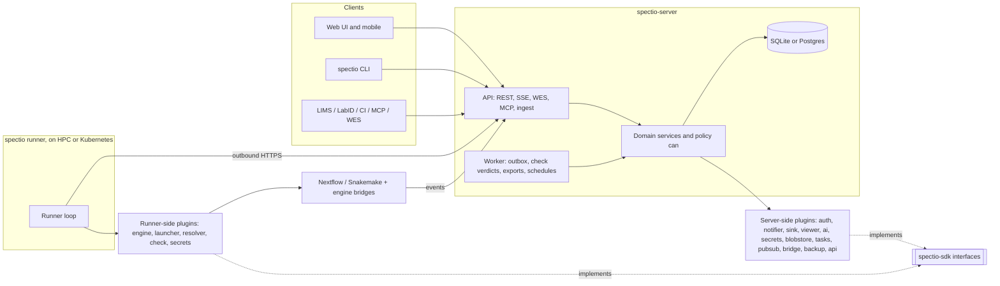

# Spectio — plugin architecture and packaging

Status: draft v0.1 · 2026-10-25 · author: Thomas Weber (with Claude)
Companion docs: [`api-and-data-model.md`](api-and-data-model.md) (§3 plugin kinds, §6 identity, §13 depictio), [`synthesis.md`](synthesis.md) (§7 stack), [`cli-and-shared-libraries.md`](cli-and-shared-libraries.md) (CLI, shared client, models and run readers), [`admin-and-operations.md`](admin-and-operations.md) (backups, tasks, logs, health), [`depictio-ecosystem-reuse.md`](depictio-ecosystem-reuse.md), [`decisions/log.md`](../decisions/log.md) (decisions log).

## 0. Decisions in brief

1. **Everything that varies between sites is a plugin.** Workflow engines, where the engine runs (local, SLURM, Kubernetes…), identity, notifications, third-party connections (LabID, depictio, OMERO, Zenodo), checks, viewers, secrets, file storage, background tasks, event bridges (MQTT, RabbitMQ, Kafka) and backup destinations all go through one plugin system. The core only holds the domain: projects, runs, gates, decisions, permissions, events.
2. **Built-ins are plugins too.** Nextflow, Snakemake, single-user auth, email and the local file store use the same interfaces and entry points as third-party plugins. If a built-in cannot be written as a plugin, the interface is incomplete.
3. **Same model as Snakemake, two deliberate differences.** Spectio keeps Snakemake's typed interfaces, settings declared once and turned into CLI flags and env vars, tagged instances, conformance test suites, a scaffold and a catalogue. It changes two things:
   - discovery uses standard Python entry points instead of a module-name scan;
   - one plugin package may provide several kinds, because a third-party connection such as LabID is a resolver, a sink and an inbound API at once.
4. **The relational database is not a plugin.** SQLite and Postgres are both supported behind SQLAlchemy and switched by `SPECTIO_DATABASE_URL` (alias `DATABASE_URL`, §7.3). The infrastructure that really varies (file storage, task backend, pub/sub, secrets, backup destinations) is pluggable.
5. **Plugins never touch the database.** They get a context with a scoped API client, so tenancy and permission checks stay in one place (`can(principal, action, resource)`).
6. **One wheel, three deployments.**
   - `pip install "spectio[server]"` runs everything in one process with SQLite and a local data directory.
   - The Docker image is built from that same wheel, so Docker Compose and the Helm chart change configuration only, never code.

## 1. What Snakemake does (verified in its code)

- **One interface package per plugin type.** Each is semantically versioned and ships its own test suite: `snakemake-interface-executor-plugins`, `-storage-`, `-report-`, `-logger-`, `-software-deployment-` and `-scheduler-plugins` (Snakemake `1c67a66` `pyproject.toml:58`), plus `snakemake-interface-common` for the shared registry. Interfaces are "strongly typed abstract base classes" ([codebase docs](https://snakemake.readthedocs.io/en/stable/project_info/codebase.html)).
- **Discovery by naming.**
  - Packages follow `snakemake-<type>-plugin-<name>`. At start, the registry walks `pkgutil.iter_modules()` and imports every top-level package whose name starts with the type's module prefix, e.g. `snakemake_executor_plugin_`.
  - It does not use entry points. A comment in the code notes that editable installs are not detected ([plugin_registry](https://github.com/snakemake/snakemake-interface-common/blob/main/src/snakemake_interface_common/plugin_registry/__init__.py)).
- **Validation at load.** Expected attributes and their base classes are checked, and a missing one raises `InvalidPluginException`.
- **Settings declared once.**
  - Settings are a dataclass. Each field carries metadata (`help` is required; `required`, `env_var`, `type`, `choices`, `nargs`, `parse_func`/`unparse_func`, `subgroup` are optional).
  - The registry derives the CLI flag `--<prefix>-<field>` and the env var `SNAKEMAKE_<PREFIX>_<FIELD>`.
  - Plugins that set `support_tagged_values` accept `TAG::VALUE`, i.e. several configured instances of one plugin, with untagged values as the default ([plugin.py](https://github.com/snakemake/snakemake-interface-common/blob/main/src/snakemake_interface_common/plugin_registry/plugin.py)).
- **Ecosystem tooling.**
  - Snakedeploy scaffolds a plugin with implementation, tests, CI and release automation.
  - The [plugin catalogue](https://snakemake.github.io/snakemake-plugin-catalog/) is built from PyPI, and authors extend their page with `docs/intro.md` and `docs/further.md`.

What Spectio takes: typed contracts, settings → CLI/env/forms, tagged instances, per-interface semantic versioning, conformance suites, scaffold, catalogue.
What it changes: entry points (editable installs, several kinds per package, no import of unrelated packages at start) and per-kind API versions inside a single SDK package (see §4).

## 2. Plugin kinds

| Kind | Entry-point group | Runs on | Built in | Optional plugins |
|---|---|---|---|---|
| Engine | `spectio.engine` | runner (launch) + server (ingest) | nextflow, snakemake | cwl (cwltool/Toil), wdl (miniwdl/Cromwell) |
| Launcher (where the engine head runs) | `spectio.launcher` | runner | local, slurm | lsf, sge, pbs, kubernetes, ssh |
| Input resolver | `spectio.resolver` | runner | `file://`, `https://` | `s3://`, `drs://`, `labid://`, `omero://`, `ena://` |
| Output sink | `spectio.sink` | server or runner | RO-Crate (file) | depictio, LabID, S3 copy, WorkflowHub, Zenodo |
| Check provider | `spectio.check` | runner (source binding: file → values); the verdict (values × thresholds) is computed by the server core, [`checking-scenarios.md`](checking-scenarios.md) §11.1 *(assumed — pending Thomas, inbox #28)* | multiqc, table, json (MultiQC-based and h5ad bindings need the `spectio[checks]` extra, §7.3) | h5ad, vcf, script |
| Evidence viewer | `spectio.viewer` | UI (+ server for data) | html (sandboxed), table, image, pdf | OME-Zarr, IGV, Vitessce |
| Notifier | `spectio.notifier` | server | email, webhook (the delivery code for the project `webhooks` table of [`api-and-data-model.md`](api-and-data-model.md) §7 and §8; subscriptions are rows of that table, not plugin instances *(assumed — pending Thomas, inbox #29)*) | Slack, Mattermost, Teams, Matrix, ntfy |
| Identity provider | `spectio.auth` | server | single-user, local (password + tokens) | OIDC, SAML, depictio JWT, LDAP |
| AI provider | `spectio.ai` | server | — | Anthropic, any OpenAI-compatible endpoint (vLLM, Ollama on EMBL GPUs) |
| Secret backend | `spectio.secrets` | server, runner | encrypted file | env/file refs, HashiCorp Vault, Kubernetes Secrets |
| File store (blobs) | `spectio.blobstore` | server | local directory | any S3-compatible store (SeaweedFS, as in depictio) |
| Task backend (executes background tasks) | `spectio.tasks` | server | in-process, SQL (SQLite / Postgres) | Celery (Redis or RabbitMQ broker) |
| Pub/sub (live events between server processes) | `spectio.pubsub` | server | in-memory, Postgres `LISTEN/NOTIFY` | Redis |
| Event bridge (CloudEvents to and from message systems) | `spectio.bridge` | server | — | MQTT (lab instruments, robots), AMQP / RabbitMQ, Kafka, NATS |
| Backup destination | `spectio.backup` | server | local directory | S3-compatible, SFTP |
| Web analytics (frontend tracker chosen by the instance owner) | `spectio.analytics` | UI (+ server for CSP and public config) | none | GA4, Umami, Plausible, Matomo, PostHog, custom (`telemetry-and-analytics.md` §4) |
| API extension | `spectio.api` | server | — | inbound routes under `/api/v1/ext/<plugin>/` (e.g. LabID callbacks) |
| CLI extension | `spectio.cli` | server, runner | — | extra `spectio <command>` subcommands |

Built-ins ship as modules of `spectio` or `spectio-server`, not as separate distributions (§6). *(assumed — pending Thomas, inbox #29)*

**Model endpoints.** Each configured AI-provider instance is a model endpoint: a hosted provider API, or a self-hosted OpenAI-compatible server, possibly started as a GPU job by `spectio ai serve` ([`ui-spec.md`](ui-spec.md) §4.9). Endpoints and the default limits for agents are managed under `/admin/ai/*` ([`admin-and-operations.md`](admin-and-operations.md) §5). *(assumed — pending Thomas, inbox #29)*

**`drs://` and the engines.** For Nextflow runs, `drs://` URIs are passed through to the engine: `nextflow-io/nf-ga4gh` 1.5.0 (2026-07-02) accepts them directly as process inputs, its DRS file system is read-only, and under the TES executor the URI is passed straight through (README:120-153). The `drs://` resolver is then used only for pre-flight checks and checksums. For Snakemake runs the resolver stages the object, because the Snakemake storage plugin catalogue has no DRS plugin (checked 2026-10-26). DRS is at 1.5.0 (`fe25c39`). Sources: [landscape note](../research/landscape-2026-10-26.md) §8.

**Plugins for Spectio vs Spectio plugins for engines.** The engine-side bridges are not Spectio plugins. They live in each engine's own ecosystem:
- `snakemake-logger-plugin-spectio` on PyPI, installed in the Snakemake environment;
- `nf-spectio` in the Nextflow plugin registry.

The `spectio.engine` plugin for each engine wires them in: it generates the config that enables them, and it maps their events on the server. How the bridges send events, fail and which engine versions they support: §13.

**Snakemake: add `spectio` to the user's loggers, never replace them.** `--logger` takes a list (`nargs="+"`, "Specify one or more custom loggers", snakemake `1c67a66`, `src/snakemake/cli.py:1623-1628`), and the current docs say several logger plugins can be used at once (`docs/executing/monitoring.rst`). A profile only sets default command-line arguments (`cli.py:1916`, configargparse), so an explicit `--logger spectio` replaces a profile's `logger: [snkmt]` **[to be validated: how configargparse resolves lists, R9 spike 1]**, and a repeated `--logger a --logger b` may keep only `b` **[to be validated]**. On the API path, handlers come only from `settings.log_handler_settings` (`src/snakemake/logging.py:648`), so a profile Spectio does not read is ignored there. The Snakemake adapter therefore reads the effective loggers (command line, `--profile`, `--workflow-profile`, `workflow/profiles/default`), appends `spectio`, passes their settings through, and emits one `--logger <existing…> spectio`, never a second `--logger`; on the API path it passes the same handlers in `log_handler_settings`. Users of panoptes, snkmt, FlowO or prometheus (12 loggers are in the [plugin catalogue](https://snakemake.github.io/snakemake-plugin-catalog/), [landscape note](../research/landscape-2026-10-26.md) §3) keep their monitor when Spectio launches or adopts their run, as [decision 0001](../decisions/0001-nextflow-through-nf-spectio.md) does for Nextflow.

**Why the database is not on the list.**
- The schema, the Alembic migrations, row-level security and the query semantics are part of the core contract.
- A third database would need its own migration and test matrix, which an outside plugin cannot guarantee. Airflow, Prefect and MLflow share this much: one SQLAlchemy URL and a closed list of supported backends. They differ on migrations: Prefect keeps one Alembic tree per dialect (`21a1f02`); Spectio keeps one tree ([`admin-and-operations.md`](admin-and-operations.md) §4.3). *(assumed — pending Thomas, inbox #28)*
- Internally, services still go through repository interfaces (ports and adapters), never raw SQL. Adding a backend later stays a core change, not a rewrite.

### 2.1 Secrets on runners and in jobs

The secret backend runs on the server and on runners (table above). Credentials a run needs (resolvers, sinks, registries, LabID) reach it as follows *(decided — Thomas, 2026-10-27, inbox #14)*:
- **Per-run credentials.** The runner receives credentials for one run only. Where the secret backend supports it they are derived and short-lived, with the run's lifetime (for example an S3 STS session with a prefix policy, or a Vault dynamic secret **[to be validated per backend]**).
- **Files, never environment exports.** Credentials are written as 0600 files in the run directory and referenced by path. They are never passed through `sbatch --export` or on a command line.
- **Head jobs** are submitted with `--export=NONE` and read a 0600 env file from the run directory ([sbatch](https://slurm.schedmd.com/sbatch.html) **[to be validated]**).
- **Job names and comments** carry the run ID only, never project, sample or workflow names ([`schedulers-and-monitoring.md`](schedulers-and-monitoring.md) §3.1).
- **Site prerequisite.** By default Slurm shows every job to every user: `PrivateData`: "By default, all information is visible to all users", and `AccountingStoreFlags=job_env` stores "a batch job's environment variables used at job submission" in slurmdbd ([slurm.conf](https://slurm.schedmd.com/slurm.conf.html), read 2026-10-26). Spectio recommends `PrivateData=jobs` to sites; with credentials in files and `--export=NONE`, a site that sets `job_env` stores no secret.
- **Test:** a synthetic pipeline that dumps `env` finds no long-lived secret.

Provenance: [R5 SEC-103](../reviews/R5-security.md).

## 3. The plugin contract

### 3.1 Package and discovery

- **Naming.** A distribution is called `spectio-plugin-<name>` and its module `spectio_plugin_<name>`, so the catalogue can find it on PyPI. A package declares one entry point per component it provides, and may provide several kinds:

```toml
# pyproject.toml of spectio-plugin-labid
[project]
name = "spectio-plugin-labid"
dependencies = ["spectio-sdk>=1.2,<2", "httpx>=0.27"]

[project.entry-points."spectio.resolver"]
labid = "spectio_plugin_labid.resolver:LabIDResolver"

[project.entry-points."spectio.sink"]
labid = "spectio_plugin_labid.sink:LabIDSink"

[project.entry-points."spectio.api"]
labid = "spectio_plugin_labid.api:router"
```

- **Loading.**
  - `importlib.metadata.entry_points(group=...)` lists components without importing them. A component is imported only when an enabled instance needs it, so startup stays fast and a broken plugin cannot stop the server.
  - A component that fails to import or validate is shown as **failed**, with its traceback, in Administration → Instance → Plugins (admin §4.2).
- **Name collisions.** If two distributions register the same `kind/name`, the component is addressed as `<distribution>:<name>` and the admin picks one.
- **Allow-list and safe mode.** `plugins.allow` / `plugins.deny` in the config restrict what loads. `spectio serve --safe-mode` loads built-ins only, which is the recovery path after a bad install.

### 3.2 Settings: declared once, used everywhere

Settings are a Pydantic model, since Spectio already uses Pydantic for the API. Each field uses `setting()`, a thin wrapper over `pydantic.Field` that adds Spectio metadata:

```python
from spectio_sdk import Settings, setting
from spectio_sdk.notifier import Notifier, Message, Context, Result, API_VERSION

class MattermostSettings(Settings):
    webhook_url: str = setting(help="Incoming webhook URL", required=True, secret=True)
    channel: str | None = setting(None, help="Override the webhook's default channel")
    mention_on: list[str] = setting(["spectio.gate.opened"], help="Events that @mention the assignee")

class Mattermost(Notifier):
    name = "mattermost"
    api = ">=1.2,<2"            # notifier API versions this plugin supports
    settings_model = MattermostSettings

    async def send(self, msg: Message, ctx: Context) -> Result: ...
    async def healthcheck(self, ctx: Context): ...
```

From that one model Spectio derives:

| Use | Derived form |
|---|---|
| CLI flag | `--notifier-mattermost-webhook-url` |
| Environment variable | `SPECTIO_NOTIFIER_MATTERMOST_WEBHOOK_URL` |
| Config file | `[notifier.mattermost.<instance>]` table in `spectio.toml` |
| Settings form in the UI and API | JSON Schema from the model; `secret=True` fields are write-only and never returned |
| Catalogue page | settings table with help text and defaults |

Secret values are references, never plain text in the database: `env:MM_URL`, `file:/run/secrets/mm`, `vault:kv/spectio#mm`, or a value stored once through the active secret backend.

### 3.3 Instances and scope (Snakemake's tags, made multi-user)

One plugin can have several configured **instances**: two OIDC providers, the EMBL Slack and a core-facility Mattermost, or two SLURM clusters. This is the equivalent of Snakemake's `TAG::VALUE`.

- **Where instances come from.**
  - From the config file. These are read-only in the UI, with a "set in config" badge, which suits GitOps on Kubernetes.
  - From the UI or the API. These are stored in a new `plugin_instances` table: `id`, `kind`, `plugin`, `name`, `scope` (instance / group / project), `scope_id`, `settings` JSON, `secret_refs`, `enabled`, `created_by`, `created_at`, `updated_at`. This table extends the schema in [`api-and-data-model.md`](api-and-data-model.md) §7.
- **Scope rules.**
  - Identity provider, secret backend, file store, task backend, pub/sub, event bridge and backup destination are instance-wide and admin-only.
  - Notifier, sink, resolver, check, viewer and AI provider can also be scoped to a group or a project. A group can then bring its own Slack or LabID credentials without seeing another group's.
- **Single-user mode** has exactly one instance of each, created at first start.

### 3.4 Context instead of globals

Every call receives a `Context`. A plugin never imports server internals.

| `ctx.` | What it gives |
|---|---|
| `settings` | the validated settings of this instance |
| `secrets.get(ref)` | a secret, resolved through the active secret backend |
| `http` | a shared `httpx.AsyncClient` with the instance proxy, CA bundle, timeouts and retries |
| `api` | an in-process client for the public API, acting as the plugin instance's service principal, limited to the scopes the plugin declared |
| `events.publish(...)` | emits a CloudEvent (`spectio.ext.<plugin>.*`) |
| `blobs` | read and write in the file store, under the plugin's prefix |
| `log`, `tmp_dir`, `clock` | structured logging, scratch space, testable time |

The rule "no database session for plugins" is what keeps multi-user safe. Everything a plugin reads or writes goes through the same permission check as the UI.

### 3.5 Events and hooks

- **Selected providers.** Most kinds are providers: Spectio picks one instance and calls its methods (`Engine.plan`, `Launcher.submit`, `Notifier.send`).
- **Event subscriptions.** For "react when something happens", a component declares `subscriptions = ["spectio.run.completed", "spectio.gate.*"]`. Events are delivered through the same outbox as webhooks: at least once, retried with backoff, idempotent by event ID.
- **One delivery path.** An outgoing webhook is a row of the project `webhooks` table ([`api-and-data-model.md`](api-and-data-model.md) §8), delivered by the built-in `webhook` notifier's code through the same outbox (§2) *(assumed — pending Thomas, inbox #29)*. Sinks (RO-Crate to LabID, hand-off to depictio) are triggered the same way.

### 3.6 Core interfaces (sketch)

```python
class Engine:                          # spectio.engine
    name: str                          # "nextflow"
    def detect(self, source) -> Detection             # is this my workflow, which version
    def describe(self, source) -> WorkflowDescription # params schema, stages, samplesheet schema
    def plan(self, launch: LaunchSpec) -> ExecutionPlan  # command, env, generated config (gates → ext.when / --until), monitoring hook-up
    def plan_resume(self, run: RunRef, change_set) -> ExecutionPlan  # -resume / --forcerun from a stage
    def collect(self, run_dir) -> Iterable[Event]     # post-hoc metadata (.snakemake, nf-prov)
    ingest: type[IngestAdapter]                        # server side: native events → Spectio events

class Launcher:                        # spectio.launcher
    def submit(self, plan: ExecutionPlan) -> Handle    # local process, sbatch, Kubernetes Job…
    def status(self, handle) -> HeadState
    def cancel(self, handle) -> None
    def reconcile(self, handles) -> Iterable[Correction]  # e.g. sacct after a runner restart

class Resolver:  def resolve(self, uri, ctx) -> LocalPath     # with checksum, staged copy if needed
class Sink:      async def publish(self, run, artifacts, ctx) -> SinkResult
class CheckProvider: def evaluate(self, files, check_spec) -> ItemMetricTable
class IdentityProvider: async def authenticate(self, request) -> Principal | Redirect
```

Each method has a typed input and output model in `spectio-sdk`. No `dict` crosses the boundary untyped.

## 4. Versioning, tests, scaffold, catalogue

- **One SDK, versioned per kind.**
  - `spectio-sdk` contains all interfaces, settings helpers, event schemas and the testing kit. It depends only on Pydantic.
  - Each kind carries its own `API_VERSION` (`engine 1.3`, `notifier 1.2`…), and a plugin declares the range it supports. The loader refuses an incompatible plugin with a clear message.
  - A minor version adds optional methods with defaults. A major version is a breaking change, and the previous major stays supported for one Spectio minor release (how this relates to the CLI, runner and bridge versions: §12).
  - For the `viewer` kind, the API version also covers the versions of the shared modules the host exposes through its import map (React, Mantine, `@spectio/ui-kit`, §5): a new major of one of them is a `viewer` API major. *(assumed — pending Thomas, inbox #29)*
  - This keeps Snakemake's per-interface semantic versioning without ten separate interface packages. Kinds can still be split into their own packages later if they diverge.
- **Engine-side bridges follow the engine's interface.** `snakemake-logger-plugin-spectio` is not a Spectio plugin and does not use `spectio-sdk` ranges: it declares `snakemake-interface-logger-plugins>=1.2,<3` (interface 1.x and 2.x) and supports Snakemake ≥ 9.0 (§13.4). It reads log records defensively, because Snakemake's `DefaultFilter` changed signature three times within 9.x. The runner checks the Snakemake version it finds and warns when it is outside that range. Tested versions: [`dev-environment-and-testing.md`](dev-environment-and-testing.md) §1 and §6. *(assumed — pending Thomas, inbox #28)*
- **Conformance suites.**
  - `spectio_sdk.testing` provides one base test class per kind: `EngineConformance` (with tiny Nextflow and Snakemake fixture workflows and a fake server), `NotifierConformance`, `SinkConformance`, `IdentityProviderConformance`, and so on.
  - It also provides a `FakeContext` and HTTP mocking with respx ([PyPI](https://pypi.org/project/respx/): "mocking out the Python HTTPX and HTTP Core libraries"); recorded cassettes, if wanted, need a recorder such as vcrpy or pytest-recording **[to be validated]**. A plugin passes when it subclasses the suite and the tests are green, exactly like Snakemake's interface test suites.
- **Scaffold.**
  - `spectio plugin new --kind notifier --name mattermost` renders a Copier template through `uvx copier` (Copier is not a dependency of `spectio`): package layout, entry points, settings model, conformance test, `docs/intro.md`, and GitHub Actions for tests (every supported Python, §7.3, × supported SDK majors) and trusted publishing to PyPI.
  - `copier update` keeps old plugins in line with the template.
- **Catalogue.**
  - A scheduled CI job lists PyPI projects named `spectio-plugin-*` and downloads each latest wheel.
  - From the wheel it reads `entry_points.txt` and the settings JSON Schema (exported at build time into the wheel as `spectio-plugin.json`, so nothing is imported).
  - It publishes one page per plugin: kinds, settings, compatible API versions, plus the author's `docs/intro.md` and `docs/further.md` (Snakemake's convention).
  - Administration → Instance → Plugins ([`admin-and-operations.md`](admin-and-operations.md) §4.2) shows the same information for installed plugins, plus health and instances.

## 5. Frontend plugins (viewers, and later panels)

Three levels, from no JavaScript to full code:

1. **Declarative (most plugins).** Settings forms are generated from JSON Schema. Evidence uses built-in viewers chosen by MIME type or file pattern (table, sandboxed HTML, image, PDF). A notifier, sink or resolver never ships JavaScript.
2. **ESM viewer module.**
   - A viewer plugin ships a prebuilt ES module in its package data (`static/`). The server serves it at `/plugins/<name>/static/<hash>.js`.
   - The UI reads `GET /api/v1/plugins/ui-manifest`, then calls `import()` on the module, which exports `mount(el, {data, theme, api, locale})` and `unmount()`.
   - React, Mantine and `@spectio/ui-kit` are exposed through an import map, so a plugin shares the host's instances and theme instead of bundling its own. This works the same on desktop and mobile. Their versions are part of the `viewer` API version (§4).
3. **Isolated (untrusted or third-party HTML).** The viewer runs in a sandboxed iframe on a separate origin with a `postMessage` bridge, under the same rules as embedded elements ([`api-and-data-model.md`](api-and-data-model.md) §9).

Same-origin JavaScript has full access to the user's session. Level 2 is therefore only for packages the admin installed on purpose. Anything else is level 3.

## 6. Code layout

One git repository, one uv workspace, one release train for the core packages. `spectio-sdk` follows its own semver because plugins depend on it.

```
spectio/
├─ packages/
│  ├─ spectio-sdk/       interfaces, settings, event schemas, testing kit      (deps: pydantic)
│  ├─ spectio/           base install: `spectio` CLI (Typer) + generated Python client + runner daemon and local launcher
│  │                     + built-in runner-side plugins as modules (engines nextflow and snakemake, launchers local and slurm,
│  │                       resolvers file and https, check bindings multiqc / table / json)
│  │                     (deps: the allow-list of cli-and-shared-libraries.md §6; no FastAPI, no SQLAlchemy; < 80 MB env, CI-checked)
│  ├─ spectio-server/    FastAPI app, services, policy, SQLAlchemy + Alembic, worker, bundled web UI
│  │                     + built-in server-side plugins as modules (single-user and local auth, email and webhook notifiers,
│  │                       RO-Crate sink, in-process and SQL task backends, …); pulled by `spectio[server]`, never installed by name
│  └─ spectio-cli/       alias package depending on `spectio` (discoverability, as depictio-cli)
│  (shared with depictio and LabID, see cli-and-shared-libraries.md §4: bioplatform-client, bioplatform-models, bioplatform-runinfo)
├─ plugins/              optional first-party plugins, each its own distribution `spectio-plugin-<name>` in directory `<name>/`
│  ├─ kubernetes/  oidc/  saml/  h5ad/  labid/  s3/   (s3: resolver, blobstore and backup in one package)
│  ├─ depictio/          auth + sink components, one distribution `spectio-plugin-depictio` (§8)
│  ├─ slack/  mattermost/  openai-compatible/
│  └─ celery/  redis/  mqtt/  kafka/  vault/
├─ engine-bridges/
│  ├─ nf-spectio/                         Groovy, Nextflow plugin registry
│  └─ snakemake-logger-plugin-spectio/    PyPI, installed in the Snakemake env
├─ web/                  React + Vite + Mantine 7 + TanStack; `@spectio/ui-kit` for viewer plugins
├─ deploy/
│  ├─ compose/           compose.yaml + profiles + compose.depictio.yaml
│  └─ helm/spectio/      chart (server, worker, runner sub-chart)
└─ templates/plugin/     Copier template used by `spectio plugin new`
```

The web UI stays on Mantine 7, depictio's major (`viewer/package.json:29` `^7.14.0` at depictio `0d1aa0a`), although upstream is at 9.x (`@mantine/core` 9.7.4 on 2026-10-25), so that `depictio-react-core` can be reused (decision log, "Name and branding"). *(assumed — pending Thomas, inbox #29)*

**Built-ins are modules, not distributions.** The built-in plugins of §2 ship as modules of `spectio` (runner side) or `spectio-server` (server side) and register their entry points there, so `uv tool install spectio` is enough on a login node and `spectio[server]` is enough for a server. Each auth or backend extra pulls its plugin distribution: `spectio[oidc]` → `spectio-plugin-oidc`, `[saml]` → `spectio-plugin-saml`, `[s3]` → `spectio-plugin-s3`, `[redis]` → `spectio-plugin-redis`, `[celery]` → `spectio-plugin-celery`. *(assumed — pending Thomas, inbox #29)*

**Dependency rules.** These are checked in CI with import-linter.
- Plugins depend on `spectio-sdk` only, never on `spectio-server` or on the runner modules of `spectio`.
- The runner never imports server code.
- The engine plugins' server-side ingest halves import nothing heavy at module level.
- Check providers run on the runner ([`checking-scenarios.md`](checking-scenarios.md) §11.1). Their heavy dependencies (MultiQC, anndata) are only in the `spectio[checks]` extra, so the base install keeps its < 80 MB budget ([`cli-and-shared-libraries.md`](cli-and-shared-libraries.md) §6). *(assumed — pending Thomas, inbox #28)*



## 7. Packaging and the three deployments

### 7.1 Processes and roles

The server has two roles, `api` and `worker`.
- `spectio serve` runs both in one process.
- `spectio serve --role api` and `spectio serve --role worker` split them.
- `spectio serve --with-runner` also starts a local runner in the same process, which is the default in personal mode.
  - It is one built-in environment of kind `local` with its `runners` row ([`api-and-data-model.md`](api-and-data-model.md) §7), and that environment is the default `environment_id`. The in-process runner consumes the same `runner_commands` rows (api-and-data-model §7), read in-process instead of over the network, so the runner transport decided later (inbox #12) replaces only the transport, not the command contract. *(decided — Thomas, 2026-10-27, inbox #35)*
  - Local heads outlive the server process and are re-adopted at the next start ([`schedulers-and-monitoring.md`](schedulers-and-monitoring.md) §3.1.1). *(decided — Thomas, 2026-10-27, inbox #35)*
- The runner is always its own program on remote machines.

### 7.2 Infrastructure per deployment

| Concern | Python bundle | Docker Compose | Kubernetes (Helm) |
|---|---|---|---|
| Processes | 1 (api + worker + local runner) | api, worker, migrate (one-shot), runner (optional) | api Deployment (replicas, HPA), worker Deployment, migrate Job (pre-install/upgrade hook), runner Deployment |
| Database | SQLite WAL in the data directory | Postgres 18 container | external Postgres (managed, or CloudNativePG) |
| Tasks | in-process, persisted in the `background_tasks` table ([`admin-and-operations.md`](admin-and-operations.md) §3.1) *(assumed — pending Thomas, inbox #29)* | SQL workers on Postgres (`FOR UPDATE SKIP LOCKED`) | SQL workers; Celery plugin optional |
| Live events (SSE across processes) | in memory | Postgres `LISTEN/NOTIFY` | Postgres `LISTEN/NOTIFY`, Redis optional |
| Backups | `spectio backup` to a local directory | worker schedule to a volume or S3 | CronJob or worker schedule to S3 |
| Scheduled jobs | in-process, slot claims in `schedules` | worker, slot claims in `schedules` | worker, slot claims in `schedules`, safe with several replicas (admin §3.1) *(assumed — pending Thomas, inbox #29)* |
| File store | `~/.local/share/spectio/blobs` | named volume, or S3-compatible service (profile) | S3-compatible store or PVC |
| Identity | `single` (bound to 127.0.0.1) | local or OIDC | OIDC / SAML / depictio JWT |
| Secrets | encrypted file, key in the data directory | Docker secrets via `file:` refs | Kubernetes Secrets, Vault plugin |
| TLS / routing | none (localhost) or `spectio serve --tls` | Caddy (profile `proxy`) | Ingress with a configurable path prefix |

- **SQLite runs in one process only.** With SQLite, the server refuses to start a split role or a second replica. It also refuses to start if the database file is on a network file system; the refusal message names the file-system type and the alternatives (a node-local `--data-dir`, a laptop, a VM or a service node, §7.3) (risk register item 1 in [`synthesis.md`](synthesis.md)).
- **One writer, short transactions.** One process is not one connection. All writes go through one writer connection (or queue) that opens `BEGIN IMMEDIATE`, with `busy_timeout` set; every maintenance write is chunked (at most about 50 ms per transaction); a scheduled `wal_checkpoint(TRUNCATE)` runs in reader gaps; `auto_vacuum=INCREMENTAL` is set when the database is created. Why: SQLite allows one writer at a time ([wal.html](https://www.sqlite.org/wal.html) §2.2); upgrading a read transaction to a write one fails with `SQLITE_BUSY` when another connection is writing ([lang_transaction.html](https://www.sqlite.org/lang_transaction.html) §2.1); with always at least one active reader the WAL file grows without bound (wal.html §6). Long writers (a run move, a restore, a migration, log pruning) and long readers (a logical backup, `VACUUM INTO`, SSE replay) would otherwise stall ingest or let the WAL grow by a day's ingest.
- **Run directories.** The default layout is `<data-dir>/runs/<run id>/{launch,work,results}`; the paths are stored on the run ([`api-and-data-model.md`](api-and-data-model.md) §7). *(assumed — pending Thomas, inbox #40)* Note 2026-10-27: when the data directory is on node-local disk of a login node (0.0.1 on a cluster), compute nodes cannot write there, so the run directories go under a runs root on the shared file system, set at `spectio init` ([`dev-environment-and-testing.md`](dev-environment-and-testing.md#153-001-on-a-cluster-architecture-and-safety-without-accounts) §15.3).
- **Boot order.** Open the database; adopt the heads ([`schedulers-and-monitoring.md`](schedulers-and-monitoring.md) §3.1.1); catch up the projector ([`api-and-data-model.md`](api-and-data-model.md) §8.1); replay the spool with a rate cap (§13.1); run the sweep (gate timeouts, leases). Why: these steps share the one writer connection, and state served before the catch-up shows runs that ended during the downtime as running. *(assumed — pending Thomas, inbox #40)*
- **Redis is optional.** No deployment needs it, so Compose has one service fewer than a typical stack.
- **SSE needs HTTP/2 on team servers.** When not used over HTTP/2, a browser opens at most 6 SSE connections, a limit marked 'Won't fix' ([MDN EventSource](https://developer.mozilla.org/en-US/docs/Web/API/EventSource)). The Caddy profile and the Ingress serve HTTP/2. Browsers use HTTP/2 only over TLS, so `http://127.0.0.1` and SSH tunnels stay on HTTP/1.1 **[to be validated in S5]**; one stream per browser ([`api-and-data-model.md`](api-and-data-model.md) §8.3) keeps them under the limit. *(assumed — pending Thomas, inbox #28)*
- **`LISTEN/NOTIFY` is a wake-up, not a bus.** One notifier sends a coalesced wake-up (run ID and max `seq`) at most every 100 ms, outside the ingest transaction; consumers read the tables. Listeners and advisory locks use a direct session connection, never a pooler in transaction mode (Helm value `database.directUrl`, §7.5). Why: a NOTIFY payload must be shorter than 8000 bytes in the default configuration, and when the queue is full, transactions calling `NOTIFY` fail at commit ([NOTIFY, PG 18](https://www.postgresql.org/docs/18/sql-notify.html)); PgBouncer in transaction pooling supports neither LISTEN nor session-level advisory locks ([PgBouncer features](https://www.pgbouncer.org/features.html)); a global lock at commit when NOTIFY runs inside a transaction is reported by [Recall.ai](https://recall.ai/blog/postgres-listen-notify-does-not-scale) and disputed by [DBOS](https://dbos.dev/blog/postgres-listen-notify-scalability), **[to be validated]** on Postgres 18.

### 7.3 Python bundle

```bash
uv tool install --managed-python "spectio[server]"   # or: pipx / pip install "spectio[server]"
spectio init                       # data dir, config, first user, project "default"
spectio serve                      # http://127.0.0.1:8080, UI + API + local runner
spectio plugin install spectio-plugin-slack   # wraps `uv pip install` after a compatibility check
```

- **Python 3.11–3.14.** This is the only place the supported range is declared; the server is tested on 3.13 ([`dev-environment-and-testing.md`](dev-environment-and-testing.md) §1) *(decided — Thomas, 2026-10-27, inbox #26)*. Python 3.10 reached end of life on 2026-10-01 ([PEP 619](https://peps.python.org/pep-0619/)). `uv tool install --managed-python` installs into a uv-managed Python, which embeds a recent SQLite (python-build-standalone `a3f2146` embeds SQLite 3.53.1); without the flag, uv uses a compatible system Python and its SQLite ([uv Python versions](https://docs.astral.sh/uv/concepts/python-versions/), read 2026-10-26). The SQLite version is checked at start (rule: [`api-and-data-model.md`](api-and-data-model.md) §7).
- **The web UI ships inside the wheel.** CI builds it with Vite, and a hatch build hook includes `web/dist` as package data. The sdist carries the prebuilt assets too, so no install path needs Node.
- **Extras keep the default install light.** This is the single list of extras: `spectio[server]` (the server, pulling `spectio-server`), `[postgres]` (psycopg binary), `[s3]`, `[oidc]` (Authlib, through `spectio-plugin-oidc`), `[saml]`, `[redis]`, `[celery]`, `[checks]` (heavy check bindings: MultiQC for `multiqc:` bindings, the h5ad check plugin with anndata), `[keyring]` (OS keyring token source, [`cli-and-shared-libraries.md`](cli-and-shared-libraries.md) §0.3), `[all]`. *(assumed — pending Thomas, inbox #29; `[checks]`: inbox #28)*
  - `[saml]` needs a system dependency whichever library is chosen: pysaml2 calls the `xmlsec1` binary (pysaml2 7.5.5 `saml2/sigver.py:160`), and python3-saml needs `lxml` built from source against the same libxml2 as `xmlsec` (python3-saml README l.129; the xmlsec 1.3.17 manylinux wheels link libxmlsec1 statically) **[library to be chosen]**. The docs say so, and the container image includes it.
- **On an HPC login node, only the base install:** `uv tool install spectio` (CLI + client + runner, no server extras), then `spectio runner connect <server> --token …`. It has no compiled dependencies beyond Pydantic's wheels (the optional `[keyring]` extra adds `cryptography`, cli §0.3), and no root is needed.
- **The server on a login node** (personal mode) needs an explicit `--data-dir` on node-local, non-purged storage, and is pinned to one hostname. `$HOME` and project space are usually NFS, GPFS or Lustre, where WAL does not work ([wal.html](https://www.sqlite.org/wal.html) §1) and the server refuses to start (§7.2); node-local disks (`/tmp`, `/local`) are usually purged; login aliases round-robin, so the next SSH may land on another node. Otherwise use a laptop, a VM or a service node. EMBL's file systems are **[to be validated]** (spike S12); Docker Desktop bind mounts may also defeat WAL shared memory **[to be validated]**.
- **Configuration has one layered model** (pydantic-settings), lowest priority first:
  1. built-in defaults;
  2. `spectio.toml` (`$SPECTIO_CONFIG`, then `~/.config/spectio/`, then `/etc/spectio/`);
  3. `SPECTIO_*` env vars (naming rule below);
  4. CLI flags.
- **Environment-variable names.**
  - Every setting has one flat name `SPECTIO_<AREA>_<FIELD>` (for example `SPECTIO_AUTH_MODE`, `SPECTIO_TELEMETRY_ENABLED`, `SPECTIO_BRANDING_PRESET`, `SPECTIO_BACKUP_*`), declared explicitly for each field; there is no `__` nesting.
  - `DATABASE_URL` is accepted as an alias of `SPECTIO_DATABASE_URL`.
  - A plugin setting's variable `SPECTIO_<KIND>_<PLUGIN>_<FIELD>` (§3.2) sets only the default (untagged) instance, as untagged values are the default in Snakemake (§1, `plugin.py`); tagged instances come from `spectio.toml` or the UI (§3.3).
  - The CLI's own file is `~/.config/spectio/servers.yaml` ([`cli-and-shared-libraries.md`](cli-and-shared-libraries.md) §3).
- **Operator commands.**
  - `spectio config show --effective` prints every value with its source, secrets masked.
  - `spectio doctor` checks the SQLite version and local disk, the data directory's file-system type (statfs) and the host pin, plugin compatibility, runner reachability, proxy variables and CA bundle for the runner and the engine bridges (§13.6, *assumed — pending Thomas, inbox #12*), and clock skew (warning above 5 s).
- **0.0.1 prerequisites.** The user installs the engines (Java and Nextflow, Snakemake with its SLURM executor plugin) on the login node, for example from the site's modules or a conda environment; Spectio does not install them, and `spectio doctor` reports each one with its version, or names the one that is missing. nf-spectio ships as a jar inside the `spectio` wheel and is passed to Nextflow from there, so it works offline and matches the server version **[to be validated: how a local plugin jar is loaded, in spike T2]**; the Snakemake logger plugin is a dependency of the wheel. *(decided — Thomas, 2026-10-27, inbox #35)*

### 7.4 Docker Compose

- **One image, built from the published wheel** (`FROM python:3.13-slim`, then `uv pip install "spectio[server,postgres,s3,oidc,saml]==X.Y.Z"`). It runs as a non-root user, and the role is chosen by the command. The image contains exactly what `pip install` gives.
- **Profiles:**
  - `minimal`: one `spectio` service with SQLite on a volume. It is the bundle in a container.
  - `team` (default): adds `db` (Postgres 18), `worker` and a one-shot `migrate` service.
  - `proxy`: Caddy with automatic TLS.
  - `s3`: an S3-compatible store.
  - `runner`: a local runner container for demos and small servers.
- **Real runs usually run elsewhere.** Engines run on clusters through remote runners, not inside Compose. The `runner` profile image comes in an `-engines` variant (Java + Nextflow, Snakemake via pixi). A container engine inside it needs either the host Docker socket, which effectively gives root on the host and is documented as such, or Apptainer.
- **Adding plugins:**
  - recommended: a derived image (`FROM ghcr.io/<org>/spectio:X.Y` + `uv pip install …`);
  - for trials: `SPECTIO_EXTRA_PLUGINS="spectio-plugin-slack==1.2.0"`, installed at start with pinned versions and logged as non-reproducible.
- **Object storage.** MinIO's community edition stopped publishing images and binaries in October 2025 and its repository is archived ([It's FOSS](https://itsfoss.com/news/minio-moves-away-from-open-source/)). depictio has already moved to SeaweedFS (`chrislusf/seaweedfs` running `weed mini`, Compose service `s3` with a `minio` network alias, `DEPICTIO_S3_*` settings, and a `scripts/migrate_minio_to_seaweedfs.py` migration). Spectio's `s3` profile uses the same image and version. When the two are co-hosted, they share one SeaweedFS with separate buckets and credentials.

### 7.5 Kubernetes (Helm)

- **Workloads.** The chart `spectio` contains:
  - api Deployment, with probes on `/health/live` and `/health/ready`, plus an HPA;
  - worker Deployment;
  - migrate Job as a Helm pre-install / pre-upgrade hook. The ConfigMap and Secret it reads are rendered as hooks with a lower `helm.sh/hook-weight` (or the Job reads only an existing Secret named in values), because pre-install hooks run "after templates are rendered, but before any resources are created" ([Helm chart hooks](https://helm.sh/docs/topics/charts_hooks/), read 2026-10-26); hook resources are not managed as part of the release;
  - Service and Ingress, whose path prefix is configurable (`/spectio` when co-hosted);
  - a ConfigMap rendered from `values.yaml` into `spectio.toml`, and Secrets for keys;
  - PodSecurity `restricted`, non-root, read-only root file system, and NetworkPolicies.
- **Chart versions and secrets.** Chart versions are semver and immutable: a published chart version is never pushed again (depictio overwrites its OCI chart tags on every main push that touches the chart, `repackage-helm-chart.yaml:1-18,71-75`). The chart `version` equals the app version (`appVersion`); no date versions. Every Secret can come from an `existingSecret`, and the chart never uses `lookup`, which breaks `helm template` and GitOps (depictio `templates/secrets.yaml:12,44-50`).
- **Postgres** is external by default, with an optional CloudNativePG `Cluster`. The chart does not ship a single-pod Postgres for production. When a pooler (PgBouncer) sits in front of it, the value `database.directUrl` gives listeners and advisory locks a direct session connection (§7.2).
- **Runner sub-chart.**
  - A runner Deployment and the two ServiceAccounts with their Roles (runner, engine head) defined in [`schedulers-and-monitoring.md`](schedulers-and-monitoring.md) §4, in a work namespace, used by the `kubernetes` launcher.
  - Nextflow's Kubernetes executor needs a work directory shared by all task pods: an RWX PersistentVolumeClaim, or Fusion.
  - Snakemake's Kubernetes executor assumes no shared file system (`implies_no_shared_fs=True`, snakemake-executor-plugin-kubernetes `d5f720e`, `__init__.py:120-125`): every run needs `--default-storage-provider` and `--default-storage-prefix` (e.g. `s3` and a bucket prefix), or Snakemake refuses to start (`src/snakemake/api.py:546-575`, Snakemake `1c67a66`); the runner sub-chart provides them, with the S3 credentials. An RWX volume serves Nextflow only.
  - The chart exposes the RWX volume (or Fusion) for Nextflow and the object-storage settings for Snakemake.
- **Plugins:** a derived image (recommended), or `plugins.install: [...]` in values, which runs an init container doing `uv pip install --target /plugins` with pinned versions and hashes, mounted on `PYTHONPATH`.
- **Configuration as code.** Plugin instances can be declared under `values.plugins.instances`. They become read-only "set in config" instances (§3.3), so a cluster's notifiers, identity providers and sinks live in Git.

### 7.6 Tasks, events and message brokers (Celery, RabbitMQ, MQTT, Kafka)

Spectio moves three kinds of traffic. Each needs a different tool, so they are kept apart:

| Traffic | Examples | Mechanism | Why |
|---|---|---|---|
| **Background tasks**: work the server must do, with retries | evaluate gate checks, export an RO-Crate, deliver a webhook, run a backup, clean up work directories, re-render thumbnails | a `background_tasks` table (the source of truth; columns owned by [`admin-and-operations.md`](admin-and-operations.md) §3.1) + a pluggable task backend (`spectio.tasks`) | the admin panel must show state, progress, owner and project for every task, whichever backend runs it |
| **Commands to runners**: launch, cancel, resume | "launch run_01JB… on EMBL SLURM" | runner pulls over outbound HTTPS (long poll or SSE) | runners sit behind HPC firewalls with no inbound ports, and a message broker would need one more port opened from every cluster |
| **Events**: facts that already happened | `spectio.run.completed`, `spectio.gate.opened` | outbox → webhooks, SSE, and event bridges (`spectio.bridge`) | many consumers, each at its own pace; CloudEvents has standard bindings for HTTP, MQTT, AMQP, Kafka and NATS |

**Task model.** depictio has the equivalent in its `Job` model.

```
background_tasks(id, kind, project_id, created_by, state: queued|running|succeeded|failed|cancelled|retrying,
      priority, queue, attempts, max_attempts, run_after, idempotency_key, progress {done, total, message},
      result_ref, error {type, message, traceback_ref}, worker_id, started_at, finished_at, created_at)
```

**Task backends.**

| Backend | Deployment | Notes |
|---|---|---|
| `inprocess` (built in) | Python bundle | asyncio workers inside `spectio serve`; the `background_tasks` table keeps the queue across restarts; SQLite |
| `sql` (built in) | Compose, Kubernetes | `spectio serve --role worker` processes claim rows with `FOR UPDATE SKIP LOCKED`, are woken by `LISTEN/NOTIFY`, and run scheduled tasks by a unique slot claim in `schedules(schedule_key, slot_start)` (admin §3.1), which also works on SQLite. No extra service |
| `celery` (plugin `spectio-plugin-celery`) | sites that already run Celery, or co-hosting with depictio | Redis or RabbitMQ as broker. Workers still write state into the `background_tasks` table, so the admin panel and API are unchanged; Flower can be added for Celery-level monitoring |

- **Why not Celery by default.**
  - Celery's stable brokers are RabbitMQ, Redis and Amazon SQS. Kafka is listed as experimental, and there is no SQL broker ([Celery docs](https://docs.celeryq.dev/en/stable/getting-started/backends-and-brokers/)).
  - So a pip-only install would have to download and run a Redis server. depictio does exactly that through py-rattler in `depictio local up`, and its design notes explain why removing Redis there would cost 14 call sites.
  - Spectio's task volume (checks, exports, deliveries) fits a SQL queue, and it starts without that constraint.
- **Libraries considered.**
  - Huey has SQLite, Postgres and Redis storages, periodic tasks, retries and locks, but it keeps its own tables and is not asyncio-native ([Huey API](https://huey.readthedocs.io/en/stable/api.html)).
  - Procrastinate is Postgres-only ([docs](https://procrastinate.readthedocs.io)).
  - taskiq is async-native with brokers for Redis, RabbitMQ, NATS and Kafka ([PyPI](https://pypi.org/project/taskiq/)).
  - The `sql` backend is small enough to own: a few hundred lines on top of the domain database, with the `background_tasks` table already needed by the admin panel. taskiq is the fallback if more brokers are wanted later.
- **Event bridges, each optional:**
  - **MQTT** (e.g. Mosquitto): instruments, robots and lab-automation controllers that speak MQTT.
    - Outbound topics follow `spectio/<project>/<type>`, e.g. `spectio/prj_…/gate/opened`, with QoS 1.
    - Inbound, a robot can publish a gate signal or a launch request. The bridge maps it to the same API call with the bridge instance's service principal, so policy and the audit log apply unchanged.
  - **AMQP / RabbitMQ:** institute integration buses. One topic exchange, routing key = event type.
  - **Kafka:** institute data platforms and analytics. One topic per event family, CloudEvents Kafka binding, key = run ID so events stay ordered per run.
  - **NATS:** lightweight sites that already run it.

  Bridges read from the same outbox as webhooks: at least once, with event IDs for de-duplication.

## 8. depictio alignment

- **Different internals, one platform.** depictio uses MongoDB, S3 + Delta, Celery and Redis. Spectio uses SQL and does not need Redis. Only identity, tokens, the API and the routing conventions are shared ([`api-and-data-model.md`](api-and-data-model.md) §13).
- **Co-hosting.**
  - `deploy/compose/compose.depictio.yaml` joins depictio's Compose network behind one reverse proxy, with `/depictio` and `/spectio` path routing, and gives Spectio depictio's JWT public key.
  - In Helm, both charts use the same Ingress host with different path prefixes.
- **depictio as plugins.** The integration is two plugins in one package, `spectio-plugin-depictio`: an `auth` component that trusts depictio JWTs, and a `sink` component that hands a run off with `depictio-cli ingest --triggered-by spectio`. A Spectio install without depictio carries none of it. The package declares the depictio server versions it supports as metadata, checked at runtime against `GET /depictio/api/v1/utils/status`, not as a Python dependency on `depictio`: depictio published 23 version tags between 2026-10-05 and 2026-10-23 (R8b DEP-T-017). *(decided — Thomas, 2026-10-27, inbox #22)*
- **Shared Redis is possible but never required.** If depictio's Redis is already there, Spectio can use it through the `spectio-plugin-redis` plugin (and Celery through `spectio-plugin-celery`), on a separate database index.

## 9. Phasing

| Phase | Plugin system | Packaging |
|---|---|---|
| MVP | `spectio-sdk` with engine, launcher (local, slurm), check, notifier (email, webhook), auth (single, local); entry-point loader; settings → CLI/env/TOML | Python bundle only; `spectio` (CLI + runner) and `spectio-server` on PyPI |
| 1b | instances and scopes in the UI, conformance kit, `spectio plugin new`, OIDC, SQL task workers on Postgres, backup and restore, sinks (RO-Crate, depictio) | Docker image from the wheel, Compose profiles `minimal` / `team` / `proxy` |
| 2 | viewer ESM modules, SAML, resolver and sink for LabID, AI providers, catalogue site | Helm chart with runner sub-chart, CloudNativePG option, `compose.depictio.yaml` |
| 3 | CWL / WDL engines, Vault, Celery and Redis plugins, event bridges (MQTT, Kafka, AMQP), extra launchers (LSF, SGE, PBS) | multi-replica hardening (signed images and SBOM moved to the first published image: [`dev-environment-and-testing.md`](dev-environment-and-testing.md) §12) *(decided — Thomas, 2026-10-27, inbox #26)* |

## 10. Risks

1. **Interface churn breaks third-party plugins.** Per-kind versions, one minor of overlap, conformance suites run in each plugin's CI against the next SDK release candidate.
2. **A plugin bypasses tenancy.** No database access, a scoped API client, and the declared scopes are shown when an admin enables the plugin.
3. **A plugin slows startup or crashes the server.** Lazy loading, import time measured and shown in Administration → Instance → Plugins, failures isolated, safe mode.
4. **Plugins installed at start make deployments non-reproducible.** Derived images are the documented path; the start-up install requires pinned versions and logs a warning.
5. **Same-origin viewer JavaScript.** Admin-installed only; everything else is sandboxed (§5).
6. **Too many packages for one maintainer.** One repository and workspace, one template, shared CI. First-party plugins are released together with the core; third-party plugins follow the SDK.

## 11. Open questions

1. Should the UI let an admin install a plugin, or only show what is installed? Proposed answer: show only, for now, because installing from a browser means running arbitrary code from the web.
2. Should the SDK be split per kind now, like Snakemake? Proposed answer: no, revisit if two kinds need different release cadences.
3. Does EMBL's Kubernetes provide RWX storage for Nextflow work directories, or should Fusion / S3 work directories be the default?
4. ~~Should depictio and Spectio standardise on SeaweedFS or Garage for the S3 profile?~~ Settled: SeaweedFS, which depictio already uses.

## 12. Compatibility between components

*(assumed — pending Thomas, inbox #28)*

| Pair | Before 1.0 | From 1.0 | Where it is checked |
|---|---|---|---|
| CLI ↔ server | same minor (patch may differ); otherwise the CLI stops with exit code 6 and an upgrade hint | server N accepts CLI N and N−1 | `GET /version` at start ([`cli-and-shared-libraries.md`](cli-and-shared-libraries.md) §1) |
| Runner ↔ server | same minor; otherwise registration and heartbeats are refused and the runner shows as incompatible ([`admin-and-operations.md`](admin-and-operations.md) §3.2) | N and N−1 | heartbeat version |
| Engine bridge (`nf-spectio`, Snakemake logger) ↔ ingest schema | own version, separate from the REST API's v1 ([`api-and-data-model.md`](api-and-data-model.md) §14); the server accepts bridges released in the last 12 months, against the current and the previous server minor; bridges are released separately (§2) | same | ingest response (`ingest-version-unsupported`) |
| Plugin ↔ core | a plugin declares only its per-kind `api` range (§4); the `spectio-sdk` package version is independent | same | the loader at start |

Pre-1.0 minors may break the API ([`dev-environment-and-testing.md`](dev-environment-and-testing.md) §12), which is why the CLI and runners must match the server's minor until 1.0.

**Engine bridges ↔ ingest.** Bridge versions are pinned in user environments (conda locks, `nextflow.config` plugin pins), sometimes for years, and are not upgraded with the server. The ingest schema therefore has its own version, separate from the REST API's v1 ([`api-and-data-model.md`](api-and-data-model.md) §14). Proposed window: the server accepts every bridge released in the last 12 months, against the current and the previous server minor. Servers ignore unknown fields. Outside the window the server refuses with `application/problem+json` type `ingest-version-unsupported`, and the run shows 'bridge too old'. The server records the bridge versions of each run (api §7, `runs`). *(assumed — pending Thomas, inbox #28)*

## 13. Engine bridges

`nf-spectio` and `snakemake-logger-plugin-spectio` (§2) run inside the engine's head process. This section owns how they send events, fail and which engine versions they support; the wire format and the testable bounds belong to the ingest contract ([`api-and-data-model.md`](api-and-data-model.md) §14).

### 13.1 Event path: spool first, forwarded by the runner

*(assumed — pending Thomas, inbox #28)*

Each bridge appends its events to a spool in the launch directory (`.spectio/events/*.jsonl`, append-only, rotated). When the network allows, it also posts the same events directly to `POST /ingest/events`; the direct post is an optimisation, not the only path. The runner tails the spool from the login node and forwards what the server has not acknowledged. Event IDs make both paths idempotent (`unique (run_id, event_id)`, api §7). The server never reads the spool, because it never mounts storage ([`checking-scenarios.md`](checking-scenarios.md) §11.1). Note 2026-10-27: in 0.0.1 on a cluster, the built-in runner runs inside the server process on the login node, so that process reads the spool from the shared file system as a runner would; the bridges do not post directly, and spool events are untrusted input ([`dev-environment-and-testing.md`](dev-environment-and-testing.md#153-001-on-a-cluster-architecture-and-safety-without-accounts) §15.3).

Why: in the recommended head-job mode the engine runs on a compute node ([`schedulers-and-monitoring.md`](schedulers-and-monitoring.md) §3.1), and many HPC sites filter egress from compute nodes **[to be validated at EMBL]** ([`schedulers-and-monitoring.md`](schedulers-and-monitoring.md) §12).

The forwarder keeps `.spectio/events/.cursor` (file, byte offset, last `source_seq`). On boot it asks the server for the highest stored `source_seq` per (run, producer) ([`api-and-data-model.md`](api-and-data-model.md) §8.2) and forwards from there. Rotation never deletes a file beyond the cursor. The numbers (batch size, replay rate cap, drop counters) belong to the ingest contract (api §14).

### 13.2 Traffic budget

*(assumed — pending Thomas, inbox #28)*

- Batches of at most 500 events or 1 s, whichever comes first, gzip-compressed.
- The full trace record only on terminal events, deltas otherwise.
- `429` and `503` are honoured with `Retry-After`; the bridges never fail the run on ingest errors.
- The spool (§13.1) keeps at least 24 h or 200 MB of events, whichever comes first (the bound the ingest contract sets, api §14); beyond it the oldest non-terminal events are dropped first, terminal events never.
- Each heartbeat carries a dropped-event counter.

Why: each Nextflow task fires `onTaskPending`, `onTaskSubmit`, `onTaskStart` and `onTaskComplete`, plus one `onFilePublish` per published file (`TraceObserverV2.groovy:77-140`, Nextflow `114f1fe`): about 0.45–0.6 M events for a 100 000-task run (R4 scale model, estimate). Grid executors default to `queueSize` 100 and a 1-minute `queueStatInterval` (`AbstractGridExecutor.groovy:68`), so completions arrive in bursts after each queue refresh. A 1-hour outage means 20 000–30 000 events per such run (estimate), too much for an in-JVM queue in a 4 GB head.

### 13.3 Failure semantics and heartbeat

*(assumed — pending Thomas, inbox #28)*

Hooks only enqueue; a sender thread batches and sends (§13.2). The plugin never throws, and never throws `AbortRunException`. Each heartbeat carries the bridge and engine versions, hook counters and an internal-error counter, so the server shows 'bridge degraded' rather than 'head silent' ([`schedulers-and-monitoring.md`](schedulers-and-monitoring.md) §7).

Why: Nextflow calls observers synchronously in a loop, and any `Throwable` other than `AbortRunException` is logged at debug level and swallowed (`Session.groovy:1347-1361`, Nextflow `114f1fe`). A slow HTTP call in a hook blocks Nextflow's own thread (in `onTaskComplete`, the task-polling thread), and a `NoSuchMethodError` after an interface change stops every event with nothing to explain it. `TraceObserverV2` is `@Beta` (`trace/TraceObserverV2.groovy:32`). `TaskEvent` carries the internal classes `TaskHandler handler` and `TraceRecord trace` (`trace/event/TaskEvent.groovy:35,39`), so reading outputs through the handler depends on internals beyond the interface.

### 13.4 Supported engine versions

*(assumed — pending Thomas, inbox #28)*

- **Nextflow ≥ 25.04**, the first release with `TraceObserverV2`: the `v24.10.0` tree has no `*ObserverV2*` file (Nextflow tags read for R4, 2026-10-26). `nf-spectio` declares a `requires` range equal to the versions tested in CI ([`dev-environment-and-testing.md`](dev-environment-and-testing.md) §1, §11). A plugin whose `requires` excludes the running Nextflow aborts the launch ('Failed requirement - Plugin $name requires Nextflow version …', `nf-commons/.../BasePlugin.groovy:52-53`, `114f1fe`), so the runner checks the Nextflow version before launch and refuses below the floor with a clear message. A weekly CI job runs `nf-spectio` against Nextflow `edge` and the latest stable release (dev-env §11).
- **Snakemake ≥ 9.0**: the logger plugin interface arrived in Snakemake 9.0.0 (2025-03-14, 'Logging refactor & add LoggerPluginInterface', `CHANGELOG.md` at `1c67a66`). `snakemake-logger-plugin-spectio` supports logger interface 1.x and 2.x (declared range: §4): `snakemake-interface-logger-plugins` had breaking releases 0.2.0 (2025-02-12), 1.0.0 (2025-03-10) and 2.0.0 (2025-09-28, 'All LogHandlerBase subclasses must now implement the emit() method') (`CHANGELOG.md`, `f27aaf1`), and Snakemake accepts `>=1.1.0,<3.0.0` (`pyproject.toml:57`, `1c67a66`). Snakemake ≤ 8, still common in site modules **[to be validated]**, is not supported. When the Snakemake environment is read-only (a site module), `pip install` of the plugin fails, so the runner puts the logger plugin on `PYTHONPATH`; plugin discovery on module prefixes (§1) is **[to be validated]**.

### 13.5 Payload content

*(assumed — pending Thomas, inbox #28)*

`nf-spectio` sends `script` and `env` at most once per task, or never (the runner reads `.command.sh` on demand), and each event has a payload cap ([`api-and-data-model.md`](api-and-data-model.md) §14). The full trace record goes only with terminal events (§13.2). Retention on the server: api §8.4.

### 13.6 Network: proxies and CA bundles

*(assumed — pending Thomas, inbox #12)*

The bridges and the runner read the proxy variables (`https_proxy`, `HTTPS_PROXY`, `no_proxy`) and a configurable CA bundle. `nf-spectio` maps the proxy variables into its HTTP client, because the JVM ignores `https_proxy` unless the plugin maps it **[to be validated]**. An institute CA is often missing from Java's trust store and from certifi. `spectio doctor` checks both (§7.3).

### 13.7 Log sources per engine

*(assumed — pending Thomas, inbox #40)*

The runner reads these files on demand; the UI's Tasks and Logs tabs ([`ui-spec.md`](ui-spec.md) §4.4) show them. Each source is **[to be validated]** until spike T1.

| Log | Nextflow | Snakemake |
|---|---|---|
| Task log | work-directory files `.command.out`, `.command.err`, `.command.log` | the rule's `log:` files, or "no per-task log, see the run log at line N" |
| Run log | `.nextflow.log` | `.snakemake/log/*.log` |
| Head stdout / stderr | `.spectio/head.out`, `.spectio/head.err` ([`schedulers-and-monitoring.md`](schedulers-and-monitoring.md) §3.1.1) | same |

## Sources

- Snakemake: [codebase and architecture](https://snakemake.readthedocs.io/en/stable/project_info/codebase.html), [plugin registry (`snakemake-interface-common`)](https://github.com/snakemake/snakemake-interface-common/blob/main/src/snakemake_interface_common/plugin_registry/__init__.py), [plugin settings and tags](https://github.com/snakemake/snakemake-interface-common/blob/main/src/snakemake_interface_common/plugin_registry/plugin.py), [executor plugins](https://snakemake.readthedocs.io/en/stable/executing/executors.html), [plugin catalogue](https://snakemake.github.io/snakemake-plugin-catalog/)
- Python packaging: [entry points specification](https://packaging.python.org/en/latest/specifications/entry-points/)
- Object storage: [MinIO moves away from open source (It's FOSS)](https://itsfoss.com/news/minio-moves-away-from-open-source/)
