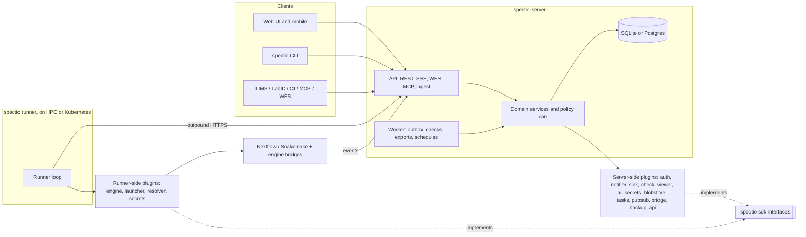

# Spectio — plugin architecture and packaging

Status: draft v0.1 · 2026-10-25 · author: Thomas Weber (with Claude)
Companion docs: [`api-and-data-model.md`](api-and-data-model.md) (§3 plugin kinds, §6 identity, §13 depictio), [`synthesis.md`](synthesis.md) (§7 stack), [`cli-and-shared-libraries.md`](cli-and-shared-libraries.md) (CLI, shared client, models and run readers), [`admin-and-operations.md`](admin-and-operations.md) (backups, tasks, logs, health), [`depictio-ecosystem-reuse.md`](depictio-ecosystem-reuse.md), [`decisions/log.md`](../decisions/log.md) (decisions log).

## 0. Decisions in brief

1. **Everything that varies between sites is a plugin.** Workflow engines, where the engine runs (local, SLURM, Kubernetes…), identity, notifications, third-party connections (LabID, depictio, OMERO, Zenodo), checks, viewers, secrets, file storage, background tasks, event bridges (MQTT, RabbitMQ, Kafka) and backup destinations all go through one plugin system. The core only holds the domain: projects, runs, gates, decisions, permissions, events.
2. **Built-ins are plugins too.** Nextflow, Snakemake, single-user auth, email and the local file store use the same interfaces and entry points as third-party plugins. If a built-in cannot be written as a plugin, the interface is incomplete.
3. **Same model as Snakemake, two deliberate differences.** Spectio keeps Snakemake's typed interfaces, settings declared once and turned into CLI flags and env vars, tagged instances, conformance test suites, a scaffold and a catalogue. It changes two things:
   - discovery uses standard Python entry points instead of a module-name scan;
   - one plugin package may provide several kinds, because a third-party connection such as LabID is a resolver, a sink and an inbound API at once.
4. **The relational database is not a plugin.** SQLite and Postgres are both supported behind SQLAlchemy and switched by `DATABASE_URL`. The infrastructure that really varies (file storage, task backend, pub/sub, secrets, backup destinations) is pluggable.
5. **Plugins never touch the database.** They get a context with a scoped API client, so tenancy and permission checks stay in one place (`can(principal, action, resource)`).
6. **One wheel, three deployments.**
   - `pip install spectio` runs everything in one process with SQLite and a local data directory.
   - The Docker image is built from that same wheel, so Docker Compose and the Helm chart change configuration only, never code.

## 1. What Snakemake does (verified in its code)

- **One interface package per plugin type.** Each is semantically versioned and ships its own test suite: `snakemake-interface-executor-plugins`, `-storage-`, `-report-`, `-logger-`, `-software-deployment-`, plus `snakemake-interface-common` for the shared registry. Interfaces are "strongly typed abstract base classes" ([codebase docs](https://snakemake.readthedocs.io/en/stable/project_info/codebase.html)).
- **Discovery by naming.**
  - Packages follow `snakemake-<type>-plugin-<name>`. At start, the registry walks `pkgutil.iter_modules()` and imports every top-level package whose name starts with the type's module prefix, e.g. `snakemake_executor_plugin_`.
  - It does not use entry points. A comment in the code notes that editable installs are not detected ([plugin_registry](https://github.com/snakemake/snakemake-interface-common/blob/main/src/snakemake_interface_common/plugin_registry/__init__.py)).
- **Validation at load.** Expected attributes and their base classes are checked, and a missing one raises `InvalidPluginException`.
- **Settings declared once.**
  - Settings are a dataclass. Each field carries metadata (`help` is required; `required`, `env_var`, `type`, `choices`, `nargs`, `parse_func`/`unparse_func`, `subgroup` are optional).
  - The registry derives the CLI flag `--<prefix>-<field>` and the env var `SNAKEMAKE_<PREFIX>_<FIELD>`.
  - Plugins that set `support_tagged_values` accept `TAG::VALUE`, i.e. several configured instances of one plugin, with untagged values as the default ([plugin.py](https://github.com/snakemake/snakemake-interface-common/blob/main/src/snakemake_interface_common/plugin_registry/plugin.py)).
- **Ecosystem tooling.**
  - Snakedeploy scaffolds a plugin with implementation, tests, CI and release automation.
  - The [plugin catalogue](https://snakemake.github.io/snakemake-plugin-catalog/) is built from PyPI, and authors extend their page with `docs/intro.md` and `docs/further.md`.

What Spectio takes: typed contracts, settings → CLI/env/forms, tagged instances, per-interface semantic versioning, conformance suites, scaffold, catalogue.
What it changes: entry points (editable installs, several kinds per package, no import of unrelated packages at start) and per-kind API versions inside a single SDK package (see §4).

## 2. Plugin kinds

| Kind | Entry-point group | Runs on | Built in | Optional plugins |
|---|---|---|---|---|
| Engine | `spectio.engine` | runner (launch) + server (ingest) | nextflow, snakemake | cwl (cwltool/Toil), wdl (miniwdl/Cromwell) |
| Launcher (where the engine head runs) | `spectio.launcher` | runner | local, slurm | lsf, sge, pbs, kubernetes, ssh |
| Input resolver | `spectio.resolver` | runner | `file://`, `https://` | `s3://`, `drs://`, `labid://`, `omero://`, `ena://` |
| Output sink | `spectio.sink` | server or runner | RO-Crate (file) | depictio, LabID, S3 copy, WorkflowHub, Zenodo |
| Check provider | `spectio.check` | server | multiqc, table, json | h5ad, vcf, script |
| Evidence viewer | `spectio.viewer` | UI (+ server for data) | html (sandboxed), table, image, pdf | OME-Zarr, IGV, Vitessce |
| Notifier | `spectio.notifier` | server | email, webhook | Slack, Mattermost, Teams, Matrix, ntfy |
| Identity provider | `spectio.auth` | server | single-user, local (password + tokens) | OIDC, SAML, depictio JWT, LDAP |
| AI provider | `spectio.ai` | server | — | Anthropic, any OpenAI-compatible endpoint (vLLM, Ollama on EMBL GPUs) |
| Secret backend | `spectio.secrets` | server, runner | encrypted file | env/file refs, HashiCorp Vault, Kubernetes Secrets |
| File store (blobs) | `spectio.blobstore` | server | local directory | any S3-compatible store (SeaweedFS, as in depictio) |
| Task backend (executes background tasks) | `spectio.tasks` | server | in-process, SQL (SQLite / Postgres) | Celery (Redis or RabbitMQ broker) |
| Pub/sub (live events between server processes) | `spectio.pubsub` | server | in-memory, Postgres `LISTEN/NOTIFY` | Redis |
| Event bridge (CloudEvents to and from message systems) | `spectio.bridge` | server | — | MQTT (lab instruments, robots), AMQP / RabbitMQ, Kafka, NATS |
| Backup destination | `spectio.backup` | server | local directory | S3-compatible, SFTP |
| Web analytics (frontend tracker chosen by the instance owner) | `spectio.analytics` | UI (+ server for CSP and public config) | none | GA4, Umami, Plausible, Matomo, PostHog, custom (`telemetry-and-analytics.md` §4) |
| API extension | `spectio.api` | server | — | inbound routes under `/api/v1/ext/<plugin>/` (e.g. LabID callbacks) |
| CLI extension | `spectio.cli` | server, runner | — | extra `spectio <command>` subcommands |

**Plugins for Spectio vs Spectio plugins for engines.** The engine-side bridges are not Spectio plugins. They live in each engine's own ecosystem:
- `snakemake-logger-plugin-spectio` on PyPI, installed in the Snakemake environment;
- `nf-spectio` in the Nextflow plugin registry.

The `spectio.engine` plugin for each engine wires them in: it generates the config that enables them, and it maps their events on the server.

**Why the database is not on the list.**
- The schema, the Alembic migrations, row-level security and the query semantics are part of the core contract.
- A third database would need its own migration and test matrix, which an outside plugin cannot guarantee. Airflow, Prefect and MLflow make the same choice: one SQLAlchemy URL, a short list of supported backends.
- Internally, services still go through repository interfaces (ports and adapters), never raw SQL. Adding a backend later stays a core change, not a rewrite.

## 3. The plugin contract

### 3.1 Package and discovery

- **Naming.** A distribution is called `spectio-plugin-<name>` and its module `spectio_plugin_<name>`, so the catalogue can find it on PyPI. A package declares one entry point per component it provides, and may provide several kinds:

```toml
# pyproject.toml of spectio-plugin-labid
[project]
name = "spectio-plugin-labid"
dependencies = ["spectio-sdk>=1.2,<2", "httpx>=0.27"]

[project.entry-points."spectio.resolver"]
labid = "spectio_plugin_labid.resolver:LabIDResolver"

[project.entry-points."spectio.sink"]
labid = "spectio_plugin_labid.sink:LabIDSink"

[project.entry-points."spectio.api"]
labid = "spectio_plugin_labid.api:router"
```

- **Loading.**
  - `importlib.metadata.entry_points(group=...)` lists components without importing them. A component is imported only when an enabled instance needs it, so startup stays fast and a broken plugin cannot stop the server.
  - A component that fails to import or validate is shown as **failed**, with its traceback, in Settings → Plugins.
- **Name collisions.** If two distributions register the same `kind/name`, the component is addressed as `<distribution>:<name>` and the admin picks one.
- **Allow-list and safe mode.** `plugins.allow` / `plugins.deny` in the config restrict what loads. `spectio serve --safe-mode` loads built-ins only, which is the recovery path after a bad install.

### 3.2 Settings: declared once, used everywhere

Settings are a Pydantic model, since Spectio already uses Pydantic for the API. Each field uses `setting()`, a thin wrapper over `pydantic.Field` that adds Spectio metadata:

```python
from spectio_sdk import Settings, setting
from spectio_sdk.notifier import Notifier, Message, Context, Result, API_VERSION

class MattermostSettings(Settings):
    webhook_url: str = setting(help="Incoming webhook URL", required=True, secret=True)
    channel: str | None = setting(None, help="Override the webhook's default channel")
    mention_on: list[str] = setting(["spectio.gate.opened"], help="Events that @mention the assignee")

class Mattermost(Notifier):
    name = "mattermost"
    api = ">=1.2,<2"            # notifier API versions this plugin supports
    settings_model = MattermostSettings

    async def send(self, msg: Message, ctx: Context) -> Result: ...
    async def healthcheck(self, ctx: Context): ...
```

From that one model Spectio derives:

| Use | Derived form |
|---|---|
| CLI flag | `--notifier-mattermost-webhook-url` |
| Environment variable | `SPECTIO_NOTIFIER_MATTERMOST_WEBHOOK_URL` |
| Config file | `[notifier.mattermost.<instance>]` table in `spectio.toml` |
| Settings form in the UI and API | JSON Schema from the model; `secret=True` fields are write-only and never returned |
| Catalogue page | settings table with help text and defaults |

Secret values are references, never plain text in the database: `env:MM_URL`, `file:/run/secrets/mm`, `vault:kv/spectio#mm`, or a value stored once through the active secret backend.

### 3.3 Instances and scope (Snakemake's tags, made multi-user)

One plugin can have several configured **instances**: two OIDC providers, the EMBL Slack and a core-facility Mattermost, or two SLURM clusters. This is the equivalent of Snakemake's `TAG::VALUE`.

- **Where instances come from.**
  - From the config file. These are read-only in the UI, with a "set in config" badge, which suits GitOps on Kubernetes.
  - From the UI or the API. These are stored in a new `plugin_instances` table: `id`, `kind`, `plugin`, `name`, `scope` (instance / group / project), `scope_id`, `settings` JSON, `secret_refs`, `enabled`, `created_by`, `created_at`, `updated_at`. This table extends the schema in [`api-and-data-model.md`](api-and-data-model.md) §7.
- **Scope rules.**
  - Identity provider, secret backend, file store, task backend, pub/sub, event bridge and backup destination are instance-wide and admin-only.
  - Notifier, sink, resolver, check, viewer and AI provider can also be scoped to a group or a project. A group can then bring its own Slack or LabID credentials without seeing another group's.
- **Single-user mode** has exactly one instance of each, created at first start.

### 3.4 Context instead of globals

Every call receives a `Context`. A plugin never imports server internals.

| `ctx.` | What it gives |
|---|---|
| `settings` | the validated settings of this instance |
| `secrets.get(ref)` | a secret, resolved through the active secret backend |
| `http` | a shared `httpx.AsyncClient` with the instance proxy, CA bundle, timeouts and retries |
| `api` | an in-process client for the public API, acting as the plugin instance's service principal, limited to the scopes the plugin declared |
| `events.publish(...)` | emits a CloudEvent (`spectio.ext.<plugin>.*`) |
| `blobs` | read and write in the file store, under the plugin's prefix |
| `log`, `tmp_dir`, `clock` | structured logging, scratch space, testable time |

The rule "no database session for plugins" is what keeps multi-user safe. Everything a plugin reads or writes goes through the same permission check as the UI.

### 3.5 Events and hooks

- **Selected providers.** Most kinds are providers: Spectio picks one instance and calls its methods (`Engine.plan`, `Launcher.submit`, `Notifier.send`).
- **Event subscriptions.** For "react when something happens", a component declares `subscriptions = ["spectio.run.completed", "spectio.gate.*"]`. Events are delivered through the same outbox as webhooks: at least once, retried with backoff, idempotent by event ID.
- **One delivery path.** An outgoing webhook is just an instance of the built-in `webhook` notifier. Sinks (RO-Crate to LabID, hand-off to depictio) are triggered the same way.

### 3.6 Core interfaces (sketch)

```python
class Engine:                          # spectio.engine
    name: str                          # "nextflow"
    def detect(self, source) -> Detection             # is this my workflow, which version
    def describe(self, source) -> WorkflowDescription # params schema, stages, samplesheet schema
    def plan(self, launch: LaunchSpec) -> ExecutionPlan  # command, env, generated config (gates → ext.when / --until), monitoring hook-up
    def plan_resume(self, run: RunRef, change_set) -> ExecutionPlan  # -resume / --forcerun from a stage
    def collect(self, run_dir) -> Iterable[Event]     # post-hoc metadata (.snakemake, nf-prov)
    ingest: type[IngestAdapter]                        # server side: native events → Spectio events

class Launcher:                        # spectio.launcher
    def submit(self, plan: ExecutionPlan) -> Handle    # local process, sbatch, Kubernetes Job…
    def status(self, handle) -> HeadState
    def cancel(self, handle) -> None
    def reconcile(self, handles) -> Iterable[Correction]  # e.g. sacct after a runner restart

class Resolver:  def resolve(self, uri, ctx) -> LocalPath     # with checksum, staged copy if needed
class Sink:      async def publish(self, run, artifacts, ctx) -> SinkResult
class CheckProvider: def evaluate(self, files, check_spec) -> ItemMetricTable
class IdentityProvider: async def authenticate(self, request) -> Principal | Redirect
```

Each method has a typed input and output model in `spectio-sdk`. No `dict` crosses the boundary untyped.

## 4. Versioning, tests, scaffold, catalogue

- **One SDK, versioned per kind.**
  - `spectio-sdk` contains all interfaces, settings helpers, event schemas and the testing kit. It depends only on Pydantic.
  - Each kind carries its own `API_VERSION` (`engine 1.3`, `notifier 1.2`…), and a plugin declares the range it supports. The loader refuses an incompatible plugin with a clear message.
  - A minor version adds optional methods with defaults. A major version is a breaking change, and the previous major stays supported for one Spectio minor release.
  - This keeps Snakemake's per-interface semantic versioning without ten separate interface packages. Kinds can still be split into their own packages later if they diverge.
- **Conformance suites.**
  - `spectio_sdk.testing` provides one base test class per kind: `EngineConformance` (with tiny Nextflow and Snakemake fixture workflows and a fake server), `NotifierConformance`, `SinkConformance`, `IdentityProviderConformance`, and so on.
  - It also provides a `FakeContext` and recorded HTTP (respx). A plugin passes when it subclasses the suite and the tests are green, exactly like Snakemake's interface test suites.
- **Scaffold.**
  - `spectio plugin new --kind notifier --name mattermost` renders a Copier template: package layout, entry points, settings model, conformance test, `docs/intro.md`, and GitHub Actions for tests (Python 3.11–3.14 × supported SDK majors) and trusted publishing to PyPI.
  - `copier update` keeps old plugins in line with the template.
- **Catalogue.**
  - A scheduled CI job lists PyPI projects named `spectio-plugin-*` and downloads each latest wheel.
  - From the wheel it reads `entry_points.txt` and the settings JSON Schema (exported at build time into the wheel as `spectio-plugin.json`, so nothing is imported).
  - It publishes one page per plugin: kinds, settings, compatible API versions, plus the author's `docs/intro.md` and `docs/further.md` (Snakemake's convention).
  - The admin's Settings → Plugins tab shows the same information for installed plugins, plus health and instances.

## 5. Frontend plugins (viewers, and later panels)

Three levels, from no JavaScript to full code:

1. **Declarative (most plugins).** Settings forms are generated from JSON Schema. Evidence uses built-in viewers chosen by MIME type or file pattern (table, sandboxed HTML, image, PDF). A notifier, sink or resolver never ships JavaScript.
2. **ESM viewer module.**
   - A viewer plugin ships a prebuilt ES module in its package data (`static/`). The server serves it at `/plugins/<name>/static/<hash>.js`.
   - The UI reads `GET /api/v1/plugins/ui-manifest`, then calls `import()` on the module, which exports `mount(el, {data, theme, api, locale})` and `unmount()`.
   - React, Mantine and `@spectio/ui-kit` are exposed through an import map, so a plugin shares the host's instances and theme instead of bundling its own. This works the same on desktop and mobile.
3. **Isolated (untrusted or third-party HTML).** The viewer runs in a sandboxed iframe on a separate origin with a `postMessage` bridge, under the same rules as embedded elements ([`api-and-data-model.md`](api-and-data-model.md) §9).

Same-origin JavaScript has full access to the user's session. Level 2 is therefore only for packages the admin installed on purpose. Anything else is level 3.

## 6. Code layout

One git repository, one uv workspace, one release train for the core packages. `spectio-sdk` follows its own semver because plugins depend on it.

```
spectio/
├─ packages/
│  ├─ spectio-sdk/       interfaces, settings, event schemas, testing kit      (deps: pydantic)
│  ├─ spectio/           base install: `spectio` CLI (Typer) + generated Python client + runner daemon and local launcher
│  │                     (deps: httpx, pydantic, typer, rich; no FastAPI, no SQLAlchemy; < 80 MB env, CI-checked)
│  ├─ spectio-server/    FastAPI app, services, policy, SQLAlchemy + Alembic, worker, bundled web UI (pulled by `spectio[server]`)
│  └─ spectio-cli/       alias package depending on `spectio` (discoverability, as depictio-cli)
│  (shared with depictio and LabID, see cli-and-shared-libraries.md §4: bioplatform-client, bioplatform-models, bioplatform-runinfo)
├─ plugins/              first-party plugins, each its own distribution
│  ├─ engine-nextflow/  engine-snakemake/  launcher-slurm/  launcher-kubernetes/
│  ├─ auth-oidc/  auth-saml/  auth-depictio/
│  ├─ notifier-email/  notifier-slack/  notifier-mattermost/
│  ├─ check-multiqc/  check-h5ad/  sink-rocrate/  sink-depictio/  resolver-s3/  plugin-labid/
│  └─ blobstore-s3/  tasks-celery/  pubsub-redis/  bridge-mqtt/  bridge-kafka/  backup-s3/  secrets-vault/  ai-openai-compatible/
├─ engine-bridges/
│  ├─ nf-spectio/                         Groovy, Nextflow plugin registry
│  └─ snakemake-logger-plugin-spectio/    PyPI, installed in the Snakemake env
├─ web/                  React + Vite + Mantine 7 + TanStack; `@spectio/ui-kit` for viewer plugins
├─ deploy/
│  ├─ compose/           compose.yaml + profiles + compose.depictio.yaml
│  └─ helm/spectio/      chart (server, worker, runner sub-chart)
└─ templates/plugin/     Copier template used by `spectio plugin new`
```

**Dependency rules.** These are checked in CI with import-linter.
- Plugins depend on `spectio-sdk` only, never on `spectio-server` or on the runner modules of `spectio`.
- The runner never imports server code.
- The engine plugins' server-side ingest halves import nothing heavy at module level.



## 7. Packaging and the three deployments

### 7.1 Processes and roles

The server has two roles, `api` and `worker`.
- `spectio serve` runs both in one process.
- `spectio serve --role api` and `spectio serve --role worker` split them.
- `spectio serve --with-runner` also starts a local runner in the same process, which is the default in personal mode.
- The runner is always its own program on remote machines.

### 7.2 Infrastructure per deployment

| Concern | Python bundle | Docker Compose | Kubernetes (Helm) |
|---|---|---|---|
| Processes | 1 (api + worker + local runner) | api, worker, migrate (one-shot), runner (optional) | api Deployment (replicas, HPA), worker Deployment, migrate Job (pre-install/upgrade hook), runner Deployment |
| Database | SQLite WAL in the data directory | Postgres 18 container | external Postgres (managed, or CloudNativePG) |
| Tasks | in-process, persisted in the `tasks` table | SQL workers on Postgres (`FOR UPDATE SKIP LOCKED`) | SQL workers; Celery plugin optional |
| Live events (SSE across processes) | in memory | Postgres `LISTEN/NOTIFY` | Postgres `LISTEN/NOTIFY`, Redis optional |
| Backups | `spectio backup` to a local directory | worker schedule to a volume or S3 | CronJob or worker schedule to S3 |
| Scheduled jobs | in-process | worker, Postgres advisory lock | worker, Postgres advisory lock (safe with several replicas) |
| File store | `~/.local/share/spectio/blobs` | named volume, or S3-compatible service (profile) | S3-compatible store or PVC |
| Identity | `single` (bound to 127.0.0.1) | local or OIDC | OIDC / SAML / depictio JWT |
| Secrets | encrypted file, key in the data directory | Docker secrets via `file:` refs | Kubernetes Secrets, Vault plugin |
| TLS / routing | none (localhost) or `spectio serve --tls` | Caddy (profile `proxy`) | Ingress with a configurable path prefix |

- **SQLite runs in one process only.** With SQLite, the server refuses to start a split role or a second replica. It also refuses to start if the database file is on a network file system (risk register item 1 in [`synthesis.md`](synthesis.md)).
- **Redis is optional.** No deployment needs it, so Compose has one service fewer than a typical stack.

### 7.3 Python bundle

```bash
uv tool install "spectio[server]"   # or: pipx / pip install "spectio[server]"
spectio init                       # data dir, config, first user, project "default"
spectio serve                      # http://127.0.0.1:8080, UI + API + local runner
spectio plugin install spectio-plugin-slack   # wraps `uv pip install` after a compatibility check
```

- **Python ≥ 3.11.** Python 3.10 reaches end of life in October 2026. `uv tool install` brings its own managed Python, which also embeds a recent SQLite (≥ 3.51.3, checked at start).
- **The web UI ships inside the wheel.** CI builds it with Vite, and a hatch build hook includes `web/dist` as package data. The sdist carries the prebuilt assets too, so no install path needs Node.
- **Extras keep the default install light:** `spectio[postgres]` (psycopg binary), `[s3]`, `[oidc]` (Authlib), `[saml]`, `[redis]`, `[all]`.
  - `[saml]` is the only extra that needs a system library, `xmlsec1`. The docs say so, and the container image includes it.
- **On an HPC login node, only the base install:** `uv tool install spectio` (CLI + client + runner, no server extras), then `spectio runner connect <server> --token …`. It has no compiled dependencies beyond Pydantic's wheels, and no root is needed.
- **Configuration has one layered model** (pydantic-settings), lowest priority first:
  1. built-in defaults;
  2. `spectio.toml` (`$SPECTIO_CONFIG`, then `~/.config/spectio/`, then `/etc/spectio/`);
  3. `SPECTIO_*` env vars, with `__` for nesting;
  4. CLI flags.
- **Operator commands.**
  - `spectio config show --effective` prints every value with its source, secrets masked.
  - `spectio doctor` checks the SQLite version and local disk, plugin compatibility, runner reachability and clock skew.

### 7.4 Docker Compose

- **One image, built from the published wheel** (`FROM python:3.13-slim`, then `uv pip install "spectio[postgres,s3,oidc,saml]==X.Y.Z"`). It runs as a non-root user, and the role is chosen by the command. The image contains exactly what `pip install` gives.
- **Profiles:**
  - `minimal`: one `spectio` service with SQLite on a volume. It is the bundle in a container.
  - `team` (default): adds `db` (Postgres 18), `worker` and a one-shot `migrate` service.
  - `proxy`: Caddy with automatic TLS.
  - `s3`: an S3-compatible store.
  - `runner`: a local runner container for demos and small servers.
- **Real runs usually run elsewhere.** Engines run on clusters through remote runners, not inside Compose. The `runner` profile image comes in an `-engines` variant (Java + Nextflow, Snakemake via pixi). A container engine inside it needs either the host Docker socket, which effectively gives root on the host and is documented as such, or Apptainer.
- **Adding plugins:**
  - recommended: a derived image (`FROM ghcr.io/<org>/spectio:X.Y` + `uv pip install …`);
  - for trials: `SPECTIO_EXTRA_PLUGINS="spectio-plugin-slack==1.2.0"`, installed at start with pinned versions and logged as non-reproducible.
- **Object storage.** MinIO's community edition stopped publishing images and binaries in October 2025 and its repository is archived ([It's FOSS](https://itsfoss.com/news/minio-moves-away-from-open-source/)). depictio has already moved to SeaweedFS (`chrislusf/seaweedfs` running `weed mini`, Compose service `s3` with a `minio` network alias, `DEPICTIO_S3_*` settings, and a `scripts/migrate_minio_to_seaweedfs.py` migration). Spectio's `s3` profile uses the same image and version. When the two are co-hosted, they share one SeaweedFS with separate buckets and credentials.

### 7.5 Kubernetes (Helm)

- **Workloads.** The chart `spectio` contains:
  - api Deployment, with probes on `/health/live` and `/health/ready`, plus an HPA;
  - worker Deployment;
  - migrate Job as a Helm pre-install / pre-upgrade hook;
  - Service and Ingress, whose path prefix is configurable (`/spectio` when co-hosted);
  - a ConfigMap rendered from `values.yaml` into `spectio.toml`, and Secrets for keys;
  - PodSecurity `restricted`, non-root, read-only root file system, and NetworkPolicies.
- **Postgres** is external by default, with an optional CloudNativePG `Cluster`. The chart does not ship a single-pod Postgres for production.
- **Runner sub-chart.**
  - A runner Deployment with a ServiceAccount and a Role that lets it create Jobs and Pods in a work namespace, used by the `kubernetes` launcher.
  - Nextflow's Kubernetes executor needs a work directory shared by all task pods: an RWX PersistentVolumeClaim, or Fusion.
  - Snakemake's Kubernetes executor can use a remote storage plugin (S3) as the default storage provider instead of a shared file system **[to be validated against the executor plugin's docs]**.
  - The chart exposes both options.
- **Plugins:** a derived image (recommended), or `plugins.install: [...]` in values, which runs an init container doing `uv pip install --target /plugins` with pinned versions and hashes, mounted on `PYTHONPATH`.
- **Configuration as code.** Plugin instances can be declared under `values.plugins.instances`. They become read-only "set in config" instances (§3.3), so a cluster's notifiers, identity providers and sinks live in Git.

### 7.6 Tasks, events and message brokers (Celery, RabbitMQ, MQTT, Kafka)

Spectio moves three kinds of traffic. Each needs a different tool, so they are kept apart:

| Traffic | Examples | Mechanism | Why |
|---|---|---|---|
| **Background tasks**: work the server must do, with retries | evaluate gate checks, export an RO-Crate, deliver a webhook, run a backup, clean up work directories, re-render thumbnails | a `tasks` table (the source of truth) + a pluggable task backend (`spectio.tasks`) | the admin panel must show state, progress, owner and project for every task, whichever backend runs it |
| **Commands to runners**: launch, cancel, resume | "launch run_01JB… on EMBL SLURM" | runner pulls over outbound HTTPS (long poll or SSE) | runners sit behind HPC firewalls with no inbound ports, and a message broker would need one more port opened from every cluster |
| **Events**: facts that already happened | `spectio.run.completed`, `spectio.gate.opened` | outbox → webhooks, SSE, and event bridges (`spectio.bridge`) | many consumers, each at its own pace; CloudEvents has standard bindings for HTTP, MQTT, AMQP, Kafka and NATS |

**Task model.** depictio has the equivalent in its `Job` model.

```
tasks(id, kind, project_id, created_by, state: queued|running|succeeded|failed|cancelled|retrying,
      priority, queue, attempts, max_attempts, run_after, idempotency_key, progress {done, total, message},
      result_ref, error {type, message, traceback_ref}, worker_id, started_at, finished_at, created_at)
```

**Task backends.**

| Backend | Deployment | Notes |
|---|---|---|
| `inprocess` (built in) | Python bundle | asyncio workers inside `spectio serve`; the `tasks` table keeps the queue across restarts; SQLite |
| `sql` (built in) | Compose, Kubernetes | `spectio serve --role worker` processes claim rows with `FOR UPDATE SKIP LOCKED`, are woken by `LISTEN/NOTIFY`, and run scheduled tasks under a Postgres advisory lock. No extra service |
| `celery` (plugin `spectio-plugin-celery`) | sites that already run Celery, or co-hosting with depictio | Redis or RabbitMQ as broker. Workers still write state into the `tasks` table, so the admin panel and API are unchanged; Flower can be added for Celery-level monitoring |

- **Why not Celery by default.**
  - Celery's stable brokers are RabbitMQ, Redis and Amazon SQS. Kafka is listed as experimental, and there is no SQL broker ([Celery docs](https://docs.celeryq.dev/en/stable/getting-started/backends-and-brokers/)).
  - So a pip-only install would have to download and run a Redis server. depictio does exactly that through py-rattler in `depictio local up`, and its design notes explain why removing Redis there would cost 14 call sites.
  - Spectio's task volume (checks, exports, deliveries) fits a SQL queue, and it starts without that constraint.
- **Libraries considered.**
  - Huey has SQLite, Postgres and Redis storages, periodic tasks, retries and locks, but it keeps its own tables and is not asyncio-native ([Huey API](https://huey.readthedocs.io/en/stable/api.html)).
  - Procrastinate is Postgres-only ([docs](https://procrastinate.readthedocs.io)).
  - taskiq is async-native with brokers for Redis, RabbitMQ, NATS and Kafka ([PyPI](https://pypi.org/project/taskiq/)).
  - The `sql` backend is small enough to own: a few hundred lines on top of the domain database, with the `tasks` table already needed by the admin panel. taskiq is the fallback if more brokers are wanted later.
- **Event bridges, each optional:**
  - **MQTT** (e.g. Mosquitto): instruments, robots and lab-automation controllers that speak MQTT.
    - Outbound topics follow `spectio/<project>/<type>`, e.g. `spectio/prj_…/gate/opened`, with QoS 1.
    - Inbound, a robot can publish a gate signal or a launch request. The bridge maps it to the same API call with the bridge instance's service principal, so policy and the audit log apply unchanged.
  - **AMQP / RabbitMQ:** institute integration buses. One topic exchange, routing key = event type.
  - **Kafka:** institute data platforms and analytics. One topic per event family, CloudEvents Kafka binding, key = run ID so events stay ordered per run.
  - **NATS:** lightweight sites that already run it.

  Bridges read from the same outbox as webhooks: at least once, with event IDs for de-duplication.

## 8. depictio alignment

- **Different internals, one platform.** depictio uses MongoDB, S3 + Delta, Celery and Redis. Spectio uses SQL and does not need Redis. Only identity, tokens, the API and the routing conventions are shared ([`api-and-data-model.md`](api-and-data-model.md) §13).
- **Co-hosting.**
  - `deploy/compose/compose.depictio.yaml` joins depictio's Compose network behind one reverse proxy, with `/depictio` and `/spectio` path routing, and gives Spectio depictio's JWT public key.
  - In Helm, both charts use the same Ingress host with different path prefixes.
- **depictio as plugins.** The integration is two plugins in one package, `spectio-plugin-depictio`: an `auth` component that trusts depictio JWTs, and a `sink` component that hands a run off with `depictio-cli ingest --triggered-by spectio`. A Spectio install without depictio carries none of it.
- **Shared Redis is possible but never required.** If depictio's Redis is already there, Spectio can use it through the `pubsub-redis` plugin (and Celery through `tasks-celery`), on a separate database index.

## 9. Phasing

| Phase | Plugin system | Packaging |
|---|---|---|
| MVP | `spectio-sdk` with engine, launcher (local, slurm), check, notifier (email, webhook), auth (single, local); entry-point loader; settings → CLI/env/TOML | Python bundle only; `spectio` (CLI + runner) and `spectio-server` on PyPI |
| 1b | instances and scopes in the UI, conformance kit, `spectio plugin new`, OIDC, SQL task workers on Postgres, backup and restore, sinks (RO-Crate, depictio) | Docker image from the wheel, Compose profiles `minimal` / `team` / `proxy` |
| 2 | viewer ESM modules, SAML, resolver and sink for LabID, AI providers, catalogue site | Helm chart with runner sub-chart, CloudNativePG option, `compose.depictio.yaml` |
| 3 | CWL / WDL engines, Vault, Celery and Redis plugins, event bridges (MQTT, Kafka, AMQP), extra launchers (LSF, SGE, PBS) | multi-replica hardening, signed images (cosign), SBOM |

## 10. Risks

1. **Interface churn breaks third-party plugins.** Per-kind versions, one minor of overlap, conformance suites run in each plugin's CI against the next SDK release candidate.
2. **A plugin bypasses tenancy.** No database access, a scoped API client, and the declared scopes are shown when an admin enables the plugin.
3. **A plugin slows startup or crashes the server.** Lazy loading, import time measured and shown in Settings → Plugins, failures isolated, safe mode.
4. **Plugins installed at start make deployments non-reproducible.** Derived images are the documented path; the start-up install requires pinned versions and logs a warning.
5. **Same-origin viewer JavaScript.** Admin-installed only; everything else is sandboxed (§5).
6. **Too many packages for one maintainer.** One repository and workspace, one template, shared CI. First-party plugins are released together with the core; third-party plugins follow the SDK.

## 11. Open questions

1. Should the UI let an admin install a plugin, or only show what is installed? Proposed answer: show only in v1, because installing from a browser means running arbitrary code from the web.
2. Should the SDK be split per kind now, like Snakemake? Proposed answer: no, revisit if two kinds need different release cadences.
3. Does EMBL's Kubernetes provide RWX storage for Nextflow work directories, or should Fusion / S3 work directories be the default?
4. ~~Should depictio and Spectio standardise on SeaweedFS or Garage for the S3 profile?~~ Settled: SeaweedFS, which depictio already uses.

## Sources

- Snakemake: [codebase and architecture](https://snakemake.readthedocs.io/en/stable/project_info/codebase.html), [plugin registry (`snakemake-interface-common`)](https://github.com/snakemake/snakemake-interface-common/blob/main/src/snakemake_interface_common/plugin_registry/__init__.py), [plugin settings and tags](https://github.com/snakemake/snakemake-interface-common/blob/main/src/snakemake_interface_common/plugin_registry/plugin.py), [executor plugins](https://snakemake.readthedocs.io/en/stable/executing/executors.html), [plugin catalogue](https://snakemake.github.io/snakemake-plugin-catalog/)
- Python packaging: [entry points specification](https://packaging.python.org/en/latest/specifications/entry-points/)
- Object storage: [MinIO moves away from open source (It's FOSS)](https://itsfoss.com/news/minio-moves-away-from-open-source/)
