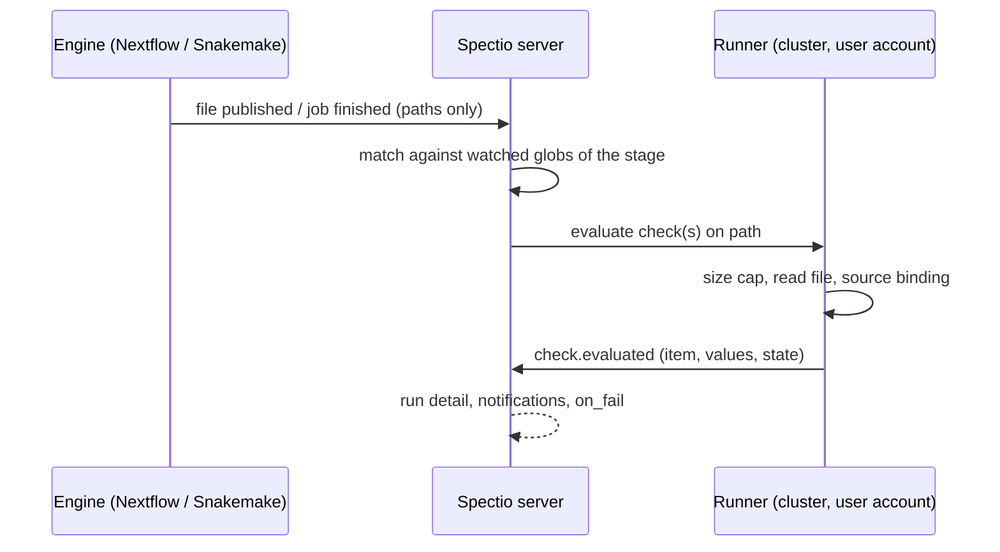

# Spectio — checking scenarios: a generic review model

Status: draft v0.1 · 2026-10-25 · author: Thomas Weber (with Claude)
Companion docs: [`ui-spec.md`](ui-spec.md) §4.5 (Review), [`synthesis.md`](synthesis.md) §5–5ter (gates, interventions), [`api-and-data-model.md`](api-and-data-model.md) §5–7 (gate endpoints and tables).

## 0. Summary

- Basis: the **106 nf-core pipelines** that are released and not archived on 25/10/2026. For each, `modules.json`, `docs/output.md` and `assets/schema_input.json` were read from the repository (method in §10).
- **96 of the 106 produce a MultiQC report.** The MultiQC general-statistics table, one row per sample, is the universal source of checks.
- **86 produce other HTML reports as well**, often one per sample: FastQC, fastp, pycoQC, SnpEff, PCGR/CPSR, igv.js, per-structure reports.
- **25 declare groups** in their samplesheet: tumour/normal pairs, families, replicates, ChIP controls, conditions.
- What a reviewer decides on falls into a small number of **item kinds**:
  - samples, alone or in groups;
  - cells;
  - wells, images or tiles;
  - assemblies or bins;
  - variants;
  - features or taxa;
  - mass-spectrometry runs;
  - predictions.
- They fall into three **scales**:
  - a few items, decided one by one;
  - many items, decided by rules plus exceptions;
  - massive numbers, decided by rules only.
- **One generic model** covers them all: *items × checks × evidence × decisions*, declared in `spectio.yml`.
- **Five review views** cover the whole catalogue:
  - item table;
  - distributions and thresholds;
  - spatial grid;
  - candidate list;
  - report reader.

  All 98 pipelines that have something to review (the other 8 are utilities) fit at least one view. 88 of them get per-sample checks with no extra code, from MultiQC.
- **Stages can be marked important and watched file by file during the run** (§11), without a gate.
- **The main limit is not the UI but the engines.** Redoing *some* items with *different* parameters needs the pipeline to read that parameter per item; otherwise a parameter change applies to all items. §6.3 gives the options.

## 1. Inventory: what a reviewer decides on

| Primary item | Sub-item | Pipelines | Count | Examples |
|---|---|---|---|---|
| Sample (bulk) | — | atacseq, chipseq, cutandrun, methylseq, rnaseq, smrnaseq, riboseq, nanoseq, ampliseq, eager, hic, demultiplex, differentialabundance, … | 45 | 50–500 samples per run |
| Sample | Assembly / bin / contig | mag, bacass, genomeassembler, genomeqc, viralrecon, viralmetagenome, denovotranscript, metatdenovo, funcscan, isoseq, pangenome, … | 13 | MAG bins with completeness / contamination |
| Sample in groups | Variant | sarek, raredisease, oncoanalyser, rnadnavar, tumourevo, longraredisease, pacvar, rnavar, variantprioritization, variantbenchmarking, createpanelrefs | 11 | tumour/normal pairs, trios |
| Sample | Cell / barcode / clone | scrnaseq, scnanoseq, hadge, pixelator, airrflow | 5 | thousands to millions of cells |
| Image / slide / ROI | Cell / spot | mcmicro, molkart, imcyto, sopa, spatialaxe, lsmquant | 6 | OME-TIFF, masks, Zarr, per-cell tables |
| Image | Tile | rangeland | 1 | satellite mosaics |
| Sample | Feature / taxon | taxprofiler, funcprofiler, metapep, epitopeprediction | 4 | contaminant taxa, host reads |
| MS run | Peptide / feature | diaproteomics, mhcquant, metaboigniter, ribomsqc, proteogenomicsdb | 5 | FDR, identification rates |
| Prediction / model | — | proteinfold, multiplesequencealign, proteinfamilies, proteinannotator, phyloplace, reportho, bacmodel, drugresponseeval | 8 | pLDDT / PAE per model |
| Run only (utility) | — | fetchngs, references, createtaxdb, datasync, seqsubmit, readsimulator, demo, provenancereport | 8 | no item review; at most a run-level check |

Groups that constrain decisions appear in **25 samplesheets**, through columns such as `patient`, `status`, `replicate`, `control`, `condition`, `group`, `family` or `phenotype`. Excluding one member of a group can break the analysis: a normal sample whose tumour stays in the run, a single remaining replicate, a ChIP sample whose input control is gone, or a trio reduced to a duo.

## 2. Scale decides the interaction

| Scale | Typical count | How people decide | Examples |
|---|---|---|---|
| **Few** | 1–200 | Item by item: keep, exclude, redo, with a reason | bulk samples, trios, MS runs, predictions, plates of 96 wells |
| **Many** | 200–10,000 | Rules first, then exceptions on the flagged items | MAG bins, candidate variants after filtering, image fields, peaks per sample |
| **Massive** | > 10,000 | Rules only (thresholds), looked at as distributions, summarised per parent item | cells, barcodes, spots, raw variants, features |

The same run can mix scales. Cell QC, for instance, sets thresholds for the cells (massive), then keeps or excludes each sample (few) according to how many cells pass.

## 3. Evidence: what people look at

| Evidence kind | Where it comes from | Viewer | Notes |
|---|---|---|---|
| Metrics table | MultiQC general stats (`multiqc_data/`, 96 / 106), tool tables (QUAST, CheckM / GUNC, BUSCO, mosdepth, `*.sex_check.csv`, `*_plddt.tsv`, `final_QC.all_samples.csv`) | table, sortable, worst first | the basis of checks |
| HTML report, run level | MultiQC, Cell Ranger `web_summary`, Quarto / R Markdown reports, `report.html` (sopa) | sandboxed report reader | large (MultiQC can be tens of MB): loaded on demand |
| HTML report, per item | FastQC, fastp, pycoQC, SnpEff summaries, PCGR / CPSR, igv.js reports, per-prediction reports (proteinfold) | the same reader, opened from the item | file name carries the item key |
| Images | OME-TIFF, masks, Zarr, PNG overviews (mcmicro, molkart, imcyto, sopa, spatialaxe) | OME-Zarr viewer, overlays | tiles streamed by the runner |
| Matrices | `.h5ad` (scrnaseq, sopa), count tables | distributions, embedding scatter | downsampled for display |
| Genomic tracks | BAM / CRAM, VCF, BigWig | igv.js | streamed with range requests |
| Plots | PNG / SVG / PDF from the pipeline | image viewer | e.g. PCA, density, coverage plots |
| Structures | PDB, PAE matrices | 3D viewer, PAE heatmap | proteinfold |

HTML reports run in a sandboxed iframe from a separate origin, with no access to the Spectio session. AI agents get the metrics, small thumbnails and extracted text, never the raw HTML (prompt-injection risk; see synthesis §5bis).

## 4. Checks: one vocabulary

| Check kind | Meaning | Example |
|---|---|---|
| `min` / `max` / `range` | fixed thresholds | uniquely mapped ≥ 80 %; contamination ≤ 2 % |
| `outlier` | robust deviation from the batch (median ± k·MAD), per group if given | wells whose object size is > 3 MAD from the plate median |
| `relative` | compared with a reference run, a control or the previous run | coverage drop > 30 % versus the previous sequencing of the same patient |
| `consistency` | metadata against data | sex check against the samplesheet; relatedness against the pedigree; tumour/normal identity; inferred against declared strandedness |
| `completeness` | expected items and files are there | every samplesheet row produced its outputs; 96 wells imaged |
| `presence` | something must or must not be found | host reads < 5 %; no reads in the negative control |
| `count` | enough sub-items per parent | ≥ 500 cells passing per sample; ≥ 1 high-quality bin per sample |

Each check has:
- a **scope**: item, group or run;
- a **severity**: `block` (opens the gate), `warn` (shown, does not open it) or `info`;
- a **source binding** that tells Spectio where the value comes from (§7).

Built-in presets for frequent pipelines can ship with Spectio as overlays:

| Pipeline | Preset checks |
|---|---|
| rnaseq | mapped %, rRNA %, strandedness |
| sarek | coverage, duplication, contamination, tumour/normal match |
| scrnaseq | cells per sample, median genes, mitochondrial % |
| mag | completeness and contamination (MIMAG tiers) |
| atacseq | FRiP, TSS enrichment |
| chipseq | FRiP, NSC / RSC |
| methylseq | conversion rate |
| viralrecon | % of the genome at ≥ 10× |
| taxprofiler | host %, negative controls |

## 5. Decisions: one set of verbs

| Level | Verbs | Applies to |
|---|---|---|
| Gate | approve · stop · go back to a stage · reassign · wait for a signal | all |
| Item | keep · exclude (with a reason) · redo (optionally with overrides) · flag (keep, but annotated) · replace input (e.g. a new FASTQ) | few and many |
| Rule | set or change thresholds; the inclusion of each item is derived from the rules | many and massive |
| Group | exclude a whole group; accept a degraded group (trio → duo) after a warning | grouped samples |
| Data | edit the samplesheet, edit parameters, edit a declared intermediate file | all |

**Constraints** are checked before applying. A pair needs both members, a replicate group needs at least N samples, a ChIP sample needs its control, joint calling needs at least two samples. A decision that breaks a constraint is shown as a warning, with the consequences ("variant calling for patient P3 will be skipped").

## 6. How decisions reach the engines

### 6.1 Excluding items
- **Nextflow**: Spectio writes samplesheet v2 without the excluded rows and continues with `-resume`. Tasks for the other items come from the cache; aggregate steps (MultiQC, DESeq2, joint calling) rerun because their inputs changed.
- **Snakemake**: Spectio edits the samples table (or the config), and the rules that depend on it rerun.
- The excluded rows and their reasons are kept in the run record and in the RO-Crate.

### 6.2 Redoing items with the same parameters
Spectio invalidates the tasks of those items (Snakemake `--forcerun` on the item's outputs; Nextflow by changing a per-item key in the samplesheet, or by removing those work directories) and continues.

### 6.3 Redoing items with different parameters
There are three cases:

| Case | When | Effect |
|---|---|---|
| Per-item value | the pipeline reads the parameter from a samplesheet column (nf-core `meta` map) or a per-item config | only those items rerun (the plate example: `diameter` per well) |
| Global change | the parameter is global | every task using it reruns, for all items; Spectio says so before applying |
| Child run for the subset | neither, but the user still wants it | Spectio launches a linked run for the flagged items only, with new parameters; outputs stay separate unless the workflow can merge them |

`spectio.yml` declares which parameters are per-item (`per_item: [diameter]`), so the UI offers only what will actually work.

### 6.4 Thresholds on massive items
- The decision produces a **filter artifact**: a keep list of barcodes or cells, a variant-filter expression, or a bin list.
- Spectio passes it to the next stage through a declared parameter (`apply: {param: cell_filter}`), or attaches it to the run for downstream tools: depictio dashboards, a notebook, another pipeline.
- Example: nf-core/scrnaseq stops at matrices; a cell keep list produced at the gate is what downstream analysis needs.

### 6.5 Edited intermediate files
Covered in [`ui-spec.md`](ui-spec.md) §4.5. Snakemake replaces the output and its consumers rerun; Nextflow needs a declared parameter to feed the edited file back.

## 7. The generic model in `spectio.yml`

```yaml
gates:
  <gate_id>:
    title: Mapping QC
    after_stage: align
    items:                               # what one item is
      source: samplesheet                # samplesheet | table | multiqc | h5ad | images | vcf
      key: sample                        # column / field that identifies an item
      group_by: [patient]                # optional: groups and their constraints
      children:                          # optional sub-items (massive or many)
        kind: cell
        source: { h5ad: "**/{key}_filtered_matrix.h5ad", table: obs }
    checks:
      - { id: mapped, from: "multiqc:star.uniquely_mapped_percent", min: 80, severity: block }
      - { id: rrna,   from: "multiqc:sortmerna.rRNA_pct", max: 10, severity: warn }
      - { id: sex,    kind: consistency, from: "table:**/*.sex_check.csv#sample:predicted_sex", equals: "samplesheet:sex" }
      - { id: cells,  scope: item, kind: count, of: children, where: "pct_counts_mt < 20 and n_genes > 200", min: 500 }
    evidence:
      - { kind: report, path: "multiqc/**/multiqc_report.html" }
      - { kind: report, per_item: true, path: "fastqc/**/{key}*_fastqc.html" }
      - { kind: image,  per_item: true, path: "images/{key}.ome.zarr" }
    decide:
      item_actions: [keep, exclude, redo]
      per_item: [diameter]               # parameters the workflow reads per item
      rules: [ { id: mt_max, on: children, metric: pct_counts_mt, default: 20, apply: { param: max_mito } } ]
      constraints:
        - { kind: pair, by: patient, roles: { status: [0, 1] } }
        - { kind: min_per_group, by: condition, min: 2 }
      humans: [group:rnaseq-core]
      agents: propose
    editable: [ { path: "qc/objects_per_well.tsv", feed: { param: objects_override } } ]
```

Source bindings:
- `multiqc:<module>.<column>`: read from MultiQC's data directory.
- `table:<glob>#<key column>:<value column>`: TSV/CSV.
- `json:<glob>#<JSONPath>`.
- `h5ad:<glob>#obs.<column>`.
- `vcf:<glob>`: through `bcftools stats`.
- `script:<command>`: any program printing `{item: {metric: value}}` as JSON.

Other sources can be added as check-provider plugins.

## 8. Five review views

| View | Scale | Used for | What it shows | Phone |
|---|---|---|---|---|
| **Item table** | few | samples, MS runs, predictions, grouped samples | one row per item, metric columns with check colours, worst first, keep / exclude / redo per row, groups as lanes with constraint warnings | cards, one item per card |
| **Distributions & thresholds** | massive | cells, spots, features, raw variants | per-metric histograms or violins per parent item, draggable thresholds, live "kept / removed" counts per parent, optional embedding scatter (downsampled) | one metric at a time with a slider and the kept count |
| **Spatial grid** | few to many | wells, slides, ROIs, tiles | plate map, slide overview with tiles, image viewer with overlays | compact grid, tap to open the image |
| **Candidate list** | many | bins, candidate variants, structures | ranked list with a scatter of two key metrics (completeness vs contamination, pLDDT vs PAE), accept / reject, an evidence panel per candidate | swipeable cards |
| **Report reader** | any | MultiQC and any HTML report | sandboxed report, with a side panel listing the checks and items; clicking an item filters the report | full screen, side panel as a sheet |

Every gate opens on **Summary**, which shows the checks and run health, followed by the most suitable view as its first tab. The other views are available as tabs when the gate's data supports them.

## 9. Coverage

| Class (from §1) | Pipelines | Views needed | Checks with no extra code |
|---|---|---|---|
| Bulk sample | 45 | item table + report reader | yes (MultiQC) |
| Sample + assembly | 13 | item table + candidate list | mostly (QUAST / BUSCO / CheckM tables need a binding or preset) |
| Grouped samples + variants | 11 | item table with groups + candidate list | yes for sample QC; variant review needs a table / VCF binding |
| Sample + cells | 5 | item table + distributions | partly (h5ad binding) |
| Image + cells / tiles | 7 | spatial grid + distributions | needs table / image bindings (presets for mcmicro, molkart) |
| Sample + features | 4 | item table + distributions | yes for sample QC |
| MS runs | 5 | item table | needs table bindings (2 have no MultiQC) |
| Predictions | 8 | candidate list | needs table bindings |
| Run only | 8 | none (run-level check at most) | — |

All 98 pipelines with something to review fit the five views. 88 of them get per-sample checks from MultiQC alone; the remaining 10 need one table binding in `spectio.yml`, or a preset shipped with Spectio.

Known limits:
- per-item parameter redo depends on the pipeline (§6.3);
- embeddings of millions of cells must be downsampled for display (decisions still apply to all cells through the rules);
- items created by a dynamic step (Snakemake checkpoints, bins found during the run) exist only after that stage, so gates on them must come after it;
- clinical pipelines (raredisease, oncoanalyser, variantprioritization) carry personal data in their reports, so reviewer access follows project roles strictly.

## 10. Method

On 25/10/2026, `https://nf-co.re/pipelines.json` listed 159 repositories, of which 106 were not archived and had at least one release. For each of these, `modules.json`, `docs/output.md` and `assets/schema_input.json` were read from the default branch through a sparse git clone:
- MultiQC was counted when it appears in the modules or in the output documentation;
- group columns were counted from the samplesheet schema;
- HTML reports were taken from the output documentation;
- the item class of each pipeline was assigned by hand from its description, samplesheet and outputs.

The classification is in the working files (`classes.json`, `analysis.json`) and can be regenerated.

## 11. Watched stages and live checks

Gates (§7) are evaluated once, at the end of a stage. This section adds checks that run **while the run is going**, file by file, and a way to mark the stages a lab cares about. Neither needs a gate, and neither stops the run unless asked.

### 11.1 How files reach a check

Three parts, each with one job:

1. **Engines send events, never files.** The events say *which* file has just been written. Spectio never scans the disk to find out.

   | Engine | Event | What it carries | Source |
   |---|---|---|---|
   | Nextflow, plugin `nf-spectio` | `onFilePublish(FilePublishEvent)` | `source` (work dir) and `target` (published) paths, `labels`; one event per file, for `publishDir` and workflow outputs | nextflow `dfa5c1c` (2026-10-22), `TraceObserverV2.groovy:140`, `trace/event/FilePublishEvent.groovy:32-48` |
   | Nextflow, plugin `nf-spectio` | `onTaskComplete(TaskEvent)` | the task handler and trace record (work dir, exit status) | `TraceObserverV2.groovy:99`, `trace/event/TaskEvent.groovy:31-40`; reading the declared outputs through the handler is **[to be validated]** |
   | Nextflow, plugin `nf-spectio` | `onWorkflowOutput(WorkflowOutputEvent)` | output name, value, index file; emitted when the output is complete, so too late for live checks | `TraceObserverV2.groovy:132`, `trace/event/WorkflowOutputEvent.groovy:32-59` |
   | Nextflow, Tower protocol (not used, [decision 0001](../decisions/0001-nextflow-through-nf-spectio.md)) | task records in `/trace/progress` | process, tag, `workdir`, status; **no file names** | [`synthesis.md`](synthesis.md) §2bis |
   | Snakemake, `--logger spectio` | `JOB_INFO` | `jobid`, `rule_name`, `input`, `output`, `log`, `wildcards`; emitted when the job is scheduled | snakemake `1c67a66` (2026-10-19), `src/snakemake/jobs.py:1028-1045` |
   | Snakemake, `--logger spectio` | `JOB_FINISHED` | `job_id` only; Spectio joins it to the `JOB_INFO` of the same job. Not emitted under `--quiet progress` or in a dry run | `src/snakemake/scheduling/job_scheduler.py:90-92, 474-484` |

   Without the Nextflow plugin, Spectio only knows the task's work directory. The runner then lists that directory to match the watched globs: one listing per finished task of a watched stage.

2. **The runner is the only component that reads files.** It runs on the cluster under the user's account ([`synthesis.md`](synthesis.md) §7quater). The server never mounts storage. For a watched file the runner:
   - checks the size cap (default 50 MB per file, set per watch);
   - reads the file, or only the byte range it needs;
   - runs the check's source binding (§7);
   - sends back the values only, over its outbound connection, as a `check.evaluated` event.

   Files on object storage (Snakemake storage plugins, Nextflow on cloud executors) are read through the same storage credentials the run uses **[to be validated]** per provider.

3. **`spectio.yml`, or a lab overlay, says what to read.** A pipeline author writes it next to the pipeline. A lab that does not own the pipeline (most nf-core users) writes an overlay in Spectio (`WorkflowOverlay` board), merged over the author's file. An overlay can add watches, never remove an author's `block` check.



### 11.2 Declaring it

```yaml
stages:
  - id: align
    match: ["*:ALIGN_STAR:*"]              # processes or rules of the stage
    important: true
    watch:
      - id: star_log
        files: "star_salmon/log/{sample}.Log.final.out"   # {key} binds the item, as in §7
        when: task_done                    # task_done | published | stage_done
        checks:
          - { id: unique, from: "multiqc:star.uniquely_mapped_percent", min: 70, severity: warn }
          - { id: multi,  from: "multiqc:star.multimapped_percent", max: 8, severity: warn }
        on_fail: flag                      # notify | flag | open_gate | pause_after_stage
        max_size: 5MB
    gate: false                            # a gate stays optional (§7)
```

| Key | Meaning |
|---|---|
| `important` | The stage is shown first in the run gauge, the run summary and the phone run card. Its start, end, failures and failed live checks are notified to the run's watchers. It changes no behaviour of the run. |
| `watch[].files` | A glob relative to the results directory (published files) or to the task work directory. `{key}` captures the item key so results land on the right sample. |
| `watch[].when` | `task_done`: as soon as the task that writes the file finishes. `published`: on the publish event (Nextflow plugin) or job end (Snakemake). `stage_done`: once, at the end of the stage, for aggregate files such as MultiQC. |
| `watch[].checks` | The check vocabulary of §4 and the source bindings of §7. On a watched file, `multiqc:<module>.<column>` means "run that MultiQC module on this one file", so the live value has the same name and the same parser as the final report **[to be validated]**: start-up time per call, and that `multiqc -m <module> <file>` parses a single file. A `depictio:<module>/<output>#<column>` binding is possible once depictio has per-file recipes (§11.6). |
| `watch[].on_fail` | What to do when a `warn` or `block` check fails. See §11.3. |
| `watch[].max_size` | Files above it are not read; the check shows "too large" instead of a value. |

Checks that compare items with each other (`outlier`, `relative` to the batch) need the whole batch, so they are evaluated per file **as a provisional value** and confirmed at `stage_done`. The run detail labels them "provisional" until then.

### 11.3 What a failed live check does

| `on_fail` | Effect | Needs |
|---|---|---|
| `notify` (default) | A notification to the run's watchers, the item marked red in the run detail. | nothing |
| `flag` | As `notify`, and the item carries a flag into any later gate, the RO-Crate and the depictio hand-off (`spectio_checks`). | nothing |
| `open_gate` | A gate is opened at the end of the stage, even if the stage declares none, with the failed items preselected. | a stage boundary (below) |
| `pause_after_stage` | The run stops cleanly at the end of the stage and waits for a decision. | a stage boundary |

A **stage boundary** is a planned stop, fixed at launch: Snakemake `--until`, or for Nextflow a generated config that sets `ext.when = false` on the processes of later stages ([`ui-spec.md`](ui-spec.md) §5.1, [`synthesis.md`](synthesis.md) §5ter). A live check decides *during* the run, so the boundary must be conditional:
- **Nextflow**: the generated config sets `ext.when` on later stages to a closure that tests a stop file the runner writes (`{ !file("<launch dir>/.spectio/stop-after-align").exists() }`). Tasks created after the file appears are skipped; tasks already running finish. That nf-core modules evaluate such a closure per task, at task creation, is **[to be validated]** on `nf-toy` ([`dev-environment-and-testing.md`](dev-environment-and-testing.md)).
- **Snakemake**: no conditional `--until` exists **[to be validated]**, so Spectio stops the run (SIGINT) once the last job of the stage has finished; running jobs of later stages are lost and rerun on resume.

Spectio says which of the two applies in the overlay editor before the watch is saved.

Live checks never kill a running task and never stop the run in the middle of a stage.

### 11.4 Results, and how the gate reuses them

- Each evaluation is stored as a check result: run, stage, item, check, value, state (`ok`, `warn`, `fail`, `provisional`, `too_large`, `error`), file path and hash, time. Table `check_results` and event `spectio.check.failed` in [`api-and-data-model.md`](api-and-data-model.md) §7–8.
- A gate at the end of the same stage reuses a result when the file hash has not changed, so the numbers seen during the run and at the gate are the same.
- The run detail shows a **Live checks** panel: one row per item, one column per watched check, filled as tasks finish. Boards: `RunLiveChecks` (the panel, nf-core/rnaseq megatest replayed at minute 56) and `WorkflowWatches` (editing `important` and `watch` in a lab overlay).

### 11.5 Limits

- **Cost.** One file read per watched file. A watch on 10,000 per-cell files is refused at save time; watch the per-sample summary instead.
- **Order.** Nextflow runs stages as dataflow, so `align` may still run for one sample while a later stage has started for another. "End of stage" means all tasks matching the stage's `match` globs have finished, which is only known once the upstream channel is closed **[to be validated]**.
- **Observed runs** (started from a terminal, [`ui-spec.md`](ui-spec.md) §6) get live checks only if a runner is registered for the environment that can read the run's directories.
- **Snakemake `temp()` files** may be deleted before the runner reads them; watch a kept output instead.

### 11.6 depictio catalogue and live checks

The depictio catalogue reads STAR and Salmon alignment QC through the run's `multiqc.parquet` (depictio `0d1aa0a`: `depictio/catalog/multiqc/star.yaml` and `multiqc/salmon.yaml`, `find.path_glob: "**/multiqc/multiqc_data/multiqc.parquet"`). MultiQC runs once, at the end of nf-core/rnaseq (in the 3.27.0 megatest, at minute 2,038 of 2,040; `tests/fixtures/megatests/rnaseq/`). Live checks therefore cannot use those catalogue outputs. Two ways out:
- run the MultiQC module on the single file (§11.2), which needs nothing from depictio;
- ask depictio for **per-file recipes** for the tools people watch (STAR `Log.final.out`, Trim Galore and fastp reports, Salmon `meta_info.json`, mosdepth summaries), with the same column names as the MultiQC route. This joins the requests in the [research note](../research/depictio-qc-integration-2026-10-26.md) §3.

