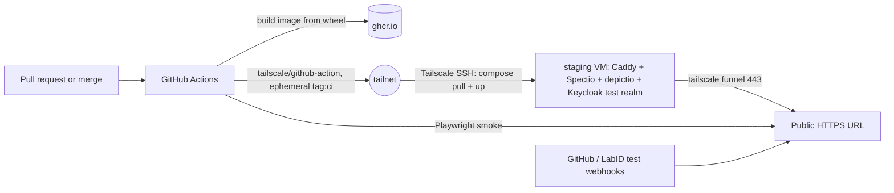

# Spectio — development environment, automation and testing

Status: draft v0.1 · 2026-10-25 · author: Thomas Weber (with Claude)
Companion docs:
- [`schedulers-and-monitoring.md`](schedulers-and-monitoring.md): what is tested against SLURM and Kubernetes.
- [`architecture-plugins-and-packaging.md`](architecture-plugins-and-packaging.md): packages, plugin conformance suites, deployments.
- [`admin-and-operations.md`](admin-and-operations.md): backup compatibility tests.
- `docs/playbooks/next-phase.md`: the order in which this is built.

## 0. Decisions in brief

1. **Agents check their own work against real tools.**
   - Every behaviour Spectio relies on is tested against the real tool at a pinned version: Nextflow, Snakemake and its executor plugins, Slurm, Kubernetes and Kueue.
   - Mocks are for unit tests only.
   - Real outputs are recorded as golden fixtures, with the tool version in the file name.
2. **Local clusters, no real HPC needed for development.**
   - SLURM runs in Docker with [sind](https://github.com/GSI-HPC/sind) (Slurm 25.11 and 26.05 images; slurmdbd; slurmrestd with JWT; node power-cycle simulation; GitHub Action; MCP server; no privileged containers needed; LGPL-3.0, used as a tool, not linked).
   - Kubernetes runs in kind with Kueue installed.
3. **Scenarios are isolated and run in parallel.** Each has its own Compose project, port range, Docker network, sind realm or kind cluster, and data directory. Agents in parallel worktrees never collide.
4. **One bootstrap script everywhere.** `dev/bootstrap.sh` installs the pinned toolchain from `dev/versions.env` in:
   - the Claude Code cloud environment setup script, cached when it finishes in about 5 minutes;
   - CI;
   - a developer laptop.
   
   `dev/doctor.sh` proves each tool works.
5. **A "fake public instance" for staging.**
   - It runs on a small VM that Thomas owns, on his tailnet. It is public through Tailscale Funnel only for demos and inbound webhooks.
   - CI deploys to it after merges and for PR previews.
   - Playwright smoke-tests it after every deploy.
   - Cloud sessions never hold tailnet credentials.
6. **Claude is part of the development loop, inside guard rails:**
   - project agents and skills in `.claude/`;
   - PR review by those agents in GitHub Actions;
   - auto-fix of CI failures on PRs;
   - scheduled routines for drift checks.
   
   Humans merge.

## 1. Toolchain (pinned in `dev/versions.env`)

| Tool | Pin (initial) | How it is installed | Used for |
|---|---|---|---|
| Python | 3.13 (uv-managed; embeds SQLite ≥ 3.51.3) | `uv python install` | server, CLI, runner, tests |
| uv | latest at bootstrap time, then pinned | official installer | everything Python |
| Node.js | 22 LTS | distro or `nvm` | UI build, Playwright, mermaid-cli |
| Java | 21 (Temurin) | distro package or SDKMAN | Nextflow |
| Nextflow | 26.10.x and 25.10.x (two versions, both tested) | release launcher from GitHub releases, `NXF_VER` pinned **[to be validated: asset names and whether the cloud allowlist reaches `get.nextflow.io` / `www.nextflow.io`]** | fixture and nf-core runs |
| Snakemake | 9.x + `snakemake-executor-plugin-slurm`, `-kubernetes`, `-kueue`, plus `snakemake-logger-plugin-spectio` (ours) | `uv tool install` with `--with` plugins, or a pixi environment | fixture runs |
| sind | latest release, pinned | release binary **[to be validated: install method, see gsi-hpc.github.io/sind]** | SLURM clusters |
| kind, kubectl, helm | pinned releases | release binaries | Kubernetes clusters, chart tests |
| Kueue | pinned manifest version | `kubectl apply --server-side -f` | queueing scenarios |
| Playwright | pinned, Chromium | `npm i -D playwright`; Chromium is pre-installed in some environments | e2e tests, board rendering |
| mermaid-cli, mkdocs-material | pinned | `npx`, `uvx` | docs CI |
| Apptainer | optional, later | distro package | Apptainer-only HPC scenarios |

**Checks.**
- `dev/doctor.sh` prints each tool and version, then runs one smoke test per layer:
  - `docker run --rm hello-world`;
  - `sind` create, then `sbatch --wrap hostname` with `--wait`;
  - `kind create cluster`, then a Job, then delete;
  - `nextflow run tests/fixtures/workflows/nf-toy -profile local`;
  - `snakemake -n -s tests/fixtures/workflows/smk-toy/Snakefile`;
  - Playwright opening `about:blank`.
- It exits non-zero on the first failure, naming the tool.

## 2. Where agents work

| Place | What it is good for | Limits to design around |
|---|---|---|
| **Claude Code on the user's machine** (terminal, desktop) | interactive work, plugins (superpowers, Karpathy guidelines, frontend-design) installed normally | the user's machine resources |
| **Cloud sessions** (claude.ai/code, `claude --cloud`) | parallel autonomous tasks, one per branch; Docker is available | setup script cached only if it finishes in about 5 min; commands time out at 2 min by default (10 max, then moved to the background, up to 30 more min; `BASH_DEFAULT_TIMEOUT_MS` raises it); outbound network through an allowlist proxy (Trusted, Custom or Full); **plugins are not loaded**, so the skills are vendored in `.claude/skills/`; VM memory limits; idle VMs are reclaimed ([cloud environments](https://code.claude.com/docs/en/cloud-environments.md), [cloud sessions](https://code.claude.com/docs/en/claude-code-on-the-web.md)) |
| **GitHub Actions** | PR gates, nightly matrix, deploys to staging, Claude PR review | runner time and memory |
| **Staging VM** | long-lived demo instance, webhooks from outside, real-browser checks over the internet | must hold only fake data |

**Cloud environment settings** (claude.ai/code → environment):
- **Network:** Custom, with the default list plus the hosts Nextflow, nf-core and the container registries need. The list is to be confirmed by spike D2: `www.nextflow.io`, `get.nextflow.io`, `registry.nextflow.io`, `quay.io`, `ghcr.io`, `community.wave.seqera.io`, `conda.anaconda.org`, `prefix.dev`.
- **Environment variables:** `BASH_DEFAULT_TIMEOUT_MS=600000`, `BASH_MAX_TIMEOUT_MS=1800000`, `CLAUDE_CODE_EXPERIMENTAL_AGENT_TEAMS=1` (optional).
- **Setup script:** `bash dev/bootstrap.sh --ci` (toolchain and pre-pulled images only).
- **SessionStart hook:** in `.claude/settings.json`, starts nothing heavy by default. Scenarios start their own clusters.

## 3. Fixture workflows (`tests/fixtures/workflows/`)

Tiny, deterministic, shell-only tasks (seconds each), with explicit stages so gates can be exercised:

| Fixture | Engine | What it exercises |
|---|---|---|
| `nf-toy` | Nextflow DSL2 | 3 stages (A → gate → B → C), `ext.when` stage stop and `-resume`; params `fail=oom\|timeout\|exit\|flaky`, `fanout=N`, `array=true`; `publishDir` outputs, a MultiQC-like JSON and a per-sample TSV for checks |
| `smk-toy` | Snakemake | the same stages with `--until` and `--forcerun`; a checkpoint that changes the DAG; rule `resources` for SLURM; the same failure parameters |
| `nf-core/demo` (real) | Nextflow | `-profile test,docker` on the local executor and on kind; a real MultiQC report for review views |
| `nf-core/rnaseq` test profile (real, nightly) | Nextflow | full gate scenario "Mapping QC" from `checking-scenarios.md`, on kind |

**Failure injection.**
- *OOM:* a task allocates more memory than requested. SLURM then reports `OUT_OF_MEMORY`, Kubernetes reports `OOMKilled`.
- *Timeout:* `sleep` beyond the time limit.
- *Flaky:* fails when `task.attempt == 1`.
- *Node failure:* sind power-cycles a worker during a running job.
- *Preemption:* a higher-priority partition and QoS in the sind cluster.

## 4. Local clusters

### 4.1 SLURM with sind

| Profile | Topology | Used for |
|---|---|---|
| `slurm-mini` | controller + 1 worker, no accounting | head job, `squeue --json`, cancel, reconcile |
| `slurm-site` | controller, db (slurmdbd), 3 workers in partitions `htc`, `bigmem`, `gpu` (fake GRES), users with association limits, a maintenance reservation | pending reasons, `sacct` outcomes, fairshare, limits, pre-flight, failure classes |
| `slurm-rest` | `slurm-site` + api node (slurmrestd, JWT, 26.05) | slurmrestd transport and `data_parser` negotiation |
| `slurm-versions` | `slurm-site` on 25.11 and 26.05 | version matrix |

The runner runs on the sind submitter node as an unprivileged user, exactly as on a login node. Fixture workflows are mounted into it. Nextflow and Snakemake run inside the submitter node, using the cluster's `sbatch`.

### 4.2 Kubernetes with kind

| Profile | Setup | Used for |
|---|---|---|
| `k8s-mini` | kind, 1 node, a namespace with a `ResourceQuota`, a namespaced runner Role (see `schedulers-and-monitoring.md` §4) | watch API, pod reasons, OOMKilled, logs |
| `k8s-kueue` | kind with 2 workers, Kueue with a `ClusterQueue` and a `LocalQueue`, the visibility API | queue positions, admission, preemption |
| `k8s-rwx` | `k8s-mini` + an RWX storage class (NFS provisioner) | Nextflow k8s executor with a shared work directory |

Whether kind runs inside a Claude Code cloud session (kind needs privileged node containers) is the first thing spike D2 answers. If it does not, Kubernetes scenarios run in CI and on the user's machine only.

## 5. Isolated, parallel scenarios

- **One command per scenario.** `dev/scenario.py up <scenario> [--id <n>]` creates:
  - Docker network `spx-<id>`;
  - Compose project `spx-<id>` with ports `20000 + 100·id + k`;
  - data directory `.scenarios/<id>/`;
  - sind realm `spx-<id>` or kind cluster `spx-<id>`.
  
  It prints a JSON with every URL and credential. `down` removes all of it.
- **Scenarios are YAML** (`tests/scenarios/*.yaml`): deployment (bundle / compose), scheduler profile, engine and version, fixture and parameters, gate script (who decides what, when), and expected events and states.
- **The matrix** is engine {nextflow 25.10, 26.10; snakemake 9} × scheduler {local, slurm-mini, slurm-site, k8s-mini, k8s-kueue} × deployment {bundle, compose} × scenario {happy, gate-approve, gate-exclude-and-resume, oom-retry-suggestion, runner-offline-mid-run, restore-during-idle, multi-user-permissions}. A PR runs a smoke subset, the full matrix runs nightly.
- **Parallelism is capped by memory,** checked against free RAM before `up`. One Claude agent per worktree and scenario ID, so agents working in parallel never share state.

## 6. Test tiers

| Tier | What | Runs on | Gates |
|---|---|---|---|
| 0 · static | ruff, ty or mypy, import-linter (dependency rules), eslint, OpenAPI diff, docs build, Mermaid | every push | PR |
| 1 · unit and contract | pure logic; plugin conformance suites (`spectio_sdk.testing`); golden fixtures for the Tower protocol, Snakemake logger events, `squeue` / `sacct` JSON and Kubernetes objects | every push, seconds | PR |
| 2 · component | server with SQLite, fake runner, recorded engine event streams replayed; API tests with RFC 9457 errors, `If-Match`, idempotency | every push, < 2 min | PR |
| 3 · integration | real engines on `slurm-mini` and `k8s-mini`; backup → restore → migrate; bundle → Compose hand-over | PR (smoke subset), < 15 min | PR |
| 4 · end-to-end | Playwright against the bundle and Compose: launch, watch, review a gate, relaunch, admin pages, phone viewport | PR (smoke), nightly (full) | PR (smoke) |
| 5 · matrix and compatibility | the full scenario matrix; cross-version backup restore (previous release → current); depictio hand-off with a depictio container | nightly / weekly | release |
| 6 · staging | deploy + Playwright smoke over the public URL; inbound webhook round trip | after merge | release |

**Visual review.** Playwright saves screenshots of the real pages named after the canvas boards (`RunDetail`, `ReviewQueue`…). A report puts them side by side with the renders of `design/ui-canvas`. This is a review aid for the `ux-reviewer` agent and for humans, not a pixel-diff gate.

## 7. Staging: the fake public instance

- **Host.** A small VM or LXC on Thomas's own infrastructure, `tag:staging` on the tailnet. It runs:
  - Docker Compose with Spectio's `team` profile;
  - depictio's Compose stack;
  - Caddy routing `/spectio` and `/depictio`;
  - a Keycloak test realm, so OIDC and SAML can be tested with fake users.
- **Public exposure.**
  - `tailscale funnel` on port 443 forwards to Caddy. Funnel only listens on 443, 8443 or 10000, and needs MagicDNS, HTTPS certificates and the `funnel` node attribute in the tailnet policy ([Tailscale Funnel](https://tailscale.com/docs/features/tailscale-funnel)).
  - Funnel can be turned off when not demoing; the tailnet-only URL keeps working.
- **PR previews.** One Compose project per PR on its own port, routed by Caddy under `/pr-<n>/`, torn down when the PR closes. Path-based routing through one Funnel port avoids needing more public ports. This is to be checked against Funnel's serve-path configuration **[to be validated]**.
- **Deploy path.**
  - GitHub Actions joins the tailnet with `tailscale/github-action`, using an OAuth client and an ephemeral `tag:ci`. The ACL allows only `tag:ci → tag:staging:22`.
  - It deploys over Tailscale SSH, then runs the Playwright smoke test against the public URL.
  - Cloud sessions and agents never receive tailnet keys: they push branches, and CI deploys.
- **Data and safety.**
  - Fake data only: fixture runs and nf-core test profiles.
  - Fake identities from Keycloak.
  - No single-user mode.
  - Rate limiting in Caddy.
  - A banner "staging, data reset nightly", and a nightly reset from a known backup, which also exercises restore.

## 8. Claude in the development loop

| Mechanism | Use in Spectio | Reference |
|---|---|---|
| Project memory `CLAUDE.md` | project rules, phase, commands | [memory](https://code.claude.com/docs/en/memory.md) |
| Subagents `.claude/agents/` | eight reviewers and builders (spec, facts, constraints, security, UX, depictio liaison, tests, infra) | [sub-agents](https://code.claude.com/docs/en/sub-agents.md) |
| Skills `.claude/skills/` | workflow skills (`review-round`, `apply-findings`, `verify-claims`, `render-board`, `spike`) + vendored superpowers and Karpathy guidelines | [skills](https://code.claude.com/docs/en/skills.md), `.claude/skills/THIRD_PARTY.md` |
| Worktrees | one agent and scenario per worktree (`isolation: worktree` for implementer agents later) | sub-agents docs |
| Cloud sessions in parallel | independent spikes and review rounds, each on its own branch | [cloud sessions](https://code.claude.com/docs/en/claude-code-on-the-web.md) |
| Auto-fix pull requests | Claude watches CI and review comments on a PR and pushes fixes (needs the Claude GitHub App) | same page, "Auto-fix" |
| GitHub Actions with Claude | PR review by `spec-reviewer` on `docs/**`, `security-reviewer` on auth, tokens, plugins and runner paths | [GitHub Actions](https://code.claude.com/docs/en/github-actions.md) |
| Routines | weekly `depictio-liaison` drift check; weekly nf-core release check against templates and `checking-scenarios.md`; nightly `verify-claims` on specs whose upstream released | [routines](https://code.claude.com/docs/en/routines.md) |
| Agent teams (experimental) | large review rounds where reviewers discuss findings | [agent teams](https://code.claude.com/docs/en/agent-teams.md) |
| sind's MCP server | agents create and break SLURM clusters through tools instead of shell | sind README |
| Playwright | e2e tests, and agents looking at the UI they built | — |

**Guard rails.**
- Agents work on branches and open PRs.
- CI tiers 0–4 must pass.
- A human merges.
- Reviewers are read-only.
- No secrets in the repository or in shared environment variables.
- Staging credentials stay in GitHub Actions.

## 9. First steps (playbook phase D)

1. **D1:** validate `.claude/` (agents load, skills appear in `/`), and add the docs CI.
2. **D2 spike (the cloud environment):**
   - does Docker, sind and kind each work in a cloud session?
   - which domains Nextflow, nf-core and the registries need;
   - can the setup script stay under 5 minutes?
3. **D3:** write `dev/versions.env`, `dev/bootstrap.sh` and `dev/doctor.sh`, and run them green in a cloud session, in CI and locally.
4. **D4:** build the fixture workflows and record the first golden fixtures (Tower protocol payloads, Snakemake logger events, `squeue` / `sacct` JSON from sind).
5. **D5:** set up the staging VM, Funnel, and the CI deploy job with a hello-world container, before Spectio exists.

## 10. Pipeline test corpus

### 10.1 Synthetic scenario pipelines (`tests/pipelines/synthetic/`)

**Two twin pipelines, one written for each engine:**
- [`nextflow/main.nf`](https://github.com/weber8thomas/spectio/blob/main/tests/pipelines/synthetic/nextflow/main.nf)
- [`snakemake/workflow/Snakefile`](https://github.com/weber8thomas/spectio/blob/main/tests/pipelines/synthetic/snakemake/workflow/Snakefile)

**What they share:**
- the same three stages (`qc` → gate → `align` → gate → `quant`);
- the same task bodies (`bin/synth.py`, deterministic and seeded);
- the same 12-sample samplesheet (three groups, one low-depth outlier, S03);
- the same failure injection (`exit`, `oom`, `oom_once`, `oom_real`, `timeout`, `flaky`), targeted at one process or rule and, optionally, one sample.

Both engines produce byte-identical results (the counts matrix compared with `diff`).

**Gate stops** use exactly what Spectio generates:
- Nextflow: a config setting `ext.when = false` on later stages (`conf/stop_after_qc.config`), then `-resume`.
- Snakemake: `--until qc_report` or `--until align_done`, then a plain rerun.

**Scenarios** are in `scenarios.yaml`. `run_scenarios.py` runs them and checks:
- exit codes;
- expected and forbidden outputs;
- content checks;
- per-process counts of completed and failed tasks, exit codes and attempts, read from the Nextflow trace or the Snakemake log;
- cached tasks after `-resume`.

| Scenario | What it proves |
|---|---|
| `happy` | 65 tasks, all outputs |
| `gate_qc_then_resume`, `gate_align_then_resume` | stop at a gate with the generated config, resume with cached work |
| `exclude_sample_and_resume` | samplesheet v2 without the outlier; downstream recomputed without it |
| `flaky_retry` | failure on attempt 1, success on retry |
| `oom_once_retry` | exit 137 once, success with more memory on attempt 2 |
| `oom_fatal`, `timeout_fatal` | failure after 3 attempts with the right exit codes (137, 143 / 124) |
| `tool_error_then_fixed_resume` | a non-retried tool error, then a resume after the fix |
| `dynamic_fanout` | chunk count decided at run time (Nextflow dynamic channel, Snakemake checkpoint): 45 ALIGN tasks |
| `fanout_medium` | 180 ALIGN tasks (PR) |
| `fanout_stress` | about 12 000 ALIGN tasks (nightly) |

**Verified runs on 2026-10-26** (this session, local executor, 2 CPUs) — see `docs/research/spike-synthetic-pipelines-2026-10-26.md`:

| Engine | Result |
|---|---|
| Nextflow 26.10.3 | 11 / 11 pass |
| Nextflow 25.10.9 | 11 / 11 pass (after retrying time-limit kills that carry no exit code) |
| Snakemake 9.27.1 | 11 / 11 pass; about 1 run in 8 of `oom_once_retry` hits a known engine fault and is repeated once (`PASS*`) |

**Known engine faults.** These are listed in `scenarios.yaml` under `engine_faults`, each with the log pattern that identifies it. A failed scenario that matches one is repeated once, from scratch, and reported as `PASS*`. Any other failure fails the build.

**Profiles for the same pipelines on other executors:**
- Nextflow `-profile slurm`, which includes job arrays for ALIGN;
- Nextflow `-profile k8s`, which adds the `spectio.io/run-id` pod label;
- Snakemake `--workflow-profile profiles/slurm`.

These run against sind and kind in T3 and T4.

### 10.2 Real pipelines (`tests/pipelines/real/corpus.yaml`)

Real pipelines run with their own test datasets. They are chosen to cover the scenario classes of [`checking-scenarios.md`](checking-scenarios.md) §1. Sources: `docs/research/corpus-and-ci-2026-10-26.md`.

| Source | PR tier | Nightly tier |
|---|---|---|
| nf-core (`-profile test,docker`, data from nf-core/test-datasets) | demo, rnaseq, viralrecon, methylseq, molkart | fetchngs, sarek, scrnaseq, mhcquant, differentialabundance, mag, ampliseq, taxprofiler (mcmicro: manual) |
| Snakemake Workflow Catalog (`.test/` directory, `--sdm conda`) | rna-seq-star-deseq2, dna-seq-gatk-variant-calling, ms-proteomics (dry-run only, as upstream) | rna-seq-kallisto-sleuth, dna-seq-varlociraptor, single-cell-rna-seq, chipseq, cyrcular-calling, ONT-AmpSeq |

- **`run_corpus.py`** runs one entry, a tier or everything, and writes `result.json` per pipeline.
- **The same entries are reused later:** once the server exists, they are launched *through Spectio* (runner → engine), and the checks move from exit codes to Spectio's own run states, gates and evidence.
- **Constraints:**
  - mag 5.5.0 and ampliseq 3.0.0 need Nextflow ≥ 26.04, so the 25.10 leg skips them;
  - private-repository GitHub runners have 2 CPU / 8 GB, so nf-core runs get `process.resourceLimits` from `runner_limits.private`;
  - the heaviest entries are nightly only.

## 11. CI workflows

| Workflow | Trigger | What it runs |
|---|---|---|
| `docs.yml` | PR and push touching `docs/` | strict MkDocs build, Mermaid render |
| `pipelines-synthetic.yml` | PR, main, nightly | synthetic scenarios × {Nextflow 26.10.3, 25.10.9, Snakemake 9.27.1}; stress scenario nightly; artifacts with reports, logs, traces |
| `pipelines-real.yml` | PR touching the corpus, nightly, manual | matrix generated from `corpus.yaml`: nf-core with `nf-core/setup-nextflow@v3`, the catalog with `snakemake/snakemake-github-action@v2` on the workflow's own `.test` |
| `pipelines-slurm.yml` (T3) | PR touching runner code, nightly | `GSI-HPC/sind-action@v2` cluster, synthetic scenarios with the SLURM profiles. Needs cgroup v2 Docker, which GitHub runners have; this cloud session has cgroup v1, so not here |
| `pipelines-k8s.yml` (T4) | nightly | `helm/kind-action@v1` + Kueue, synthetic scenarios with the k8s profile, nf-core/demo |
| `release-please.yml` | push to main | release PR with version bump and changelog (§12) |
| `staging.yml` | push to main; PR labelled `preview` | deploy over the tailnet, verify through the public URL, post a share link (§13) |

## 12. Versioning and releases

- **Commit and PR titles: Conventional Commits** (`feat:`, `fix:`, `docs:`, `test:`, `ci:`, `chore:`). The PR title becomes the squash commit, so the title is what is checked.
- **Release PR.** `release-please` keeps one open on `main`, with the next version and a concise `CHANGELOG.md` section grouped by type. Each line links the PR and its commit.
- **Releasing.** Merging the release PR tags `vX.Y.Z`, creates the GitHub release, and triggers the image, Helm chart and PyPI builds.
- **One version train for the core** (`spectio`, `spectio-server`, Helm `appVersion`), kept in step with the `linked-versions` plugin once the Python packages exist. `spectio-sdk` follows its own semver (`architecture-plugins-and-packaging.md` §4). For now `release-type: simple` versions the repository as a whole.
- **Image tags** (`docker/metadata-action@v6`): `X.Y.Z` and `X.Y` on releases, `sha-<7>` on every build, `edge` on main, `pr-<n>` on previews.
- **Versions you can see:**
  - `GET /api/v1/version` returns `version`, `git_sha`, `build_date`, `schema_revision` and `deployment`;
  - the UI footer shows the version and links to its changelog entry;
  - staging shows a "deployed vX.Y.Z+sha" banner;
  - `spectio --version` prints the client version and warns when the server differs.
- **Pre-1.0 policy:** minor versions may break the API, and the changelog says so. From 1.0, semver applies to the public API and the plugin SDK.

## 13. Instance verification and access

**Verification after every deploy** (main or preview), all through the public URL, so DNS, TLS and Funnel are exercised too:
1. `/health/ready` and `/api/v1/version`, whose `git_sha` must match the commit just deployed;
2. a Playwright smoke test (T6) covering:
   - sign-in by magic link (Mailpit on staging);
   - opening a run;
   - opening a gate and approving it on a synthetic run executed by the staging runner on its sind cluster;
   - the phone viewport;
3. a share-link round trip: create a link, open it in a fresh browser context, check the scope, revoke it, and check that the link now fails.

**Public access, without accounts.**
- **The URL.** Staging is reachable at its Tailscale Funnel URL (`https://<host>.<tailnet>.ts.net/spectio`, with PR previews under `/pr-<n>/`).
- **Signing in.** Instead of shared passwords, the deploy job creates a **scoped share link** (`authentication-and-access.md` §2) and posts it on the PR: reviewer role on the demo project, 72 h, 20 uses.
- **For a demo,** an admin creates the same kind of link from the share dialog.
- **Guests.** The instance runs in `demo` mode, so visitors without a link only see read-only demo data.
- **Nightly reset.** A known backup is restored every night, which also tests restore.
