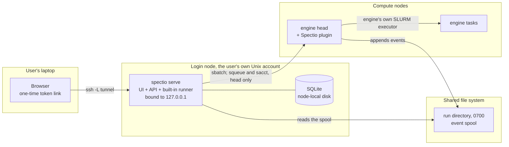

# Spectio — development environment, automation and testing

Status: draft v0.1 · 2026-10-25 · author: Thomas Weber (with Claude)
Companion docs:
- [`schedulers-and-monitoring.md`](schedulers-and-monitoring.md): what is tested against SLURM and Kubernetes.
- [`architecture-plugins-and-packaging.md`](architecture-plugins-and-packaging.md): packages, plugin conformance suites, deployments.
- [`admin-and-operations.md`](admin-and-operations.md): backup compatibility tests.
- `docs/playbooks/next-phase.md`: the order in which this is built.

## 0. Decisions in brief

1. **Agents check their own work against real tools.**
   - Every behaviour Spectio relies on is tested against the real tool at a pinned version: Nextflow, Snakemake and its executor plugins, Slurm, Kubernetes and Kueue.
   - Mocks are for unit tests only.
   - Real outputs are recorded as golden fixtures, with the tool version in the file name.
2. **Local clusters, no real HPC needed for development.**
   - SLURM runs in Docker with [sind](https://github.com/GSI-HPC/sind) (Slurm 25.11 and 26.05 images; slurmdbd; slurmrestd with JWT on the 26.05 images only, sind `0065750` `docs/content/guides/rest-api.md:36`; node power-cycle simulation; GitHub Action; MCP server; no privileged containers needed; LGPL-3.0, used as a tool, not linked).
   - Kubernetes runs in kind with Kueue installed.
3. **Scenarios are isolated and run in parallel.** Each has its own Compose project, port range, Docker network, sind realm or kind cluster, and data directory. Agents in parallel worktrees never collide.
4. **One bootstrap script everywhere.** `dev/bootstrap.sh` installs the pinned toolchain from `dev/versions.env` in:
   - the Claude Code cloud environment setup script, cached when it finishes in about 5 minutes;
   - CI;
   - a developer laptop.
   
   `dev/doctor.sh` proves each tool works.
5. **Dev previews without a server; a public instance only later, on EMBL Kubernetes** (revised 2026-10-26, §7). There is no staging VM, and the institute network is behind a VPN that GitHub cannot reach.
   - Every PR, validated wave and release is published as its own static preview on Cloudflare Pages. Nothing is overwritten, and a `/versions` page lists them all.
   - The full stack runs on demand in GitHub Codespaces, from a link on each PR.
   - The cost is 0 € within the free quotas.
   - The public instance for users comes at the beta, on EMBL's Kubernetes, deployed like depictio's.
6. **Claude is part of the development loop, inside guard rails:**
   - project agents and skills in `.claude/`;
   - PR review by those agents in GitHub Actions;
   - auto-fix of CI failures on PRs;
   - scheduled routines for drift checks.
   
   Merges follow [`documentation-system.md`](documentation-system.md#8-auto-merge) §8.

## 1. Toolchain (pinned in `dev/versions.env`)

| Tool | Pin (initial) | How it is installed | Used for |
|---|---|---|---|
| Python | 3.13 (uv-managed; embeds SQLite ≥ 3.51.3) | `uv python install` | server, CLI, runner, tests |
| uv | latest at bootstrap time, then pinned | official installer | everything Python |
| Node.js | 24 LTS (maintenance until 2028-04-30); move to 26 once it is Active LTS (2026-10-28) ([Node release schedule](https://github.com/nodejs/Release/blob/main/schedule.json); v22 ends on 2027-04-30) | distro or `nvm` | UI build, Playwright, mermaid-cli |
| Java | 21 (Temurin) | distro package or SDKMAN | Nextflow |
| Nextflow | 26.10.x, 25.10.x and 25.04.x, the supported floor ([`architecture-plugins-and-packaging.md`](architecture-plugins-and-packaging.md) §13.4); all tested, and `nf-spectio`'s `requires` equals this range *(assumed — pending Thomas, inbox #28)* | the self-contained `nextflow-<ver>-dist` from GitHub releases (offline-capable, still downloads plugins; [install docs](https://docs.seqera.io/nextflow/install)), or the `get.nextflow.io` launcher with `NXF_VER` pinned, which downloads `nextflow-<ver>-one.jar` from `www.nextflow.io/releases`; plugins come from `registry.nextflow.io` (`PluginsFacade.groovy:48`). All reachable from a cloud session (checked 2026-10-26). | fixture and nf-core runs |
| Snakemake | two versions, both tested: the minimum supported and the latest (9.27.1 today). Supported range: Snakemake ≥ 9.0 (the logger plugin interface arrived in 9.0.0, `CHANGELOG.md` at `1c67a66`; [`architecture-plugins-and-packaging.md`](architecture-plugins-and-packaging.md) §13.4) with `snakemake-interface-logger-plugins` `>=1.2,<3` (1.x and 2.x, the range snkmt also pins); the exact minimum tested version is set by R9 spike 2 **[to be validated]** *(assumed — pending Thomas, inbox #28)*. Plus `snakemake-executor-plugin-slurm`, `-kubernetes`, and `snakemake-logger-plugin-spectio` (ours); `-kueue` (0.1.0, the only PyPI release, 2024-01-03; repository unmaintained since 2024-03, HEAD `c09bf0d`; wheel says "under development") only if spike D2 shows it runs on Snakemake 9 **[to be validated]** | `uv tool install` with `--with` plugins, or a pixi environment | fixture runs |
| sind | latest release, pinned | release binary `sind-linux-<arch>` from GitHub releases; needs Docker ≥ 28 on cgroup v2 | SLURM clusters |
| kind, kubectl, helm | pinned releases | release binaries | Kubernetes clusters, chart tests |
| Kueue | two pinned manifest versions: the newest supported Kueue minor (v0.20 at the time of R4) and an older one, both run in `k8s-kueue`. The older one is chosen to support the lowest targeted Kubernetes (1.33), with the kind node image pinned to match (Kueue v0.20.3 recommends Kubernetes 1.34 or newer, [install page](https://kueue.sigs.k8s.io/docs/getting-started/installation/)) **[to be validated: Kueue release supporting 1.33]** | `kubectl apply --server-side -f` | queueing scenarios |
| Playwright | pinned, Chromium | `npm i -D playwright`; Chromium is pre-installed in some environments | e2e tests, board rendering |
| mermaid-cli, mkdocs-material | pinned | `npx`, `uvx` | docs CI |
| Apptainer | pinned; installed on the sind submitter node *(assumed — pending Thomas, inbox #28)* | distro package | the Apptainer runtime axis on `slurm-site`, nightly (§5); whether Apptainer works in nested containers is **[to be validated]** |
| depictio | `DEPICTIO_VERSION`: the latest stable release, pinned (`v1.19.2` on 2026-10-26); never `next`, which also moves on betas, nor the force-moved `stable` git tag (depictio `build-images.yaml:280-282`, `bump-with-helm.sh:55-60`) *(decided — Thomas, 2026-10-27, inbox #22)* | container images `ghcr.io/depictio/depictio-{api,worker,viewer,cli}:<version>` | tier 5 hand-off tests |

**Checks.**
- `dev/doctor.sh` prints each tool and version, then runs one smoke test per layer:
  - `docker run --rm hello-world`;
  - `sind` create, then `sbatch --wrap hostname` with `--wait`;
  - `kind create cluster`, then a Job, then delete;
  - `nextflow run tests/pipelines/synthetic/nextflow -profile test,local`;
  - `snakemake -n -s tests/pipelines/synthetic/snakemake/workflow/Snakefile`;
  - Playwright opening `about:blank`.
- It exits non-zero on the first failure, naming the tool.

**Dependency updates.** Renovate keeps every pin current: the uv lock, npm, GitHub Actions (pinned by commit SHA), Docker image digests, Helm dependencies and pre-commit hooks, plus regex managers for `dev/versions.env` and `tests/pipelines/real/corpus.yaml` (Renovate rather than Dependabot because of these regex managers **[to be validated: Dependabot has no equivalent]**). Updates arrive as grouped monthly PRs; security updates arrive as they are published. Every update PR goes through the `ci-ok` gate (§11). depictio runs Dependabot monthly for uv (two groups) and GitHub Actions (`.github/dependabot.yml` l.20-59 at `v1.19.2`), and its actions are at `checkout@v7`, `upload-artifact@v7`, `setup-uv@v7`; Spectio's workflows still use `checkout@v4`, `upload-artifact@v4`, `setup-node@v4`, `setup-uv@v6` and `github-script@v7`, and Node 20 actions face deprecation **[to be validated: date]**.

## 2. Where agents work

| Place | What it is good for | Limits to design around |
|---|---|---|
| **Claude Code on the user's machine** (terminal, desktop) | interactive work, plugins (superpowers, Karpathy guidelines, frontend-design) installed normally | the user's machine resources |
| **Cloud sessions** (claude.ai/code, `claude --cloud`) | parallel autonomous tasks, one per branch; Docker is available | setup script cached only if it finishes in about 5 min; commands time out at 2 min by default (10 max, then moved to the background, up to 30 more min; `BASH_DEFAULT_TIMEOUT_MS` raises it); outbound network through an allowlist proxy (Trusted, Custom or Full); **plugins are not loaded**, so the skills are vendored in `.claude/skills/`; VM memory limits; idle VMs are reclaimed ([cloud environments](https://code.claude.com/docs/en/cloud-environments.md), [cloud sessions](https://code.claude.com/docs/en/claude-code-on-the-web.md)) |
| **GitHub Actions** | PR gates, nightly matrix, preview deploys, Claude PR review | runner time and memory |
| **Cloudflare Pages** | one static preview per PR, wave and release (docs, boards, later the UI with a mocked API) | static only; public unless Cloudflare Access is on |
| **GitHub Codespaces** | the full stack on demand for Thomas, one per branch | about 60 h a month of a 2-core machine in the free quota; stops when idle |

**Cloud environment settings** (claude.ai/code → environment):
- **Network:** Custom, with the default list plus the hosts Nextflow, nf-core and the container registries need. The list is to be confirmed by spike D2: `www.nextflow.io`, `get.nextflow.io`, `registry.nextflow.io`, `quay.io`, `ghcr.io`, `community.wave.seqera.io`, `conda.anaconda.org`, `prefix.dev`.
- **Environment variables:** `BASH_DEFAULT_TIMEOUT_MS=600000`, `BASH_MAX_TIMEOUT_MS=1800000`, `CLAUDE_CODE_EXPERIMENTAL_AGENT_TEAMS=1` (optional).
- **Setup script:** `bash dev/bootstrap.sh --ci` (toolchain and pre-pulled images only).
- **SessionStart hook:** in `.claude/settings.json`, starts nothing heavy by default. Scenarios start their own clusters.

## 3. Fixture workflows (see §10.1)

The fixture workflows are the synthetic scenario pipelines of §10.1 (`tests/pipelines/synthetic/`): one twin per engine, three stages, two gates, the same failure injection. Real pipelines (nf-core/demo, the nf-core/rnaseq test profile) are in §10.2. *(assumed — pending Thomas, inbox #28)*

**Gate stop on real pipelines.** The `nf-core/rnaseq` and `nf-core/sarek` test profiles (Nextflow, local executor with Docker) check the gate stop on a real pipeline: a generated config stops after alignment through `ext.when`, then `-resume` without it; the cached-task count and the exit code are checked. Part of spikes T1/T2, before the walking skeleton. *(assumed — pending Thomas, inbox #28)*

**Failure injection.**
- *OOM, timeout, flaky:* §10.1 scenarios (`oom`, `oom_once`, `oom_real`, `timeout`, `flaky`). On a cluster, SLURM reports `OUT_OF_MEMORY` and Kubernetes reports `OOMKilled`.
- Cluster-level cases, run in T3:
  - *Node failure:* sind power-cycles a worker during a running job.
  - *Preemption:* a higher-priority partition and QoS in the sind cluster.

## 4. Local clusters

### 4.1 SLURM with sind

| Profile | Topology | Used for |
|---|---|---|
| `slurm-mini` | controller + 1 worker, no accounting | head job, `squeue --json`, signal drain then cancel (`scancel --signal=TERM --full`, then a plain `scancel` after the grace period; one test per engine, spike T3) *(assumed — pending Thomas, inbox #28)*, runner restart while a head job runs, reconciled by `squeue --me --json` and the `spectio-head-` prefix filter (spike T3) |
| `slurm-site` | controller, db (slurmdbd), 3 workers in partitions `htc`, `bigmem`, `gpu` (fake GRES), users with association limits, a maintenance reservation | pending reasons, `sacct` outcomes, fairshare, limits, pre-flight, failure classes |
| `slurm-rest` | `slurm-site` + api node (slurmrestd, JWT, 26.05) | slurmrestd transport and `data_parser` negotiation |
| `slurm-versions` | `slurm-site` on 25.11 and 26.05 | version matrix; the 25.11 leg covers the CLI transport only (sind's 25.11 images have no slurmrestd) |

The runner runs on the sind submitter node as an unprivileged user, exactly as on a login node. Fixture workflows are mounted into it. Nextflow and Snakemake run inside the submitter node, using the cluster's `sbatch`.

### 4.2 Kubernetes with kind

| Profile | Setup | Used for |
|---|---|---|
| `k8s-mini` | kind, 1 node, a namespace with a `ResourceQuota`, a namespaced runner Role (see `schedulers-and-monitoring.md` §4), SeaweedFS (S3) in the cluster | watch API, pod reasons, OOMKilled, logs, Snakemake Kubernetes executor with `--default-storage-provider s3` against SeaweedFS (object storage is mandatory for it, architecture §7.5); the real pod and Job objects of a failed task (`state.terminated.reason`, pod `DeadlineExceeded`, Job `Failed` condition) captured as golden fixtures (spike T4) |
| `k8s-kueue` | kind with 2 workers, Kueue with a `ClusterQueue` and a `LocalQueue`, the visibility API | queue positions, admission, preemption |
| `k8s-rwx` | `k8s-mini` + an RWX storage class (NFS provisioner) | Nextflow k8s executor with a shared work directory (Nextflow only; Snakemake needs S3) |

Whether kind runs inside a Claude Code cloud session (kind needs privileged node containers) is the first thing spike D2 answers. If it does not, Kubernetes scenarios run in CI and on the user's machine only.

## 5. Isolated, parallel scenarios

- **One command per scenario.** `dev/scenario.py up <scenario> [--id <n>]` creates:
  - Docker network `spx-<id>`;
  - Compose project `spx-<id>` with ports `20000 + 100·id + k`;
  - data directory `.scenarios/<id>/`;
  - sind realm `spx-<id>` or kind cluster `spx-<id>`.
  
  It prints a JSON with every URL and credential. `down` removes all of it.
- **Scenarios are YAML** (`tests/scenarios/*.yaml`): deployment (bundle / compose), scheduler profile, engine and version, fixture and parameters, gate script (who decides what, when), and expected events and states.
- **The matrix** is engine {nextflow 25.10, 26.10; snakemake minimum and latest (§1)} × scheduler {local, slurm-mini, slurm-site, k8s-mini, k8s-kueue} × runtime {docker, apptainer} (apptainer on `slurm-site`, nightly only; Spectio targets HPC, where Apptainer is the usual container runtime, and every scenario used Docker) *(assumed — pending Thomas, inbox #28)* × deployment {bundle, compose} × scenario {happy, gate-approve, gate-exclude-and-resume, oom-retry-suggestion, runner-offline-mid-run, restore-during-idle, multi-user-permissions}. A PR runs a smoke subset, the full matrix runs nightly. The cell snakemake × `k8s-kueue` is pending a spike (D2 install, T4 run): `snakemake-executor-plugin-kueue` 0.1.0 is an unmaintained prototype (§1); if it does not run, Snakemake on Kueue is tested with the `kubernetes` executor and Kueue's pod integration **[to be validated]**.
- **Parallelism is capped by memory,** checked against free RAM before `up`. One Claude agent per worktree and scenario ID, so agents working in parallel never share state.

## 6. Test tiers

| Tier | What | Runs on | Gates |
|---|---|---|---|
| 0 · static | ruff, mypy on every package (`--strict` on `spectio-sdk`), import-linter (dependency rules), `pre-commit run --all-files`, eslint, OpenAPI diff, docs build, Mermaid | every push | PR |
| 1 · unit and contract | pure logic; plugin conformance suites (`spectio_sdk.testing`); golden fixtures for `nf-spectio` events, Snakemake logger events, `squeue` / `sacct` JSON and Kubernetes objects | every push, seconds | PR |
| 2 · component | server on SQLite and on Postgres 18, fake runner, recorded engine event streams replayed; API tests with RFC 9457 errors, `If-Match`, idempotency; the golden fixtures of every released bridge version replayed against the current server (compatibility window, [`architecture-plugins-and-packaging.md`](architecture-plugins-and-packaging.md) §12) *(assumed — pending Thomas, inbox #28)* | every push, < 2 min | PR |
| 3 · integration | real engines on `slurm-mini` and `k8s-mini`; backup → restore → migrate; bundle → Compose hand-over; two-replica tests on Postgres | PR (smoke subset), < 15 min | PR |
| 4 · end-to-end | Playwright against the bundle and Compose: launch, watch, review a gate, relaunch, admin pages, phone viewport | PR (smoke), nightly (full) | PR (smoke) |
| 5 · matrix and compatibility | the full scenario matrix; cross-version backup restore (previous release → current); depictio hand-off against the minimum depictio version `spectio-plugin-depictio` supports and the latest stable (`DEPICTIO_VERSION`, §1) *(decided — Thomas, 2026-10-27, inbox #22)*; in-place upgrades N-1 → N and N-3 → N (`upgrade.yml`, §11) | nightly / weekly | release |
| 6 · preview and instance | static preview: links and media checked on the deployed URL. Public instance, from the beta: deploy + Playwright smoke over its URL; inbound webhook round trip | after merge | release |

**Both databases.** Tiers 1 and 2 run on SQLite and on Postgres 18; tests marked `@pytest.mark.db(...)` name the dialects they need. This covers the Postgres-only paths (`FOR UPDATE SKIP LOCKED`, `LISTEN/NOTIFY`, advisory locks: [`architecture-plugins-and-packaging.md`](architecture-plugins-and-packaging.md) §7.2 and §7.6) and SQLite's Alembic batch mode. A migration test runs from an empty database and from each frozen backup fixture, on both dialects. The two-replica tests run on Postgres in tier 3. depictio's unit suite runs on mongomock and misses runtime-only regressions (`pyproject.toml:79-80,109-110` at `v1.19.2`).

**One type checker, one source of tool versions.** mypy gates every package from the first commit, with no narrowed paths, and `spectio-sdk` runs `--strict`. Pre-commit hooks are `language: system` and call the tools through `uv run`, so `uv.lock` is the only source of tool versions; tier 0 runs `pre-commit run --all-files`. depictio narrowed its ty gate to `depictio/models/` after about 280 diagnostics (`depictio-ci.yaml:242-250`), pins ruff `v0.15.16` in pre-commit but `ruff==0.16.1` in its dev dependencies, and has `pre-commit run --all-files` commented out in CI (`:252-255`).

**Safety nets.**
- A collection guard fails tier 1 when a `test_*.py` file is not collected (depictio's recipe tests were written but never run, because their directory was missing from `testpaths`: `pyproject.toml:293-297`).
- Diff coverage is reported on every PR, advisory for now, not a gate.
- Flaky tests are quarantined the way known engine faults are (§10.1): a `quarantine` marker, a linked issue, and a fix or removal within 2 weeks.
- Destructive end-to-end specs run last, in their own Playwright project (as depictio does: `playwright.config.ts:16-17,50-58,80-87`).

**Snakemake versions.** Tier 1 runs the logger interface's own suite (`snakemake_interface_logger_plugins.tests`) against `snakemake-logger-plugin-spectio`, and tier 2 replays the recorded Snakemake event streams, on both Snakemake versions of §1. Why: `DefaultFilter.__init__` changed signature three times within 9.x ("<=9.2.x … >=9.10.0 … >=9.23", FlowO 2.2.0 sdist, `plugin/client/log_handler.py:156-176`), and interface 2.1.0 (2026-05-20) added `needs_rulegraph`, which its `tests.py:114-116` asserts. A silent logger means no events, and so no gates. *(assumed — pending Thomas, inbox #28)*

**Exported crates.** Tier 2 validates every RO-Crate the export produces with `crs4/rocrate-validator`, against the version set pinned in [`api-and-data-model.md`](api-and-data-model.md) §10 (RO-Crate 1.1 + WRROC 0.5). `snakemake-report-plugin-rocrate` validates its crates the same way ([landscape note](../research/landscape-2026-10-26.md) §7).

**Visual review.** Playwright saves screenshots of the real pages named after the canvas boards (`RunDetail`, `ReviewQueue`…). A report puts them side by side with the renders of `design/ui-canvas`. This is a review aid for the `ux-reviewer` agent and for humans, not a pixel-diff gate.

## 7. Dev previews and the public instance

**Context.**
- **No staging VM:** Thomas has no VM of his own.
- **No institute host:** the institute's machines are behind a VPN that GitHub cannot reach.
- **Cost:** it must stay as close to zero as possible.

The earlier design (a tailnet VM behind Tailscale Funnel) is replaced; see the decision log of 2026-10-26.

### 7.1 Static previews on Cloudflare Pages (now)

- **What is published.** The built docs site, which already contains the progress pages, figures, casts and board screenshots. Once the UI exists, its build in **mock mode** is published too (§7.3).
- **How.**
  - `previews.yml` builds the site in GitHub Actions, then uploads it with `wrangler pages deploy` (direct upload).
  - Cloudflare never reads the repository, so a private repository is not an issue.
  - The secrets `CLOUDFLARE_API_TOKEN` and `CLOUDFLARE_ACCOUNT_ID` live in the GitHub environment `previews`, which only `previews.yml` uses.
- **Versions side by side, nothing overwritten** ([Cloudflare docs](https://developers.cloudflare.com/pages/configuration/preview-deployments/)):
  - each deployment gets its own hash URL (`<hash>.spectio.pages.dev`), which stays reachable;
  - each branch gets an alias that follows its latest deployment (`<branch>.spectio.pages.dev`).
- **Which branch each kind of preview is deployed under:**

  | Event | Branch |
  |---|---|
  | a PR | `pr-<n>` |
  | a validated wave | `wave-<id>`, for example `wave-w2` |
  | a release | `v<X-Y-Z>` |
  | `main` | the production URL |

- **The `/versions` page.** It is generated at every deploy from the Cloudflare deployments API (`tools/previews/versions_page.py`) and lists every preview with its date, branch, commit, PR and link. It is the "versions step by step" view.
- **Privacy.**
  - Previews are public by default. Cloudflare Pages' access policy restricts preview deployments to members of the Cloudflare account; the production URL (`spectio.pages.dev`), whose `/versions` page lists every preview, needs a separate Cloudflare Access application ([preview deployments](https://developers.cloudflare.com/pages/configuration/preview-deployments/)).
  - Media are rendered with fixture names (`documentation-system.md` §5.5).
- **Limits (free plan):** 500 builds a month, 20 000 files and 25 MiB per file ([limits](https://developers.cloudflare.com/pages/platform/limits/)). Whether direct uploads count as builds is **[to be validated]**. The site is far below both limits.
- **Without the secrets,** the workflow skips the deploy, with a notice, and still builds.
- **Checked on 2026-10-26:**
  - The first deploys worked: `https://spectio.pages.dev` (main) and `https://pr-1.spectio.pages.dev` (PR #1), with the PR comment posted.
  - `/versions` reads the deployments API as expected.
  - A new deployment's hostname took more than 60 s to answer, so the verification step waits up to 4 minutes.
  - The production branch is served at the project root, not under a `main` alias.

### 7.2 The full stack on demand in GitHub Codespaces (from D3)

- **The dev container** (`.devcontainer/`) installs the pinned toolchain (§1): uv, Python, Java 21, Nextflow, Snakemake, Node and Playwright, plus Docker-in-Docker for sind and kind.
- **Forwarded ports:** the docs site on 8000, and, once it exists, Spectio on 8080 with a seeded demo.
- **Opening it.** Each PR comment from `previews.yml` carries an "Open in Codespaces" link for its branch (`https://codespaces.new/weber8thomas/spectio/tree/<branch>?quickstart=1`). Thomas opens it when he wants to try the real thing.
- **Lifetime.** The codespace stops when idle, and nothing runs when nobody looks.
- **Cost:** GitHub Free includes 120 hours and 15 GB a month, and 2-core machines count double ([billing](https://docs.github.com/en/billing/concepts/product-billing/github-codespaces)). Without a payment method, usage stops at the quota instead of being billed.
- **Showing it to someone.** A forwarded port can be made public (`https://<codespace>-<port>.app.github.dev`), with no sign-in ([ports](https://docs.github.com/en/codespaces/developing-in-a-codespace/forwarding-ports-in-your-codespace)). Use this only for short demos, with demo mode on.

### 7.3 The UI in mock mode (from the first UI milestone)

The front-end has a build flag that replaces the API with fixtures generated from the OpenAPI and the demo dataset (MSW). That build is static, so every UI iteration can be published on Cloudflare Pages and compared side by side with no backend at all. The real backend stays covered by tiers 2–4 and by Codespaces.

### 7.4 The public instance (from the public beta)

- **Where.** On EMBL's Kubernetes, with the Helm chart, as depictio does: a self-hosted runner inside EMBL, `workflow_dispatch` only, behind a GitHub environment with a required reviewer.
- **What is not copied from depictio** (`docs/reviews/R8b-depictio-tooling.md`, DEP-T-032): `--insecure-skip-tls-verify` and values files kept on the runner's disk.
- **Before it exists:** nothing public runs Spectio's backend. Inbound webhook tests run in CI against a local instance.

## 8. Claude in the development loop

| Mechanism | Use in Spectio | Reference |
|---|---|---|
| Project memory `CLAUDE.md` | project rules, phase, commands | [memory](https://code.claude.com/docs/en/memory.md) |
| Subagents `.claude/agents/` | the reviewers and builders listed in the agent table of `CLAUDE.md` | [sub-agents](https://code.claude.com/docs/en/sub-agents.md) |
| Skills `.claude/skills/` | workflow skills (`review-round`, `apply-findings`, `verify-claims`, `render-board`, `spike`) + vendored superpowers and Karpathy guidelines | [skills](https://code.claude.com/docs/en/skills.md), `.claude/skills/THIRD_PARTY.md` |
| Worktrees | one agent and scenario per worktree (`isolation: worktree` for implementer agents later) | sub-agents docs |
| Cloud sessions in parallel | independent spikes and review rounds, each on its own branch | [cloud sessions](https://code.claude.com/docs/en/claude-code-on-the-web.md) |
| Auto-fix pull requests | Claude watches CI and review comments on a PR and pushes fixes (needs the Claude GitHub App) | same page, "Auto-fix" |
| GitHub Actions with Claude | PR review by `spec-reviewer` on `docs/**`, `security-reviewer` on every PR that changes code (revised 2026-10-27; it was auth, tokens, plugins and runner paths only) | [GitHub Actions](https://code.claude.com/docs/en/github-actions.md) |
| Routines | weekly `depictio-liaison` drift check, which also opens the `DEPICTIO_VERSION` bump PR when depictio has a new stable release *(decided — Thomas, 2026-10-27, inbox #22)*; weekly nf-core release check against templates and `checking-scenarios.md`; nightly `verify-claims` on specs whose upstream released | [routines](https://code.claude.com/docs/en/routines.md) |
| Agent teams (experimental) | large review rounds where reviewers discuss findings | [agent teams](https://code.claude.com/docs/en/agent-teams.md) |
| sind's MCP server | agents create and break SLURM clusters through tools instead of shell | sind README |
| Playwright | e2e tests, and agents looking at the UI they built | — |

**Guard rails.**
- Agents work on branches and open PRs.
- CI tiers 0–4 must pass.
- Merges follow [`documentation-system.md`](documentation-system.md#8-auto-merge) §8.
- Reviewers are read-only.
- No secrets in the repository or in shared environment variables.
- Deploy credentials (Cloudflare now, EMBL later) stay in GitHub environments, never in repository-level secrets (R8b DEP-T-007).

## 9. First steps (playbook phase D)

The D steps and their exit checks are defined in [`pipeline.yaml`](../playbooks/pipeline.yaml) and described in [`next-phase.md`](../playbooks/next-phase.md) (phase D); this section does not number steps itself. *(assumed — pending Thomas, inbox #28)*

## 10. Pipeline test corpus

### 10.1 Synthetic scenario pipelines (`tests/pipelines/synthetic/`)

**Two twin pipelines, one written for each engine:**
- [`nextflow/main.nf`](https://github.com/weber8thomas/spectio/blob/main/tests/pipelines/synthetic/nextflow/main.nf)
- [`snakemake/workflow/Snakefile`](https://github.com/weber8thomas/spectio/blob/main/tests/pipelines/synthetic/snakemake/workflow/Snakefile)

**What they share:**
- the same three stages (`qc` → gate → `align` → gate → `quant`);
- the same task bodies (`bin/synth.py`, deterministic and seeded);
- the same 12-sample samplesheet (three groups, one low-depth outlier, S03);
- the same failure injection (`exit`, `oom`, `oom_once`, `oom_real`, `timeout`, `flaky`), targeted at one process or rule and, optionally, one sample.

Both engines produce byte-identical results (the counts matrix compared with `diff`).

**Gate stops** use exactly what Spectio generates:
- Nextflow: a config setting `ext.when = false` on later stages (`conf/stop_after_qc.config`), then `-resume`.
- Snakemake: `--until qc_report` or `--until align_done`, then a plain rerun.

**Scenarios** are in `scenarios.yaml`. `run_scenarios.py` runs them and checks:
- exit codes;
- expected and forbidden outputs;
- content checks;
- per-process counts of completed and failed tasks, exit codes and attempts, read from the Nextflow trace or the Snakemake log;
- cached tasks after `-resume`.

| Scenario | What it proves |
|---|---|
| `happy` | 65 tasks, all outputs |
| `gate_qc_then_resume`, `gate_align_then_resume` | stop at a gate with the generated config, resume with cached work |
| `exclude_sample_and_resume` | samplesheet v2 without the outlier; downstream recomputed without it |
| `flaky_retry` | failure on attempt 1, success on retry |
| `oom_once_retry` | exit 137 once, success with more memory on attempt 2 |
| `oom_fatal`, `timeout_fatal` | failure after 3 attempts with the right exit codes (137, 143 / 124) |
| `tool_error_then_fixed_resume` | a non-retried tool error, then a resume after the fix |
| `dynamic_fanout` | chunk count decided at run time (Nextflow dynamic channel, Snakemake checkpoint): 45 ALIGN tasks |
| `fanout_medium` | 180 ALIGN tasks (PR) |
| `fanout_stress` | about 12 000 ALIGN tasks (nightly) |

**Verified runs on 2026-10-26** (this session, local executor, 2 CPUs); see `docs/research/spike-synthetic-pipelines-2026-10-26.md` and the step page [F2](../progress/W0/F2.md):

| Engine | Result |
|---|---|
| Nextflow 26.10.3 | 11 / 11 pass |
| Nextflow 25.10.9 | 11 / 11 pass (after retrying time-limit kills that carry no exit code) |
| Snakemake 9.27.1 | 11 / 11 pass. `oom_once_retry` hit a known engine fault in 4 of its 18 executions; the faulty run is repeated once and reported as `PASS*` |

**Known engine faults.** These are listed in `scenarios.yaml` under `engine_faults`, each with the log pattern that identifies it. A failed scenario that matches one is repeated once, from scratch, and reported as `PASS*`. Any other failure fails the build.

**Profiles for the same pipelines on other executors:**
- Nextflow `-profile slurm`, which includes job arrays for ALIGN;
- Nextflow `-profile k8s`, which adds the `spectio.io/run-id` pod label;
- Snakemake `--workflow-profile profiles/slurm`.

These run against sind and kind in T3 and T4.

### 10.2 Real pipelines (`tests/pipelines/real/corpus.yaml`)

Step page: [F3](../progress/W0/F3.md). Real pipelines run with their own test datasets. They are chosen to cover the scenario classes of [`checking-scenarios.md`](checking-scenarios.md) §1. Sources: `docs/research/corpus-and-ci-2026-10-26.md`.

| Source | PR tier | Nightly tier |
|---|---|---|
| nf-core (`-profile test,docker`, data from nf-core/test-datasets) | demo, rnaseq, viralrecon, methylseq, molkart | fetchngs, sarek, scrnaseq, mhcquant, differentialabundance, mag, ampliseq, taxprofiler (mcmicro: manual) |
| Snakemake Workflow Catalog (`.test/` directory, `--sdm conda`) | rna-seq-star-deseq2, dna-seq-gatk-variant-calling, ms-proteomics (dry-run only, as upstream) | rna-seq-kallisto-sleuth, dna-seq-varlociraptor, single-cell-rna-seq, chipseq, cyrcular-calling, ONT-AmpSeq |

- **`run_corpus.py`** runs one entry, a tier or everything, and writes `result.json` per pipeline.
- **The same entries are reused later:** once the server exists, they are launched *through Spectio* (runner → engine), and the checks move from exit codes to Spectio's own run states, gates and evidence.
- **Constraints:**
  - mag 5.5.0 and ampliseq 3.0.0 need Nextflow ≥ 26.04, so the 25.10 leg skips them;
  - private-repository GitHub runners have 2 CPU / 8 GB, so nf-core runs get `process.resourceLimits` from `runner_limits.private`;
  - the heaviest entries are nightly only.

### 10.3 Real outputs from the nf-core megatests (`tests/fixtures/megatests/`)

Every nf-core release runs its full-size test on AWS and publishes the results in a public bucket, `s3://nf-core-awsmegatests/<pipeline>/results-<release commit>/` (listed and read over HTTPS on 2026-10-26). These are real outputs at real scale, without running anything.
- **`tools/fixtures/megatests.py`** resolves a pipeline's newest release whose upload includes MultiQC data (`git ls-remote` for the tag → commit), lists that prefix and downloads small QC files (`fetch`). `curate` keeps, per pipeline and under 600 kB:
  - the MultiQC general statistics (rebuilt from `multiqc_data.json` when no `.txt` was published);
  - one execution trace (real process names, durations, peak memory, exit codes);
  - the params file and the software versions;
  - a few tool tables (mosdepth, STAR, Cell Ranger, airrflow sequence numbers…).
- **Pipelines** (2026-10-26): rnaseq 3.27.0, sarek 3.10.0, scrnaseq 4.2.0, smrnaseq 2.4.1, ampliseq 3.0.0, taxprofiler 2.0.1, viralrecon 2.6.0, rnafusion 4.1.3, airrflow 5.1.0, methylseq 4.2.0, chipseq 2.1.0, mag 5.4.2. Some recent releases have partial uploads (no MultiQC data, or nothing), which is why the tool falls back to an older release. `SOURCE.json` records the release, commit and prefix.
- **Used for:**
  - check bindings tested against real column names (`multiqc:qualimap_rnaseq-5_3_bias`, …);
  - the UI boards' numbers;
  - run-detail fixtures (traces);
  - later, the API's mock mode (§7.3).
- **Licence of the outputs:** they are derived from nf-core/test-datasets **[to be validated]**.

### 10.4 Real test images (`design/ui-canvas/images/`)

Imaging review and the OME-Zarr viewer are designed on real images, not drawings.
- **`tools/canvas/images.py`** reads public OME-Zarr from the IDR OME-NGFF samples (only the pyramid level needed is fetched over HTTPS) and the imaging branches of nf-core/test-datasets (sparse git). It writes WebP thumbnails, JSON side files with real numbers, and `SOURCES.md` (source, level, channels, licence per file).
- **Scenarios covered:**

  | Scenario | Data | Item decided on |
  |---|---|---|
  | HCS plate | idr0001 (96 wells, OME-Zarr plate), idr0033 Cell Painting (5 channels) | well |
  | Whole slide, brightfield IHC | idr0073 (21115 × 16433, 8 levels) | tile |
  | Imaging mass cytometry | nf-core/imcyto test ROI, idr0076 (50 channels, with labels), idr0054 | ROI |
  | Spots (Molecular Cartography) | nf-core/molkart test data | sample / region |
  | Xenium | nf-core/spatialxe test bundle (human kidney) | section |
  | Light-sheet volume | idr0066 mesoSPIM (1937 z) | sample / region |
  | 3D nuclei with labels | idr0062 | viewer component |
  | Satellite scenes | nf-core/rangeland Landsat 4/5 (56 scenes, cloud from QA_PIXEL) | scene |

- **The same sources** become the viewer's test fixtures: a multiscale image, a plate, labels, v0.4 and v0.5 stores.
- **Licences:** IDR studies are CC BY 4.0 as a rule **[to be validated per study]**; Landsat is public domain.

## 11. CI workflows

| Workflow | Trigger | What it runs |
|---|---|---|
| `docs.yml` | PR and push touching `docs/` | strict MkDocs build, Mermaid render |
| `ci.yml` | every PR, push to `main` and `autopilot/integration` | a change-detection job (docs only, `tests/pipelines/synthetic/**`, the corpus, runner code, `deploy/helm/`…; pattern from depictio `depictio-ci.yaml:89-159` at `v1.19.2` / `0d1aa0a`) calls each pipeline workflow as a reusable workflow (`workflow_call`) only when its paths changed; a final `ci-ok` job `needs:` every job, runs with `if: always()`, counts skipped jobs as passing and fails only when a job ended `failure` or `cancelled` (depictio `depictio-ci.yaml:3144-3174`, `:3166-3170`) *(decided — Thomas, 2026-10-27, inbox #26)* |
| `pipelines-synthetic.yml` | called by `ci.yml` (PR, main) when its paths changed; nightly | synthetic scenarios × {Nextflow 26.10.3, 25.10.9, Snakemake 9.27.1 and the minimum supported Snakemake (§1)}; where nf-prov is enabled, nf-prov 1.7.x with Nextflow 25.10.9 and 1.8.x with 26.10.3 (nf-prov README, `8aa8280`); stress scenario nightly; artifacts with reports, logs, traces |
| `pipelines-real.yml` | called by `ci.yml` when the corpus changed; nightly; manual | matrix generated from `corpus.yaml`: nf-core with `nf-core/setup-nextflow@v3`, the catalog with `snakemake/snakemake-github-action@v2` on the workflow's own `.test` |
| `pipelines-slurm.yml` (T3) | called by `ci.yml` when runner code changed; nightly | `GSI-HPC/sind-action@v2` cluster, synthetic scenarios with the SLURM profiles. Needs cgroup v2 Docker, which GitHub runners have; this cloud session has cgroup v1, so not here |
| `pipelines-k8s.yml` (T4) | nightly | `helm/kind-action@v1` + Kueue, synthetic scenarios with the k8s profile, nf-core/demo; a first `helm install` of the chart on an empty kind cluster, which must pass the pre-install migrate hook (architecture §7.5) |
| `nextflow-edge.yml` | weekly | the synthetic Nextflow pipeline (§10.1) with `nf-spectio` against Nextflow `edge` and the latest stable release; events diffed against the golden fixtures ([`architecture-plugins-and-packaging.md`](architecture-plugins-and-packaging.md) §13.4) *(assumed — pending Thomas, inbox #28)* |
| `release-please.yml` | push to main | release PR with version bump and changelog (§12), opened with the GitHub App token (§12); runs only when `RELEASE_PLEASE_ENABLED` is `true` *(decided — Thomas, 2026-10-27, inbox #26)* |
| `previews.yml` | PR, push to main, `v*` tags, wave approvals, manual | build the docs site, deploy it to Cloudflare Pages under its own branch alias, regenerate `/versions`, comment the preview and Codespaces links on the PR (§7) |
| `quick-start.yml` | PR (amd64), release (every published image architecture) | boots the docs' `compose.yaml` alone, with no `.env`, once per image architecture on native runners (`ubuntu-24.04`, `ubuntu-24.04-arm`, no QEMU), and asserts the version (`/api/v1/version`), `/api/v1/openapi.json` and first-boot seeding. depictio runs a smoke test per architecture and boots its Compose quick start with no `.env` (`build-images.yaml:296-312`, `:335-467` at `v1.19.2`) |
| `security.yml` | called by `ci.yml` on every PR, with no path filter; push to main; weekly | the four checks of "Security checks on every PR" below (secret scanning, dependency audit, SAST, workflow linter); Trivy or Grype on every built image, failing on fixable critical vulnerabilities *(decided — Thomas, 2026-10-27, inbox #26)* |
| `chart.yml` | PR touching `deploy/helm/`, release | `helm lint --strict`; `values.schema.json` generated from the Pydantic settings and checked for drift; `kubeconform` against the supported Kubernetes minors; `ct install` and `ct upgrade` on kind in a namespace labelled `pod-security.kubernetes.io/enforce=restricted`; `helm test` hooks that call `/health/ready`. It verifies the chart claims of [`architecture-plugins-and-packaging.md`](architecture-plugins-and-packaging.md) §7.5 (PodSecurity `restricted`, NetworkPolicies, the migrate hook, probes). depictio's chart has no values schema, no `templates/tests/`, no `ct` and no upgrade test (`test-and-package-helm-chart.yaml`, `v1.19.2`) |
| `upgrade.yml` | weekly, release PRs | in-place upgrade from the previous release (N-1 → N) and from three releases back (N-3 → N) on the bundle, Compose and Helm (`ct upgrade`): seed with synthetic runs, upgrade (pre-upgrade backup, then migrations), then assert that the schema is at head, the pre-upgrade backup exists, runs and gates are intact, and tokens behave as specified; results go on the 1.0-gate checklist (§14 item 5). depictio tests restore across versions and package upgrades, never an in-place stack upgrade (`backup-compat-cross-version.yaml:45-60`, `publish-pypi.yaml:92-138`) |
| `base-install.yml` | PR (subset), nightly (full grid) | the base install (`uv tool install spectio`, no server extras) and the runner tests on every supported Python (3.11–3.14, [`architecture-plugins-and-packaging.md`](architecture-plugins-and-packaging.md) §7.3) × {Linux x86_64, Linux aarch64}: the full grid nightly; on PRs the lowest and highest supported Python on x86_64. It asserts that server dependencies are absent, as depictio's `cli-base-install.yaml:38-56` does. macOS arm64 waits for Thomas (inbox #26: Actions minutes) *(decided — Thomas, 2026-10-27, inbox #26)* |
| `deploy-audit.yml` | PR touching `deploy/`, nightly | the static checks of Spectio's copies of depictio's `scripts/security_audit_compose.sh` and `security_audit_helm.sh` on PRs; the live audit nightly against a running Compose stack and a kind install. depictio runs neither script in any workflow, and its static check 1.10 already fails on its own Compose (`security_audit_compose.sh:188-196` expects `DEPICTIO_S3_ROOT_PASSWORD:?`, `docker-compose.yaml:59-60` uses `:-minio123`, `v1.19.2`) |

**Required checks.** Branch protection requires only `ci-ok`, `docs-gate` and `pr-body`, never a path-filtered workflow or a matrix leg. A check that a PR skips never reports, so the PR would wait forever ("Expected — waiting"), and a matrix job skipped before it expands never reports under its leg names (R8b DEP-T-001; depictio's comment at `depictio-ci.yaml:3144-3174`). The pipeline workflows (`pipelines-synthetic.yml`, `pipelines-real.yml`, `pipelines-slurm.yml`, `pipelines-k8s.yml`) are reusable workflows (`on: workflow_call`, plus their own schedule) that `ci.yml` calls. Branch protection stays unset until `ci.yml` exists (inbox #8). No merge queue for now. *(decided — Thomas, 2026-10-27, inbox #26)*

**Workflow conventions** (every workflow): `concurrency` per workflow and PR or ref, cancelling superseded PR runs; `timeout-minutes` on every job; a fork guard on jobs that use secrets or push; docs-only detection through the change-detection job of `ci.yml`; `permissions:` set per job, read-only by default; actions pinned by full commit SHA. depictio does each of these (`depictio-ci.yaml:20-28`, `:437-439`, `:412-416`, `:116-121` at `v1.19.2`). Today only `previews.yml` has all three of concurrency, a timeout and a fork guard (`pipelines-real.yml` has a timeout only; checked 2026-10-27).

**Security checks on every PR** (Thomas, 2026-10-27: "il faut être béton"). This paragraph owns the security checks of `security.yml`. Every PR runs four checks, with no path filter: `ci.yml` calls `security.yml` as a reusable workflow, so `ci-ok` covers it and the required checks stay the three of **Required checks** above. Step D4 builds them; the tools are candidates, each **[to be validated]** against its own documentation before use:
- **secret scanning** of the PR's commits (gitleaks);
- **dependency vulnerability audit** for Python and for JavaScript (pip-audit or osv-scanner for the uv lock; npm audit or osv-scanner for the npm lock; GitHub dependency review where the plan provides it);
- **static analysis (SAST)** of Python and JavaScript (semgrep, or CodeQL where the plan provides it **[to be validated: availability for a private repository on this plan]**);
- **a GitHub Actions workflow linter** (zizmor; actionlint).

A check fails on any detected secret, on a known vulnerability that has a fixed version, and on a high or critical SAST finding. An exception is a reviewed entry in the tool's ignore file, with a reason. This complements the `security-reviewer` pass on every build step's diff (`.claude/skills/review-code/SKILL.md`).

## 12. Versioning and releases

- **Commit and PR titles: Conventional Commits** (`feat:`, `fix:`, `docs:`, `test:`, `ci:`, `chore:`). The PR title becomes the squash commit, so the title is what is checked.
- **Release PR.** `release-please` keeps one open on `main`, with the next version and a concise `CHANGELOG.md` section grouped by type. Each line links the PR and its commit.
- **Releasing.** Merging the release PR tags `vX.Y.Z`, creates the GitHub release, and triggers the image, Helm chart and PyPI builds.
- **Bot token.** `release-please.yml` runs with a GitHub App installation token (`actions/create-github-app-token`, permissions `contents: write` and `pull-requests: write`), never `GITHUB_TOKEN`. Events created with `GITHUB_TOKEN` start no new workflow run, except `workflow_dispatch` and `repository_dispatch` ([GitHub docs](https://docs.github.com/en/actions/how-tos/write-workflows/choose-when-workflows-run/trigger-a-workflow); [release-please-action README](https://github.com/GoogleCloudPlatform/release-please-action)). With `GITHUB_TOKEN`, the release tag would start no image, chart or PyPI build, and the release PR would get no required checks, so `release-guard.yml` would never run on it. Every other bot PR (the generated API docs PR of [`documentation-system.md`](documentation-system.md) §9, dependency updates) uses the same App token. release-please stays off (`RELEASE_PLEASE_ENABLED` unset) until the App exists and its ID and key are stored as environment secrets (inbox #8). *(decided — Thomas, 2026-10-27, inbox #26)*
- **One version train for the core** (`spectio`, `spectio-server`, Helm `appVersion`), kept in step with the `linked-versions` plugin once the Python packages exist. `spectio-sdk` follows its own semver (`architecture-plugins-and-packaging.md` §4). For now `release-type: simple` versions the repository as a whole. When `spectio-sdk` is released on its own, it gets component tags (`spectio-sdk-v1.2.0`) while the core keeps `vX.Y.Z`. With today's `include-component-in-tag: false`, a second component would also tag `vX.Y.Z` and collide **[to be validated with a dry run]**.
- **Image tags** (`docker/metadata-action@v6`): `X.Y.Z` and `X.Y` on releases, `sha-<7>` on every build, `edge` on main, `pr-<n>` on previews.
- **Supply-chain evidence, from the first published artifact.** Every published image and Helm chart carries an SBOM and a provenance attestation (buildx `provenance: mode=max` and `sbom: true`, `actions/attest-build-provenance`) and a keyless cosign signature. Adding them later would change tags and digests that users have already pinned. The install docs show how to check them with `gh attestation verify` **[to be validated: exact command for OCI images]**. depictio has no SBOM, cosign or attestations (R8b DEP-T-005). *(decided — Thomas, 2026-10-27, inbox #26)*
- **Publishing** (about 30 artifacts per release: the core packages, the plugins, `nf-spectio`, `snakemake-logger-plugin-spectio`, the npm packages; `architecture-plugins-and-packaging.md` §6):
  - a strict order through `needs:`: `spectio-sdk` → `spectio` → `spectio-server` → first-party plugins → `spectio-cli`, each with `skip-existing`, so a re-run after a partial failure resumes;
  - one PyPI trusted publisher and one GitHub environment (`pypi-<project>`) per project, registered before that project's first publish (owner `weber8thomas` for now, inbox #9);
  - before upload: the tag matches the package version, `twine check --strict`, and a wheel-content check;
  - an upgrade-from-previous-release job that installs the last published version with pip and with uv, upgrades to the new wheels, and fails if any file went missing;
  - `nf-spectio` is released to the Nextflow plugin registry by its own job **[to be validated: registry release steps]**;
  - npm packages are published with provenance.

  Pattern from depictio `publish-pypi.yaml` l.36-43 (tag check), 77-80 (`twine check --strict`, wheel content), 92-138 (upgrade matrix), 145-207 (one environment per project, trusted publishing), 184 and 203 (`needs:` order), at `v1.19.2` / `0d1aa0a`.
- **Versions you can see:**
  - `GET /api/v1/version` returns `version`, `git_sha`, `build_date`, `schema_revision` and `deployment`;
  - the UI footer shows the version and links to its changelog entry;
  - every preview and instance shows a "vX.Y.Z+sha" banner;
  - `spectio --version` prints the client version and warns when the server differs.
- **Pre-1.0 policy:** minor versions may break the API, and the changelog says so. From 1.0, semver applies to the public API and the plugin SDK.
- **The version follows the importance of the change, automatically** (`release-please-config.json`):

  | Merged since the last release | Next version (while < 1.0) |
  |---|---|
  | only `docs`, `test`, `ci`, `chore`, `refactor` | no release |
  | at least one `fix` or `perf` | patch: 0.3.1 → 0.3.2 |
  | at least one `feat` | minor: 0.3.1 → 0.4.0 |
  | a breaking change (`feat!:` or a `BREAKING CHANGE:` footer) | minor too (`bump-minor-pre-major`), never 1.0.0 |

  - **Design phase:** `feat` and `fix` are kept for product code. Tooling (`tools/`, `tests/`, workflows) uses `chore`, `test` or `ci`. Docs, specs and research use `docs`. So no release is cut before the first version, `0.0.1` ([§15](#15-what-ships-in-which-version); how its tag is made: §15.2).
  - **Docs and tests do not cut releases.** They are hidden from the generated `CHANGELOG.md`, because the curated changelog (`documentation-system.md` §6) covers docs. A commit in a visible changelog section is releasable: release-please skips a release only when the generated changelog is empty (release-please `c589293`, `src/strategies/base.ts:331-337`).
  - **1.0.0 is never automatic.** release-please only reaches it when `release-as: 1.0.0` is set in the config (release-please manifest docs). Exception: the very first release, whose default is 1.0.0; §15.2 says how 0.0.1 is forced instead. A guard (`release-guard.yml`) also fails any release PR at ≥ 1.0.0 unless the repository variable `ALLOW_V1` is `true`. Thomas sets that variable once the 1.0 gate (§14) is met.

## 13. Instance verification and access

**Dev previews (now).**
- After each deploy, `previews.yml` fetches the deployed URL and checks:
  - the home page and `/versions` answer;
  - the build's commit SHA is in the page footer;
  - a sample of internal links resolves.
- The preview and Codespaces links are posted on the PR.

**The public instance (from the beta, §7.4).** Every deploy is verified through its public URL:
1. **Version:** `/health/ready` and `/api/v1/version`, whose `git_sha` must match the deployed commit.
2. **Playwright smoke test (T6):**
   - sign-in by magic link (Mailpit in the test profile);
   - opening a run;
   - opening a gate and approving it on a synthetic run;
   - the phone viewport.
3. **Share-link round trip:** create a link, open it in a fresh browser context, check its scope, revoke it, and check that it now fails.

**Access without accounts.**
- **Share links.** On the public instance, demos and outside reviewers use scoped share links (`authentication-and-access.md` §2) instead of shared passwords.
- **Demo mode.** Visitors without a link see read-only demo data.
- **Nightly reset.** The demo data is reset every night from a known backup, which also tests restore.

## 14. Release stages and the 1.0 gate

Spectio stays in 0.x until it has been checked, in a fairly robust way, against several use cases and by several users. Each stage has an entry condition, and the docs say which stage a version belongs to: the changelog block's admonition and a badge on the landing page.

| Stage | Versions | Who uses it | Entry condition |
|---|---|---|---|
| **Design** | none | Thomas and the agents | — |
| **0.0.x · First MVP** | 0.0.x | Thomas, on the synthetic pipelines, then first test users on their cluster | `GO` gate passed; the 0.0.1 cut of §15 |
| **Private alpha** | 0.2 – 0.4 | 3 to 5 design-partner groups at EMBL (`docs/research/adoption-and-positioning-2026-10-26.md`) | install in under 30 min from the docs alone; real corpus green nightly; backup and restore tested; R5 security findings closed |
| **Public beta** | 0.5 – 0.9 | anyone, with a public demo instance | 2 weeks without a P0/P1 bug at the partners; upgrade tested across 3 consecutive minors; every guide has a cast or screenshots |
| **1.0** | 1.0.0 | stable for institutional installs | the **1.0 gate** below, checked by a review step (`R-v1`, added to the pipeline when the beta starts) and decided by Thomas |

The stage between 0.0.x and the private alpha is not defined yet (inbox #16). Revised 2026-10-27: the first stage was a 0.1.x walking skeleton with SLURM; Thomas cut it down to the 0.0.x MVP of §15, then revised that cut the same day (§15.1).

**The 1.0 gate** (all of them):
1. **Use cases.** At least one real pipeline from each scenario class of `checking-scenarios.md` §1 runs through Spectio, with a gate decided by a person other than its author.
2. **Users and sites.** At least 3 groups, 2 of them outside Thomas's own team, and 10 or more active users over 8 consecutive weeks. At least one site other than EMBL **[to be validated: realistic target]**.
3. **Engines and schedulers.** Nextflow and Snakemake on SLURM and on Kubernetes in daily use, plus the local runner.
4. **Tests.** The synthetic suite is green on every PR, and the real corpus is green nightly for 4 consecutive weeks. The auth matrix (`authentication-and-access.md` §6) and the Playwright suite are green.
5. **Operations.** An upgrade path is tested across at least 3 minors with backup, restore and migration, in place, by `upgrade.yml` (§11). No open P0 or P1 bug. A documented support channel answers within a week.
6. **Contracts.** The OpenAPI and the plugin SDK are frozen, with a deprecation policy. The data model has a migration test for every revision.
7. **Docs.** Install, user, admin and operator guides, the reference (API, CLI, configuration), and a curated changelog for every 0.x version.

## 15. What ships in which version

Added 2026-10-27 ([decision log](../decisions/log.md), inbox #16). **This section is the single owner of what each version contains.** Other docs (the roadmap, the landing page, [`mvp-0.0.1.md`](mvp-0.0.1.md), the phase tables of other specs) link here and do not repeat the lists. The old phase tables (`synthesis.md` §9, `architecture-plugins-and-packaging.md` §9, `schedulers-and-monitoring.md` §11) are historical where they disagree with this section.

### 15.1 Capabilities by version

The first version is **0.0.1**, the simplest version that test users can install and try (Thomas, 2026-10-27, revised the same day: [decision log](../decisions/log.md#2026-10-27-001-revised-on-the-cluster-no-gates-a-token-link)):
- one user, no sign-in, no accounts, no roles. A one-time token link guards the server instead (§15.3);
- runs go to SLURM: each user runs `spectio serve` under their own Unix account on the cluster login node, and its built-in runner submits each engine head with `sbatch`; the engine sends its tasks to SLURM through its own SLURM executor (§15.3);
- no QC checks and no gates;
- no Kubernetes, no shared server, no remote runner.

Everything after 0.0.x is **open**: "later (open)" means no version is assigned yet, and no assumption is made about the order (inbox #16). "Not planned" means a recorded decision rules it out.

| Capability | 0.0.1 | Later (open) | Not planned | Owning spec |
|---|---|---|---|---|
| Snakemake engine, through the Spectio logger plugin (`--logger spectio`); a run is always launched with the plugin | yes: tasks through `snakemake-executor-plugin-slurm`; the head submitted with `sbatch` **[to be validated]** in spike T3, because that plugin advises against running Snakemake inside a SLURM job (§15.3). Fallback: the Snakemake head runs on the login node, started by the built-in runner, and its tasks still go through the SLURM executor. The local executor is for tests and development only (§15.3) | other executors | | [`synthesis.md`](synthesis.md) §2, [`ui-spec.md`](ui-spec.md) §5 |
| Nextflow engine, through `nf-spectio`; a run is always launched with the plugin | yes: head submitted with `sbatch`, tasks through Nextflow's `slurm` executor. The local executor is for tests and development only (§15.3) | other executors | the Tower protocol routes ([decision 0001](../decisions/0001-nextflow-through-nf-spectio.md)) | [decision 0001](../decisions/0001-nextflow-through-nf-spectio.md), [`synthesis.md`](synthesis.md) §2 |
| Launch a run from the UI (form from the parameter schema) | yes | | | [`ui-spec.md`](ui-spec.md) §4.6, [`api-and-data-model.md`](api-and-data-model.md) §5 |
| Monitoring: run state, number of jobs / tasks, stages | yes | | | [`ui-spec.md`](ui-spec.md) §3, §4.3, §4.4 |
| Relaunch, including with changed parameters | yes; every relaunch, Resume after a failure included, is a new child run ([`api-and-data-model.md`](api-and-data-model.md) §5.1) *(decided — Thomas, 2026-10-27, inbox #32)* | | | [`ui-spec.md`](ui-spec.md) §4.6 (relaunch dialog), [`api-and-data-model.md`](api-and-data-model.md) §5 (`:relaunch`) |
| Parameter history: which parameters each run used, and what changed | yes | | | [`ui-spec.md`](ui-spec.md) §4.4 (Parameters, Lineage tabs), [`api-and-data-model.md`](api-and-data-model.md) §7 (`run_inputs`) |
| QC checks and gates: the checks of a stage, a gate, then resume or relaunch | no (Thomas, 2026-10-27: removed from 0.0.1; checks and QC stay the product direction of 2026-10-26) | yes, every part: the checks of a stage, gates and their verbs (`approve`, `stop`, `apply`, `go_back`), item decisions, samplesheet and file edits, AI proposals, review queue, live checks | | [`checking-scenarios.md`](checking-scenarios.md) §4, §7, [`ui-spec.md`](ui-spec.md) §5.1, [`synthesis.md`](synthesis.md) §5ter |
| Runs started from a terminal (observed, adopted) | no | yes (inbox #11) | | [`ui-spec.md`](ui-spec.md) §6 |
| Users, sign-in, roles, OIDC / SAML, share links | no: one user, no sign-in | yes (inbox #11–#15, #18–#20) | | [`authentication-and-access.md`](authentication-and-access.md), [`api-and-data-model.md`](api-and-data-model.md) §6 |
| Access to the server: one-time token link, through an SSH tunnel; server bound to 127.0.0.1 | yes (§15.3) | replaced by sign-in on a shared server | | §15.3 |
| SLURM launcher | yes, built in: the engine head through `sbatch`, CLI transport | slurmrestd transport | | [`schedulers-and-monitoring.md`](schedulers-and-monitoring.md) §3.1, §3.3 |
| Kubernetes launcher | no | yes | | [`schedulers-and-monitoring.md`](schedulers-and-monitoring.md) §4 |
| Shared server (on Kubernetes or a service node) with remote runners | no | yes (runner credentials and user identity: inbox #12–#14) | | [`architecture-plugins-and-packaging.md`](architecture-plugins-and-packaging.md) §7.1, [`schedulers-and-monitoring.md`](schedulers-and-monitoring.md) §6 |
| Scheduler monitoring (pending reasons, accounting, capacity) | minimal: what the engines report, plus the state of the head job only (`squeue --me` and `sacct -j <head>`) | yes: task jobs, pending reasons, accounting, capacity, quotas | | [`schedulers-and-monitoring.md`](schedulers-and-monitoring.md) §3 |
| Database | SQLite, single process, on node-local disk of the login node (§15.3) | Postgres | | [`architecture-plugins-and-packaging.md`](architecture-plugins-and-packaging.md) §7.2 |
| Deployment | Python bundle (`spectio serve`) on the cluster login node, opened through an SSH tunnel (§15.3) | Docker Compose, Helm | | [`architecture-plugins-and-packaging.md`](architecture-plugins-and-packaging.md) §7.3–§7.5 |
| depictio hand-off | no | yes | | [`api-and-data-model.md`](api-and-data-model.md) §13.3 |
| WES facade, MCP server | no | yes (inbox #17) | | [`api-and-data-model.md`](api-and-data-model.md) §5, §10 |
| Embedded elements in other web apps | no | yes | | [`api-and-data-model.md`](api-and-data-model.md) §9 |
| LabID integration | no | yes | | [`api-and-data-model.md`](api-and-data-model.md) §2 A |

The 0.0.1 cut, with the screens that show each feature: [`mvp-0.0.1.md`](mvp-0.0.1.md).

### 15.2 How the first tag is made

- **State today.** `.release-please-manifest.json` holds `{".": "0.0.0"}`, and `release-please-config.json` sets `bump-minor-pre-major: true` and `bump-patch-for-minor-pre-major: false`. `release-please.yml` runs only when the repository variable `RELEASE_PLEASE_ENABLED` is `true`.
- **Without an override, the first release would not be 0.0.1.**
  - With the manifest at `0.0.0` and no earlier release tag, release-please does not bump `0.0.0`. It falls back to its initial version, `1.0.0` unless `initial-version` is set. Source, release-please `c589293` (main on 2026-10-27): `src/manifest.ts:709-735` skips the manifest backfill for `0.0.0`, and `src/strategies/base.ts:543-573` and `:756-762` return the initial version, `1.0.0` by default.
  - `release-guard.yml` would then fail that release PR (§12).
  - After a first release, a `feat` while < 1.0 gives the next minor (`src/versioning-strategies/default.ts:97-102`), as in the §12 table.
- **So the first release commit carries the footer `Release-As: 0.0.1`** in its commit body, for example `git commit --allow-empty -m "chore: release 0.0.1" -m "Release-As: 0.0.1"`. release-please then opens a release PR for exactly that version: the README section ["How do I change the version number?"](https://github.com/googleapis/release-please#how-do-i-change-the-version-number), and `src/strategies/base.ts:554-564`, where a `Release-As` note takes precedence over the initial version and over bumps.
- **Later 0.0.x patches** follow the §12 table from `0.0.1`: a `fix` gives `0.0.2`. A `feat` would give `0.1.0`, so every `feat` merged during 0.0.x also needs a `Release-As: 0.0.N` footer, until a version after 0.0.x is decided (inbox #16). Dry-run the first release PR before merging it (`release-please release-pr --dry-run`) **[to be validated]**.

### 15.3 0.0.1 on a cluster: architecture and safety without accounts

Added 2026-10-27 (Thomas, option "everything on the cluster"; [decision log](../decisions/log.md#2026-10-27-001-revised-on-the-cluster-no-gates-a-token-link)). This subsection owns how 0.0.1 is deployed on a cluster and the rules that make "no accounts" safe there. The general designs it reuses stay with their owners, linked below.

**Architecture.**
- **One server per user.** Each user runs `spectio serve` under their own Unix account on the cluster login node: one process holding the UI, the API, the built-in runner and SQLite ([`architecture-plugins-and-packaging.md`](architecture-plugins-and-packaging.md) §7.1, §7.3). Users do not share a server, so the Unix account is the only identity; there are no Spectio accounts.
- **Launch.** The built-in runner submits each engine head with `sbatch` (built-in SLURM launcher, CLI transport; head job, naming and restart reconciliation: [`schedulers-and-monitoring.md`](schedulers-and-monitoring.md) §3.1, §3.3). The head runs the engine with its Spectio plugin, always; its tasks go to SLURM through the engine's own SLURM executor. Where compute nodes have no egress, the network steps of the offline head (§3.1 there) run on the login node before `sbatch` **[to be validated per site]**. The Snakemake SLURM executor plugin warns against running Snakemake inside a SLURM job (quoted in [`schedulers-and-monitoring.md`](schedulers-and-monitoring.md) §3.1); whether the Snakemake head is a head job in 0.0.1 is **[to be validated]** in spike T3. If it is not, the fallback is the head on the login node, started and adopted by the built-in runner like a local head ([`schedulers-and-monitoring.md`](schedulers-and-monitoring.md) §3.1.1), with its tasks still sent through the SLURM executor.
- **Events through the spool, no network from compute nodes.** The plugins append their events to the spool in the launch directory (`.spectio/events/*.jsonl`, [`architecture-plugins-and-packaging.md`](architecture-plugins-and-packaging.md) §13.1), on the shared file system. The built-in runner, inside the server process, reads it with the cursor of §13.1 there; this is the one case where the server process reads a spool (dated note in §13.1). The plugins' direct post to the server is not used in 0.0.1: the server listens on the login node's loopback only, which compute nodes cannot reach.
- **Monitoring** shows what the engines report, plus the head job's state from `squeue --me` and `sacct -j <head>` (§15.1, scheduler monitoring row).
- **Where data lives.** The data directory, with SQLite, is on node-local disk of the login node, because the server refuses a database on a network file system ([`architecture-plugins-and-packaging.md`](architecture-plugins-and-packaging.md) §7.2, §7.3). The run directories cannot live there, since compute nodes must write them: they go under a runs root on the shared file system, set at `spectio init`, instead of the default `<data-dir>/runs/` (dated note in §7.2 there).
- **Site prerequisites, [to be validated per site].** That the login node has persistent node-local disk that is not purged, that the site allows a long-running user process on a login node, and how that process is kept up ([`schedulers-and-monitoring.md`](schedulers-and-monitoring.md) §6 lists the options). The server is pinned to one login node, and the SSH tunnel must reach that node ([`architecture-plugins-and-packaging.md`](architecture-plugins-and-packaging.md) §7.3).
- **Server restart.** The heads are SLURM jobs and keep running; at the next start the built-in runner adopts them by name ([`schedulers-and-monitoring.md`](schedulers-and-monitoring.md) §3.1, runner restart) and reads the spool from its cursor.
- **Local executor.** The local launcher ([`schedulers-and-monitoring.md`](schedulers-and-monitoring.md) §3.1.1) stays for unit and API tests and for development without a cluster. It is not a user-facing option in 0.0.1.
- **Not in 0.0.1.** Kubernetes, and a shared server (on Kubernetes or a service node) with remote runners: that needs runner credentials and user identity (inbox #12–#14) and stays later (open), §15.1.

**Access.** The user opens the server through an SSH tunnel (`ssh -L <local port>:127.0.0.1:<server port> <login node>`), with a token link. This answers the 0.0.1 part of inbox #15 (SEC-102): the login node's loopback is shared by every user of that node, so tokenless loopback is not accepted. Three secrets are involved:
- **Server key.** Generated at each start of `spectio serve` and written to a 0600 file in the data directory; it never appears in a URL. It lets `spectio login --print-link`, run under the same Unix account, ask the running server for a new link. A restart replaces it.
- **Link ticket.** Each link carries a fresh ticket. `spectio serve` prints a link at start; `spectio login --print-link` prints another one at any time. The ticket follows the hand-over magic link of [`authentication-and-access.md`](authentication-and-access.md) §2 and §2.1: 256 bits, stored as a hash, delivered in the URL fragment, exchanged by a POST, burned on first use, valid 15 minutes. The difference: no email is involved and there is no "Continue as" screen, since the link is only ever printed on the user's own terminal.
- **Session secret.** The exchange returns a separate secret (at least 256 bits) in a cookie, and every later request needs it. Sessions are kept in memory, so a server restart ends them and the user opens the new link that `spectio serve` prints.

This differs from Jupyter Server, whose token is reusable and whose login cookie persists, but the cookie name follows Jupyter's rule: Jupyter names its login cookie `username-<Host>`, so two servers on one host name with different ports do not collide (`get_cookie_name` in [`jupyter_server/auth/identity.py`](https://github.com/jupyter-server/jupyter_server/blob/main/jupyter_server/auth/identity.py), read 2026-10-27; token printed at start and cookie set on visit: [Jupyter Server security](https://jupyter-server.readthedocs.io/en/latest/operators/security.html)). Spectio's cookie name likewise includes the port of the `Host` header, so two tunnelled servers on different local ports do not overwrite each other's cookie.

**Security requirements** (they make "no accounts" safe; [`authentication-and-access.md`](authentication-and-access.md) §1 `single` mode links here for 0.0.1):
1. **Bind.** The server binds to `127.0.0.1` only; 0.0.1 accepts no other bind address.
2. **Secrets.** The server key, each link ticket and each session secret are at least 256 bits from a CSPRNG (Python [`secrets`](https://docs.python.org/3/library/secrets.html)) and compared in constant time ([`hmac.compare_digest`](https://docs.python.org/3/library/hmac.html#hmac.compare_digest)). A valid session secret is required on every HTTP request, SSE streams included; a request without one gets 401 and no data. Only the link exchange accepts a ticket instead, and only `spectio login --print-link` the server key.
3. **Cookie.** The session cookie is `HttpOnly` and `SameSite=Strict`, and its name includes the `Host` port. Browser behaviour that this relies on is **[to be validated]** in the spike sec-single-mode: that `EventSource` requests carry the cookie, and that a `SameSite=Strict` cookie set by the exchange is sent on the next requests when the link was opened from another site.
4. **Host allow-list.** Requests are accepted only when the `Host` header names a loopback host, `127.0.0.1`, `localhost` or `[::1]`, on any port; every other host name is refused, against DNS rebinding. Any port is needed because the tunnel's local port, which the browser puts in `Host`, can differ from the server port. It stays safe: a rebinding attack makes the browser reach the server under the attacker's own host name, which the browser sends in `Host` whatever the port, so the name check alone refuses it.
5. **File modes.** The data directory is 0700; the server key file and the database files are 0600; the run directories are 0700.
6. **Spool events are untrusted input.** Each event read from a spool file is validated against the event schema ([`api-and-data-model.md`](api-and-data-model.md) §8) and size-capped (per line and per file; for 0.0.1 the spool format and its caps are the driven-run part of the ingest contract, api §14, decided in inbox #36 and written in the next apply pass). It is never executed, and an invalid or oversized event is dropped and counted.
7. **Writes.** Every request that changes state must carry an `Origin` header naming the same loopback host and port as `Host`, and a body of type `application/json`; anything else is refused with 403 or 415. Together with the token, this blocks cross-site form posts. *(decided — Thomas, 2026-10-27, inbox #37)*
