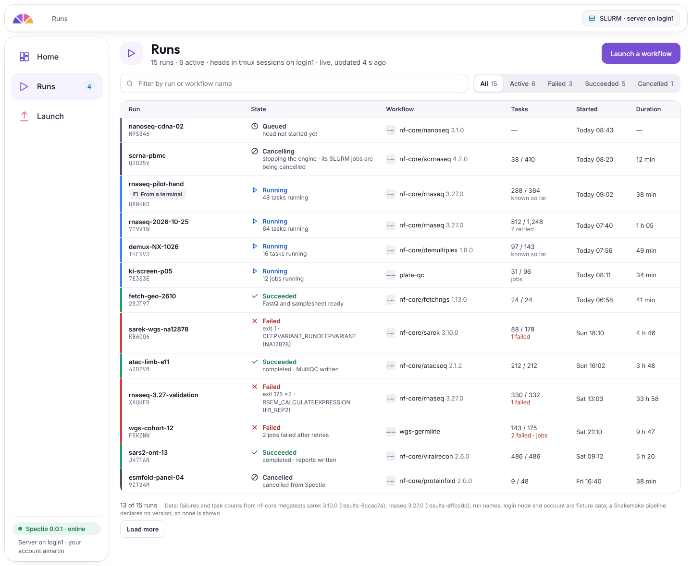
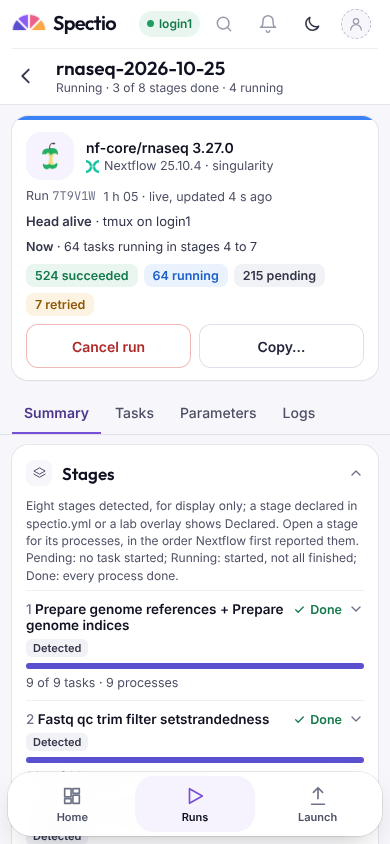

# MVP 0.0.1 — what the first version does

Status: draft v0.4 · 2026-10-28 · author: Thomas Weber (with Claude)
Companion docs:
- [`dev-environment-and-testing.md`](dev-environment-and-testing.md#15-what-ships-in-which-version) §15: the single owner of what each version contains. §15.1 holds the 0.0.1 cut and §15.3 how 0.0.1 runs on a cluster and stays safe without accounts. This page only maps the 0.0.1 cut to specs and boards; it adds no requirement.
- [Decision log, 2026-10-27, revised the same day](../decisions/log.md#2026-10-27-001-revised-on-the-cluster-no-gates-a-token-link): why the cut is this one. It replaces the [first 0.0.1 cut](../decisions/log.md#2026-10-27-first-version-is-001-a-basic-local-mvp) where they differ.
- [`ui-spec.md`](ui-spec.md): the screens. Boards are in `design/ui-canvas/`; render one with `node tools/canvas/render.js design/ui-canvas/<Board>.dc.html 1440 1180 /tmp/out.png`.

## 1. The frame

Thomas, 2026-10-27: the simplest version to start with, easy to share with users who test it, without the complexity of the full product.

Thomas, 2026-10-28: "the MVP must not handle Kubernetes, complexity, etc.; I want an ultra-simple UI; launch and monitoring of workflows; no gating; no visualisation" ([decision log](../decisions/log.md#2026-10-28-001-narrowed-launch-and-monitor-an-ultra-simple-ui)). The UI has four screens: home, the launch form, the runs list and the run detail. Home was kept as the fourth screen (Thomas, 2026-10-28, [decision log](../decisions/log.md#2026-10-28-001-has-four-screens-home-kept)): counts by state and the active runs, fed by `GET /runs:summary` ([P1](../plans/P1-walking-skeleton.md) Task 18).

- **The EMBL cluster only.** 0.0.1 targets the EMBL cluster, with no genericity across sites for now (Thomas, 2026-10-28): [`dev-environment-and-testing.md`](dev-environment-and-testing.md#153-001-on-a-cluster-architecture-and-safety-without-accounts) §15.3.
- **One user per server, no sign-in, no accounts, no roles.** Each user runs `spectio serve` under their own Unix account on a cluster login node and opens it through an SSH tunnel with a one-time token link. The tunnel is opened by an SSH config entry, with nothing to install, or by `spectio-open <host> [--node <login node>]`, a small laptop tool (Thomas, 2026-10-28, [decision log](../decisions/log.md#2026-10-28-001-head-in-tmux-on-the-login-node-ssh-config-and-spectio-open)): [`dev-environment-and-testing.md`](dev-environment-and-testing.md#153-001-on-a-cluster-architecture-and-safety-without-accounts) §15.3 (access and security requirements); [`authentication-and-access.md`](authentication-and-access.md) §1 (`single` mode).
- **Runs go to SLURM.** The built-in runner starts each engine head in its own tmux session on the login node, where the user can attach to it, never in `sbatch`; the engine sends its tasks through its own SLURM executor; the plugins' events come back through the spool in the run directory: §15.3; [`schedulers-and-monitoring.md`](schedulers-and-monitoring.md) §3.1.1 (tmux launcher); [`architecture-plugins-and-packaging.md`](architecture-plugins-and-packaging.md) §13.1 (spool).
- **One process on the login node**, with SQLite as an index in a node-local temporary directory, rebuilt from the run directories when it is missing *(assumed — pending Thomas, inbox #64)*: §15.3 (Where data lives); [`architecture-plugins-and-packaging.md`](architecture-plugins-and-packaging.md) §7.1–§7.3.
- **Live refresh over SSE.** The runs list and the run detail update as events arrive, over one Server-Sent Events stream *(decided — Thomas, 2026-10-28)*: [`api-and-data-model.md`](api-and-data-model.md) §8.3.
- **Board:** Environments (the one SLURM environment of the login node). Not drawn yet: the token-link page and the "open this link" text printed by `spectio serve`.

The full boards were drawn for the full product. They also show things 0.0.1 does not have: projects, who may decide, gates, review queues, several environments. The 0.0.1 screens are drawn on their own canvas page, **0.0.1 lite** (`Lite*` desktop and `MLite*` phone boards, listed with what each keeps and drops in [`design/README.md`](https://github.com/weber8thomas/spectio/blob/main/design/README.md#001-lite-boards)); the full boards stay unchanged as the reference for later versions. Marking the full boards is UX-227 (inbox #16, open).

## 2. Features and where they are specified

| Feature | Owning spec sections | Boards (`design/ui-canvas/`) |
|---|---|---|
| **Snakemake**, always through the Spectio logger plugin (`--logger spectio`), tasks through its SLURM executor | [`synthesis.md`](synthesis.md) §2, §2bis; [`ui-spec.md`](ui-spec.md) §5; [`schedulers-and-monitoring.md`](schedulers-and-monitoring.md) §3.1.1 (the Snakemake head in tmux on the login node, as the SLURM executor plugin advises) | LiteLaunchSnakemake, LiteRunDetailSnakemake (full board: LaunchSnakemake) |
| **Nextflow**, always through `nf-spectio`, tasks through its `slurm` executor | [decision 0001](../decisions/0001-nextflow-through-nf-spectio.md); [`synthesis.md`](synthesis.md) §2bis; [`ui-spec.md`](ui-spec.md) §5 | LiteLaunch, MLiteLaunch (full board: Launch) |
| **Launch a run from the UI**, its head started in tmux on the login node | [`ui-spec.md`](ui-spec.md) §4.6 (launch form); [`api-and-data-model.md`](api-and-data-model.md) §5 (`POST /runs`, workflow schema); [`schedulers-and-monitoring.md`](schedulers-and-monitoring.md) §3.1.1 | LiteLaunch, LiteLaunchSnakemake, MLiteLaunch, LiteStates (no schema, launch error), LiteStatesRun (launch loading, directory refused, value refused) |
| **Monitor it**: run state, number of jobs / tasks, stages as the engine reports them, and whether the head is alive, as text and tables | [`ui-spec.md`](ui-spec.md) §3.1, §3.2, §4.3, §4.4 (Summary, Tasks); [`api-and-data-model.md`](api-and-data-model.md) §5, §8; head process only: [`dev-environment-and-testing.md`](dev-environment-and-testing.md#151-capabilities-by-version) §15.1 (scheduler monitoring row) | LiteHome, LiteRuns, LiteRunDetail, LiteRunDetailSnakemake, LiteRunTasks, LiteRunLogs (log sources: [`architecture-plugins-and-packaging.md`](architecture-plugins-and-packaging.md) §13.7), LiteRunFailed *(assumed — pending Thomas, inbox #40)*, LiteCancelDialog, LiteLegend, LiteStates, LiteStatesRun; phone: MLiteHome, MLiteRuns, MLiteRunDetail, MLiteRunTasks, MLiteRunLogs, MLiteCancelSheet |
| **Stages and the processes or rules list, both**: stages declared in a `spectio.yml` or a lab overlay file, else detected from the pipeline's structure (Nextflow subworkflows, Snakemake rule files), display only; example pipelines nf-core/rnaseq, sarek, methylseq and mosaicatcher-pipeline (Thomas, 2026-10-28, [decision log](../decisions/log.md#2026-10-28-001-shows-stages-declared-or-detected-and-the-processes-or-rules-list)) | [`ui-spec.md`](ui-spec.md) §5.1, §5.1.1; [`checking-scenarios.md`](checking-scenarios.md) §12.1 (`match`); [`api-and-data-model.md`](api-and-data-model.md) §7 (`run_stages`); [spike note](../research/spike-stage-detection-2026-10-28.md); presentation: the [ui-spec §4.4 note](ui-spec.md#44-run-detail) of 2026-10-28 | LiteRunDetail, LiteRunDetailSnakemake, LiteRunTasks, MLiteRunDetail |
| **Runs started from a terminal**, monitor only: the user enables the bridge (`NXF_PLUGINS_DEFAULT=nf-spectio@<ver>`, `--logger spectio`) and runs the engine by hand; the server finds the run through a pointer file in `~/.spectio/observed/` (Thomas, 2026-10-28, [decision log](../decisions/log.md#2026-10-28-001-also-monitors-runs-started-from-a-terminal-bridges-published-in-the-engines-catalogues)). *Revised 2026-10-29: `NXF_PLUGINS_DEFAULT` replaces `-plugins` ([inbox #69](../reviews/inbox.md#69-nf-spectio-is-enabled-in-a-way-that-breaks-nf-core-runs-or-drops-the-bridge), decided; [architecture §13.8](architecture-plugins-and-packaging.md#138-runs-started-from-a-terminal)).* | [`dev-environment-and-testing.md`](dev-environment-and-testing.md#151-capabilities-by-version) §15.1 (row), §15.3; [`architecture-plugins-and-packaging.md`](architecture-plugins-and-packaging.md#138-runs-started-from-a-terminal) §13.8; [`ui-spec.md`](ui-spec.md) §6 (note 2026-10-28) | LiteRuns and MLiteRuns (the "From a terminal" chip), LiteRunObserved, MLiteRunObserved (full board: RunObserved) |
| **Each job's files and the run logs**: Nextflow work-directory files, Snakemake rule logs and SLURM job logs, the work directory to copy (Thomas, 2026-10-28, [decision log](../decisions/log.md#2026-10-28-001-shows-each-jobs-files-and-gains-resume-failure-summary-results-copy-and-resources)) | [architecture §13.7](architecture-plugins-and-packaging.md#137-log-sources-per-engine); [`api-and-data-model.md`](api-and-data-model.md) §5 (note 2026-10-28); [`ui-spec.md`](ui-spec.md) §4.4 (note 2026-10-28, run tools); [`dev-environment-and-testing.md`](dev-environment-and-testing.md#153-001-on-a-cluster-architecture-and-safety-without-accounts) §15.3 req. 13 | LiteRunTasks, LiteTaskFiles, LiteTaskFilesStates, LiteRunLogs; phone: MLiteRunTasks, MLiteTaskFilesSheet, MLiteRunLogs |
| **Resume** a failed or cancelled run, **failure summary** with the SLURM state and reason, **results and reports** read only, **copy** the command and parameters or to a new launch, **resources** per job (Thomas, 2026-10-28: "les 5 dans 0.0.1", [decision log](../decisions/log.md#2026-10-28-001-shows-each-jobs-files-and-gains-resume-failure-summary-results-copy-and-resources)) | [`ui-spec.md`](ui-spec.md) §4.4 (note 2026-10-28, run tools); [`api-and-data-model.md`](api-and-data-model.md) §5 and §5.1 (notes 2026-10-28); [`dev-environment-and-testing.md`](dev-environment-and-testing.md#151-capabilities-by-version) §15.1 (rows), §15.3 req. 14 to 16 | LiteRunFailed, LiteRunActions, LiteRunDetail, LiteRunTasks, LiteResults, LiteReportViewer, LiteLaunch; phone: MLiteRunDetail, MLiteRunFailed, MLiteResumeSheet |

The 0.0.1 lite boards, rendered (regenerated with `python3 tools/media/shots.py run --all --theme light`):

## 3. Deferred

Not in 0.0.1, version not set:
- relaunch with changed parameters, rerun from a stage, and the parameter history across runs *(assumed — pending Thomas, inbox #61)*; Resume and Copy to a new launch are in 0.0.1 (§2);
- visualisation: DAG, timelines, charts, resource plots, run comparison (Thomas, 2026-10-28);
- QC checks and gates in every form, including live checks and the review queue (still the product direction, decision of 2026-10-26);
- Kubernetes, and a shared server with remote runners;
- users, sign-in, accounts and roles;
- full scheduler monitoring (task jobs, pending reasons, accounting, capacity);
- Postgres, Compose and Helm;
- the depictio hand-off;
- WES, MCP and embedded elements;
- LabID.

The full list, with owners, is in [`dev-environment-and-testing.md`](dev-environment-and-testing.md#15-what-ships-in-which-version) §15.

## 4. Cheap extras that keep the way open

Thomas, 2026-10-27: 0.0.1 stays small so that it can be checked by hand, and bugs, defects and visual problems are fixed from the start. One choice costs almost nothing now and avoids rework later. It is not a promise for 0.0.1.
- **The data model stays multi-user ready.** It keeps the existing rule "single-user first, multi-user ready" ([decision log](../decisions/log.md), 2026-10-25): every tenant row carries its `project_id`, and `spectio init` creates the one user, group and project. 0.0.1 builds no sign-in and no roles on top.
